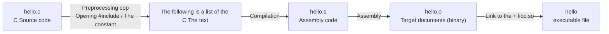

## main :  int main (int argc, char \* argv\[ 4\]);
- Int: return type of value 
- argc: number of command line parameters
- argv: An array of intrinsic string pointers, ending in \\0 (each, in the c string), argv\[4\] == NULL
- ./program hello 123 Explanation: argc = 3 argv\[0\] = "./program" starts with an argv\[1\] = "hello" argv\[2\] = "123" argv\[3\] = NULL ending in a blank character

## compilation Compilación del programa
- Start with \#include \<stdio.h\>
- Multi-source files can be combined with a separate source file. \# include "operacions.h", at which point the code will go to that file for the source code, and in this file it can write \# include itself.
- 
## One, the three basic structures of algorithms

### Theory

The essence of writing is to break down a problem into steps that the computer can execute. The complete workflow is: understanding the problem → designing algorithms → writing source code in some language → (if it's a compilation language) compilation and linking → testing _testing phase_ The first is the "Goldilocks". _production phase_ The testing phase should be as extensive as possible to verify the correctness of the process, and errors are detected and repaired; after entering the production stage, users need to contact the developer for maintenance if they find any errors.

There are only three parts that the algorithm can use:  **Böhm ⁇ Jacopini Structured procedural theories**  Content: Combining these three structures can express any algorithm that can be executed on a computer.

|Structure|Catalan|The role|The correspondence in C|
|---|---|---|---|
|Order of the day|_sequence_|The action is executed one by one.|The following is a list of the most commonly used terms in the English language:  `;`  The End|
|Choose|_selection / condition_|The conditions for the actual execution of one set of actions and the false execution of another set|`if … else`, `switch`|
|The cycle|_iterativa_|Re-processing a sequence or value within a range|`for`, `while`, `do-while`|

There are three types of "movements" in a sequence structure: simple data movements or mathematical operations. `a = b + c` (I'm not sure what to do.) `print`, `open`, `read` The user can set up a function call. `a = suma(b, c)` Input of algorithms usually comes from two sources: the program parameters in C/C++ are  `argc`, `argv` In Python, it's  `sys.argv` The first is the "Firefinder" or "Firefox".

### The method

When faced with a problem, the big task is broken down into small actions, and then each action is judged as orderly, selective or circular, and finally combined.

### Example 1: Four-order calculator (s) using only order + choice

Requirements: Receive two numbers and an operator, output results.

```text
a ← 把第 1 个参数转成整数
s ← 取第 2 个参数（运算符）
b ← 把第 3 个参数转成整数
如果 s 是 '+'      → r = a + b
否则如果 s 是 '-'  → r = a - b
否则如果 s 是 '*'  → r = a * b
否则如果 s 是 '/'  → r = a / b
否则               → 报错"运算符无法识别"，结束
输出 r
结束
```

Watch out for this  `a`  and  `b`  The conversion can be done before the operator is judged, because no matter which operation, both numbers are converted. This is also mentioned later in the tip of practice 2.

### Example 2: Simplified grep (three structures are used)

```text
f ← 打开输入文件
如果文件打开成功：
    对文件 f 的每一行：          ← 循环
        如果这一行含有目标字符串：   ← 选择
            输出这一行
否则：
    报错"文件不存在"
```

---

## 2 C program skeleton: main and function interface

### Theory

C/C++ programs are made up of several documents, each with a different format.  `.c`  A file contains several functions, each of which is a series of actions organized according to the three structures mentioned above. Unlike Python, C does not start from the first line of the file directly, but instead starts with the execution of the commands. **There must be a name  `main`  The function** It's the first function to be executed in code you write.  `main`  It's running.)

The function is called "name + parameter + return value"**Functional interface**(_function interface_).`main`  The meaning of the parameters and returns is defined by the operating system (here GNU/Linux) as:

```c
int main (int argc, char * argv[]);
```

- `argc`(_argument counter_): The number of command line parameters, **Includes the program name itself**.
- `argv`(_argument vector_): String array, storing each parameter.
- Return value  `int`: **Exit code**.`0`  The correct ending, the positive integer 1, 2, 3...) is wrong, and each number represents a specific error that the programmer has made.

### Derivation: Why Does  `argc`  Always less than 1?

execute  `./hello arg1 arg2 arg3`  When:

|Subtitles|Content|
|---|---|
|`argv[0]`|`"./hello"`|
|`argv[1]`|`"arg1"`|
|`argv[2]`|`"arg2"`|
|`argv[3]`|`"arg3"`|

So, what?  `argc = 4` See you.  `argv[0]`  The name of the program that is always executed, so even if there are no additional parameters, it's not a function. `argc`  At least one. **This directly determines the parametric checks in the exercise:**  The procedure requiring two numbers should be checked  `argc == 3` But not  `argc == 2`.

### Declarations and definitions

The only thing that is important is to make sure that the user can understand what they are saying. **Definition** The function, or the body of a function that writes it.  `{ }`  The name is **Code blocks**(_code block_ Each action in the block is called a move. **The phrase**(_statement_ (A) between sentences  `;`  Separation. C is almost unlimited in the layout of a sentence, and a sentence can be cross-line, shrinking to no meaning for compilationists (as opposed to Python), but it should still be shrinking for readability and later maintenance.

### Example: Hello.c version (1)

```c
#include <stdio.h>

int main (int argc, char * argv[])
{
    printf ("Hello, World!\n");
    return 0;
}
```

The process of execution: Call first  `printf` The string is written to the standard output (usually terminal); then executed in sequence.  `return 0;` Let's go.  `main`  Returning to the caller, exit code 0 indicates that everything is normal.

> \[!warning\] The example code in the PDF is a quotation trap, because of the redemption.  `“ ”`.**I'm going to copy it directly.  `.c`  The file will fail compilation** C. Only the English quotation marks.  `" "` The other is a PDF.  `"Hello, World\n"` Somewhere written  `"Hello, World!\n"` The latter, for the sake of the  `write(1, "Hello, World!\n", 14)`  The number of bytes is correct.

---

## 3 From source to executable file: compilation chain

### Theory

**Compilation**(_compilar_ It is the translation of one language into another, and the target language is usually lower than the source language. **The language of interpretation (Python, Perl, Bash, etc.) does not require this process.** The first is the test.



The usual  `gcc`  We'll do the first three steps together, and we rarely see the middle file.  `hello.s`  and  `hello.o` The first is that the two schools are not in a single classroom.  **gcc** The compilation options and behavior of all people are consistent. See help: `man gcc`, `gcc --help`, `gcc --help --verbose`.

### The way: Two steps away

```bash
$ gcc -c hello.c          # 只编译，生成目标文件 hello.o
$ gcc -o hello hello.o    # 链接，生成可执行文件 hello
$ ./hello                 # 运行
```

`$`  The command line prompt is not to be entered by yourself. `-c`  means compile without linking; `-o 名字`  Specify the output file name.

### Why not?  `#include`  Trigger a Warning?

If you  `hello.c`  It's not written.  `#include <stdio.h>` The compilation will give a similar warning, and the new version of the compilation may even directly report an error:

```text
hello.c:3:4: warning: incompatible implicit declaration of built-in function 'printf'
```

The reason is that C and C++ have a rule: **The function must be declared first, then called**. compilation device must be known first  `printf`  What is a function, and what are its parameters and return values? `printf`  C is a standard library, and its declaration is written in the title document  `stdio.h`(_standard input/output header_ How do you know which documents should be included?  `man 3 printf` The first paragraph of the Synopsis reads:

```c
#include <stdio.h>
int printf(const char *format, ...);
```

to  `#`  The first is **Preprocessing instructions**, processed by compilation's first step\*\* preprocessing (cpp)\*\*: consolidates the contained head-file text, expands the constant and macros, and then hands the results over to the real compilation phase.

### `#include`  The two types of writing

|Writing|Search order|
|---|---|
|`#include "operacions.h"`|**First of all.** Find the current directory and then go to the system directory|
|`#include <stdio.h>`|**Only** The default is in the default directory  `/usr/include` (Find out)|

Use  `-I`  You can add a search directory, and the self-added directory is always placed at the end:

```bash
$ gcc -c -I. -I/opt/support/include operacions.c
# 搜索顺序：当前目录 "." → /opt/support/include → /usr/include
```

**Separate compilation** And then, every  `.c`  With a name  `.h` (for example,  `operacions.c` / `operacions.h`), `.h`  Let it go.  `.c`  The statement of the middle function is included for other documents.

### Link to the video _linking_)

`printf`  of **Definition** (Real code) is not in your file, but in the C standard library it's usually  `/usr/lib`  Down there.  `libc.so` (x86-64 on the machine)  `/usr/lib/x86_64-linux-gnu` There's also Curry.  `fopen`, `fread`, `fwrite`  The function is the  `open`, `read`, `write`, `fork`, `exec`  The system calls are all in the target file format.  `hello.o`  The executable file is a collection of files that are used to create executable files.  `hello.o`  The full content of the library, together with references to the library function.

gcc is the default automatic link C library, so the following two commands are equivalent to `-lc`  It means "link".  `libc.so`"): 

```bash
$ gcc -o hello hello.o
$ gcc -o hello hello.o -lc
```

> \[!note\] Extended name of executable file GNU/Linux in the executable file traditionally **No extended name** Windows is the only one.  `.exe`.

---

## Four: output and command line parameters

### Theory: Three ways of output

|The Way|Writing|The characteristics|
|---|---|---|
|`printf`|`printf("格式串", 参数…)`|Most commonly used, supported  `%`  Format, default output to standard output|
|`fprintf`|`fprintf(stdout, "格式串", 参数…)`|The first is the "target file" parameter. `stdout`  Standard output that is open by default|
|`write` (system call)|`write(1, "Hello, World!\n", 14)`|Not supported  `%` You can only write the existing string and give it bytes.|

`write`  The three parameters of the data are: `int file_descriptor` (file descriptor 1, representing the standard output) `char * buffer` (Instructions for the location of the characters to be written) `int data_size` (Number of characters to write) `"Hello, World!\n"`  It is a combination of 13 characters and one alternate line, which makes 14 bytes.

### `printf`  Commonly used formatting tags

The format is in strings  `%`  The first substring is replaced by the following parameters:

|Format code|Meaning|
|---|---|
|`%s`|The next parameter is string.|
|`%d`|The next parameter is the symbol integer|
|`%u`|The next parameter is the unknown integer (natural number)|
|`%x`|The next parameter is the non-symmetric integer, and output is 16.|
|`%%`|The output of a literal  `%` The number of parameters|

`\n`  The following is a list of the most commonly used forms of data processing.  `man 3 printf`.

### Method: Use  `for`  The cycle  `argv`

`for`  The syntax is:

```c
for ( init ; condició ; step )
    cos          // cos 是单条语句，或 { 语句1; 语句2; ... }
```

`init`  It's a first. `condició`  The decision to continue `step`  The next round is the one that takes responsibility.

```c
int i;
for ( i = 1; i < 11; i++ ) {
    printf ("%d\n", i);
}
```

The first is that the government has not yet taken any action. `argv`  The legal subpoena is 0 to  `argc - 1` So the cycle is  `i < argc` The modern C (C99) allows direct access to the  `init`  In the following sentence, a variable is declared as:

```c
for ( int i = 0; i < argc; i++ ) {
    printf ("argv[%d] = \"%s\"\n", i, argv[i]);
}
```

The three cycles of C are  `for`, `while`, `do-while` The first is the structure of programming.

### Example: Hello.c version (2)

```c
#include <stdio.h>

int main (int argc, char * argv[])
{
    printf ("Hello, World!\n");
    for ( int i = 0; i < argc; i++ ) {
        printf ("argv[%d] = \"%s\"\n", i, argv[i]);
    }
    return 0;
}
```

Running  `./hello arg1 arg2 arg3`  outputs in order  `argv[0]`  to  `argv[3]`- The string.  `\"`  The transcript is a two-digit number.

---

## Five, make and makefile

### Theory

The code is changed every time it's called again.  `gcc`  The commands are very difficult.  `make`  The tool can write "what dependencies do the targets need, how to generate" into a message called  **Makefile**  The document, by  `make`  Automatic judgement of what needs to be re-worked.  `Makefile`  or  `makefile`  The following is a list of the files that are included in this file:  `-f 文件名`  Name the other person.

A Makefile is a collection of several **rules** The structure of each rule is:

```make
目标: 依赖1 依赖2 ...
<TAB>要执行的命令
```

Dependencies must be existing documents or can be generated by other rules.

> The command line must start with the \*\* tab\*\*\* and do not run in space, otherwise it will be wrong:  `Makefile:4: *** missing separator. Stop.`  In VS Code, the editor must check whether Tab is automatically converted to a blank.

### `make`  How do you decide not to reproduce?

to  `hello: hello.c`  as an example, `make`  The logic of judgement is:

1. Check the dependency  `hello.c`  The first is that the data is not available to the public.
2. Check the targets  `hello`  It's not.
3. If  `hello`  The current system is the same as the previous one. **It's not  `hello.c`  Updated** I'm not doing anything.
4. If  `hello`  It doesn't exist, or **It's not  `hello.c`  The oldest** The commands in the execution rules are generated again.

That's why when you change only one file, it's not a good idea. `make`  The only part of the compilation that is relevant to the rest, speed is fast.

### Method: From simple to complex

**The first is a rule of thumb: compilation + link merger.**

```make
hello: hello.c
	gcc -o hello hello.c
```

This time  `hello.o`  Gcc generates and passes it to the link stage internally, without us having to process it.

**The two rules:**

```make
hello: hello.o
	gcc -o hello hello.o
hello.o: hello.c
	gcc -c hello.c
```

Directly operated  `make` It's from **Rule 1** The goal is to start with  `hello` It depends.  `hello.o` and  `hello.o`  The second rule is triggered by expiration or non-existent, and then returned to the first. `make hello.o`, `make hello`.

**`clean` Rules without dependency**

```make
clean:
	rm -f hello hello.o
```

It's not dependent, so every time  `make clean`  The city will execute. `rm -f`  of  `-f`  The company is also responsible for the maintenance of the security and safety records.

**`all` The first is the "General Goal".**

```make
all: hello
	echo "Compilació acabada"
```

When a project has multiple executable files, write them all in  `all`  The report also highlights the importance of  `make`  It is the default destination because it is at the beginning of a file.

### Example: Hello's full Makefile

```make
all: hello
	echo "Compilació acabada"

hello: hello.o
	gcc -o hello hello.o

hello.o: hello.c
	gcc -c hello.c

clean:
	rm -f hello.o hello
```

The first is to practice.  `all`  The following are the results of this study:  `suma`, `calculadora`, `ordena`  That's right.

> The following is a list of the most commonly used methods for calculating the value of a currency.  `clean`  and  `all`  It is not a real file name. If there is a document with the same name in the directory, it will be used to identify the file. `make clean`  The standard practice is to make a file in the Riga.  `.PHONY: all clean` The report also states that the "false targets" are not required, but it is a good practice.

---

## Six, the number conversion: strtol

### Theory

The command line parameters are  `argv`  It's the **Strings** The string.  `"672"`  and integers  `672`  The standard library function is completely different in memory and must be converted first to perform the calculation.  `strtol`(_string to long integer_ The following are the interfaces:

```c
long int strtol (const char * str, char ** endstr, int base);
```

|The parameters|Meaning|
|---|---|
|`str`|Strings to be converted|
|`endstr`|The output parameters: After the conversion is completed, where does the "remaining part" of the string start.  `NULL`  It says no need|
|`base`|The system|

about  `base`: 

- The message  `10` The first is the "Triple" in the title.
- The message  `0` The following are the results of the survey:  `0x`  The first was in the 16th inning (base 16) and the second innings.  `0`  The first is in the 8th inning.

In this experiment  `suma`  The second parameter is passed, so we don't expect any other characters to be behind the numbers.  `NULL`.`strtol`  So, what is the meaning of this?  `-83`, `+200`  It's all about the right conversion.

### Methods and Examples

```c
long a = strtol (argv[1], NULL, 10);
long b = strtol (argv[2], NULL, 10);
printf ("resultat: %ld\n", a + b);
```

So the return value is  `long` So when you're going out, use it.  `%ld`  It's not  `%d`.

> The following is a list of the most commonly used methods for calculating the value of a currency.  `base = 10`  and  `base = 0`  The difference in input  `010`  The first one gets 10, the second one gets 8. In this example, the experiment uses a decimal system and recommends using 10 to avoid accidents.  `abc` (i) to transmit non- `NULL`  of  `endstr` The test is performed to check that the pointers are still pointing at the beginning of the string after the conversion has been completed, but this experiment does not require it.

---

## Seven, three exercises analyzed

### Exercise 1: `suma.c`

**The need**: `./suma <num1> <num2>`  The output  `resultat: <和>` For example,  `./suma 672 78` → `resultat: 750`; `./suma -83 +200` → `resultat: 117`; `./suma 200 -83` → `resultat: -117`.

**High-level algorithms** (Speech given):

1. Check if the number of parameters is exactly two, otherwise print the wrong information with the wrong code  `1`  I'm out of here.
2. Use  `strtol`  Converting  `num1`, `num2`.
3. Ask and save variables  `resultat`.
4. The results are printed in  `0`  I'm out of here.

**I'm going to tell you.**: 

- The parameters are checked  `argc != 3` (The name of the program occupies a position, see the second section of the derivation.)
- The wrong information can be used  `fprintf(stderr, …)`  The standard error is the default, but the instruction only requires "give the wrong information and exit with the wrong code 1".
- Makefile is updated  `suma`  The rules and adding it  `all`.

**Supporting script  `prova.sh`** Bash: multiple calls  `./suma` The first is the positive, negative and band.  `+`  The number of numbers, **And cover up for the wrong situation.** The following is a list of the most commonly used numerical expressions in the English language.

### Exercise 2: `calculadora.c`

**The need**: `./calculadora <整数> <运算符> <整数>` The operator is  `+`, `-`, `*`, `/`  One is the output of the operation.

**Three tips for the speech**: 

1. The way to convert numbers is the same as practicing 1. **The first is to convert the data before the operator can judge.**.
2. Use  `if-then-else`  Chain or  `switch-case`  The operator, both of them.
3. The function is unknown. `strtol`, `printf`...and check the manual page.

**The point and the easy point**: 

- The operator is a string.  `argv[2]` I'm going to take the first letter of it.  `argv[2][0]`  The  `'+'`  This is it. **The character constant** The two characters represent a string.
- In the shell, `*`  The list of filenames in the current directory will be unfolded, so write as  `./calculadora 3 '*' 4`  or  `3 \* 4` This is  `test-calc.sh`  The first is the "Battle of the Sexes".
- The whole number decomposition will cut off the minor numbers; cases of a decomposition of 0 are worth treating separately (note that there is no mention of the lectures, but the requirement to "test all cases" should be included).
- The lecture requires that the operator be misrepresented and terminated when it is unrecognizable.

**Supporting script  `test-calc.sh`** The following are the four types of operations: positive-negative portfolios, incorrect parameters, illegal operators.

### Exercise 3: `ordena.c`

**The need** Implementing the function

```c
void ordena(int * vector, int n_elems);
```

Parameters are the set of sets and elements to be sorted. **The exchange** The value at each position is moved to the lower point, whereas the larger value naturally falls to the lower-point. **The order of the events** The basic code (initiated random array) is provided by the lecturer, downloaded as:

```bash
# 下载地址见 PDF 第 13 页
$ tar xvf S3-FC_GIA.tar.gz     # 解压得到 ordena.c
```

**I'm going to tell you.**: 

- The lecture does not specify a specific algorithm, but instead uses the most basic comparison and exchange (such as bubble sequencing, selection sequencing).
- The function returns  `void` Yes, I did. **The raw material** Sequencing: Directly modifying the input array without returning value.
- Adding to Makefile  `ordena`  The compilation link rules and added  `all`.

---

## 8 Delivery and checklist

Package commands (executed in the directory containing all files):

```bash
$ tar czvf session3.tar.gz Makefile *.c *.sh
```

And then there's  **RACO**  Uploaded  `session3.tar.gz`  The following is a list of the topics covered by this article.

**Checklist before submission**: 

- [ ] `suma.c`, `calculadora.c`, `ordena.c`  It's all about the  `make`  Compilation, and no warning
- [ ] Each of them  `.c`  They're all there.  `#include <stdio.h>` (and used to  `strtol`  The time  `#include <stdlib.h>`)
- [ ] The command line in front of the Makefile is Tab, and the command line in the middle is Tab. `all`  and  `clean`  It's all about new goals.
- [ ] `prova.sh`  Coverage: Multiple group correct input + no parameters / one parameter / three or more parameters
- [ ] `test-calc.sh`  Coverage: Four operations, positive negative numbers and incorrect input
- [ ] The script has executable permissions: `chmod +x prova.sh test-calc.sh`)
- [ ] The code does not contain a quotation number copied from the PDF
- [ ] Run again.  `make clean && make` The first is that the country has a very strong economy.

---

## The speed chart

|What to do|Order|
|---|---|
|Only compilation to target file|`gcc -c hello.c`|
|Link to executable file|`gcc -o hello hello.o`|
|Step to the right|`gcc -o hello hello.c`|
|Add the search directory to the header|`gcc -c -I. -I/opt/support/include x.c`|
|See the function manual|`man 3 printf`, `man 3 strtol`|
|Automated building|`make` / `make hello` / `make clean`|
|Specify the Makefile|`make -f 文件名`|
|Operating procedures|`./hello`|
|The following is a list of the most common types of air pollution control equipment:|`tar xvf S3-FC_GIA.tar.gz` / `tar czvf session3.tar.gz Makefile *.c *.sh`|

## Related notes

- FC Index
- C Pointers and Memory
- The two's complement is a conversion of the two's