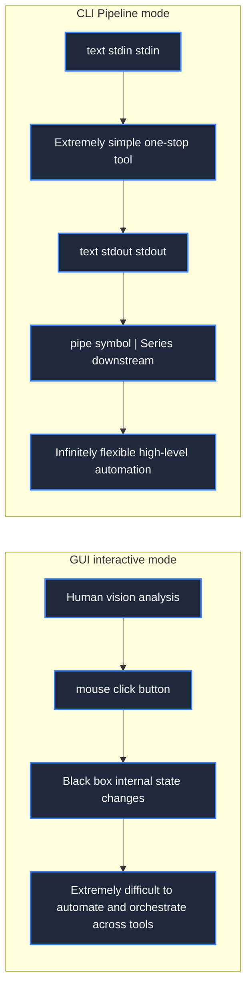
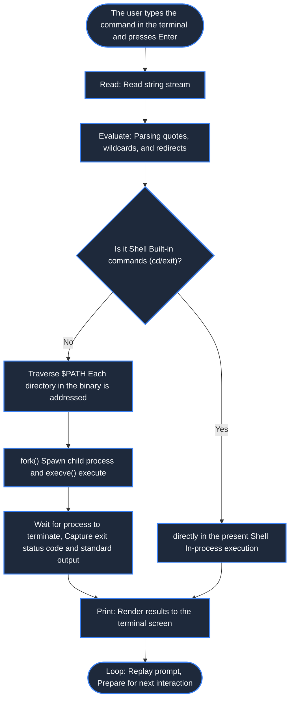
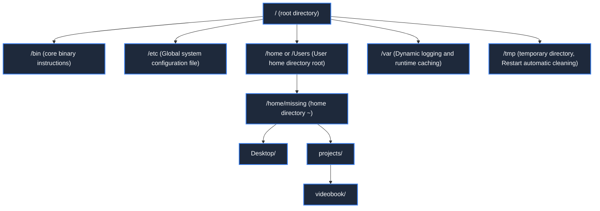
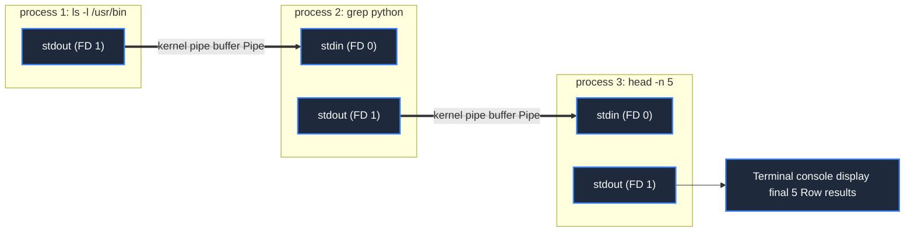
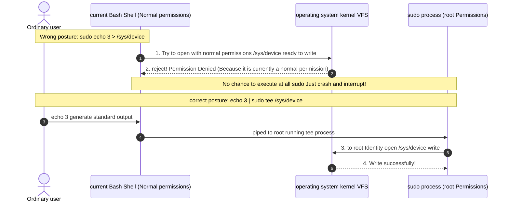

> **Course**: MIT The Missing Semester of Your CS Education, 2020  
> **Course License**: CC BY-NC-SA 4.0.  
> **Module**:Module 1: Terminal Interaction and Workflow Foundation (Foundation: Shell & Tooling)  
> **Lecture team**: Anish Athalye, Jose Javier Gonzalez Ortiz, Philip Levis (MIT CSAIL)  
> **Video duration**: 00:48:20 ｜ **Classroom HD Demonstration Blackboard**: 4 screenshots of the original painting \| **interactive graph**: Mermaid architecture flow chart  
> **Course official handouts**: [📖 MIT official Chinese course handouts](https://missing-semester-cn.github.io/2020/course-shell/) ｜ [📺Original YouTube video](https://www.youtube.com/watch?v=Z56Jmr9Z34Q)  
> **Directly connected to station B**: [📺 Watch this high-definition bilingual video on Bilibili (BV1uc411N7eK)](https://www.bilibili.com/video/BV1uc411N7eK/)  
> **Full book navigation**: <span>Previous Lecture: None (Lecture 1)</span> ｜ [📚 Return to the full book catalog](/en/notes/topics/Missing%20Semester) ｜ [Next lecture (L02) →](/en/notes/missing-semester/lecture-02)

---

## Core Introduction and Concept Panorama

Systematically elaborates on the combined productivity advantages of the command line interface (CLI), analyzes Shell REPL interaction principles, POSIX hierarchical directory tree navigation, file and metadata manipulation, standard I/O stream redirection, pipeline cascade and Linux permission isolation model, and unlocks the underlying file descriptor mechanism behind sudo redirection traps.

---

## 1. Original intention of the course: Why do computer science students need to learn tool chains specifically?

*(Reference timestamp: `00:02:15` · [📺B station video clip jump](https://www.bilibili.com/video/BV1uc411N7eK/?t=135))*

University computer science courses (such as operating systems, compilers, distributed systems, algorithms and data structures) often focus on advanced computing theory and software architecture, but often assume that students will "naturally" use computers efficiently. In reality, a large number of students and engineers waste too much time on inefficient operations: making tedious repeated clicks in the graphical interface, blindly copying and pasting spell-like commands in search engines when stuck, and saving code modifications in the form of  `code_v2_final_final.py`  in the file name.

This course was initiated by three doctoral students from the Massachusetts Institute of Technology (MIT), Anish Athalye, Jose Javier Gonzalez Ortiz, and Philip Levis, with the aim of systematically filling this gap in computer education.

#### The philosophical showdown of command line interface (CLI) vs graphical user interface (GUI)
- **GUI (Graphical User Interface)**: Intuitive, with a gentle learning curve, suitable for one-time, non-high-frequency visual operations. But the GUI has extremely poor **Composability **with** Automation capabilities**——It is difficult to cycle the button actions of three different software 1000 times in series with one button.
- **CLI (Command Line Interface)**: A universal interactive interface based on plain text streams. The core of the UNIX philosophy is "Write programs that do one thing and do it well; write programs that work together; write programs that handle text streams, because text is a universal interface." Through simple stream connections, you can combine dozens of minimalist tools to create an almost unlimited computing power pipeline.



[](https://www.bilibili.com/video/BV1uc411N7eK/?t=240)
*⏱ Timestamp: 00:04:00 · 📷 Classroom demonstration screenshot · [Watch the corresponding clip on Bilibili (BV1uc411N7eK 00:04:00)](https://www.bilibili.com/video/BV1uc411N7eK/?t=240)*

## 2. The essence of Shell and REPL interaction model

*(Reference timestamp: `00:05:40` · [📺B station video clip jump](https://www.bilibili.com/video/BV1uc411N7eK/?t=340))*

**Shell**  It is a command interpreter program provided to users, running on the kernel (Kernel), acting as a bridge between the user and the computer's underlying system calls. The most common shells include Bourne Again SHell (`bash`), Z Shell (`zsh`) and friendly  `fish`.

When you open a terminal window, what you see is the Shell command prompt (Prompt), for example:
```bash
missing:~$ 
```
This usually includes the current login user name, host name, and current working path (`~`  Indicates the user's home directory  `$HOME`).

The operation of the shell follows the rules of classical computer languages  **REPL**  Loop:
1. **Read**: Wait and read the string typed by the user;
2. **Evaluate (evaluate/parse)**: Split the input into command names and parameter lists by spaces, parse environment variables, wildcards and redirection symbols, and find the corresponding executable file in the system path;
3. **Print (output/execution)**: Spawn (fork/exec) the child process to run the target program and print the output generated by the program to the terminal screen;
4. **Loop**: Reprint the prompt and wait for the next input.

#### Environment variables and PATH addressing
When you type in the terminal  `date`  How does the Shell know which file on the hard disk to execute?
The answer is system environment variables  `$PATH`.`PATH`  Variables consist of a series preceded by a colon  `:`  Delimited directory paths.
```bash
$ echo $PATH
/usr/local/bin:/usr/bin:/bin:/usr/sbin:/sbin
```
The shell scans these directories from left to right. you can use  `which`  or  `type`  View the specific binary path where a command is parsed:
```bash
$ which date
/bin/date
$ type echo
echo is a shell builtin
```
Special distinction is needed here **System independent binaries** with  **Shell built-in commands (Builtin)**. For example  `cd` (Change the current working directory) must be built-in to the Shell, because if  `cd`  It is a child process running. Modifying the working directory of the child process does not change the current path of the parent Shell!



[](https://www.bilibili.com/video/BV1uc411N7eK/?t=780)
*⏱ Timestamp: 00:13:00 · 📷 Classroom demonstration screenshot · [Watch the corresponding clip on Bilibili (BV1uc411N7eK 00:13:00)](https://www.bilibili.com/video/BV1uc411N7eK/?t=780)*

## 3. POSIX directory tree, path navigation and file metadata manipulation

*(Reference timestamp: `00:11:30` · [📺B station video clip jump](https://www.bilibili.com/video/BV1uc411N7eK/?t=690))*

Linux and macOS follow a unified POSIX file system model: **single root node  `/`  tree hierarchical structure** (With Windows letter drives such as  `C:\`, `D:\`  completely different).

#### Two expressions of path
- **Absolute Path**: Based on the root directory  `/`  At the beginning, it deterministically points to the unique position of the node in the entire file tree, such as  `/home/eason/projects`.
- **Relative Path**: Calculated relative to the current working directory (Current Working Directory). Contains two special virtual directories:
  - `.`:Refers to the current directory;
  - `..`: refers to the upper-level parent directory.

#### A quick look at core files and navigation commands
- `pwd`:Print Working Directory, output the absolute path of the current location;
- `cd <path>`:Change Directory. If there are no parameters, it will jump to  `$HOME`, `cd -`  Quickly switch back to the last working directory;
- `ls`:List directory contents. Commonly used signs:
  - `ls -a`: Display contains  `.`  Hidden files that begin with (such as  `.bashrc`, `.git`); 
  - `ls -l`: Long format output file metadata;
  - `ls -h`: Humanized display file size (such as 4K, 12M);
- `mkdir -p a/b/c`: Recursively create multi-level directories;
- `cp -r src/ dst/`: Copy files or directories recursively;
- `mv old_name new_name`: Move or rename files;
- `rm -rf target/`: Force recursive deletion of directories (be sure to confirm the path carefully!).

#### Detailed explanation  `ls -l`  Long list output format
execute  `ls -l`  At the same time, the first 10 characters of each line reveal the core metadata system of UNIX:
```
-rwxr-xr-- 1 eason staff 4096 Oct 24 19:30 script.sh
```
1. **Digit 1 (file type)**: `-`  Represents ordinary files, `d`  Represents Directory, `l`  Represents symbolic link (Symlink), `c/b`  Represents character/block device;
2. **Positions 2-4 (owner rights User)**: Permissions owned by the file owner (`r`  read,  `w`  write,  `x`  execution);
3. **Positions 5-7 (belonging to group permissions Group)**: Permissions of members of the user group to which the file belongs;
4. **No. 8-10 (Other users)**: Permissions for all other accounts in the system.



[](https://www.bilibili.com/video/BV1uc411N7eK/?t=1560)
*⏱ Timestamp: 00:26:00 · 📷 Classroom demonstration screenshot · [Watch the corresponding clip on Bilibili (BV1uc411N7eK 00:26:00)](https://www.bilibili.com/video/BV1uc411N7eK/?t=1560)*

## 4. Standard stream redirection and pipelines (Pipelines) practice

*(Reference timestamp: `00:22:10` · [📺B station video clip jump](https://www.bilibili.com/video/BV1uc411N7eK/?t=1330))*

In UNIX systems, any newly started process opens three standard file descriptors (FD) by default:
- **FD 0 (stdin)**: Standard input, bound to the keyboard by default;
- **FD 1 (stdout)**: Standard output, prints to the screen terminal by default;
- **FD 2 (stderr)**: Standard error output, which is also printed to the screen by default, but is logically separated from stdout.

#### stream redirection operator
- `< filename`: Redirect the contents of the target file to the standard input of the process stdin;
- `> filename`: Write standard output stdout to a file (**Overwrite existing content**); 
- `>> filename`: Write the standard output stdout to the end of the file in \*\*append mode (Append)\*\*;
- `2> error.log`: Redirect standard error stderr specifically to the log;
- `&> all.log`  or  `> all.log 2>&1`: Merge and redirect stdout and stderr to the same file at the same time.

#### pipe(`|`): The pinnacle of UNIX inter-process communication
pipe symbol  `|`  Able to change the program on the left  `stdout`  Direct grafting is the right-hand procedure  `stdin`, the two are started asynchronously as concurrent processes in the kernel, and data flows through the kernel pipe buffer at high speed without generating any disk intermediate temporary files:
```bash
$ ls -l /usr/bin | grep python | head -n 5
```
This line of command instantly hatches three independent processes that cooperate with the pipeline in the kernel. The data is filtered and truncated like flowing water before spitting out the final result.



[](https://www.bilibili.com/video/BV1uc411N7eK/?t=2220)
*⏱ Timestamp: 00:37:00 · 📷 Classroom demonstration screenshot · [Watch the corresponding clip on Bilibili (BV1uc411N7eK 00:37:00)](https://www.bilibili.com/video/BV1uc411N7eK/?t=2220)*

## 5. Permission control, root privilege escalation and classic sudo redirection trap

*(Reference timestamp: `00:34:00` · [📺B station video clip jump](https://www.bilibili.com/video/BV1uc411N7eK/?t=2040))*

In Linux, the super administrator account is called  **root** (User ID is 0). root has absolute control over the entire operating system and can bypass all conventional file permission restrictions. For daily security, we should never log in to the system directly with the root account, but through  `sudo` (SuperUser DO) Temporarily gives root privileges to specific commands.

#### Classic Trampling Case: Why  `sudo echo 3 > brightness`  Will I report Permission Denied?
When many developers try to modify parameters in system device files, they often type the following commands:
```bash
$ sudo echo 3 > /sys/class/backlight/intel_backlight/brightness
bash: /sys/class/backlight/intel_backlight/brightness: Permission denied
```
Obviously added  `sudo`, why does the system still coldly report an error denying permission?

**Cause analysis (file descriptor and process fork timing)**: 
1. Before the Shell is ready to execute the command, **First, the Shell process of the current ordinary user identity** Perform redirect resolution;
2. The current shell attempts to open as a normal user  `/sys/.../brightness`  write;
3. Since the device node is only writable by root, opening the file fails and triggers directly  `Permission denied`  interrupt;
4. At this point there is not even time to derive  `sudo`  Child process!

#### Two elegant standard solutions
- **Solution 1: Use  `tee`  Commands with pipelines (highly recommended)**
  `tee`  The purpose of the command is to read data from standard input and write it to standard output and one or more target files.
  ```bash
  $ echo 3 | sudo tee /sys/class/backlight/intel_backlight/brightness
  ```
  At this time  `echo 3`  It is an ordinary user, behind the pipe  `tee`  Then it is based on  `sudo`  Run as root with elevated privileges, run as root  `tee`  Open the file for writing, perfectly bypassing the trap!
- **Solution 2: Let the elevated shell execute the entire sequence of commands**
  ```bash
  $ sudo sh -c 'echo 3 > /sys/class/backlight/intel_backlight/brightness'
  ```



## 6. Official core after-school exercises and practical analysis

*(Reference timestamp: `00:44:10` · [📺B station video clip jump](https://www.bilibili.com/video/BV1uc411N7eK/?t=2650))*

MIT officially provides exquisite after-class practical exercises for this lecture to help solidify command line intuition:

#### Exercise 1: Creating a temporary experiment directory and file life cycle
in  `/tmp`  Create a file called  `missing`  and create a new directory named  `semester`  A blank file into which data is written line by line:
```bash
# 1. 递归创建并切换进入
$ cd $(mktemp -d /tmp/missing.XXXXXX)
# 2. 写入两行数据
$ echo "#!/bin/sh" > semester
$ echo "curl --head --silent https://missing.csail.mit.edu" >> semester
```

#### Exercise 2: Granting execution permissions and Shebang mechanism
Try running directly  `./semester`, observe the system prompts:
```bash
$ ./semester
bash: ./semester: Permission denied
$ ls -l semester
-rw-r--r-- 1 missing staff 61 Oct 24 19:40 semester
```
Found missing  `x` (Execute) permissions. Pass  `chmod`  Grant execution permissions to the owner:
```bash
$ chmod u+x semester
$ ./semester
HTTP/2 200 
server: GitHub.com
content-type: text/html; charset=utf-8
...
```
At this time, the operating system kernel parses the file header  `#!/bin/sh` (Shebang), automatically called  `/bin/sh`  Interpreter to run the instructions within the script line by line!

---

## Attachment: Knowledge mind map and review thinking of this lecture

This lecture serves as  **Module 1: Terminal Interaction and Workflow Foundation (Foundation: Shell & Tooling)**  The core pillars include a complete closed-loop deduction from theoretical motivations to underlying system calls, from daily high-frequency operations to cutting-edge best practices. It is recommended to combine terminal practical exercises and after-class exercises to internalize the command line and tool chain into subconscious muscle memory.

<span>Previous Lecture: None (Lecture 1)</span> ｜ [📚 Return to the full book catalog](/en/notes/topics/Missing%20Semester) ｜ [Next lecture (L02) →](/en/notes/missing-semester/lecture-02)
