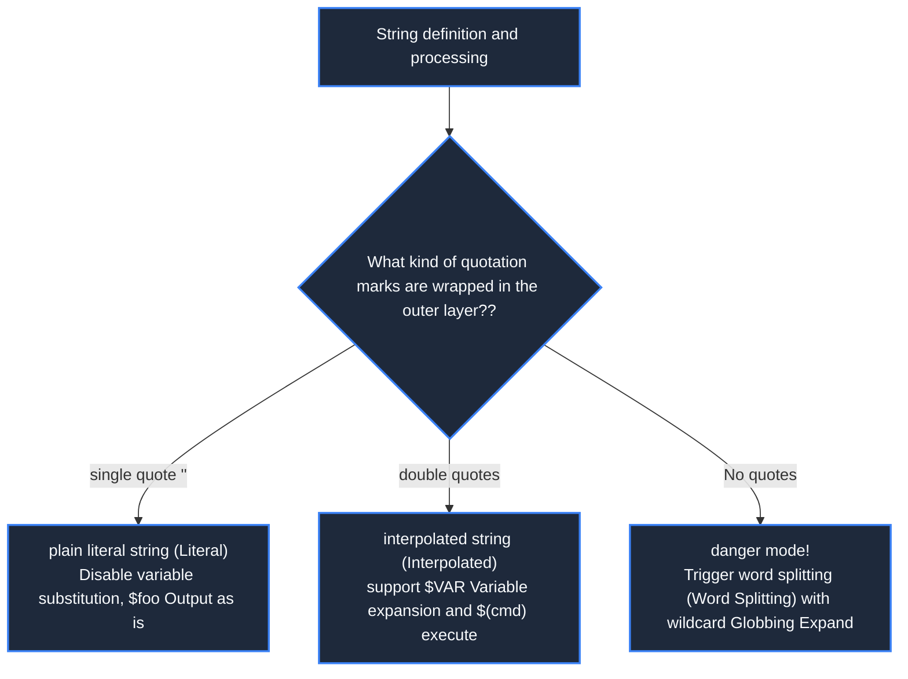
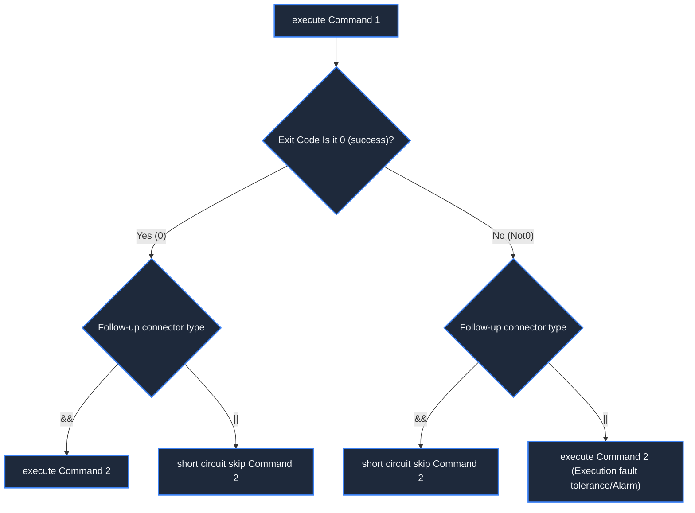
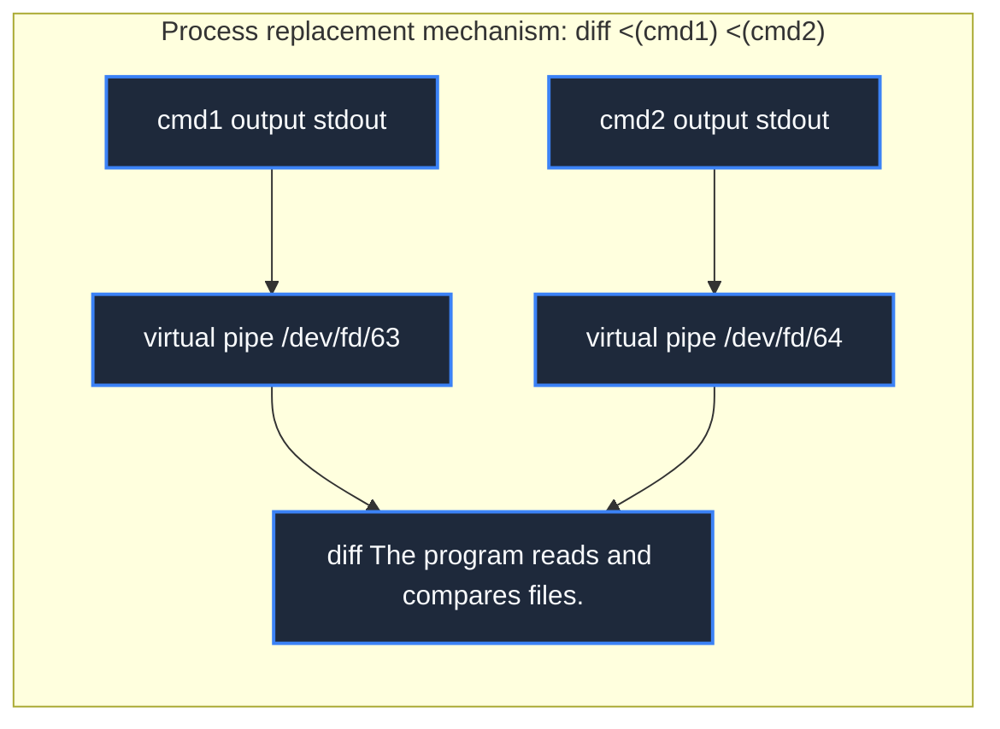
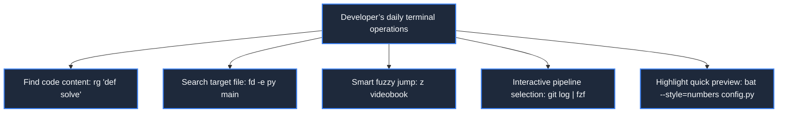

> **Course**: MIT The Missing Semester of Your CS Education, 2020  
> **Course License**: CC BY-NC-SA 4.0.  
> **Module**:Module 1: Terminal Interaction and Workflow Foundation (Foundation: Shell & Tooling)  
> **Lecture team**: Anish Athalye, Jose Javier Gonzalez Ortiz, Philip Levis (MIT CSAIL)  
> **Video duration**: 00:48:59 ｜ **Classroom HD Demonstration Blackboard**: 4 screenshots of the original painting \| **interactive graph**: Mermaid architecture flow chart  
> **Course official handouts**: [📖 MIT official Chinese course handouts](https://missing-semester-cn.github.io/2020/shell-tools/) ｜ [📺Original YouTube video](https://www.youtube.com/watch?v=kgII-YWo3Zw)  
> **Directly connected to station B**: [📺Watch this high-definition bilingual video on Bilibili (BV1xa4y1g7sZ)](https://www.bilibili.com/video/BV1xa4y1g7sZ/)  
> **Full book navigation**: [← Previous lecture (L01)](/en/notes/missing-semester/lecture-01) ｜ [📚 Return to the full book catalog](/en/notes/topics/Missing%20Semester) ｜ [Next lecture (L03) →](/en/notes/missing-semester/lecture-03)

---

## Core Introduction and Concept Panorama

In-depth exploration of the grammatical mechanism and automation paradigm of the Bash scripting language, detailed analysis of quotation mark expansion differences, special variable sets, exit status codes, Boolean short-circuit evaluation, command substitution and process substitution, a systematic introduction to shellcheck static auditing, and a panoramic review of the new generation of modern terminal productivity artifacts represented by ripgrep, fd, bat, and fzf.

---

## 1. Bash script structure: Shebang and the iron law of variable expansion

*(Reference timestamp: `00:03:00` · [📺B station video clip jump](https://www.bilibili.com/video/BV1xa4y1g7sZ/?t=180))*

A series of commonly used terminal commands are solidified in text files, and logical controls are added to form a Shell script.

#### Shebang line specification
The first line of every shell script usually starts with  `#!`  beginning, called  **Shebang**. It tells the kernel which interpreter to use to run this file:
- `#!/bin/bash`: Hard coded specification  `/bin/bash`; 
- `#!/usr/bin/env bash` (Recommended): Passed  `env`  in the current environment  `$PATH`  Dynamic addressing in Bash, with excellent cross-platform and virtual environment compatibility.

#### The iron law of variable definition and quotation mark expansion (the most common pitfall for beginners!)
When defining variables in Bash, **equal sign  `=`  There must not be any spaces on either side**: 
```bash
foo="hello"   # 正确：定义变量 foo
foo = "hello" # 错误！Shell 会把 foo 视为命令名，把 = 和 hello 视为两个参数
```
When referencing variables, you must remember **single quote  `'`  with double quotes  `"`  a world of difference**: 
- **double quotes  `""`**: Allow variable expansion and command substitution;
- **single quote  `''`**: Keep the absolute literal value and prohibit any expansion.
```bash
foo="world"
echo "Hello $foo" # 输出: Hello world
echo 'Hello $foo' # 输出: Hello $foo (原样输出)
```



[](https://www.bilibili.com/video/BV1xa4y1g7sZ/?t=300)
*⏱ Timestamp: 00:05:00 · 📷 Classroom demonstration screenshot · [Watch the corresponding clip on Bilibili (BV1xa4y1g7sZ 00:05:00)](https://www.bilibili.com/video/BV1xa4y1g7sZ/?t=300)*

## 2. Function encapsulation and Bash special reserved variable system

*(Reference timestamp: `00:10:45` · [📺B station video clip jump](https://www.bilibili.com/video/BV1xa4y1g7sZ/?t=645))*

Bash supports modular function definitions. In function and script execution contexts, Bash automatically injects a full set of built-in special variables:
- `$0`: The file name of the currently running script;
- `$1`  to  `$9`: The 1st to 9th positional parameters passed to the script or function;
- `$@`: List of all positional parameters (separated by spaces, recommended  `"$@"`  Ensure that the parameters will not be split twice when they contain spaces);
- `$#`: The total number of parameters passed;
- `$$`: The currently running Shell process ID (PID);
- `$?`: **The exit status code of the previous command (Exit Code)**; 
- `$_`: The last parameter of the previous command.

#### Exit status codes and Boolean short-circuit evaluation
In the POSIX standard, a program's exit status code follows  **0 represents success, non-0 represents failure** (This is contrary to the logic of many programming languages where 1 is true and 0 is false):
```bash
$ true; echo $?
0
$ false; echo $?
1
```
Based on this convention, Shell provides elegant Boolean logic connectors:
- `cmd1 && cmd2`: **short circuit with**. only if  `cmd1`  Only executed when 0 is returned successfully  `cmd2`; 
- `cmd1 || cmd2`: **short circuit or**. only if  `cmd1`  Only executed when non-0 is returned on failure  `cmd2`; 
- `cmd1 ; cmd2`: Execute two commands in sequence unconditionally.
```bash
# 实践经典范式：编译成功后自动运行，失败则打印警告
make && ./run_tests || echo "Build or test failed!"
```



[](https://www.bilibili.com/video/BV1xa4y1g7sZ/?t=960)
*⏱ Timestamp: 00:16:00 · 📷 Classroom demonstration screenshot · [Watch the corresponding clip on Bilibili (BV1xa4y1g7sZ 00:16:00)](https://www.bilibili.com/video/BV1xa4y1g7sZ/?t=960)*

## 3. Command substitution, process substitution and wildcard expansion

*(Reference timestamp: `00:21:15` · [📺B station video clip jump](https://www.bilibili.com/video/BV1xa4y1g7sZ/?t=1275))*

#### Command Substitution
Use when you want to capture the execution output of one command and pass it as an argument to another command.  `$(command)` (The old syntax used backticks  `` `command` ``, now obsolete and not recommended):
```bash
# 获取当前日期并嵌入文件名
cp report.md "report_$(date +%Y%m%d).md"
```

#### Process Substitution
Some commands only accept a file path as an argument and not a pipe's stdin (e.g.  `diff`  Compare the output of two commands). At this time **Process replacement  `<(command)`**  was born:
```bash
diff <(ls dir1) <(ls dir2)
```
The kernel will execute the command in the brackets asynchronously in the background and mount its standard output to an anonymous named pipe (FIFO) or  `/dev/fd/xx`  In a virtual file, pass the file path to the external command!

#### Wildcard (Globbing) and Brace Expansion (Brace Expansion)
- **File name matching (globbing)**: The shell automatically scans and matches the real files on the disk:
  - `*`: Matches any number of characters;
  - `?`: Matches exactly one arbitrary character;
  - `*.{png,jpg}`: Match specific suffix.
- **Brace Expansion**: Batch generation of plain text Cartesian products, **Does not rely on existing files on disk**: 
  ```bash
  $ echo file{A,B,C}.txt
  fileA.txt fileB.txt fileC.txt
  $ mkdir -p project/{src,bin,doc,test/{unit,integration}}
  ```



[](https://www.bilibili.com/video/BV1xa4y1g7sZ/?t=1680)
*⏱ Timestamp: 00:28:00 · 📷 Classroom demonstration screenshot · [Watch the corresponding clip on Bilibili (BV1xa4y1g7sZ 00:28:00)](https://www.bilibili.com/video/BV1xa4y1g7sZ/?t=1680)*

## 4. Script quality assurance: shellcheck static check

*(Reference timestamp: `00:32:00` · [📺B station video clip jump](https://www.bilibili.com/video/BV1xa4y1g7sZ/?t=1920))*

Bash scripts are extremely flexible and are also full of extremely insidious implicit traps (such as variables not being enclosed in double quotes, resulting in parameter splitting when the file name contains spaces, and unprocessed empty variables being directly executed).  `rm -rf $DIR/*`  leading to accidental clearing of the root directory).

It is highly recommended to introduce it into the project  **`shellcheck`**  Static analysis tools:
```bash
$ shellcheck myscript.sh
In myscript.sh line 4:
for file in $(ls *.txt)
            ^---------^ SC2045: Iterating over ls output is fragile. Use globs.
In myscript.sh line 6:
  rm $file
     ^---^ SC2086: Double quote to prevent globbing and word splitting.
```
It clearly identifies the error line, severity level, and comes with documentation of official fix recommendations for specific code smells (Code Smell).

[](https://www.bilibili.com/video/BV1xa4y1g7sZ/?t=2340)
*⏱ Timestamp: 00:39:00 · 📷 Classroom demonstration screenshot · [Watch the corresponding clip on Bilibili (BV1xa4y1g7sZ 00:39:00)](https://www.bilibili.com/video/BV1xa4y1g7sZ/?t=2340)*

## 5. Panoramic evaluation of modern CLI efficiency tools

*(Reference timestamp: `00:38:20` · [📺B station video clip jump](https://www.bilibili.com/video/BV1xa4y1g7sZ/?t=2300))*

Over the past few decades, many basic UNIX tools have suffered from backward compatibility baggage, complex command syntax, colorless output, and single-threaded defaults. The open source community (especially the Rust ecosystem) has emerged with a number of modern and enhanced alternatives:

| classic tools | modern alternatives | Core advantages |
|---|---|---|
| `man` | **`tldr`** | Abandon the lengthy manual and directly give the 5 most commonly used high-frequency practical command paradigms |
| `grep` | **`rg` (ripgrep)** | Default recursion, default reading  `.gitignore`  Filter irrelevant build files and write extremely fast multi-threading based on Rust |
| `find` | **`fd`** | The syntax is intuitive and minimalist (e.g.  `fd pattern`), color output, performance several times that of find |
| `cat` | **`bat`** | Comes with code syntax highlighting, line number display, Git modification markup and automatic paging |
| `ls` | **`eza` (exa)** | Tree view (`eza --tree`), file type icon annotation and extended attributes |
| `Ctrl+R` | **`fzf`** | Universal interactive fuzzy matcher, retrieving tens of thousands of historical commands and file paths in one second |
| `cd` | **`zoxide`** | Intelligent jump based on access frequency and recent access time (`z project`  automatic direct) |



## 6. Official after-school exercises: Capturing sporadic crash scripts in action

*(Reference timestamp: `00:45:00` · [📺B station video clip jump](https://www.bilibili.com/video/BV1xa4y1g7sZ/?t=2700))*

#### Core Exercise: Trace Debugging a Script that Fails Randomly
Suppose you have a script that crashes occasionally  `buggy.sh`: 
```bash
#!/usr/bin/env bash
n=$(( RANDOM % 100 ))
if [[ n -eq 42 ]]; then
    echo "Something went wrong"
    >&2 echo "The error was using magic numbers"
    exit 1
fi
echo "Everything went fine"
```
Write an automated script and execute it continuously  `buggy.sh`, until it crashes and exits, redirects the standard output and error output to the log, and prints how many times it ran before it failed:

```bash
#!/usr/bin/env bash
count=0
echo > out.log
while true; do
    ./buggy.sh >> out.log 2>> out.log
    if [[ $? -ne 0 ]]; then
        echo "Script failed after $count successful runs!"
        cat out.log
        break
    fi
    count=$((count + 1))
done
```
This script makes full use of loop control, `$?`  Exit code comparison and standard stream appending and redirection technology are classic prototypes of automated testing and fuzzing.

---

## Attachment: Knowledge mind map and review thinking of this lecture

This lecture serves as  **Module 1: Terminal Interaction and Workflow Foundation (Foundation: Shell & Tooling)**  The core pillars include a complete closed-loop deduction from theoretical motivations to underlying system calls, from daily high-frequency operations to cutting-edge best practices. It is recommended to combine terminal practical exercises and after-class exercises to internalize the command line and tool chain into subconscious muscle memory.

[← Previous lecture (L01)](/en/notes/missing-semester/lecture-01) ｜ [📚 Return to the full book catalog](/en/notes/topics/Missing%20Semester) ｜ [Next lecture (L03) →](/en/notes/missing-semester/lecture-03)
