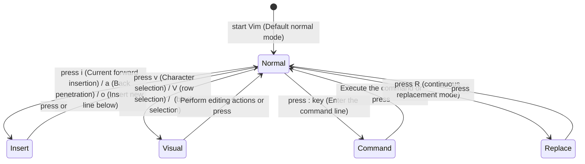
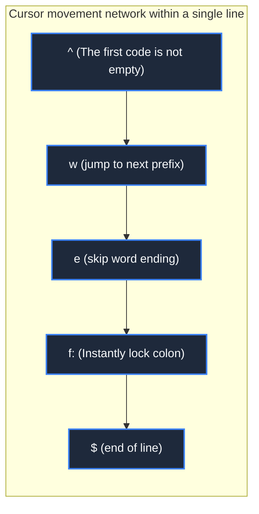
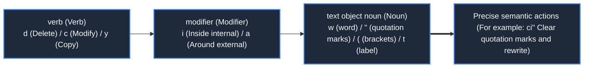

> **Course**: MIT The Missing Semester of Your CS Education, 2020  
> **Course License**: CC BY-NC-SA 4.0.  
> **Module**:Module 1: Terminal Interaction and Workflow Foundation (Foundation: Shell & Tooling)  
> **Lecture team**: Anish Athalye, Jose Javier Gonzalez Ortiz, Philip Levis (MIT CSAIL)  
> **Video duration**: 00:48:30 ｜ **Classroom HD Demonstration Blackboard**: 4 screenshots of the original painting \| **interactive graph**: Mermaid architecture flow chart  
> **Course official handouts**: [📖 MIT official Chinese course handouts](https://missing-semester-cn.github.io/2020/editors/) ｜ [📺Original YouTube video](https://www.youtube.com/watch?v=a6Q8Na575qc)  
> **Directly connected to station B**: [📺Watch the high-definition bilingual video of this lecture on Bilibili (BV1CV4y167RA)](https://www.bilibili.com/video/BV1CV4y167RA/)  
> **Full book navigation**: [← Previous lecture (L02)](/en/notes/missing-semester/lecture-02) ｜ [📚 Return to the full book catalog](/en/notes/topics/Missing%20Semester) ｜ [Next lecture (L04) →](/en/notes/missing-semester/lecture-04)

---

## Core Introduction and Concept Panorama

It deeply analyzes the cognitive psychology of text editing and Vim's modal editing (Modal Editing) philosophy, explains in detail the flow of state machines such as normal mode, insert mode, visual mode, etc., systematically deduce the combinable text grammar (Grammar of Vim) of "verb + modifier + noun", and provides practical solutions for multi-buffer, window split-screen and modern personalized configuration.

---

## 1. Modal editing philosophy: Programmers spend most of their time reading and modifying rather than typing.

*(Reference timestamp: `00:02:40` · [📺B station video clip jump](https://www.bilibili.com/video/BV1CV4y167RA/?t=160))*

Most modern text editors (like VS Code, Sublime Text) follow **Modeless mode**: The keys on the keyboard are mainly used to enter characters into the document, and movement and operations rely on the mouse or the  `Ctrl+Alt+Shift+P`  fingers twisting shortcut keys.

However, real data from software engineering shows that: **In their daily work, programmers only spend a very small amount of time typing new text continuously. Most of the time is spent browsing the code, looking for specific functions, jumping between different files, refactoring variable names, and fine-tuning a few lines of logic.**.

**The core breaking point of Vim is modal editing (Modal Editing)**:
In the default \*\*Normal Mode\*\*, every key on the keyboard is remapped into streamlined navigation and editing instructions. There is no need for your fingers to leave the Home Row for typing, and there is no need to frequently reach out to hold the mouse, thus achieving the supreme state of "synchronizing the speed of thinking with the speed of code manipulation".



[](https://www.bilibili.com/video/BV1CV4y167RA/?t=360)
*⏱ Timestamp: 00:06:00 · 📷 Classroom demonstration screenshot · [Watch the corresponding clip on Bilibili (BV1CV4y167RA 00:06:00)](https://www.bilibili.com/video/BV1CV4y167RA/?t=360)*

## 2. Vim core mode and state transfer system

*(Reference timestamp: `00:07:30` · [📺B station video clip jump](https://www.bilibili.com/video/BV1CV4y167RA/?t=450))*

The first step in using Vim proficiently is to establish a clear mental model of the state machine:
1. **Normal Mode**: Main entry into Vim. Move the cursor, delete, copy, and jump in this mode. In any mode, tap continuously  `<Esc>`  You can return to normal mode at any time;
2. **Insert Mode**: Just like a regular text editor, type characters WYSIWYG:
   - `i`: Start inserting before the current character under the cursor;
   - `a`: Start inserting (Append) after the current character under the cursor;
   - `o`: Open a new line below the current line and enter insert mode;
   - `O`: Open a new line above the current line and enter insert mode;
3. **Visual Mode**:Similar to mouse selection:
   - `v`:Character level visual mode;
   - `V`: Whole row-level visual mode;
   - `Ctrl+v`: **Column block selection mode (Block-Visual)** (The unique skill of adding comments or formatting in batches to multiple lines);
4. **Command-line Mode**: Enter in normal mode  `:`  Trigger:
   - `:w`:Save(Write);
   - `:q`:Exit(Quit);
   - `:wq`  or  `ZZ`:Save and exit;
   - `:q!`: Forced to give up modifications and exit;
   - `:%s/foo/bar/g`: Global regular search and replace.

[](https://www.bilibili.com/video/BV1CV4y167RA/?t=1020)
*⏱ Timestamp: 00:17:00 · 📷 Classroom demonstration screenshot · [Watch the corresponding clip on Bilibili (BV1CV4y167RA 00:17:00)](https://www.bilibili.com/video/BV1CV4y167RA/?t=1020)*

## 3. Efficient displacement instructions: from pixel-level movement to semantic-level shuttle

*(Reference timestamp: `00:15:10` · [📺B station video clip jump](https://www.bilibili.com/video/BV1CV4y167RA/?t=910))*

Ditch the arrow keys! In normal mode, Vim provides full-dimensional displacement keys:
- **basic direction**: `h` (left), `j` (below), `k` (top), `l` (right);
- **word level shift**: 
  - `w`: Jump to the next word (Word);
  - `b`: Go back to the beginning of the previous word (Back);
  - `e`: Jump to the current or next word end (End);
  - Uppercase corresponding key  `W`, `B`, `E`: Split words with pure whitespace characters and span code symbols;
- **Precise positioning within the line (extremely efficient)**: 
  - `0`: Jump to the absolute beginning of the line;
  - `^`: Jump to the first non-blank character in this line;
  - `$`: Jump to the end of the line;
  - `f<char>`: Search forward for the next specific character in this line (e.g.  `f"`  Instantly jump to the double quotes);
  - `t<char>`: Jump backward until the previous position of the target character (Till);
  - `;` / `,`: Repeat the last time or repeat the in-line character search in reverse;
- **File span displacement**: 
  - `gg`: Go directly to the first line of the document in an instant;
  - `G`: Go straight to the end of the document;
  - `:<N>`  or  `<N>G`: jump to line N;
  - `Ctrl+u` / `Ctrl+d`: Scroll half-screen up/down to turn pages.



[](https://www.bilibili.com/video/BV1CV4y167RA/?t=1740)
*⏱ Timestamp: 00:29:00 · 📷 Classroom demonstration screenshot · [Watch the corresponding clip on Bilibili (BV1CV4y167RA 00:29:00)](https://www.bilibili.com/video/BV1CV4y167RA/?t=1740)*

## 4. The Grammar of Vim: verb + modifier + noun

*(Reference timestamp: `00:26:40` · [📺B station video clip jump](https://www.bilibili.com/video/BV1CV4y167RA/?t=1600))*

The most powerful thing about Vim is that its commands have a language similar to human natural language. **grammatical structure**. You don’t need to memorize thousands of discrete shortcut key combinations, just master one **Verbs **and a group** Nouns/Text Objects**, which can be naturally combined by Cartesian product:

#### Core verbs (Actions/Verbs)
- `d`: Delete and cut (Delete);
- `c`:Modify (Change = delete and directly switch to insert mode);
- `y`:Copy(Yank);
- `v`:Visual selection (Visual);
- `>` / `<`: Increase/decrease indent.

#### Text Object Modifiers and Nouns (Text Objects)
Modifier:
- `i`: Inside... (Inside, excluding package delimiter);
- `a`: Around... (Around, including the wrapping delimiter).

Noun target:
- `w`: word;
- `s`: sentence;
- `p`: paragraph;
- `"`, `'`: A string wrapped in quotation marks;
- `(`, `)`, `b`: Content wrapped in parentheses;
- `{`, `}`, `B`: Code brace block;
- `t`:HTML/XML tag (Tag).

#### Classic combination in practice:
- `ci"`: **Change Inside Quotes**——Instantly clear the content inside the double quotes and enter insert mode;
- `da(`: **Delete Around Parentheses**--Delete the parentheses and the parentheses themselves together with the internal parameters;
- `gUiw`: Instantly convert the word currently under the cursor to uppercase;
- `.` (dot operator): **Repeat the last modification action** (The ultimate productivity tool in Vim).



[](https://www.bilibili.com/video/BV1CV4y167RA/?t=2400)
*⏱ Timestamp: 00:40:00 · 📷 Classroom demonstration screenshot · [Watch the corresponding clip on Bilibili (BV1CV4y167RA 00:40:00)](https://www.bilibili.com/video/BV1CV4y167RA/?t=2400)*

## 5. Multiple buffers (Buffers) and window split screen (Windows) system

*(Reference timestamp: `00:36:50` · [📺B station video clip jump](https://www.bilibili.com/video/BV1CV4y167RA/?t=2210))*

In Vim, three hierarchical concepts must be clearly distinguished:
- **Buffer**: A copy of the file open in memory. You can have 50 buffers open at the same time, but only 1 will be displayed on the screen;
- **Window**: The window used to observe a certain buffer. A screen can be divided into multiple windows;
- **Tab**: A collection of page layouts for a window (more similar to a virtual desktop).

#### Window and buffer manipulation commands
- `:e <filename>`: Open the specified file in the current window;
- `:ls`  or  `:buffers`: List all currently opened buffers;
- `:b <name_or_number>`: Switch the currently active buffer;
- `:sp` / `:vsp`: Horizontal split screen (Split)/Vertical split screen (Vertical Split);
- `Ctrl+w` + `h/j/k/l`: Freely jump the cursor focus between split-screen windows;
- `Ctrl+w` + `q`: Close the currently active window.

## 6. Personalization  `.vimrc`  Eco-Apocalypse with Modern Neovim

*(Reference timestamp: `00:43:10` · [📺B station video clip jump](https://www.bilibili.com/video/BV1CV4y167RA/?t=2590))*

through the home directory  `~/.vimrc`  Configuration file, you can completely shape Vim into an IDE-level artifact that suits you:
```vim
" 基础显示与缩进配置
syntax on
set number relativenumber " 混合相对行号，利于快速数字跳转
set tabstop=4
set shiftwidth=4
set expandtab
set smartindent
set hlsearch incsearch ignorecase smartcase

" 快捷键重映射: 将 jk 映射为回到正常模式，手不离主按键区
inoremap jk <Esc>
nnoremap <leader>w :w<CR>
```
In recent years, **Neovim**  As a modern reconstruction branch of Vim, it has suddenly emerged. It introduces Lua native configuration driver, LSP (Language Server Protocol) deep integration, Tree-sitter semantic code highlighting and highly asynchronous architecture, making this ancient modal editing art still glow with unparalleled vitality in the modern cloud native and AI era.

---

## Attachment: Knowledge mind map and review thinking of this lecture

This lecture serves as  **Module 1: Terminal Interaction and Workflow Foundation (Foundation: Shell & Tooling)**  The core pillars include a complete closed-loop deduction from theoretical motivations to underlying system calls, from daily high-frequency operations to cutting-edge best practices. It is recommended to combine terminal practical exercises and after-class exercises to internalize the command line and tool chain into subconscious muscle memory.

[← Previous lecture (L02)](/en/notes/missing-semester/lecture-02) ｜ [📚 Return to the full book catalog](/en/notes/topics/Missing%20Semester) ｜ [Next lecture (L04) →](/en/notes/missing-semester/lecture-04)
