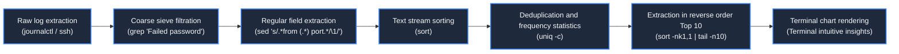
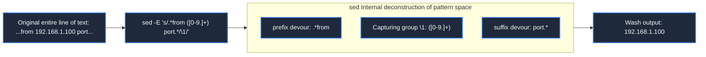
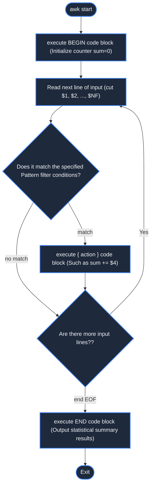

> **Course**: MIT The Missing Semester of Your CS Education, 2020  
> **Course License**: CC BY-NC-SA 4.0.  
> **Module**:Module 2: Text Stream Processing and Productivity Environment (Data Wrangling & Environment)  
> **Lecture team**: Anish Athalye, Jose Javier Gonzalez Ortiz, Philip Levis (MIT CSAIL)  
> **Video duration**: 00:50:07 ｜ **Classroom HD Demonstration Blackboard**: 4 screenshots of the original painting \| **interactive graph**: Mermaid architecture flow chart  
> **Course official handouts**: [📖 MIT official Chinese course handouts](https://missing-semester-cn.github.io/2020/data-wrangling/) ｜ [📺Original YouTube video](https://www.youtube.com/watch?v=sz_dsktIjt4)  
> **Directly connected to station B**: [📺Watch this high-definition bilingual video on Bilibili (BV14u411s7c6)](https://www.bilibili.com/video/BV14u411s7c6/)  
> **Full book navigation**: [← Previous lecture (L03)](/en/notes/missing-semester/lecture-03) ｜ [📚 Return to the full book catalog](/en/notes/topics/Missing%20Semester) ｜ [Next lecture (L05) →](/en/notes/missing-semester/lecture-05)

---

## Core Introduction and Concept Panorama

Master the engineering techniques to clean heterogeneous unstructured text into high-value structured insights. Systematic explanation of regular expression character sets, anchor points and capture groups, detailed explanation of sed stream editing and replacement syntax and awk column processing mode calculation, opening up an end-to-end automated pipeline from log filtering, frequency statistics to command line visualization.

---

## 1. What is Data Wrangling?

*(Reference timestamp: `00:02:10` · [📺B station video clip jump](https://www.bilibili.com/video/BV14u411s7c6/?t=130))*

In daily engineering, most of the data generated by the system (system operation logs, sensor indicators, network packet dumps, HTML returned by crawlers) are not neatly arranged Excel tables or SQL database records, but raw text filled with timestamps, redundant debugging information and irregular formats.

The core task of \*\*Data Wrangling\*\* is to use a streamlined and efficient command line tool chain to gradually refine, filter, convert, and summarize the unreadable original text stream, and finally transform it into high-order indicators that can directly answer business questions.

#### UNIX classic data processing pipeline mental model
The entire treatment process is similar to an industrial water purification plant:
1. **Source extraction (Acquire)**: Obtain data stream from log file, API endpoint or network packet capture (`journalctl`, `cat`, `curl`); 
2. **Primary filter (Filter)**: Discard irrelevant noise rows that you don’t care about (`grep`); 
3. **Transform**: Extract core fields, regular replacement and reconstruction format (`sed`, `tr`, `cut`); 
4. **Column aggregation and calculation (Aggregate)**: Group by column, cumulative calculation, sum and average (`awk`, `sort`, `uniq`); 
5. **Final presentation (Present)**: Sort, truncate top N, export to CSV, or graph terminal characters (`head`, `column`, `graph-cli`).



[](https://www.bilibili.com/video/BV14u411s7c6/?t=360)
*⏱ Timestamp: 00:06:00 · 📷 Classroom demonstration screenshot · [Watch the corresponding clip on Bilibili (BV14u411s7c6 00:06:00)](https://www.bilibili.com/video/BV14u411s7c6/?t=360)*

## 2. Regular Expressions system construction

*(Reference timestamp: `00:07:40` · [📺B station video clip jump](https://www.bilibili.com/video/BV14u411s7c6/?t=460))*

Regular expressions are the core weapon of data sorting. They define a formal pattern for matching specific string sequences.

#### Core Metacharacters and Grammar System
- **Basic character set**: 
  - `.`: Matches any single character except newline characters;
  - `[abc]`: Matches any character in square brackets;
  - `[^abc]`: Negative match, any character that does not contain these characters;
  - `[0-9]`  or  `[a-zA-Z]`:Character interval range;
- **Position anchors (Anchors)**: 
  - `^`: Matches the beginning of the line;
  - `$`: Matches the end of the line;
  - `\b`: word boundary;
- **Quantifiers**: 
  - `*`: Match 0 or more times (greedy mode);
  - `+`: Match 1 or more times;
  - `?`: Match 0 or 1 times;
  - `{m,n}`: Match at least m times and at most n times;
- **Capture Groups**: 
  - `(...)`: Capture matching subpatterns; passable during replacement phase  `\1`, `\2`  Re-reference the captured content in order.

> **Tips**: There is a historical difference between basic regular expressions (BRE) and extended regular expressions (ERE) in traditional UNIX tools. In a modern script, do  `grep -E`  or  `sed -E`  Turn on extended regular expressions to avoid a lot of annoying backslash escaping (such as writing directly  `(abc|def)`  rather than  `\(abc\|def\)`).

[](https://www.bilibili.com/video/BV14u411s7c6/?t=1080)
*⏱ Timestamp: 00:18:00 · 📷 Classroom demonstration screenshot · [Watch the corresponding clip on Bilibili (BV14u411s7c6 00:18:00)](https://www.bilibili.com/video/BV14u411s7c6/?t=1080)*

## 3. `sed`  Stream editor in action: pattern space and regular replacement

*(Reference timestamp: `00:15:20` · [📺B station video clip jump](https://www.bilibili.com/video/BV14u411s7c6/?t=920))*

`sed` (Stream Editor) is a lightweight and powerful non-interactive text stream editor. It reads the input stream line by line, stores it in the temporary memory "Pattern Space", applies the specified editing script, and outputs the result.

#### The core syntax: `s/regex/replacement/flags`
- `s`: Represents substitute substitution operation;
- `/`: delimiter (if the matched content itself contains a large number of slashes, such as a path  `/usr/local/bin`, you can change the delimiter arbitrarily, for example  `s#regex#replacement#g`); 
- `g` (Global Flag): Inline global matching. If not added  `g`, `sed`  By default, only the first hit of each line is replaced;
- `p`: Print only the replaced lines (often used with  `-n`  Silent option works with: `sed -n 's/pattern/\1/p'`).

#### Capture group extraction case
Suppose there is a line of log:
```
Jan 15 12:34:56 server sshd[1234]: Failed password for invalid user admin from 192.168.1.100 port 54321 ssh2
```
We just want to extract the exact attacker IP address:
```bash
$ sed -E 's/.*from ([0-9.]+) port.*/\1/' log.txt
192.168.1.100
```
here  `.*from `  Swallowed all prefixes in front of the IP, `([0-9.]+)`  Pure IP locked as a capture group, ` port.*`  After swallowing up subsequent ports and protocols, the entire string was eventually replaced by a single  `\1`  Replace!



[](https://www.bilibili.com/video/BV14u411s7c6/?t=1860)
*⏱ Timestamp: 00:31:00 · 📷 Classroom demonstration screenshot · [Watch the corresponding clip on Bilibili (BV14u411s7c6 00:31:00)](https://www.bilibili.com/video/BV14u411s7c6/?t=1860)*

## 4. `awk`  Structured column processing and statistical accumulation engine

*(Reference timestamp: `00:27:00` · [📺B station video clip jump](https://www.bilibili.com/video/BV14u411s7c6/?t=1620))*

If we say  `sed`  Good at doing pattern replacement by line, then  **`awk`**  Just for **Process structured tabular data by columns (fields)** A complete Turing-complete programming language.

#### `awk`  Core execution model: `awk 'pattern { action }'`
`awk`  By default, input lines are split by any consecutive whitespace characters (spaces or tabs):
- `$0`: refers to the current entire line of content;
- `$1, $2, ... $N`: Column 1, Column 2, until the last column;
- `NF` (Number of Fields): The total number of columns of fields contained in the current row (`$NF`  The trick is to get the content of the last column directly! );
- `NR` (Number of Records): Current line number;
- `BEGIN { ... }`: Execute once before starting to process any rows (often used to initialize accumulated variables or print headers);
- `END { ... }`: Executed once after all rows have been processed (often used to calculate averages or output final summary results).

#### Classic practical cases
1. **Print only the second column containing  `error`  The last column content of**: 
   ```bash
   $ awk '$2 ~ /error/ { print $NF }' system.log
   ```
2. **Calculate the sum and mean of the fourth column values of all rows in the file**: 
   ```bash
   $ awk '{ sum += $4; count++ } END { print "Total:", sum, "Avg:", sum/count }' data.tsv
   ```



[](https://www.bilibili.com/video/BV14u411s7c6/?t=2520)
*⏱ Timestamp: 00:42:00 · 📷 Classroom demonstration screenshot · [Watch the corresponding clip on Bilibili (BV14u411s7c6 00:42:00)](https://www.bilibili.com/video/BV14u411s7c6/?t=2520)*

## 5. Assembly line combo boxing: `sort`, `uniq`, `paste`  and numerical calculations

*(Reference timestamp: `00:38:00` · [📺B station video clip jump](https://www.bilibili.com/video/BV14u411s7c6/?t=2280))*

Connecting various professional tools with pipes can produce devastating power:
- **`sort`  Text sorting**: 
  - `sort -n`: Sort by numerical value (rather than dictionary order, to avoid 10 ranking before 2);
  - `sort -k2,2`:Specifies to sort by column 2 only;
  - `sort -r`: Descending order (Reverse) output in reverse order;
- **`uniq`  Adjacent deduplication**(**Iron rule: must pass first  `sort`  To be effective!**): 
  - `uniq -c`: Remove duplicates and count the frequency of occurrence of each element (Count);
- **`paste`  Stream merging**: 
  - `paste -sd+`: Combine multiple rows of data with a plus sign  `+`  Delimited single-line calculations;
- **`bc`  arbitrary precision calculator**: 
  ```bash
  # 一秒计算 100 个请求时延的总和：
  $ cat latencies.txt | paste -sd+ - | bc
  ```

## 6. Modern structured data cleaning: `jq`  Drawing with terminal

*(Reference timestamp: `00:45:10` · [📺B station video clip jump](https://www.bilibili.com/video/BV14u411s7c6/?t=2710))*

In modern web development, API responses commonly use JSON format. Using traditional line regular parsing to parse multi-line nested JSON is very easy to fragment. In this case, specialized  **`jq`**  Tools:
```bash
# 从 GitHub API 获取最新的 release tag 并提取所有 commit 消息
$ curl -s https://api.github.com/repos/facebook/react/commits |   jq -r '.[0:5] | .[] | "\(.commit.author.date): \(.commit.message)"'
```
cooperate  `graph-cli`  Or Python minimalist drawing script, you don’t even need to open the browser, and directly render histograms and trend charts in real time in the terminal character interface!

---

## Attachment: Knowledge mind map and review thinking of this lecture

This lecture serves as  **Module 2: Text Stream Processing and Productivity Environment (Data Wrangling & Environment)**  The core pillars include a complete closed-loop deduction from theoretical motivations to underlying system calls, from daily high-frequency operations to cutting-edge best practices. It is recommended to combine terminal practical exercises and after-class exercises to internalize the command line and tool chain into subconscious muscle memory.

[← Previous lecture (L03)](/en/notes/missing-semester/lecture-03) ｜ [📚 Return to the full book catalog](/en/notes/topics/Missing%20Semester) ｜ [Next lecture (L05) →](/en/notes/missing-semester/lecture-05)
