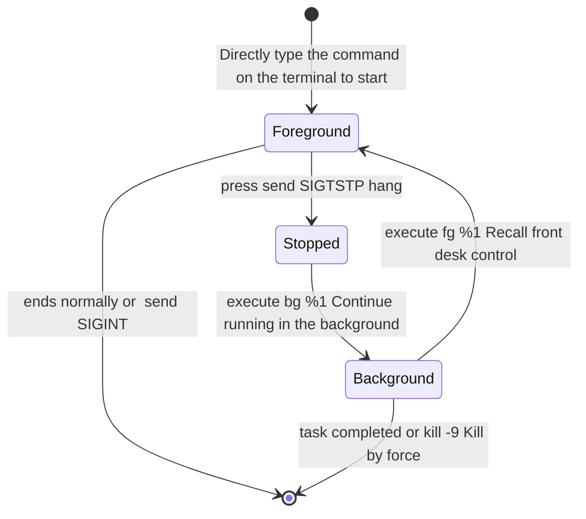
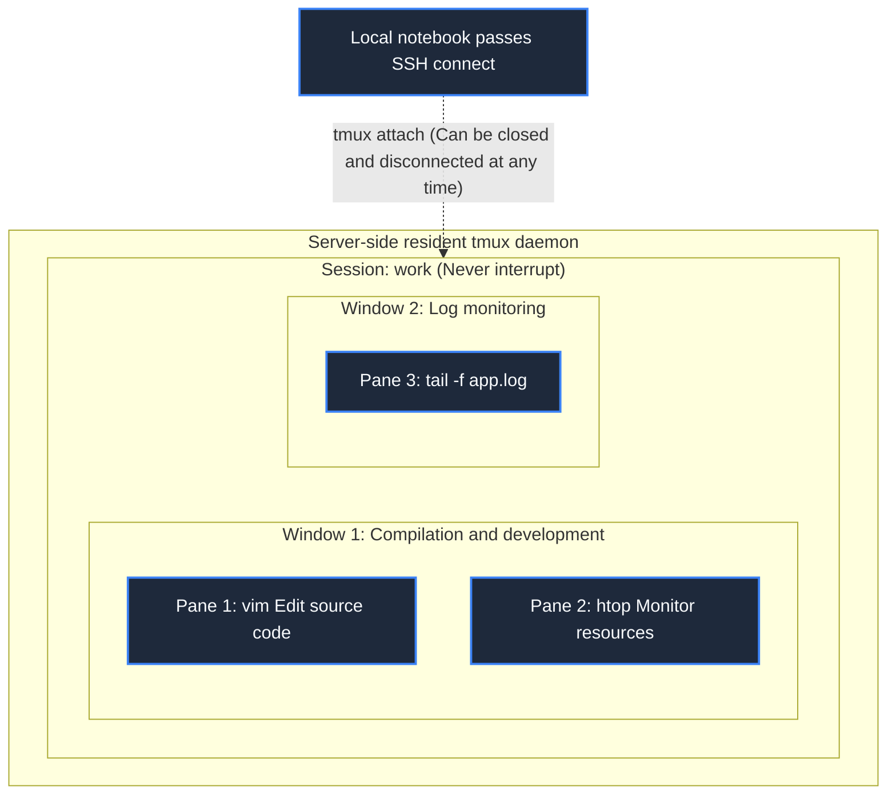
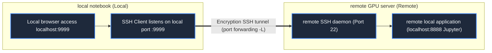

> **Course**: MIT The Missing Semester of Your CS Education, 2020  
> **Course License**: CC BY-NC-SA 4.0.  
> **Module**:Module 2: Text Stream Processing and Productivity Environment (Data Wrangling & Environment)  
> **Lecture team**: Anish Athalye, Jose Javier Gonzalez Ortiz, Philip Levis (MIT CSAIL)  
> **Video duration**: 00:56:10 ｜ **Classroom HD Demonstration Blackboard**: 4 screenshots of the original painting \| **interactive graph**: Mermaid architecture flow chart  
> **Course official handouts**: [📖 MIT official Chinese course handouts](https://missing-semester-cn.github.io/2020/command-line/) ｜ [📺Original YouTube video](https://www.youtube.com/watch?v=e8BO_dYxk5c)  
> **Directly connected to station B**: [📺Watch this high-definition bilingual video on Bilibili (BV1Jh4y1Z7SV)](https://www.bilibili.com/video/BV1Jh4y1Z7SV/)  
> **Full book navigation**: [← Previous lecture (L04)](/en/notes/missing-semester/lecture-04) ｜ [📚 Return to the full book catalog](/en/notes/topics/Missing%20Semester) ｜ [Next lecture (L06) →](/en/notes/missing-semester/lecture-06)

---

## Core Introduction and Concept Panorama

Master long-running, robust productivity workflows that survive network disconnections. Systematic analysis of UNIX mission control and core semaphore systems, practical use of tmux terminal multiplexer split-screen and persistent sessions, establishment of a Dotfiles configuration asset management system with Git as the backbone, and in-depth exploration of SSH asymmetric authentication and three advanced port forwarding tunnels.

---

## 1. Job Control and UNIX semaphore mechanism

*(Reference timestamp: `00:03:30` · [📺B station video clip jump](https://www.bilibili.com/video/BV1Jh4y1Z7SV/?t=210))*

When you run a long-running calculation task in the terminal, the current console of the Shell will be occupied. Understand the operating system **mission control** Together with \*\*Semaphores (Signals)\*\* are the prerequisite for efficient multi-task parallelism.

#### Key shortcut keys and semaphore mapping
A semaphore is an asynchronous interrupt notification sent by the operating system to a running process:
- **`Ctrl+C`  send  `SIGINT`  (Signal Interrupt, Signal 2)**: Politely notify the process of interruption and exit. Most programs will catch this signal and shut down gracefully (clean up temporary files, flush write buffers);
- **`Ctrl+\`  send  `SIGQUIT`  (Signal Quit, Signal 3)**: Force exit and generate core dump file (Core Dump);
- **`Ctrl+Z`  send  `SIGTSTP`  (Terminal Stop, signal 20)**: Notify the process to hang (pause) and instantly return control to the terminal prompt;
- **`SIGTERM`  (Signal 15)**: `kill <PID>`  Termination signal sent by default;
- **`SIGKILL`  (Signal 9)**: The kernel directly forcibly kills the process, **The signal cannot be caught or ignored by the process** (Usually used when the process is deadlocked and unresponsive: `kill -9 <PID>`); 
- **`SIGHUP`  (Signal Hangup, Signal 1)**: When the terminal window is closed or the network SSH connection is disconnected, the system broadcasts this signal to all child processes under the session. By default, all running background tasks will die instantly!

#### Suspension and background task control flow
```bash
$ python long_task.py
^Z
[1]+  Stopped                 python long_task.py
$ jobs          # 查看当前 Shell 托管的所有后台作业
[1]+  Stopped                 python long_task.py
$ bg %1         # 让作业 1 在后台继续唤醒运行 (Background)
[1]+ python long_task.py &
$ fg %1         # 将后台作业 1 重新调回前台控制 (Foreground)
```



[](https://www.bilibili.com/video/BV1Jh4y1Z7SV/?t=420)
*⏱ Timestamp: 00:07:00 · 📷 Classroom demonstration screenshot · [Watch the corresponding clip on Bilibili (BV1Jh4y1Z7SV 00:07:00)](https://www.bilibili.com/video/BV1Jh4y1Z7SV/?t=420)*

## 2. Terminal multiplexer  `tmux`: Always-on cloud session

*(Reference timestamp: `00:13:50` · [📺B station video clip jump](https://www.bilibili.com/video/BV1Jh4y1Z7SV/?t=830))*

When running a training model or compiling a kernel on a remote server, the most deadly nightmare is "closing the laptop lid or disconnecting from the Internet in the dormitory, causing the SSH connection to be disconnected, triggering SIGHUP and causing the 10-hour task to be wasted."

**`tmux` (Terminal Multiplexer) completely puts an end to this problem!**
`tmux`  Runs in the server's resident daemon. It divides the terminal into three levels:
1. **Session**: an independent workspace, even if you disconnect SSH, the session is still running at full speed in the server memory;
2. **Window**: An independent virtual desktop in a session that can instantly switch between multiple full-screen windows;
3. **Pane**: Divide a single screen into multiple small grids that do not interfere with each other (split screen up and down, split screen left and right).

#### `tmux`  Quick check of commonly used operations (all shortcut keys default to  `Ctrl+b`  as prefix key)
- Start/resume session:
  - `tmux new -s work`:Create a file named  `work`  new session;
  - `tmux ls`: List all live sessions on the server;
  - `tmux a -t work`: Reattach the connection (Attach) to the target session;
- In-session shortcut keys (press first  `Ctrl+b`, let go and then press the following keys):
  - `d`: **Detach the current session**, safely switch back to the outer console, and background tasks continue to run without loss;
  - `%`: Left and right vertical split screen;
  - `"`: Split the screen horizontally up and down;
  - Arrow keys: Move the cursor between different split-screen panes;
  - `c`: Create a new virtual window;
  - `n` / `p`: Switch to the next/previous window.



[](https://www.bilibili.com/video/BV1Jh4y1Z7SV/?t=1260)
*⏱ Timestamp: 00:21:00 · 📷 Classroom demonstration screenshot · [Watch the corresponding clip on Bilibili (BV1Jh4y1Z7SV 00:21:00)](https://www.bilibili.com/video/BV1Jh4y1Z7SV/?t=1260)*

## 3. Aliases and environment automation

*(Reference timestamp: `00:25:30` · [📺B station video clip jump](https://www.bilibili.com/video/BV1Jh4y1Z7SV/?t=1530))*

To save time typing lengthy commands, aliases can be defined in the configuration file:
```bash
alias ll="ls -lah"
alias gs="git status -sb"
alias dc="docker-compose"
```
Aliases are suitable for extremely simple command shortcut wrappers. But **If it involves passing dynamic parameters or making branch judgments, you must use Shell functions**: 
```bash
# 创建目录并立刻自动 cd 进入
mkcd() {
    mkdir -p "$1" && cd "$1"
}
```

[](https://www.bilibili.com/video/BV1Jh4y1Z7SV/?t=2100)
*⏱ Timestamp: 00:35:00 · 📷 Classroom demonstration screenshot · [Watch the corresponding clip on Bilibili (BV1Jh4y1Z7SV 00:35:00)](https://www.bilibili.com/video/BV1Jh4y1Z7SV/?t=2100)*

## 4. Dotfiles: versioning and automatic synchronization of personal configuration assets

*(Reference timestamp: `00:32:40` · [📺B station video clip jump](https://www.bilibili.com/video/BV1Jh4y1Z7SV/?t=1960))*

What the programmer deposits in the terminal  `.bashrc`, `.zshrc`, `.vimrc`, `.tmux.conf`, `.gitconfig`  and other configuration files, known as  **Dotfiles** (Hidden files starting with dot). These configurations condense the developers' years of efficiency accumulation and muscle memory.

#### Best practices: Git + GNU Stow
1. Create a dedicated Git repository in your home directory  `~/dotfiles/`; 
2. Move the real configuration files into the repository and create a symbolic link (Symlink) in the home directory;
3. use  **GNU Stow**  Automatically create and maintain these hierarchical symbolic links:
   ```bash
   $ cd ~/dotfiles
   $ stow zsh    # 自动将 ~/dotfiles/zsh/.zshrc 软链至 ~/.zshrc
   $ stow vim    # 自动将 ~/dotfiles/vim/.vimrc 软链至 ~/.vimrc
   ```
4. will  `dotfiles`  Host to a GitHub private or public repository. When switching to a new computer or logging into a new server, it only takes a second  `git clone`  You can restore the entire workflow completely painlessly!

[](https://www.bilibili.com/video/BV1Jh4y1Z7SV/?t=2820)
*⏱ Timestamp: 00:47:00 · 📷 Classroom demonstration screenshot · [Watch the corresponding clip on Bilibili (BV1Jh4y1Z7SV 00:47:00)](https://www.bilibili.com/video/BV1Jh4y1Z7SV/?t=2820)*

## 5. The Ultimate Guide to Remote Connections: SSH Key Authentication and Three Types of Port Forwarding

*(Reference timestamp: `00:41:00` · [📺B station video clip jump](https://www.bilibili.com/video/BV1Jh4y1Z7SV/?t=2460))*

SSH (Secure Shell) is the most important and secure remote management encryption protocol in the modern Internet.

#### Abandon cumbersome passwords: secret-free public and private key authentication based on Ed25519
```bash
# 1. 本地生成最高强度的现代加密密钥对 (推荐 ed25519 算法)
$ ssh-keygen -t ed25519 -C "your_email@example.com"
# 2. 将本地公钥 (~/.ssh/id_ed25519.pub) 一键部署至远程服务器 ~/.ssh/authorized_keys
$ ssh-copy-id user@remote.server.edu
```

#### Configuration  `~/.ssh/config`: Say goodbye to rote memorization of IP and ports completely
Edit local  `~/.ssh/config`: 
```ssh
Host myserver
    HostName 198.51.100.42
    User eason
    Port 2222
    IdentityFile ~/.ssh/id_ed25519
```
From now on, just type in the terminal the minimalist  `ssh myserver`, the system automatically retrieves the specified key, port and username to log in in seconds!

#### Deconstruction of the three major modes of SSH port forwarding
- **Local Port Forwarding,  `-L`)**:
Map the network services within the remote server to the port of the local machine. 
  *Typical scenario*: The remote server is at  `localhost:8888`  Running Jupyter Notebook, there is no public IP locally and you cannot view it directly. Execute:
  ```bash
  ssh -L 9999:localhost:8888 myserver
  ```
  Now open in local browser  `http://localhost:9999`, the traffic goes directly to the remote Jupyter like walking through a secret underground tunnel!
- **Remote Port Forwarding,  `-R`)**:
Reversely expose the local computer's port to the remote server.
- **Dynamic Port Forwarding,  `-D`)**:
Open a SOCKS5 proxy port locally (such as  `ssh -D 1080 myserver`), all traffic from the local browser is forwarded through the remote server.



---

## Attachment: Knowledge mind map and review thinking of this lecture

This lecture serves as  **Module 2: Text Stream Processing and Productivity Environment (Data Wrangling & Environment)**  The core pillars include a complete closed-loop deduction from theoretical motivations to underlying system calls, from daily high-frequency operations to cutting-edge best practices. It is recommended to combine terminal practical exercises and after-class exercises to internalize the command line and tool chain into subconscious muscle memory.

[← Previous lecture (L04)](/en/notes/missing-semester/lecture-04) ｜ [📚 Return to the full book catalog](/en/notes/topics/Missing%20Semester) ｜ [Next lecture (L06) →](/en/notes/missing-semester/lecture-06)
