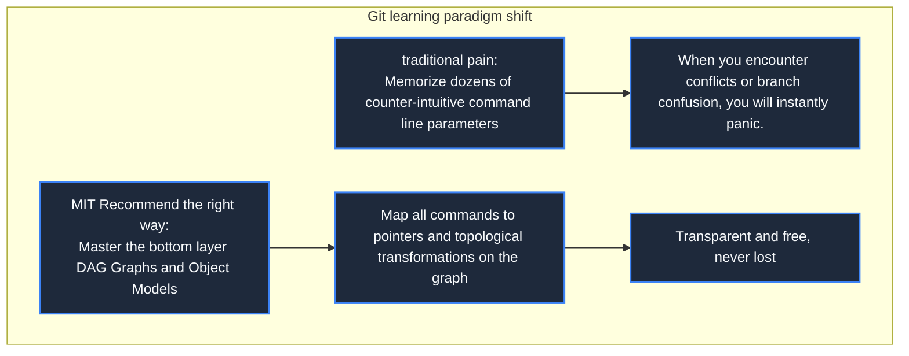
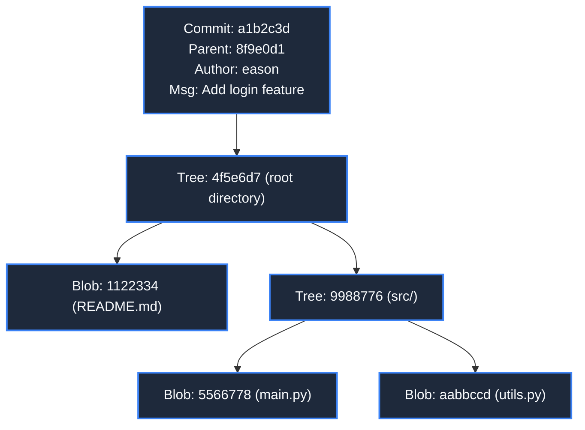
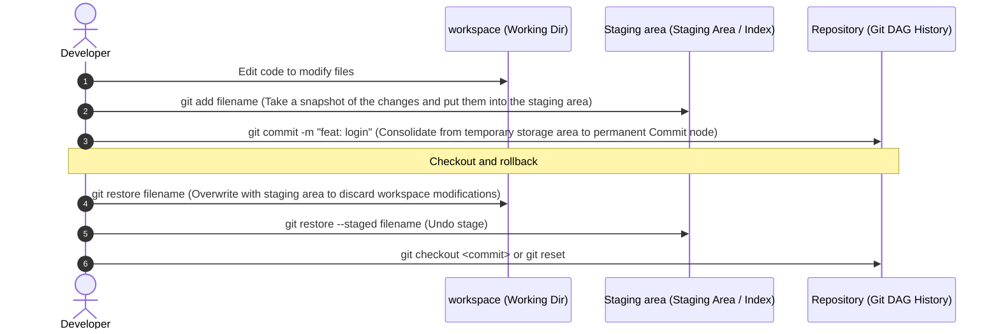
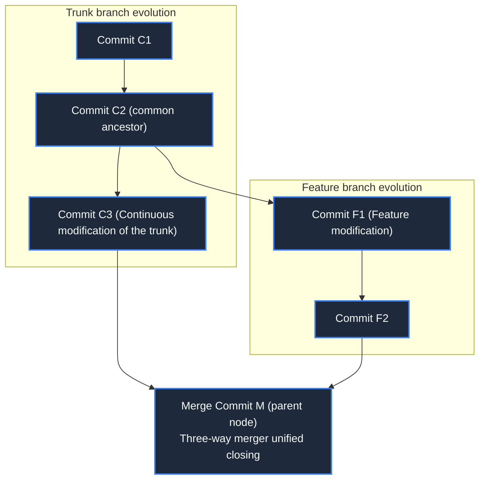

> **Course**: MIT The Missing Semester of Your CS Education, 2020  
> **Course License**: CC BY-NC-SA 4.0.  
> **Module**: Module 3: Version Control and Software Engineering (Software Engineering & Diagnostics)  
> **Lecture team**: Anish Athalye, Jose Javier Gonzalez Ortiz, Philip Levis (MIT CSAIL)  
> **Video duration**: 01:25:03 ｜ **Classroom HD Demonstration Blackboard**: 4 screenshots of the original painting \| **interactive graph**: Mermaid architecture flow chart  
> **Course official handouts**: [📖 MIT official Chinese course handouts](https://missing-semester-cn.github.io/2020/version-control/) ｜ [📺Original YouTube video](https://www.youtube.com/watch?v=2sjqTHE0zok)  
> **Directly connected to station B**: [📺Watch this high-definition bilingual video on Bilibili (BV1Wh4y1s7Lj)](https://www.bilibili.com/video/BV1Wh4y1s7Lj/)  
> **Full book navigation**: [← Previous lecture (L05)](/en/notes/missing-semester/lecture-05) ｜ [📚 Return to the full book catalog](/en/notes/topics/Missing%20Semester) ｜ [Next lecture (L07) →](/en/notes/missing-semester/lecture-07)

---

## Core Introduction and Concept Panorama

Get out of the quagmire of rote memorization of Git commands and build the ultimate understanding of Git from the dimensions of data structure and mathematical models. Panoramic analysis of directed acyclic graph (DAG), content-addressed storage, and the underlying graph of Blob/Tree/Commit objects, deducing the three-layer state flow of the work area/temporary area, and explaining in detail branch pointer changes, three-way merge algorithms, interactive rebase, and binary code debugging methods.

---

## 1. Why do you need to learn the data model first to learn Git?

*(Reference timestamp: `00:03:00` · [📺B station video clip jump](https://www.bilibili.com/video/BV1Wh4y1s7Lj/?t=180))*

Version control system (VCS) is an irreplaceable cornerstone of team collaborative development and code evolution. However, the vast majority of developers have experienced an extremely painful struggle when learning Git: memorizing it online  `git add`, `git commit`, `git pull`, `git push`; Once encountering a merge conflict, HEAD detachment, or branch confusion, you will fall into panic, and even adopt the embarrassing strategy of "delete the entire directory, clone a copy again, and then manually incorporate the modifications".

The lecturer emphasized: **Don’t memorize Git’s command line parameters first! Git's Surface Command Interface (CLI) is notoriously anti-human and unintuitive in design, but its underlying conceptual data model (Data Model) is breathtakingly elegant.**

As long as you establish a directed acyclic graph (DAG) model of Git's underlying objects in your mind, all Git commands are just simple additions, deletions, modifications, and searches of this graph structure. When faced with any problem, you just need to think: "Where in this graph am I now? Which edge on the graph do I want to move to where?"



[](https://www.bilibili.com/video/BV1Wh4y1s7Lj/?t=480)
*⏱ Timestamp: 00:08:00 · 📷 Classroom demonstration screenshot · [Watch the corresponding clip on Bilibili (BV1Wh4y1s7Lj 00:08:00)](https://www.bilibili.com/video/BV1Wh4y1s7Lj/?t=480)*

## 2. Git internal object structure and content-addressed storage

*(Reference timestamp: `00:12:30` · [📺B station video clip jump](https://www.bilibili.com/video/BV1Wh4y1s7Lj/?t=750))*

Git is essentially a **Content-Addressed Key-Value Store**. You put any data into Git, and Git will calculate a 40-bit SHA-1 hash value (or SHA-256) based on all bytes of the data, and use this hash value as a unique key to store the data object in  `.git/objects`  directory.

#### Git’s four core object types
1. **Blob (data block)**: Pure file content byte stream. Note: Blob  **Only the file content is saved, not the file name or permissions.**! Two 100MB files with identical contents will only occupy the storage space of one Blob in Git;
2. **Tree**: Represents a directory. The Tree contains a list internally, and each item records the subdirectory name, file name, permission attribute, and SHA-1 hash pointer pointing to the corresponding downstream Blob or sub-Tree;
3. **Commit (commit node)**: Represents a copy of the project at a certain point in time **global complete snapshot**. The Commit object contains:
   - Points to the top-level root directory  `Tree`  hash pointer;
   - Hash pointers of several \*\*Parent Commits\*\* (the initial commit has no parent, the normal commit has 1 parent, and the merge commit has 2 or more parents);
   - Author, submitter, timestamp and submission description;
4. **Annotated Tag**: A permanent alias pointing to a Commit.



[](https://www.bilibili.com/video/BV1Wh4y1s7Lj/?t=1440)
*⏱ Timestamp: 00:24:00 · 📷 Classroom demonstration screenshot · [Watch the corresponding clip on Bilibili (BV1Wh4y1s7Lj 00:24:00)](https://www.bilibili.com/video/BV1Wh4y1s7Lj/?t=1440)*

## 3. Three-layer circulation model of work area, temporary storage area and warehouse

*(Reference timestamp: `00:23:45` · [📺B station video clip jump](https://www.bilibili.com/video/BV1Wh4y1s7Lj/?t=1425))*

During daily modifications, code flows between three work areas:
- **Working Directory**: The real directory of the file system on the hard disk that you can directly see with the naked eye and edit directly with the editor;
- **Staging Area/Index**: The snapshot draft prepared for the next submission is stored in  `.git/index`  in the binary file. Pass  `git add`  Submit changes to the workspace to the staging area;
- **Repository**: has been permanently persisted in  `.git/objects`  Commit DAG topology history in .

#### Why do we need a staging area?
The staging area gives developers the ability to fine-tune commit atomicity (Commit Atomicity). If you fix 3 different bugs at the same time, you don't have to mix them together and make a rough Commit, but you can do it through  `git add -p`  Even row-level selection is used to put logically related changes into the temporary storage area in batches, respectively generating three clear and independent atomic commits that can be rolled back at any time.



[](https://www.bilibili.com/video/BV1Wh4y1s7Lj/?t=2520)
*⏱ Timestamp: 00:42:00 · 📷 Classroom demonstration screenshot · [Watch the corresponding clip on Bilibili (BV1Wh4y1s7Lj 00:42:00)](https://www.bilibili.com/video/BV1Wh4y1s7Lj/?t=2520)*

## 4. The true face of branches: lightweight mutable references and three-way merges

*(Reference timestamp: `00:36:10` · [📺B station video clip jump](https://www.bilibili.com/video/BV1Wh4y1s7Lj/?t=2170))*

In many older version control systems, creating a branch meant copying the complete code of the entire project to a new folder, which took several minutes. And in Git: 
**The essence of a branch is just a branch stored in  `.git/refs/heads/<branch>`  The plain text file below contains the 40-bit hash value of the Commit node it points to!**
 Therefore, creating or destroying a branch in Git typically takes less than 1 millisecond by simply writing or deleting a 41-byte file on the hard disk!

- **HEAD**: A special reference that refers to "which branch you are currently on".
- **Fast-forward merge**: When the main branch does not have any new commits since the sub-branch was cut off, the merge simply moves the main branch pointer to the end of the sub-branch.
- **3-Way Merge**: When two branches evolve from a common ancestor (Common Ancestor), Git automatically searches for the nearest common ancestor node, compares the three-way difference with the target nodes at both ends, and automatically synthesizes a new Merge Commit containing parent references. If the same line of code is modified by both ends at the same time, the famous **Merge Conflict**, marked as  `<<<<<<<`, `=======`, `>>>>>>>`, waiting for manual confirmation by the developer.



[](https://www.bilibili.com/video/BV1Wh4y1s7Lj/?t=3960)
*⏱ Timestamp: 01:06:00 · 📷 Classroom demonstration screenshot · [Watch the corresponding clip on Bilibili (BV1Wh4y1s7Lj 01:06:00)](https://www.bilibili.com/video/BV1Wh4y1s7Lj/?t=3960)*

## 5. Interactive rebasing (`rebase -i`) and historical plastic surgery

*(Reference timestamp: `00:52:00` · [📺B station video clip jump](https://www.bilibili.com/video/BV1Wh4y1s7Lj/?t=3120))*

Before merging your local personal development branch into the team's trunk, your local commits are often full of things like  `fix typo`, `wip`, `test again`  of messy trivial submissions. Use \*\*Interactive Rebase\*\* to prune the history as neatly as a textbook:
```bash
$ git rebase -i HEAD~4
```
Git will pop up a list of editors, allowing you to specify actions for the last 4 commits:
- `pick`: Keep the submission;
- `reword`: Modify the log message of the submission;
- `edit`: Stop at the submission point, allowing code to be added or modified;
- `squash` (Extremely High Frequency): Submit this **Compress and merge** Go to the previous commit and erase the temporary intermediate state;
- `drop`: Discard and delete the submission directly.

> **The golden rule of rebasing**: **Never rebase a commit that has been pushed to a public branch such as origin/main!**  Rebasing will rewrite hashes, and forcing will destroy the downstream historical baseline of all collaborators.

## 6. Strange skills and tricks: `git bisect`  Binary debugging and code archeology

*(Reference timestamp: `01:10:00` · [📺B station video clip jump](https://www.bilibili.com/video/BV1Wh4y1s7Lj/?t=4200))*

When the project is huge and contains tens of thousands of submissions, if you find a strange bug suddenly popping up online, but you don’t know which code change introduced it in the past few months, **`git bisect`**  It is a god-level life-saving tool:
```bash
$ git bisect start
$ git bisect bad                 # 告诉 Git 当前最新 HEAD 有 Bug
$ git bisect good v1.0.0         # 告诉 Git 几个月前的 v1.0 标签绝对正常
Bisecting: 128 revisions left to test after this (roughly 7 steps)
```
Git will automatically adopt **binary search algorithm**, immediately check out the middle commit point for you to test. You just test it and tell Git  `git bisect good`  or  `bad`, Git can be used in just  $\log_2(N)$  Accurately find out the culprit of the bug within one step (for example, 1000 commits only require 10 steps of testing) Commit! Can even be used with automated test scripts  `git bisect run ./test.sh`  Achieve unattended fully automatic two-point locking!

---

## Attachment: Knowledge mind map and review thinking of this lecture

This lecture serves as  **Module 3: Version Control and Software Engineering (Software Engineering & Diagnostics)**  The core pillars include a complete closed-loop deduction from theoretical motivations to underlying system calls, from daily high-frequency operations to cutting-edge best practices. It is recommended to combine terminal practical exercises and after-class exercises to internalize the command line and tool chain into subconscious muscle memory.

[← Previous lecture (L05)](/en/notes/missing-semester/lecture-05) ｜ [📚 Return to the full book catalog](/en/notes/topics/Missing%20Semester) ｜ [Next lecture (L07) →](/en/notes/missing-semester/lecture-07)
