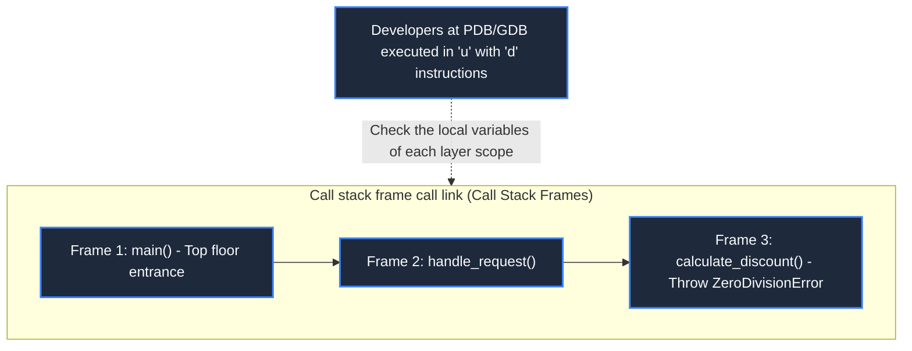
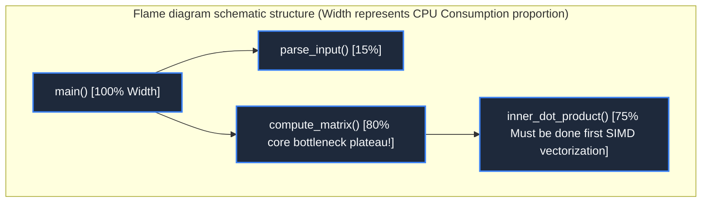

> **Course**: MIT The Missing Semester of Your CS Education, 2020  
> **Course License**: CC BY-NC-SA 4.0.  
> **Module**: Module 3: Version Control and Software Engineering (Software Engineering & Diagnostics)  
> **Lecture team**: Anish Athalye, Jose Javier Gonzalez Ortiz, Philip Levis (MIT CSAIL)  
> **Video duration**: 00:54:17 ｜ **Classroom HD Demonstration Blackboard**: 4 screenshots of the original painting \| **interactive graph**: Mermaid architecture flow chart  
> **Course official handouts**: [📖 MIT official Chinese course handouts](https://missing-semester-cn.github.io/2020/debugging-profiling/) ｜ [📺Original YouTube video](https://www.youtube.com/watch?v=l812pUnKxME)  
> **Directly connected to station B**: [📺Watch this high-definition bilingual video on Bilibili (BV16h4y1471u)](https://www.bilibili.com/video/BV16h4y1471u/)  
> **Full book navigation**: [← Previous lecture (L06)](/en/notes/missing-semester/lecture-06) ｜ [📚 Return to the full book catalog](/en/notes/topics/Missing%20Semester) ｜ [Next lecture (L08) →](/en/notes/missing-semester/lecture-08)

---

## Core Introduction and Concept Panorama

The double-edged sword of modern engineers is to master code defect diagnosis and system performance bottlenecks. The system deconstructs log troubleshooting, defensive assertions and breakpoint debugger (GDB/PDB) runtime stack frame inspection to clarify the original difference between real time consumption and CPU time, and conducts in-depth analysis of CPU sampling Profiler and Flame Graphs hotspot call stack visualization.

---

## 1. Debugging methodology and defensive programming

*(Reference timestamp: `00:02:45` · [📺B station video clip jump](https://www.bilibili.com/video/BV16h4y1471u/?t=165))*

Donald Knuth once said: "Premature optimization is the root of all evil." In program development, discovering and eliminating program behavior that does not meet expectations (bugs) takes up more than half of developers' time.

#### Four steps of scientific debugging
1. **Build a deterministic, minimally reproducible environment (Reproduction)**: If a bug cannot be reproduced stably, you cannot prove that you have fixed it;
2. **Hypothesis and bisection narrowing (Hypothesis)**: Deducing root causes from phenomena, proposing hypotheses and designing experiments to verify them;
3. **Targeted repair and verification (Fix & Verify)**; 
4. **Add anti-regression test (Regression Test)**: Precipitate the boundary use cases that cause bugs into automated tests to ensure that the team will never make the same mistake again in the future.

#### why  `print`  Will debugging ever go out of style?
Although the advanced debugger is powerful, structured logging (Logging) has irreplaceable advantages:
- Ability to record historical timing (time travel troubleshooting);
- Can be deployed in real production environments to collect heterogeneous concurrent behaviors over a long period of time;
- Supports different log level filtering (DEBUG, INFO, WARN, ERROR, CRITICAL).

[](https://www.bilibili.com/video/BV16h4y1471u/?t=420)
*⏱ Timestamp: 00:07:00 · 📷 Classroom demonstration screenshot · [Watch the corresponding clip on Bilibili (BV16h4y1471u 00:07:00)](https://www.bilibili.com/video/BV16h4y1471u/?t=420)*

## 2. Interactive debugger practice: PDB and GDB stack frame walking

*(Reference timestamp: `00:11:20` · [📺B station video clip jump](https://www.bilibili.com/video/BV16h4y1471u/?t=680))*

When the code falls into an infinite loop, crashes and throws an exception, or the internal state is destroyed, the interactive debugger allows you to directly freeze program time and drill into variable memory under any time slice.

#### Python built-in debugger  `pdb`
Insert a line where you need to pause the code:
```python
import pdb; pdb.set_trace()
# 或 Python 3.7+ 现代内置函数:
breakpoint()
```
When running here, the terminal automatically switches to the debugging interactive environment:
- `l` (List): List the source code context before and after the current cursor;
- `p <expr>` / `pp <expr>`: Print the evaluation result of any variable or expression;
- `n` (Next): Step through the next line (skip sub-function calls);
- `s` (Step): Single step into the sub-function for in-depth exploration;
- `c` (Continue): Resume program execution at full speed until the next breakpoint is hit;
- `w` (Where): Print the complete call stack frame (Backtrace);
- `u`(Up)/ `d` (Down): Switch the scope up and down between the parent function stack frame and the child function stack frame of the call stack!



[](https://www.bilibili.com/video/BV16h4y1471u/?t=1200)
*⏱ Timestamp: 00:20:00 · 📷 Classroom demonstration screenshot · [Watch the corresponding clip on Bilibili (BV16h4y1471u 00:20:00)](https://www.bilibili.com/video/BV16h4y1471u/?t=1200)*

## 3. Performance analysis philosophy: Don’t guess, you must measure quantitatively!

*(Reference timestamp: `00:22:15` · [📺B station video clip jump](https://www.bilibili.com/video/BV16h4y1471u/?t=1335))*

Before optimizing the code, human intuition is often extremely unreliable: you spent three days optimizing the local variables in a loop to the extreme, and finally found that the overall running time of the program was only reduced by 0.01%, because the real bottleneck of the system is stuck in an unindexed database disk I/O!

#### Three elements of time indicators: `real`, `user`, `sys`
Add before the terminal  `time`  Command:
```bash
$ time python compute.py
real    0m3.245s
user    0m2.810s
sys     0m0.320s
```
- **Real (clock physics time consuming)**: The real physical time experienced from the start of the command to the end;
- **User (user mode CPU time consumption)**: The total time spent by the CPU purely executing user-space instructions for your application;
- **Sys (system call CPU time)**: The time the CPU spends in the kernel state executing system calls (reading disk, allocating memory, sending network messages) instead of the program.

> **Typical diagnostic mode**: 
> - `User + Sys ≈ Real`:Purely CPU-intensive tasks;
> - `Real >> User + Sys`: Severely stuck waiting for external I/O (disk, network) or multi-thread lock contention;
> - `User + Sys >> Real`: Modern multi-core CPUs run concurrently in parallel.

[](https://www.bilibili.com/video/BV16h4y1471u/?t=1980)
*⏱ Timestamp: 00:33:00 · 📷 Classroom demonstration screenshot · [Watch the corresponding clip on Bilibili (BV16h4y1471u 00:33:00)](https://www.bilibili.com/video/BV16h4y1471u/?t=1980)*

## 4. CPU Profiler dual genre and hot spot flame graphs (Flame Graphs)

*(Reference timestamp: `00:32:40` · [📺B station video clip jump](https://www.bilibili.com/video/BV16h4y1471u/?t=1960))*

#### Sampling vs Tracing
- **Tracing Profiler**: Intercept every incoming and outgoing call of the recording function. The measurement is absolutely accurate, but the instrumentation overhead is huge, which will slow down the original program by more than ten times, and even change race conditions;
- **Sampling Profiler**: Periodically interrupt the program at a very high frequency (such as 99 times per second) and take a snapshot of the currently running call stack. The overhead is extremely low (usually only 1~2% performance loss), and it can run smoothly in high-load production environments.

#### Reading mental model of Flame Graphs
Flame graph was invented by computer performance guru Brendan Gregg, which aggregates tens of millions of sample snapshots into an extremely intuitive two-dimensional vector graph:
- **Vertical axis (Y-axis)**: Represents the call stack depth. The bottom layer is  `main`, the higher up are the deeper sub-function calls (bottom-up calls);
- **Horizontal axis (X-axis)**: Represents the percentage of time occupied by sampling (note: the horizontal axis does not represent the passage of time from left to right, but the aggregation of samples in alphabetical order!);
- **The widest plateau (Plateaus)**: If a large, very wide and flat rectangle appears at the top of the flame graph, it means that the CPU consumes a very high proportion of cycles on this function, and this is where you should bear the brunt of the refactoring efforts. **Number One Performance Hotspot**!



[](https://www.bilibili.com/video/BV16h4y1471u/?t=2700)
*⏱ Timestamp: 00:45:00 · 📷 Classroom demonstration screenshot · [Watch the corresponding clip on Bilibili (BV16h4y1471u 00:45:00)](https://www.bilibili.com/video/BV16h4y1471u/?t=2700)*

## 5. Analysis of the underlying resources of the system: `strace`, `lsof`  and system monitoring

*(Reference timestamp: `00:43:00` · [📺B station video clip jump](https://www.bilibili.com/video/BV16h4y1471u/?t=2580))*

When a binary black box program freezes abnormally and you cannot single-step debug without the source code, \*\*System Call Tracker (`strace`)\*\* is the ultimate detection radar:
```bash
# 跟踪程序所有的文件打开、读写与网络系统调用
$ strace -e trace=open,read,write ./mystery_app
```
You can clearly see which non-existent configuration file path the program is frantically trying to open, and you can instantly locate the fault. cooperate  `lsof -p <PID>`  List all file descriptors and network Socket handles opened by the process, and all system behaviors are unobstructed.

---

## Attachment: Knowledge mind map and review thinking of this lecture

This lecture serves as  **Module 3: Version Control and Software Engineering (Software Engineering & Diagnostics)**  The core pillars include a complete closed-loop deduction from theoretical motivations to underlying system calls, from daily high-frequency operations to cutting-edge best practices. It is recommended to combine terminal practical exercises and after-class exercises to internalize the command line and tool chain into subconscious muscle memory.

[← Previous lecture (L06)](/en/notes/missing-semester/lecture-06) ｜ [📚 Return to the full book catalog](/en/notes/topics/Missing%20Semester) ｜ [Next lecture (L08) →](/en/notes/missing-semester/lecture-08)
