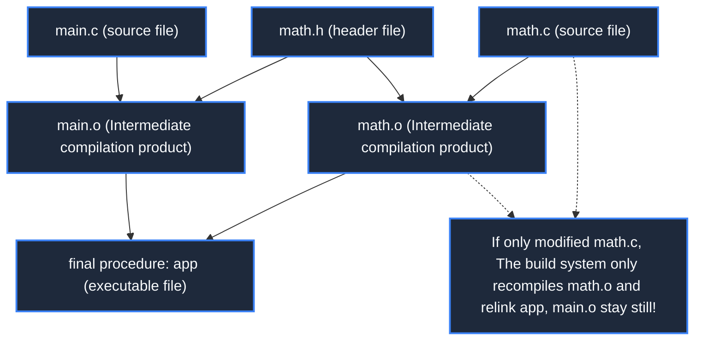
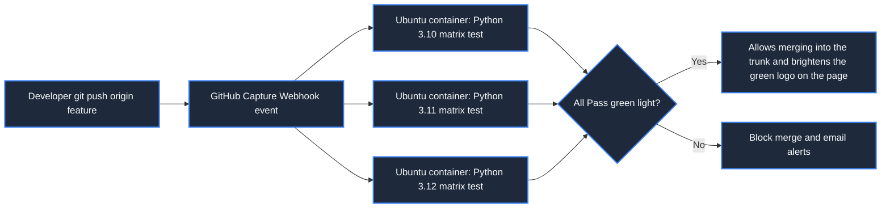

> **Course**: MIT The Missing Semester of Your CS Education, 2020  
> **Course License**: CC BY-NC-SA 4.0.  
> **Module**: Module 3: Version Control and Software Engineering (Software Engineering & Diagnostics)  
> **Lecture team**: Anish Athalye, Jose Javier Gonzalez Ortiz, Philip Levis (MIT CSAIL)  
> **Video duration**: 00:49:56 ｜ **Classroom HD Demonstration Blackboard**: 4 screenshots of the original painting \| **interactive graph**: Mermaid architecture flow chart  
> **Course official handouts**: [📖 MIT official Chinese course handouts](https://missing-semester-cn.github.io/2020/metaprogramming/) ｜ [📺Original YouTube video](https://www.youtube.com/watch?v=_Ms1Z4xfqv4)  
> **Directly connected to station B**: [📺 Watch this high-definition bilingual video on Bilibili (BV1fo4y1M7H6)](https://www.bilibili.com/video/BV1fo4y1M7H6/)  
> **Full book navigation**: [← Previous lecture (L07)](/en/notes/missing-semester/lecture-07) ｜ [📚 Return to the full book catalog](/en/notes/topics/Missing%20Semester) ｜ [Next lecture (L09) →](/en/notes/missing-semester/lecture-09)

---

## Core Introduction and Concept Panorama

Unlock the industrialization code of modern software engineering: "Let the code write the code and let the system build the system". The system deduces the construction system based on the incremental compilation philosophy of directed acyclic dependency graph and timestamps, explains the Make and Makefile mode rules and automatic variables in detail, analyzes the semantic version number (SemVer) and lock file mechanism, and practices the modern CI/CD automated pipeline based on GitHub Actions.

---

## 1. Build Systems Philosophy: Incremental Construction and Dependency Topology

*(Reference timestamp: `00:02:30` · [📺B station video clip jump](https://www.bilibili.com/video/BV1fo4y1M7H6/?t=150))*

For a small program with only a dozen lines, manually type in the terminal  `gcc main.c -o main`  Simple and straightforward. But when the project grows into an industrial-grade software composed of hundreds of source code modules, third-party static libraries, test cases, static front-end resources, and generated documents, a full recompile may take several hours.

**The core mission of building the system is to implement intelligent incremental compilation (Incremental Compilation) based on directed acyclic dependency graph (DAG)**: 
1. The build system clearly knows which prerequisites (Prerequisites) each product (Target) is derived from;
2. The build system checks the target files and dependent files **Last modified timestamp (mtime)**; 
3. **Only when the modification timestamp of a source file is newer than the target product, the corresponding compilation rule is triggered.**! The remaining thousands of unchanged modules skip reuse, reducing build times from hours to 1 second!



[](https://www.bilibili.com/video/BV1fo4y1M7H6/?t=360)
*⏱ Timestamp: 00:06:00 · 📷 Classroom demonstration screenshot · [Watch the corresponding clip on Bilibili (BV1fo4y1M7H6 00:06:00)](https://www.bilibili.com/video/BV1fo4y1M7H6/?t=360)*

## 2. `make`  with  `Makefile`  Core destructuring and automatic variables

*(Reference timestamp: `00:10:15` · [📺B station video clip jump](https://www.bilibili.com/video/BV1fo4y1M7H6/?t=615))*

`make`  It is the most enduring classic build engine in history. Its core configuration file is  `Makefile`, its basic syntax format is as follows:
```makefile
target: prerequisites ...
	recipe
	...
```
> **Extremely fatal iron law of history**: `recipe`  before execution line **Must be a real tab character, never a space!** (This is one of the most infamous syntactic relics from the early history of Unix).

#### Makefile automated variable system
- `$@`: Refers to the target file name of the current rule;
- `$<`: refers to the first dependency file in the prerequisite dependency list;
- `$^`: refers to a list of all prerequisite dependent files (separated by spaces and automatically deduplicated);
- `%.o: %.c`: **Pattern Rule**, telling Make how to convert any  `.c`  The file is compiled into the corresponding  `.o`  file.

```makefile
CC = gcc
CFLAGS = -Wall -O2

# 终极目标
paper.pdf: paper.tex plot.png
	pdflatex paper.tex

plot.png: plot.py data.csv
	python plot.py -i data.csv -o $@

clean:
	rm -f *.o paper.pdf plot.png

.PHONY: clean
```
`.PHONY`  Statement  `clean`  Is a pseudo target (Phony Target) to prevent there happens to be a named  `clean`  The real file causes the command to be judged as "already up to date" and refused to be executed.

[](https://www.bilibili.com/video/BV1fo4y1M7H6/?t=1080)
*⏱ Timestamp: 00:18:00 · 📷 Classroom demonstration screenshot · [Watch the corresponding clip on Bilibili (BV1fo4y1M7H6 00:18:00)](https://www.bilibili.com/video/BV1fo4y1M7H6/?t=1080)*

## 3. Dependency management and semantic versioning (Semantic Versioning)

*(Reference timestamp: `00:23:40` · [📺B station video clip jump](https://www.bilibili.com/video/BV1fo4y1M7H6/?t=1420))*

Modern software engineering relies extensively on open source ecological package managers (Python's pip, Node.js's npm, Rust's cargo). Each dependent package version iteration follows  **SemVer (Semantic Versioning Specification)**: 
$$MAJOR.MINOR.PATCH$$
 For example  `v2.4.1`: 
1. **MAJOR (major version number)**: Contains incompatible API changes that are breaking (Breaking Changes);
2. **MINOR (minor version number)**: New backward compatible features;
3. **PATCH (revision number)**: Backward compatibility issue fixes and bug patches.

#### Why is the lock file related to the life and death of the software?
specified in configuration  `requests = "^2.25.0"`  Allow the package manager to automatically install compatible minor versions. However, if a deep transitive dependency of a dependency releases a patch version that introduces a bug on a certain day, it will cause the code that can run today to crash strangely in the production environment tomorrow!

**Lockfile (such as  `package-lock.json`, `poetry.lock`, `Cargo.lock`) solidifies the absolutely accurate version number and content hash value of each package in the entire dependency tree**, ensuring that when the build is executed on any machine in the world, the restored running environment will be the same.

[](https://www.bilibili.com/video/BV1fo4y1M7H6/?t=1860)
*⏱ Timestamp: 00:31:00 · 📷 Classroom demonstration screenshot · [Watch the corresponding clip on Bilibili (BV1fo4y1M7H6 00:31:00)](https://www.bilibili.com/video/BV1fo4y1M7H6/?t=1860)*

## 4. Continuous integration and delivery (CI/CD): GitHub Actions in action

*(Reference timestamp: `00:36:00` · [📺B station video clip jump](https://www.bilibili.com/video/BV1fo4y1M7H6/?t=2160))*

The concept of \*\*Continuous Integration\*\* is that developers push submissions or initiate Pull Requests to the code repository, and the cloud automation cluster immediately pulls the code and automatically performs code static inspection, full unit testing, and cross-platform compilation in clean isolation containers.

#### GitHub Actions Workflow Deconstruction
in warehouse  `.github/workflows/test.yml`  Configure the declarative pipeline below:
```yaml
name: Test Suite

on: [push, pull_request]

jobs:
  build:
    runs-on: ubuntu-latest
    strategy:
      matrix:
        python-version: ["3.10", "3.11", "3.12"]
    steps:
      - name: 检出代码
        uses: actions/checkout@v4
      - name: 配置 Python 环境
        uses: actions/setup-python@v5
        with:
          python-version: ${{ matrix.python-version }}
      - name: 安装项目依赖
        run: pip install -r requirements.txt
      - name: 运行单元测试
        run: pytest tests/
```
Through the extremely elegant matrix strategy (Matrix), one code submission can automatically complete quality gatekeeping in parallel on the three mainstream Python versions, completely nipping online defects in the bud.



[](https://www.bilibili.com/video/BV1fo4y1M7H6/?t=2460)
*⏱ Timestamp: 00:41:00 · 📷 Classroom demonstration screenshot · [Watch the corresponding clip on Bilibili (BV1fo4y1M7H6 00:41:00)](https://www.bilibili.com/video/BV1fo4y1M7H6/?t=2460)*

---

## Attachment: Knowledge mind map and review thinking of this lecture

This lecture serves as  **Module 3: Version Control and Software Engineering (Software Engineering & Diagnostics)**  The core pillars include a complete closed-loop deduction from theoretical motivations to underlying system calls, from daily high-frequency operations to cutting-edge best practices. It is recommended to combine terminal practical exercises and after-class exercises to internalize the command line and tool chain into subconscious muscle memory.

[← Previous lecture (L07)](/en/notes/missing-semester/lecture-07) ｜ [📚 Return to the full book catalog](/en/notes/topics/Missing%20Semester) ｜ [Next lecture (L09) →](/en/notes/missing-semester/lecture-09)
