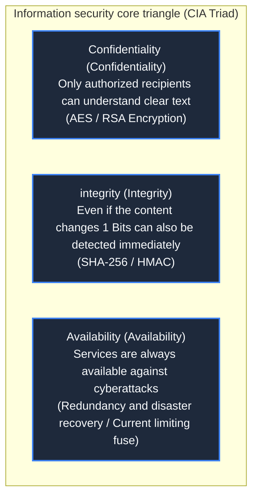
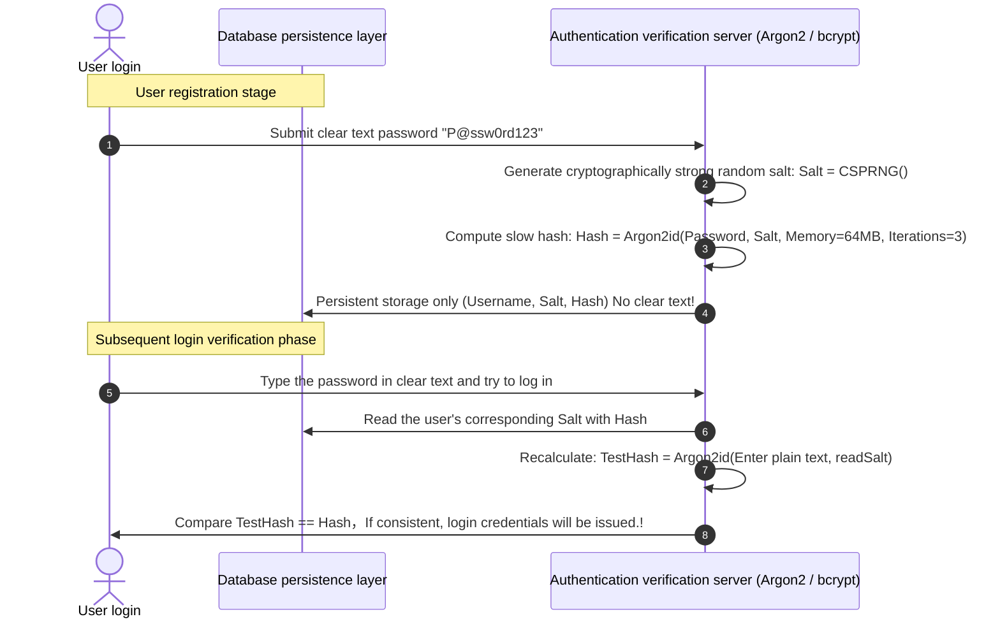
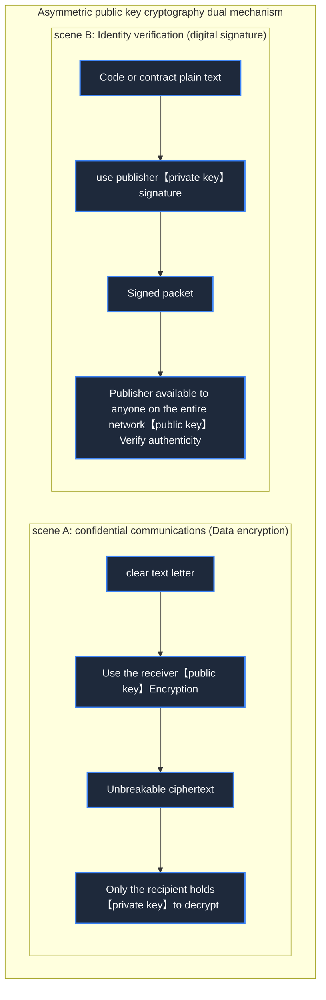
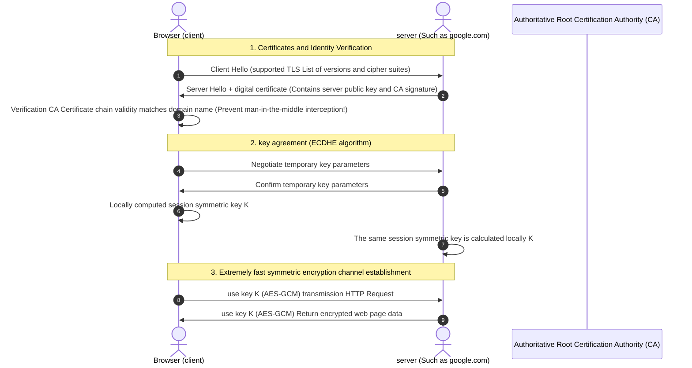

> **Course**: MIT The Missing Semester of Your CS Education, 2020  
> **Course License**: CC BY-NC-SA 4.0.  
> **Module**: Module 4: Security Line of Defense and Advanced Panorama (Security & Advanced Topics)  
> **Lecture team**: Anish Athalye, Jose Javier Gonzalez Ortiz, Philip Levis (MIT CSAIL)  
> **Video duration**: 01:01:03 ｜ **Classroom HD Demonstration Blackboard**: 4 screenshots of the original painting \| **interactive graph**: Mermaid architecture flow chart  
> **Course official handouts**: [📖 MIT official Chinese course handouts](https://missing-semester-cn.github.io/2020/security/) ｜ [📺Original YouTube video](https://www.youtube.com/watch?v=tjwobAmnKTo)  
> **Directly connected to station B**: [📺 Watch this high-definition bilingual video on Bilibili (BV1qP411X7QT)](https://www.bilibili.com/video/BV1qP411X7QT/)  
> **Full book navigation**: [← Previous lecture (L08)](/en/notes/missing-semester/lecture-08) ｜ [📚 Return to the full book catalog](/en/notes/topics/Missing%20Semester) ｜ [Next lecture (L10) →](/en/notes/missing-semester/lecture-10)

---

## Core Introduction and Concept Panorama

Master the mathematics and protocol cornerstones of defense systems in the digital world. Systematically deconstructs the three elements of information security CIA, explains in detail the cryptographic one-way hash function and anti-rainbow table key derivation (KDF), analyzes the two-wheel drive model of symmetric encryption (AES) and asymmetric encryption (RSA/ECC), illustrates the public key infrastructure (PKI), digital certificate chain and TLS handshake anti-middleman tampering mechanism, and provides the daily security self-protection rules necessary for developers.

---

## 1. The cornerstone of information security: CIA three-factor model

*(Reference timestamp: `00:03:15` · [📺B station video clip jump](https://www.bilibili.com/video/BV1qP411X7QT/?t=195))*

In the field of computer security, all security defense mechanisms revolve around the classic  **CIA three elements**  Expand:
1. **Confidentiality**: Protect sensitive information from snooping or eavesdropping by unauthorized third parties (achieved through encryption and decryption technology);
2. **Integrity**: Ensure that any unauthorized tampering, insertion or deletion of data during transmission and storage can be 100% accurately detected (through hashing and digital signatures);
3. **Availability**: Ensure that the system can respond stably when authorized users need to access resources (defend denial-of-service DoS/DDoS attacks and ensure high availability of the cluster).

In addition, modern cryptography also places great emphasis on **Non-repudiation**: After a party signs an operation or statement with its private key, it cannot deny the action afterwards.

*⏱ Timestamp: 00:07:00 · 📷 Classroom demonstration screenshot · [Watch the corresponding clip on Bilibili (BV1qP411X7QT 00:07:00)](https://www.bilibili.com/video/BV1qP411X7QT/?t=420)*

## 2. Cryptographic Hash Functions and Password Storage

*(Reference timestamp: `00:10:40` · [📺B station video clip jump](https://www.bilibili.com/video/BV1qP411X7QT/?t=640))*

Cryptographic hash functions (such as SHA-256) can map input data of arbitrary length into a fixed-length output string (digest) through complex bit obfuscation and compression functions.

#### Core mathematical properties of cryptographically secure hashes
1. **Deterministic**: The same input must produce absolutely the same hash value;
2. **One-way/Pre-image resistance**: given hash value  $h$, it is almost impossible to calculate backwards to find the original plaintext  $m$  make  $hash(m) = h$; 
3. **Avalanche Effect**: Even if only 1 binary bit is changed in the input data, more than 50% of the bits in the output hash value will flip unpredictably;
4. **Strong collision resistance (Collision resistance)**: It is computationally almost impossible to find two different inputs  $m_1 
eq m_2$, making  $hash(m_1) = hash(m_2)$.

#### User password storage pitfalls: Salt and key derivation function (KDF)
If the SHA-256 (or even clear text) of the password is saved directly in the database, after the hacker obtains the database leak, he can brute force crack hundreds of millions of weak passwords in one second through huge pre-computation \*\*Rainbow Tables\*\* or modern GPU computing power!

**Industrial grade defense iron law**: 
- **Salt (random salt)**: Generate a globally unique cryptographically strong random salt for each user when registering, enter the password and then hash it, completely reducing the attacker's universal rainbow table to useless paper;
- **Deliberately slow calculations (KDF)**: Used specifically designed for **Compute-intensive vs. memory-intensive** The key derivation function, such as  **Argon2**, **bcrypt**, **scrypt**. The time taken for a single hash verification is artificially increased from microseconds to about 0.2 seconds. It is imperceptible to users who log in normally, but it can increase the cost of hackers who try to crack offline violently by millions of times!

*⏱ Timestamp: 00:21:00 · 📷 Classroom demonstration screenshot · [Watch the corresponding clip on Bilibili (BV1qP411X7QT 00:21:00)](https://www.bilibili.com/video/BV1qP411X7QT/?t=1260)*

## 3. Symmetric encryption vs asymmetric public key cryptography

*(Reference timestamp: `00:22:30` · [📺B station video clip jump](https://www.bilibili.com/video/BV1qP411X7QT/?t=1350))*

#### Symmetric Cryptography
Encryption and decryption usage **The same shared secret key (Shared Secret Key)**, the representative algorithm is  **AES-256**.
- **Advantages**: Extremely fast, modern CPUs have specialized hardware acceleration instructions (AES-NI) and can throughput gigabytes per second;
- **Disadvantages**: **Key Distribution Problem**. If the communicating parties are thousands of miles apart and have never met, how can they safely hand over this top-secret key to the other party on the unsecured public Internet?

#### Asymmetric public key cryptography (Asymmetric Cryptography)
The cryptographic wonders pioneered by Diffie-Hellman, Rivest-Shamir-Adleman (RSA) and elliptic curve cryptography (ECC, such as X25519, Ed25519). Each entity possesses a mathematically intrinsically related key pair:
- **Public Key**: Fully open and accessible to anyone;
- **Private Key**: It is strictly kept by the owner and must not be disclosed.

#### Two core operating paradigms
1. **Confidential transmission (public key encryption, private key decryption)**: Alice wants to send a private message to Bob, and Alice uses Bob’s **public key** Encryption. The encrypted ciphertext in the world can only have the corresponding **private key** Only Bob himself can solve it!
2. **Digital signature (private key signature, public key signature verification)**: Bob releases a software and uses his own **private key** Compute signatures on software hashes. Anyone in the world can use Bob's **public key** Verify the signature to confirm that the software is 100% from Bob and has not been tampered with by hackers and implanted with Trojans!

*⏱ Timestamp: 00:35:00 · 📷 Classroom demonstration screenshot · [Watch the corresponding clip on Bilibili (BV1qP411X7QT 00:35:00)](https://www.bilibili.com/video/BV1qP411X7QT/?t=2100)*

## 4. PKI public key infrastructure, CA certificate and TLS handshake

*(Reference timestamp: `00:36:15` · [📺B station video clip jump](https://www.bilibili.com/video/BV1qP411X7QT/?t=2175))*

Although asymmetric encryption solves key distribution, it also introduces new fatal attacks——**Man-in-the-Middle (MITM) attack**: If the attacker Eve forges the public key in the middle of the network link and claims to be google.com, how can the client identify the authenticity?

#### CA certificate system and public key infrastructure (PKI)
Operating systems and browsers have built-in trusted **Root Certificate Authorities (CA) **List of public keys (e.g. Let's Encrypt, DigiCert). When the website presents the public key to the user, it comes with a certificate signed by the CA authority's private key.** Digital certificate (X.509 Certificate)**. The client verifies the CA signature chain through layer-by-layer backtracking to confirm the legitimacy of the other party's public key.

#### TLS/HTTPS hybrid encryption handshake process (combining the best of both worlds)
1. The client connects to the server and verifies the validity of the server's CA certificate and domain name;
2. The two parties negotiate a temporary, forward-secure symmetric key through an asymmetric cryptography protocol (ECDHE Elliptic Curve Temporary Key Exchange);
3. Once the negotiation is successful, all subsequent massive web page data will be switched to extremely high-performance \*\*Symmetric Encryption (AES-GCM)\*\* for secure communication!

*⏱ Timestamp: 00:49:00 · 📷 Classroom demonstration screenshot · [Watch the corresponding clip on Bilibili (BV1qP411X7QT 00:49:00)](https://www.bilibili.com/video/BV1qP411X7QT/?t=2940)*

## 5. Daily safety defense rules for programmers

*(Reference timestamp: `00:49:00` · [📺B station video clip jump](https://www.bilibili.com/video/BV1qP411X7QT/?t=2940))*

1. **Fully enabled two-factor authentication (2FA/MFA)**: Prioritize the use of time-based one-time passwords (TOTP, such as Google Authenticator) or FIDO2/WebAuthn hardware security keys (YubiKey), and resolutely abandon fragile SMS verification codes;
2. **Hardcoding any API keys or passwords in Git repositories is strictly prohibited**: Use environment variables and configure before submitting  `git-secrets`  Or pre-commit hook automatic scanning and detection;
3. **Embrace an end-to-end encrypted password manager**: Use Bitwarden or 1Password to generate a random and complex unique password of more than 20 digits to prevent multiple websites from reusing the same password;
4. **Git commit signing**: Configure GPG or SSH Key-based commit signature (`git commit -S`) to display distinguished ones on GitHub  `Verified`  The certification green label proves that the code is indeed submitted by you.

---

## Attachment: Knowledge mind map and review thinking of this lecture

This lecture serves as  **Module 4: Security & Advanced Topics**  The core pillars include a complete closed-loop deduction from theoretical motivations to underlying system calls, from daily high-frequency operations to cutting-edge best practices. It is recommended to combine terminal practical exercises and after-class exercises to internalize the command line and tool chain into subconscious muscle memory.

[← Previous lecture (L08)](/en/notes/missing-semester/lecture-08) ｜ [📚 Return to the full book catalog](/en/notes/topics/Missing%20Semester) ｜ [Next lecture (L10) →](/en/notes/missing-semester/lecture-10)
