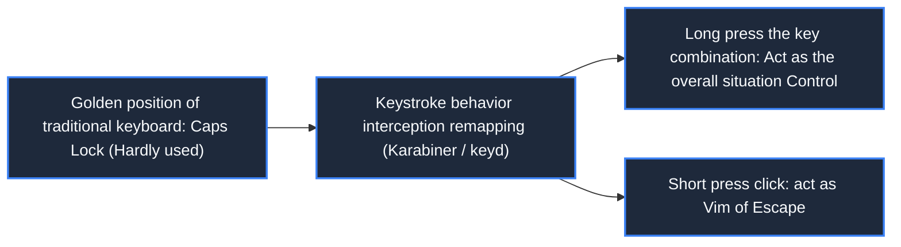
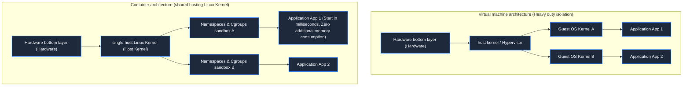

> **Course**: MIT The Missing Semester of Your CS Education, 2020  
> **Course License**: CC BY-NC-SA 4.0.  
> **Module**: Module 4: Security Line of Defense and Advanced Panorama (Security & Advanced Topics)  
> **Lecture team**: Anish Athalye, Jose Javier Gonzalez Ortiz, Philip Levis (MIT CSAIL)  
> **Video duration**: 00:57:58 ｜ **Classroom HD Demonstration Blackboard**: 4 screenshots of the original painting \| **interactive graph**: Mermaid architecture flow chart  
> **Course official handouts**: [📖 MIT official Chinese course handouts](https://missing-semester-cn.github.io/2020/potpourri/) ｜ [📺Original YouTube video](https://www.youtube.com/watch?v=JZDt-PRq0uo)  
> **Directly connected to station B**: [📺Watch this high-definition bilingual video on Bilibili (BV1Ac411V7XM)](https://www.bilibili.com/video/BV1Ac411V7XM/)  
> **Full book navigation**: [← Previous lecture (L09)](/en/notes/missing-semester/lecture-09) ｜ [📚 Return to the full book catalog](/en/notes/topics/Missing%20Semester) ｜ [Next lecture (L11) →](/en/notes/missing-semester/lecture-11)

---

## Core Introduction and Concept Panorama

Award for efficient practice integrating software and hardware interaction and system engineering. Detailed explanation of the keyboard ergonomic key changing strategy, establishment of a 3-2-1 automated snapshot backup system for data disaster prevention, panoramic combing of the technology evolution chain from physical machines, Type-1/Type-2 virtual machines to lightweight Linux containers (Namespaces & Cgroups), and demonstration of the full-keyboard extremely fast desktop flow of the Tiling Window Manager (Tiling WM).

---

## 1. Keyboard Ergonomics Transformation: Save Your Little Finger

*(Reference timestamp: `00:02:40` · [📺B station video clip jump](https://www.bilibili.com/video/BV1Ac411V7XM/?t=160))*

The standard QWERTY keyboard layout has serious ergonomic design flaws due to the mechanical anti-jamming of historical typewriters. In the center of the most precious left-hand typing area, there is an extremely infrequently used and useless  **Caps Lock**; and the most core  **Control**  But the key is squeezed in the far lower left corner, causing programmers to press frequently  `Ctrl+C`, `Ctrl+R`, `Ctrl+W`  When the little finger is forced to undergo counter-physiological excessive twisting (even triggering the famous Emacs hand/carpal tunnel syndrome RSI).

#### The ultimate key changing solution (highly recommended for all programmers to configure!)
- **Option A: Remap Caps Lock to Control**: Let your left hand naturally press down on the main button area to hit Control;
- **Solution B: Intelligent dual-mode mapping (Dual-Role)**: 
  - **Long press**  Caps Lock: Acts as  `Control`; 
  - **click**  Caps Lock: Acts as  `Escape` (The magic tool to get back to Vim's normal mode!).
Karabiner-Elements is available on macOS and Linux  `xmodmap`  or  `keyd`  Easy to implement.

*⏱ Timestamp: 00:07:00 · 📷 Classroom demonstration screenshot · [Watch the corresponding clip on Bilibili (BV1Ac411V7XM 00:07:00)](https://www.bilibili.com/video/BV1Ac411V7XM/?t=420)*

## 2. Data disaster recovery philosophy: 3-2-1 backup iron law and tool chain

*(Reference timestamp: `00:11:30` · [📺B station video clip jump](https://www.bilibili.com/video/BV1Ac411V7XM/?t=690))*

There is a cruel saying in the system administrator world: "There are only two kinds of people in the world: those who have experienced severe data loss, and those who are about to experience severe data loss."

#### Industry’s Golden Backup Rule: The 3-2-1 Principle
1. **3 copies of data**: One production data, two backup copies;
2. **2 different physical media**: For example, one copy is stored on a local NVMe SSD, and the other is stored on a removable mechanical hard drive or local NAS;
3. **1 Off-site Backup**: There must be a backup stored in a cloud object storage (such as AWS S3, Backblaze B2) that is hundreds of kilometers away to prevent local fire, theft or ransomware attacks.

#### Modern automated backup tool: `restic`
A traditional simple copy (e.g.  `cp`) is an extremely waste of disk space. modern tools  **`restic`**  It has four killer features:
- **Client-side end-to-end strong encryption** (Even if the cloud disk is stolen by hackers, no clear text can be seen);
- **Global content chunking and deduplication (Deduplication)**: Modified 1MB of content in the 10GB virtual machine file, and the incremental backup only transfers and stores this 1MB;
- **Snapshot mount (FUSE Mount)**: Ability to directly mount the backup at any historical point in time as a local virtual disk for read-only browsing!

*⏱ Timestamp: 00:20:00 · 📷 Classroom demonstration screenshot · [Watch the corresponding clip on Bilibili (BV1Ac411V7XM 00:20:00)](https://www.bilibili.com/video/BV1Ac411V7XM/?t=1200)*

## 3. Evolution of virtualization technology: physical machines, virtual machines and containers

*(Reference timestamp: `00:23:10` · [📺B station video clip jump](https://www.bilibili.com/video/BV1Ac411V7XM/?t=1390))*

In order to isolate the dependencies of different projects and improve server resource utilization, the computing runtime form has experienced three technological leaps:

#### 1. Bare Metal Physical Machine (Bare Metal)
Applications run directly on the hardware operating system, resulting in strong coupling, environmental pollution, and inability to flexibly divide resources.

#### 2. Virtual Machines (VM)
A complete set of virtual hardware is simulated through Hypervisor (such as KVM, VMware, VirtualBox), and each virtual machine must run a **Complete Guest OS operating system kernel**.
- **Advantages**: Extremely high isolation level (hardware-level security boundary);
- **Disadvantages**: Cumbersome, it takes several minutes to start, and static pre-allocation of memory is expensive.

#### 3. Container technology (Containers, represented by Docker)
Containers are not lightweight virtual machines! **There is no independent operating system kernel in the container. It directly shares the single Linux kernel of the host (Host).**.
The Linux kernel achieves lightweight sandbox isolation through two core underlying features:
- **Namespaces**: Wear a "blind mask" on the process to achieve logical isolation in the view dimension (PID process tree isolation, NET network protocol stack isolation, MNT mount point file system isolation);
- **Cgroups (Control Groups control group)**: Set rigid constraints on the upper limit of physical resources that can be used by the process (limit the container to use up to 2 CPU cores and 4GB of memory).

*⏱ Timestamp: 00:33:00 · 📷 Classroom demonstration screenshot · [Watch the corresponding clip on Bilibili (BV1Ac411V7XM 00:33:00)](https://www.bilibili.com/video/BV1Ac411V7XM/?t=1980)*

## 4. Tiling Window Managers

*(Reference timestamp: `00:37:40` · [📺B station video clip jump](https://www.bilibili.com/video/BV1Ac411V7XM/?t=2260))*

Traditional desktop (macOS Finder, Windows Explorer) adopts **Floating Windows mode**: Windows overlap and block each other. Developers need to frequently use the mouse to drag the corners to adjust the size, and search back and forth on the taskbar to find windows buried at the bottom.

\*\*Tiling Window Manager (Tiling WM, such as Linux's i3/Sway, macOS's yabai/aerospace)\*\* treats the screen as a canvas that can be split recursively seamlessly:
- Each newly opened application is automatically tiled according to the algorithm to occupy the remaining space on the screen, and the windows are seamlessly spaced, with zero overlap and zero dead space;
- Full keyboard shortcuts control everything: `Mod+Enter`  Open the terminal instantly, `Mod+h/j/k/l`  Instantly shift focus, `Mod+1..9`  Switch virtual workspaces instantly. Your fingers are always locked on the keyboard, bringing you the ultimate smooth and immersive flow experience.

*⏱ Timestamp: 00:45:00 · 📷 Classroom demonstration screenshot · [Watch the corresponding clip on Bilibili (BV1Ac411V7XM 00:45:00)](https://www.bilibili.com/video/BV1Ac411V7XM/?t=2700)*

---

## Attachment: Knowledge mind map and review thinking of this lecture

This lecture serves as  **Module 4: Security & Advanced Topics**  The core pillars include a complete closed-loop deduction from theoretical motivations to underlying system calls, from daily high-frequency operations to cutting-edge best practices. It is recommended to combine terminal practical exercises and after-class exercises to internalize the command line and tool chain into subconscious muscle memory.

[← Previous lecture (L09)](/en/notes/missing-semester/lecture-09) ｜ [📚 Return to the full book catalog](/en/notes/topics/Missing%20Semester) ｜ [Next lecture (L11) →](/en/notes/missing-semester/lecture-11)
