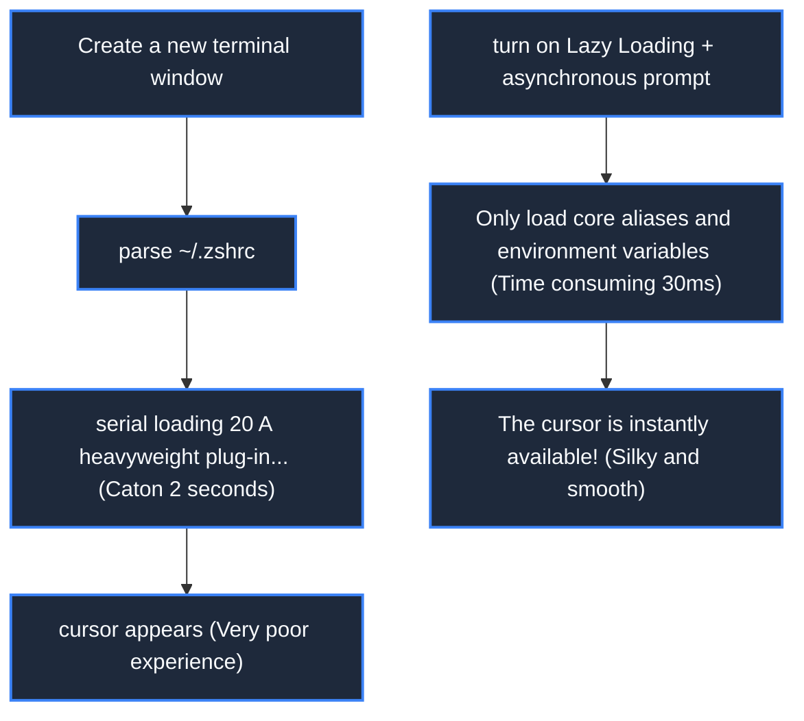

> **Course**: MIT The Missing Semester of Your CS Education, 2020  
> **Course License**: CC BY-NC-SA 4.0.  
> **Module**: Module 4: Security Line of Defense and Advanced Panorama (Security & Advanced Topics)  
> **Lecture team**: Anish Athalye, Jose Javier Gonzalez Ortiz, Philip Levis (MIT CSAIL)  
> **Video duration**: 00:53:56 ｜ **Classroom HD Demonstration Blackboard**: 4 screenshots of the original painting \| **interactive graph**: Mermaid architecture flow chart  
> **Course official handouts**: [📖 MIT official Chinese course handouts](https://missing-semester-cn.github.io/2020/qa/) ｜ [📺Original YouTube video](https://www.youtube.com/watch?v=Wz50FvGG6xU)  
> **Directly connected to station B**: [📺 Watch this high-definition bilingual video on Bilibili (BV12P411X7ey)](https://www.bilibili.com/video/BV12P411X7ey/)  
> **Full book navigation**: [← Previous lecture (L10)](/en/notes/missing-semester/lecture-10) ｜ [📚 Return to the full book catalog](/en/notes/topics/Missing%20Semester) ｜ <span>Next lecture: None (final chapter of the book)</span>

---

## Core Introduction and Concept Panorama

The MIT teaching team provides in-depth Q&A and route guidance for high-frequency real engineering doubts across the entire network. The system analyzes the selection trade-offs and compatibility boundaries of Bash, Zsh, and Fish, teaches microsecond-level diagnosis and tuning methods for shell startup, summarizes the eight iron laws of automated scripts from toys to industrial-level robustness, and provides a panoramic view of lifelong self-study of computer systems and development tool chains.

---

## 1. Common high-frequency tool selection analysis: Bash vs Zsh vs Fish

*(Reference timestamp: `00:03:00` · [📺B station video clip jump](https://www.bilibili.com/video/BV12P411X7ey/?t=180))*

During the Q&A session of the course, one of the questions students were most concerned about was: "There are so many Shells on the market, which one should I use?"

| Shell | Positioning and core advantages | Potential pain points/applicable scenarios |
|---|---|---|
| **Bash** | The de facto common standard in the industry, pre-installed in almost all Linux distributions and servers around the world | The syntax is old and lacks cool auto-completion and syntax highlighting by default. **The default shell and automation scripting language for production servers** |
| **Zsh** | Combines high customization with POSIX compatibility (macOS default shell). Together with Oh My Zsh, it has an extremely prosperous theme and plug-in ecosystem. | Improper plug-in configuration can easily lead to slow startup of the terminal. |
| **Fish** | A geek shell that pursues "out of the box" functionality. Comes with modern syntax highlighting, gray text intelligent suggestions based on historical commands, and a web configuration interface | **Not strictly backwards compatible with POSIX syntax** (Some complex Bash scripts copied online cannot be directly pasted and run without thinking) |

> **Best Practice Tips for Instructors**: **The interactive interface uses Zsh or Fish to improve daily input happiness, and all automated scripts saved as files must be strictly used.  `#!/usr/bin/env bash`  Written to guarantee absolutely deterministic execution across platforms!**

[](https://www.bilibili.com/video/BV12P411X7ey/?t=420)
*⏱ Timestamp: 00:07:00 · 📷 Classroom demonstration screenshot · [Watch the corresponding clip on Bilibili (BV12P411X7ey 00:07:00)](https://www.bilibili.com/video/BV12P411X7ey/?t=420)*

## 2. Troubleshooting terminal lag: Why does it take 2 seconds for my terminal to open?

*(Reference timestamp: `00:13:30` · [📺B station video clip jump](https://www.bilibili.com/video/BV12P411X7ey/?t=810))*

After many students installed various cool terminal plug-in frameworks (such as Oh My Zsh, nvm, pyenv, conda), they found that every time they created a new Tab in the terminal, they would be visibly stuck for several seconds, seriously damaging the operation flow.

#### The Ultimate Tool for Performance Diagnostics: Zsh Built-in Profiler  `zprof`
in  `~/.zshrc`  of **Top first row** Join:
```zsh
zmodload zsh/zprof
```
in  `~/.zshrc`  of **bottom last line** Join:
```zsh
zprof
```
After saving and reopening the terminal, the console will immediately print out a function call cost list in reverse order of time consumption:
```
num  calls                time                       self            name
-------------------------------------------------------------------------
 1)    1         345.12   345.12   54.2%    345.12   345.12   54.2%  nvm_auto
 2)    1         120.45   120.45   18.9%    120.45   120.45   18.9%  git_prompt_info
```
You can find out at a glance which plug-in scanned the entire hard drive or made inefficient network requests at startup!

#### The golden rule for targeted speed-up
- **Lazy Loading**: will  `nvm`, `pyenv`, `conda`  When the heavy initialization is postponed until the moment the command is actually typed, the terminal startup time drops from 2.5 seconds to 0.05 seconds!
- **Choose an asynchronous Git prompt plugin**: Such as  `starship`  or  `pure`, prompt calculation runs in an independent thread in the background, never blocking the main typing process.



[](https://www.bilibili.com/video/BV12P411X7ey/?t=1260)
*⏱ Timestamp: 00:21:00 · 📷 Classroom demonstration screenshot · [Watch the corresponding clip on Bilibili (BV12P411X7ey 00:21:00)](https://www.bilibili.com/video/BV12P411X7ey/?t=1260)*

## 3. Eight principles for industrial-grade robustness of automated scripts

*(Reference timestamp: `00:26:00` · [📺B station video clip jump](https://www.bilibili.com/video/BV12P411X7ey/?t=1560))*

There is a huge difference between writing a script that you can only run once and writing a script that can run maintenance-free for a long time in the server production line.

#### The "Four Guardians" Instructions for Robust Scripts
At the head of every serious Bash script, be sure to write this line of magic configuration:
```bash
set -euo pipefail
IFS=$'
	'
```
1. **`-e`(errexit)**: Once any line of command returns a non-zero failure, the script will immediately interrupt and exit to prevent avalanche execution from continuing in the error state;
2. **`-u`(nounset)**: When undefined variables are referenced, an error is reported and exited directly to prevent accidental deletion of system files caused by incorrect variable names;
3. **`-o pipefail`**: As long as any link in the pipeline fails, the entire pipeline is judged to have failed (by default, Bash only checks the status code of the last command in the pipeline!);
4. **`IFS`(Internal Field Separator)**: Limit the default field separator to newlines and tabs to avoid accidental segmentation when parameters contain spaces.

[](https://www.bilibili.com/video/BV12P411X7ey/?t=2040)
*⏱ Timestamp: 00:34:00 · 📷 Classroom demonstration screenshot · [Watch the corresponding clip on Bilibili (BV12P411X7ey 00:34:00)](https://www.bilibili.com/video/BV12P411X7ey/?t=2040)*

## 4. Programmer’s path to advancement and life-long learning suggestions

*(Reference timestamp: `00:40:00` · [📺B station video clip jump](https://www.bilibili.com/video/BV12P411X7ey/?t=2400))*

"The Missing Lesson in Computer Education" ends here, but your journey of tool exploration has just begun. The teaching team left three thought-provoking thoughts in the conclusion of the course:

1. **Be impatient with inefficiency**: If you need to do a boring mechanical task a second time, think about whether you can write a 3-line script to automate it; if you find a shortcut key that you need to press 5 times, spend 10 minutes researching whether there is a one-key direct solution;
2. **Read the official documentation and manual of the tool (Read the Docs)**: When you encounter an unfamiliar command, don’t just go to StackOverflow and copy the first line, take two minutes to scan it.  `tldr`  or  `man`, you can often find elegant options that will surprise you;
3. **Be curious and open to the open source community**: Explore the excellent GitHub dotfiles warehouse, dismantle the workflow of high-level engineers, actively try new tools, and hone the "digital exoskeleton" that best suits you in practice.

[](https://www.bilibili.com/video/BV12P411X7ey/?t=2760)
*⏱ Timestamp: 00:46:00 · 📷 Classroom demonstration screenshot · [Watch the corresponding clip on Bilibili (BV12P411X7ey 00:46:00)](https://www.bilibili.com/video/BV12P411X7ey/?t=2760)*

---

## Attachment: Knowledge mind map and review thinking of this lecture

This lecture serves as  **Module 4: Security & Advanced Topics**  The core pillars include a complete closed-loop deduction from theoretical motivations to underlying system calls, from daily high-frequency operations to cutting-edge best practices. It is recommended to combine terminal practical exercises and after-class exercises to internalize the command line and tool chain into subconscious muscle memory.

[← Previous lecture (L10)](/en/notes/missing-semester/lecture-10) ｜ [📚 Return to the full book catalog](/en/notes/topics/Missing%20Semester) ｜ <span>Next lecture: None (final chapter of the book)</span>
