> **Lecture** The following is a list of the most common causes of death in children:  
> **The product** VideoBook: Video open source technology and e-books flow waterline  
> **Full size of book** The following are the main topics covered: 35 full-length editions; 5 major knowledge system modules; 357 original high definition tablets; 260 core introduction time frames.  
> **Video source**: [The official full set of Bilibili (BV1ix411f7Yp)](https://www.bilibili.com/video/BV1ix411f7Yp/) · [MIT OpenCourseWare 18.06 (Spring 2010)](https://ocw.mit.edu/courses/18-06-linear-algebra-spring-2010/)  
> **Copyright and licenses**: The text content and formula graphics are compiled and structured by MIT OCW Open Course Materials Translation, instructor Gilbert Strang, following  [CC BY-NC-SA 4.0](https://creativecommons.org/licenses/by-nc-sa/4.0/)  Knowledge Sharing License Agreement. Full bookshelf clips are taken from the official public lecture video.

---

## Editor's note: Why read this full-length MIT 18.06 linear algebra?

In the learning hall of linear algebra, Professor Gilbert Strang's MIT 18.06 course is recognized as the most outstanding and inspirational classic work. With unparalleled intuitive geometric insight and in-depth inference, he transformed a matrix computation of the original dry abstraction into vivid geometric images.

However, traditional online video has limited information density, difficulty in tracing and difficulty in directly copying formulas; while paper lectures on the market lack the real-world feel and dynamic rhythm of video boards.

The book is based on  **VideoBook - The video technology of the electronic book system** The first of these, the "Systematic and Panoramic Digital Re-engineering", was conducted on a total of 35 sets:
1. **The entire book is in one volume, with 357 selected original high-quality printed book entries.** Each theorem, each geometrical coordinate map, and each matrix elimination real-time calculation intercepted a video native image. Each of the images below has an exact time code with a single click to jump B. The direct hyperlink to the corresponding moment in the original video is provided;
2. **Strictly complete mathematical derivation with LaTeX/MathML formula**: formulae fully covering line diagrams, elimination method, LU/QR/SVD breakdown, projection matrix, feature systems, power systems and least squares method;
3. **Mermaid Structural Topography and Geometrical Direction Flow**: Translate algebraic derivations into intuitive logical flow charts and spatial relationships;
4. **The whole time of the book is connected to video**: Whether the header of the chapter, the reference time code for each subsection, or each lecture screenshots, is accompanied by a precise time stamped hyperlink to the number of seconds for the B station player.

---

> 📚 **Module overview** Starting with the classical unified system of equations, build a linear diagram (super-plane junction) of the algebra and vectorlinear combination (vectorlinear combinations) of two geometrical graphs; then delve deeper into the Gaussian elimination algorithm, primary matrix algebra, inverse matrix and Gaussian-Rohl inversion method, and finally extract the numerical algebraic basis for the calculus. $A = LU$  and  $PA = LU$  The matrix is broken down.

---

## Description: Geometric interpretation of system of equations

> 📺 **Video link back**: [B Station 1 P: Geometric Explanation of the System of Equations](https://www.bilibili.com/video/BV1ix411f7Yp/?p=1) (⏱ 39m 50s · 10 screenshots)  
> 📖 **Official material**: [MIT OCW correspondence and summary](https://ocw.mit.edu/courses/18-06-linear-algebra-spring-2010/resources/lecture-1-the-geometry-of-linear-equations/)  
> 💡 **Key ideas** Linear combination of a line graph with a linear viewpoint, intersection of a straight line with a lineal vector, matrix essence of ax = b.

---

### 1. The core perspective of linear algebra: from system of equations to matrix

*reference timestamp: 00:01:30...  [Watch clip (P1 00:01:30)](https://www.bilibili.com/video/BV1ix411f7Yp/?p=1&t=90))*

The most fundamental point of departure for linear algebra is to solve a group of linked linear algebra system of equationss.

In primary algebra, we are used to gradual elimination or substitution of solutions; but in modern mathematics and engineering science, we must establish two completely different geometric observations: **The Row Picture **with** The Column Picture**.

#### 1.1 Classics  $2 \times 2$  Examples

We start with the simplest two-dimensional linear system:

$$
\begin{cases}
2x - y = 0 \\
-x + 2y = 3
\end{cases}
$$

The unknown numbers and coefficients are extracted and written in the standard matrix form:

$$
\boxed{Ax = b} \iff \begin{bmatrix} 2 & -1 \\ -1 & 2 \end{bmatrix} \begin{bmatrix} x \\ y \end{bmatrix} = \begin{bmatrix} 0 \\ 3 \end{bmatrix}
$$

- The coefficient matrix  $A = \begin{bmatrix} 2 & -1 \\ -1 & 2 \end{bmatrix}$
- Unknown vector  $x = \begin{bmatrix} x \\ y \end{bmatrix}$
- Right-handed vector  $b = \begin{bmatrix} 0 \\ 3 \end{bmatrix}$

*⏱ Timestamp: 00:03:30 · 📷 Lecture screenshot · [Watch clip (P1 00:03:30)](https://www.bilibili.com/video/BV1ix411f7Yp/?p=1&t=210)*

---

### 2. Two geometric images of two-dimensional situations

#### 2.1 The Row Picture: Intersection of the straight lines

*reference timestamp: 00:04:20...  [Watch clip (P1 00:04:20)](https://www.bilibili.com/video/BV1ix411f7Yp/?p=1&t=260))*

In the graph, we're going to use a system of equations **Each equation is viewed as a separate geometric object.**: 

1. **The first equation** $2x - y = 0$ This is a passage from the original:  $(0, 0)$  The slope of the line is 2.  $x = 1$ The  $y = 2$.
2. **The second equation** $-x + 2y = 3$ When:  $x = 0$  The time  $y = 3/2$ When  $x = 1$  The time  $y = 2$ When  $y = 0$  The time  $x = -3$.

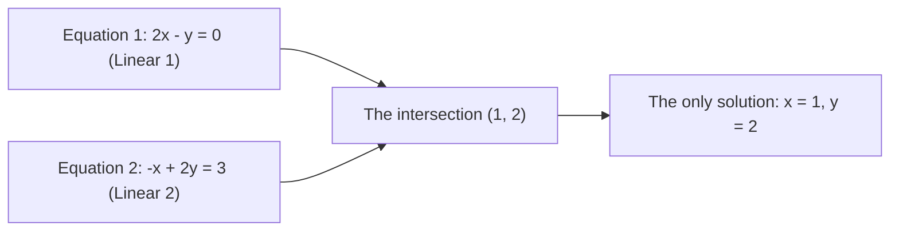

In a right-angled coordinate system, these two lines intersect at the only common point:

$$
(x, y) = (1, 2)
$$

This is the answer given by the chart: **The solution is the super-plane public intersection represented by all equations.**.

*⏱ Timestamp: 00:06:40 · 📷 Lecture screenshot · [Watch clip (P1 00:06:40)](https://www.bilibili.com/video/BV1ix411f7Yp/?p=1&t=400)*

#### 2.2 Column Picture: linear combination of vectors

*reference timestamp: 00:08:40...  [Watch clip (P1 00:08:40)](https://www.bilibili.com/video/BV1ix411f7Yp/?p=1&t=520))*

Now, let's get to the core of the whole course and the most inspiring perspective. **List of countries**.

We're going to multiply the matrix by  $Ax = b$  The following is a list of the most common types of data breaches.

$$
x \begin{bmatrix} 2 \\ -1 \end{bmatrix} + y \begin{bmatrix} -1 \\ 2 \end{bmatrix} = \begin{bmatrix} 0 \\ 3 \end{bmatrix}
$$

> **The key definition is linear combination (Linear Combination).**  
> The scale  $x$  The first row vector is multiplied by the scale.  $y$  The second row vector is a line vector. **Linear combination**.  
> Solving the equation  $Ax = b$  The problem, from a grid perspective, is: **What coefficients do we need to use?  $x, y$ (I think it's a good idea to  $A$  The two columns of vectors synthesized by the target vector  $b$?**

*⏱ Timestamp: 00:10:00 · 📷 Lecture screenshot · [Watch clip (P1 00:10:00)](https://www.bilibili.com/video/BV1ix411f7Yp/?p=1&t=600)*

The two column vectors are shown in the plane of a right-angled coordinate system:
- The first row vector: $u = \begin{bmatrix} 2 \\ -1 \end{bmatrix}$ (To the right, 2 down)
- The second row vector: $v = \begin{bmatrix} -1 \\ 2 \end{bmatrix}$ (To the left, up 2)
- The target vector: $b = \begin{bmatrix} 0 \\ 3 \end{bmatrix}$ (located in the right)  $y$  On the axis)

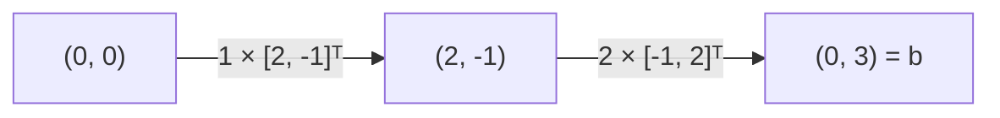

We just need one.  $u$  And two  $v$: 
$$
1 \begin{bmatrix} 2 \\ -1 \end{bmatrix} + 2 \begin{bmatrix} -1 \\ 2 \end{bmatrix} = \begin{bmatrix} 2 - 2 \\ -1 + 4 \end{bmatrix} = \begin{bmatrix} 0 \\ 3 \end{bmatrix}
$$

We go one step along the first vector and two steps along the second vector, precisely to reach the target vector.  $b$ This gives an immediate answer to the equation: $x = 1, y = 2$.

*⏱ Timestamp: 00:13:30 · 📷 Lecture screenshot · [Watch clip (P1 00:13:30)](https://www.bilibili.com/video/BV1ix411f7Yp/?p=1&t=810)*

---

### 3. The three-dimensional system: $3 \times 3$  system of linear equations

*reference timestamp: 16:40...  [Watch clip (P1 00:16:40)](https://www.bilibili.com/video/BV1ix411f7Yp/?p=1&t=1000))*

When the unknown number increases to three, the performance of linear and lattice graphs becomes a huge field.

Consider the following:  $3 \times 3$  Linear systems:

$$
\begin{cases}
2x - y = 0 \\
-x + 2y - z = -1 \\
-3y + 4z = 4
\end{cases}
$$

The matrix is as follows:

$$
\begin{bmatrix} 2 & -1 & 0 \\ -1 & 2 & -1 \\ 0 & -3 & 4 \end{bmatrix} \begin{bmatrix} x \\ y \\ z \end{bmatrix} = \begin{bmatrix} 0 \\ -1 \\ 4 \end{bmatrix}
$$

*⏱ Timestamp: 00:17:40 · 📷 Lecture screenshot · [Watch clip (P1 00:17:40)](https://www.bilibili.com/video/BV1ix411f7Yp/?p=1&t=1060)*

#### 3.1 The difficulty of 3D mapping: the intersection of space in three planes

In three-dimensional space, each equation represents one **The two-dimensional plane (Plane)**: 
1. The first equation  $2x - y = 0$  The first is the vertical  $xy$  The plane, along the line  $z$  The plane of the axis extending;
2. The second equation  $-x + 2y - z = -1$  The second slope of the plane is determined by a line that intersects the first plane **The space line**; 
3. The third equation  $-3y + 4z = 4$  The third plane is determined, which crosses this line at a certain height.

The three planes of intersection eventually lock one in space. **The isolation point**.

However, it is extremely difficult to draw intersections and junctions of three planes that are tilted towards each other on a blackboard or paper surface, and when the dimensions increase to 4D, 9D, or even 100D, the super-plane intersection upon which linear graphs depend is not entirely intuitive in the mind.

*⏱ Timestamp: 00:21:00 · 📷 Lecture screenshot · [Watch clip (P1 00:21:00)](https://www.bilibili.com/video/BV1ix411f7Yp/?p=1&t=1260)*

#### 3.2 Power of 3D charts: Always draw vectors in space

*(reference timestamp: 00:22:00)  [Watch clip (P1 00:22:00)](https://www.bilibili.com/video/BV1ix411f7Yp/?p=1&t=1320))*

Instead, the diagram is still clear in 3D space:

$$
x \begin{bmatrix} 2 \\ -1 \\ 0 \end{bmatrix} + y \begin{bmatrix} -1 \\ 2 \\ -3 \end{bmatrix} + z \begin{bmatrix} 0 \\ -1 \\ 4 \end{bmatrix} = \begin{bmatrix} 0 \\ -1 \\ 4 \end{bmatrix}
$$

Observing the target vector  $b = \begin{bmatrix} 0 \\ -1 \\ 4 \end{bmatrix}$ It's just that,  $A$  The third row vector itself!  
So we can see at a glance that the exact interpretation of this system is:

$$
x = 0, \quad y = 0, \quad z = 1
$$

In 3D space, the graph requires only that we extract 3 row vectors from the original point and then add the target vector by multiplying and adding.  $b$ No matter how high the dimensions, **The algebra of "vector linear combination" remains the same as geometry.**.

*⏱ Timestamp: 00:24:30 · 📷 Lecture screenshot · [Watch clip (P1 00:24:30)](https://www.bilibili.com/video/BV1ix411f7Yp/?p=1&t=1470)*

---

### 4. Nuclear psychology asks: $Ax = b$  to arbitrary  $b$  Do you understand?

*(reference timestamp: 00:27:50)  [Watch clip (P1 00:27:50)](https://www.bilibili.com/video/BV1ix411f7Yp/?p=1&t=1670))*

Professor Strang poses one of the most important theoretical questions in the entire course:

> **The matrix for the given matrix  $A$ whether the right-handed end of an arbitrary choice  $b$, $Ax = b$  You know what I mean?**

In the language of a table, this question is equivalent to:  
**“$A$  The linear combination of all possible vectors can be filled with the entire space in three dimensions.  $\mathbb{R}^3$?”**

*⏱ Timestamp: 00:28:10 · 📷 Lecture screenshot · [Watch clip (P1 00:28:10)](https://www.bilibili.com/video/BV1ix411f7Yp/?p=1&t=1690)*

#### Invertible / Non-singular)

If the matrix is  $A$  The column vector points to three completely independent directions in 3D space (non-convergent), then by changing the combination coefficient  $x, y, z$ The two lines of linear combination are the same.  $\mathbb{R}^3$  In space **Any point**.

This time:
- The following is a list of the  $b$ The equation  $Ax = b$  I'm not sure what the answer is.
- The matrix  $A$  Yes, I did. **The invertiblematrix is the invertible matrix.**.

#### 4.2 Singular / Non-invertible: the vector array together

*(reference timestamp: 00:30:30 ·)  [Watch clip (P1 00:30:30)](https://www.bilibili.com/video/BV1ix411f7Yp/?p=1&t=1830))*

If there is a correlation between certain columns of the matrix, for example if the third row vector happens to be in the plane where the first two columns have been arranged:

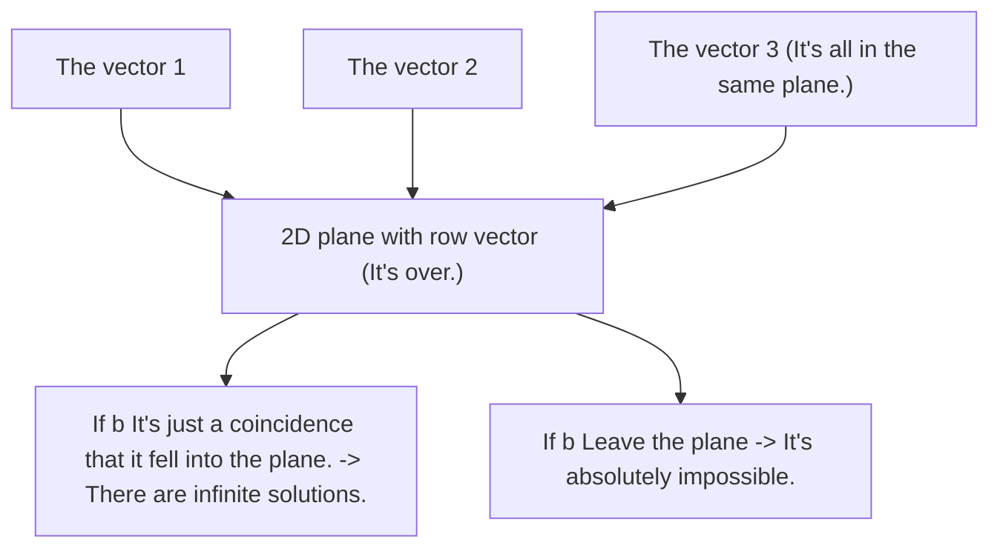

And then, whatever the coefficient  $x, y, z$  How to select any linear combination of these three column vectors **And they're all trapped in this two-dimensional plane.** It is impossible to escape into three-dimensional space beyond the plane!

The result is:
- Only when  $b$  And it's just that when I get on this plane, $Ax = b$  The solution is to solve the problem and because the vectors can be interchanged, there are **The answer is infinite.**); 
- Once you've got it  $b$  So, a little bit further away from this plane, the system of equations is going to be **It's absolutely impossible.**!
- The matrix is now  $A$  It is called **The singular matrix is the same as the singular matrix. **Or** The singular matrix**.

*⏱ Timestamp: 00:31:00 · 📷 Lecture screenshot · [Watch clip (P1 00:31:00)](https://www.bilibili.com/video/BV1ix411f7Yp/?p=1&t=1860)*

This geometric diagram is the intuitive matrix of successive column space (column space) and rank (rank) and linearly dependent linear independence (linear independence).

---

### The definition of matrix multiplication: linear combination

*(reference timestamp: 00:35:40 · [Watch clip (P1 00:35:40)](https://www.bilibili.com/video/BV1ix411f7Yp/?p=1&t=2140))*

At the end of this talk, Professor Strang makes a fundamental reformulation of the inverse matrix by multiplying the vector inverse to disrupt the habits of beginners.

Calculation in traditional teaching  $Ax$  Usually: the first line is multiplied by a point on the vector, and the second line is multiplies by a point.

In modern linear algebra, however, it is necessary to consider the matrix as a vector:

$$
\boxed{Ax = x_1 (\text{col}_1) + x_2 (\text{col}_2) + \cdots + x_n (\text{col}_n)}
$$

**$Ax$  It's the matrix.  $A$  The linear combination of vectors with the same coefficient as the vector  $x$  of the various proportions.**

For example:

$$
\begin{bmatrix} 2 & 5 \\ 1 & 3 \end{bmatrix} \begin{bmatrix} 1 \\ 2 \end{bmatrix} = 1 \begin{bmatrix} 2 \\ 1 \end{bmatrix} + 2 \begin{bmatrix} 5 \\ 3 \end{bmatrix} = \begin{bmatrix} 12 \\ 7 \end{bmatrix}
$$

The point of view of the dot product line is that  $(2\times 1 + 5\times 2 = 12)$  and  $(1\times 1 + 3\times 2 = 7)$ But from the linear combination perspective of a column, this is a vector synthesis of column 1 and column 2 of column 1.

This understanding of the multiplication of discrete numbers, and the elevation of geometry for space, is the cornerstone of all the courses.

*⏱ Timestamp: 00:36:20 · 📷 Lecture screenshot · [Watch clip (P1 00:36:20)](https://www.bilibili.com/video/BV1ix411f7Yp/?p=1&t=2180)*

---

### 6. The discussion of the mind map and the core concept counter-table

#### 6.1 Thinking map: contrast between line charts and lists

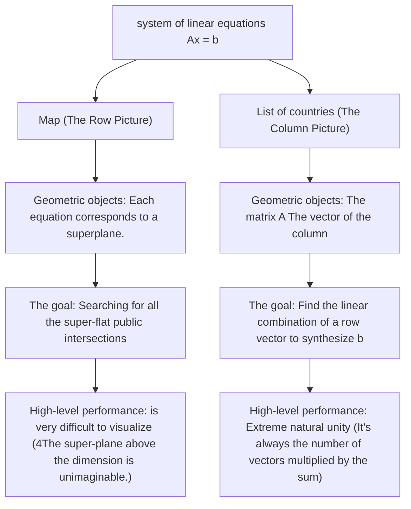

#### 6.2 Concepts and geometrical counterfacts

| The core concepts | Mathematical expression | Geometric meanings / Core understanding |
| :--- | :--- | :--- |
| **Map** | The set of all linear equations | The geometrical junction of the superplane (direct/flat) |
| **List of countries** | $\sum x_i \text{col}_i = b$ | Linear combination and synthesis of vectors according to weight |
| **Linear combination** | $c_1 v_1 + c_2 v_2 + \cdots$ | The most central unit of operation in linear algebra |
| **The existence of the solution** | $b$  Whether or not it is in the space listed | Target vector  $b$  Whether to get from column vector linear combination |
| **The Matrix of Strangeness** | V-vector shared/related | The problem is that the whole space cannot be filled, and there are solutions that can't be solved.  $b$ |
| **matrix times vector** | $Ax$ | **$A$  The vector of the row is  $x$  Linear combination for weight** |

---

### Additional: Official reference and extended reading

1. **The main page of the MIT OpenCourseWare course**:   
   [MIT 18.06 Linear Algebra (Spring 2010)](https://ocw.mit.edu/courses/18-06-linear-algebra-spring-2010/)
2. **1 Talk about video and official subtitle resources**:   
   [Lecture 1: The Geometry of Linear Equations](https://ocw.mit.edu/courses/18-06-linear-algebra-spring-2010/resources/lecture-1-the-geometry-of-linear-equations/)
3. **MIT OCW Scholar's supporting lectures and course summaries**:   
   [Unit I: Session 1 - The Geometry of Linear Equations Summary (PDF)](https://ocw.mit.edu/courses/18-06sc-linear-algebra-fall-2011/pages/ax-b-and-the-four-subspaces/the-geometry-of-linear-equations/)
4. **Recommended Teaching Materials**:   
   Gilbert Strang, *Introduction to Linear Algebra*, 4th/5th Edition, Section 1.1: "Vectors and Linear Combinations", Section 1.2: "Lengths and Dot Products", Section 2.1: "Vectors and Linear Equations".

---

## The second is matrixelimination.

> 📺 **Video link back**: [B Station 2 P: matrixelimination and first-class matrix](https://www.bilibili.com/video/BV1ix411f7Yp/?p=2) (⏱ 47m 42s · 10 screenshots)  
> 📖 **Official material**: [MIT OCW correspondence and summary](https://ocw.mit.edu/courses/18-06-linear-algebra-spring-2010/resources/lecture-2-elimination-with-matrices/)  
> 💡 **Key ideas** The following are the results: Gauss elimination algorithm, pivot selection principle, failure and substitution, augmented matrix and inverse solution.

---

### 1. The core idea of the law of elimination

*reference timestamp: 00:01:30...  [Watch clip (P2 00:01:30)](https://www.bilibili.com/video/BV1ix411f7Yp/?p=2&t=90))*

If the first one shows us a poetic puzzle in linear algebraic geometry (the junction of lines and linear combinations of charts), then the second one goes back to the most robust, most common algorithmic engine in engineering computation. **The first is the Gaussian Elimination.**.

Whether it is facing three equations or 3,000, the goal of elimination law is always one: **Systematically eliminate the unknowns, transforming a complex combined system of equations into an extremely simple triangular system (Upper Triangular System) that can then be solved easily by reversing the Back Substitution.**.

We will be doing something very representative  $3 \times 3$  The system of linear equations is a whole story:

$$
\begin{cases}
x + 2y + z = 2 \\
3x + 8y + z = 12 \\
4y + z = 2
\end{cases}
$$

The coefficient matrix  $A$  The following:

$$
A = \begin{bmatrix} 1 & 2 & 1 \\ 3 & 8 & 1 \\ 0 & 4 & 1 \end{bmatrix}
$$

---

### 2. The birth of gradual elimination and pivot (Pivots)

*reference timestamp: 00:04:10...  [Watch clip (P2 00:04:10)](https://www.bilibili.com/video/BV1ix411f7Yp/?p=2&t=250))*

The basic rule of elimination is the first line transformation: **Subtract from the other row after multiplying one row by a non-zero constant**.

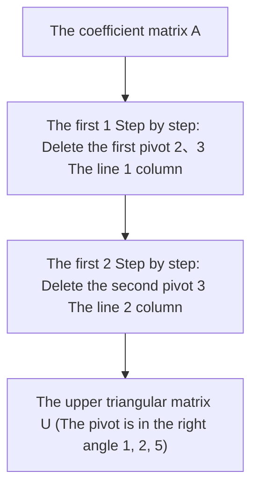

#### 2.1 First pivot and first row elimination

- **The first pivot** Number 1 in the first row of line 1, i.e.  $d_1 = 1$.
- **It disappears.  $(2,1)$  The elements** The first line of the second row is 3. We need to calculate multiples: 
  $$l_{21} = \frac{A_{21}}{A_{11}} = \frac{3}{1} = 3$$
   Execute operation: Line 2 of the string subtracted by 3 times line 1 of the string: 
  $$\text{行}_2 - 3 \times \text{行}_1 = [3, 8, 1] - 3 \times [1, 2, 1] = [0, 2, -2]$$
- **Check the  $(3,1)$  The elements** Line 3: The first row of line 3 is 0, so multiply it.  $l_{31} = 0$ No need to operate.

The matrix is then transformed into:

$$
\begin{bmatrix} \mathbf{1} & 2 & 1 \\ 0 & 2 & -2 \\ 0 & 4 & 1 \end{bmatrix}
$$

*⏱ Timestamp: 00:04:40 · 📷 Lecture screenshot · [Watch clip (P2 00:04:40)](https://www.bilibili.com/video/BV1ix411f7Yp/?p=2&t=280)*

#### 2.2 Second pivot and second row elimination

*(reference timestamp: 00:07:00 )  [Watch clip (P2 00:07:00)](https://www.bilibili.com/video/BV1ix411f7Yp/?p=2&t=420))*

- **The second pivot** The new element in the second row of line 2 is:  $d_2 = 2$.
- **It disappears.  $(3,2)$  The elements**: The number in row 3, column 2, is 4. Calculate the corresponding elimination multiplier: 
  $$l_{32} = \frac{4}{2} = 2$$
   Execute operation: Line 3 of the string subtracted by 2 times line 2 of the string: 
  $$\text{行}_3 - 2 \times \text{行}_2 = [0, 4, 1] - 2 \times [0, 2, -2] = [0, 0, 5]$$

The matrix is then completely transformed into an upper triangle, which is marked as  $U$: 

$$
U = \begin{bmatrix} \mathbf{1} & 2 & 1 \\ 0 & \mathbf{2} & -2 \\ 0 & 0 & \mathbf{5} \end{bmatrix}
$$

- **The third pivot** Located in line 3 column 3:  $d_3 = 5$.

> **The pivot can never be zero.**  
> The pivot is the divisor in elimination. Professor Strang emphasizes that: "Well, I will never accept 0 as a pivot and I will never say '0' as a pivote".

*⏱ Timestamp: 00:08:40 · 📷 Lecture screenshot · [Watch clip (P2 00:08:40)](https://www.bilibili.com/video/BV1ix411f7Yp/?p=2&t=520)*

---

### 3. Two cases where elimination failed

*reference timestamp: 10:40...  [Watch clip (P2 00:10:40)](https://www.bilibili.com/video/BV1ix411f7Yp/?p=2&t=640))*

elimination When will the law encounter obstacles? pivot When position 0 appears, it is divided into two types of situations:

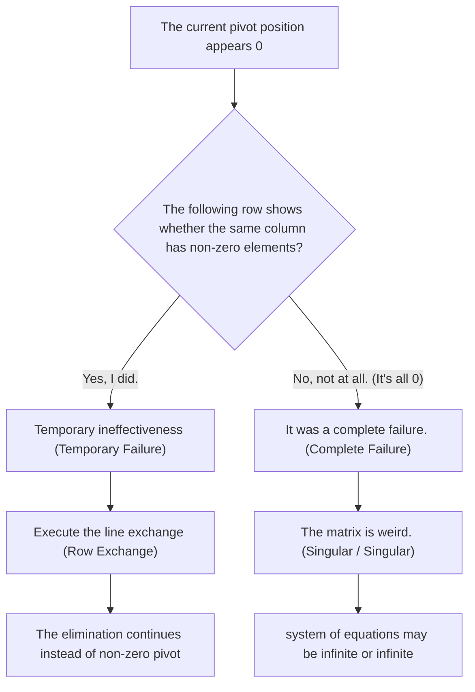

1. **Temporary Failure, which can be fixed by line exchange)**:   
   If the current pivot position is 0, but **The following row has non-zero elements in the corresponding row** We can do both lines directly. **The following is a list of the most common types of currency in the world.** The elimination process continues with the addition of non-zero elements as a legitimate pivot.
2. **Total lapse (Complete Fairure, irreversible/unreversible matrix)**:   
   If the pivot position is 0, and **So all the rows below are all zero.** The matrix is singular, it cannot align three non-zero pivot systems with the system of equations that are either completely unanswered or infinitely many solutions exist.

*⏱ Timestamp: 00:11:40 · 📷 Lecture screenshot · [Watch clip (P2 00:11:40)](https://www.bilibili.com/video/BV1ix411f7Yp/?p=2&t=700)*

---

### 4. augmented matrix with back substitution

*(reference timestamp: 00:130.)  [Watch clip (P2 00:14:30)](https://www.bilibili.com/video/BV1ix411f7Yp/?p=2&t=870))*

The elimination is not just a left-handed coefficient matrix.  $A$  The constant vector on the right side of the equation  $b$  The same line changes must also be experienced simultaneously.

We will  $b$  It's a good one.  $A$  The right side of the **The second is the augmented matrix.** $[A \mid b]$: 

$$
\left[ \begin{array}{ccc|c}
1 & 2 & 1 & 2 \\
3 & 8 & 1 & 12 \\
0 & 4 & 1 & 2
\end{array} \right]
$$

Synchronize elimination operations:
1. Line 2 minus 3 times line 1: Right-handed element  $12 - 3 \times 2 = 6$; 
2. Line 3 minus 2 times line 2: Right side element  $2 - 2 \times 6 = -10$• ((If the data is reconfigured by class to constant); eventually, the system is expanded after elimination  $[U \mid c]$: 

$$
\left[ \begin{array}{ccc|c}
1 & 2 & 1 & 2 \\
0 & 2 & -2 & 6 \\
0 & 0 & 5 & -10
\end{array} \right]
$$

*⏱ Timestamp: 00:15:30 · 📷 Lecture screenshot · [Watch clip (P2 00:15:30)](https://www.bilibili.com/video/BV1ix411f7Yp/?p=2&t=930)*

#### 4.1 Alternative solutions

The equation becomes unmatched when it is transformed into the form of an upper triangle: **From bottom to top, reverse order substitution**: 

1. **The third equation**: 
   $$5z = -10 \implies \mathbf{z = -2}$$
2. **The second equation**: 
   $$2y - 2z = 6 \implies 2y - 2(-2) = 6 \implies 2y + 4 = 6 \implies \mathbf{y = 1}$$
3. **The first equation**: 
   $$x + 2y + z = 2 \implies x + 2(1) + (-2) = 2 \implies \mathbf{x = 2}$$

The whole process is just a mess, and that's it. **The answer to the question**.

*⏱ Timestamp: 00:18:40 · 📷 Lecture screenshot · [Watch clip (P2 00:18:40)](https://www.bilibili.com/video/BV1ix411f7Yp/?p=2&t=1120)*

---

### 5. Primary elimination matrix: transforming the expression line in the matrix language

*(reference timestamp: 21:00 )  [Watch clip (P2 00:21:00)](https://www.bilibili.com/video/BV1ix411f7Yp/?p=2&t=1260))*

In computer algorithms, we can't just sit around and talk about line transformation. **Matrix times** The first is the "Strictly Formalised".

#### 5.1 Linear perspective of matrix multiplication: left-multiple linear vector

Remember the column view of matrix multiplication in the previous story? $Ax$  The linear combination of the columns.

$$
\begin{bmatrix} c_1 & c_2 & c_3 \end{bmatrix} A = c_1 (\text{行}_1) + c_2 (\text{行}_2) + c_3 (\text{行}_3)
$$

**The linear combination of the vectors in each row of the matrix is obtained by multiplying a left-handed vector by a matrix.**

*⏱ Timestamp: 00:23:40 · 📷 Lecture screenshot · [Watch clip (P2 00:23:40)](https://www.bilibili.com/video/BV1ix411f7Yp/?p=2&t=1420)*

#### 5.2 Constructing a primary elimination matrix  $E_{21}$  and  $E_{32}$

*(reference timestamp: 00:28:00)  [Watch clip (P2 00:28:00)](https://www.bilibili.com/video/BV1ix411f7Yp/?p=2&t=1680))*

We want to find a matrix.  $E_{21}$ And made it  $E_{21} A$  It is also true that the line 2 minus 3 times 1 is a line, and the rest of the line remains unchanged.

Based on the principle of line combinations, we just need to look at the unit, matrix.  $I$  The operation:
- Line 1: Keep the original line 1  $\to [1, 0, 0]$
- Line 2: Subtract 3 times the original line 1 by using 1 times the original 2  $\to [-3, 1, 0]$
- Line 3: Keep the original line 3  $\to [0, 0, 1]$

The first elimination matrix is therefore:

$$
\mathbf{E_{21}} = \begin{bmatrix} 1 & 0 & 0 \\ -3 & 1 & 0 \\ 0 & 0 & 1 \end{bmatrix}
$$

Similarly, the first-order matrix of the second step elimination (string 3 minus 2 times string 2) is:

$$
\mathbf{E_{32}} = \begin{bmatrix} 1 & 0 & 0 \\ 0 & 1 & 0 \\ 0 & -2 & 1 \end{bmatrix}
$$

The two-step elimination is connected to:

$$
E_{32} (E_{21} A) = U
$$

*⏱ Timestamp: 00:29:10 · 📷 Lecture screenshot · [Watch clip (P2 00:29:10)](https://www.bilibili.com/video/BV1ix411f7Yp/?p=2&t=1750)*

---

### 6. the inverse of a matrix to the permutation matrix

#### 6.1 The inverse of the primary matrix: cancel line transformation

*(reference timestamp: 00:33:00)  [Watch clip (P2 00:33:00)](https://www.bilibili.com/video/BV1ix411f7Yp/?p=2&t=1980))*

If we want to withdraw  $E_{21}$  What is the effect?  
$E_{21}$  The result is a line 2 minus 3 times a line 1 ton, and then its inverse transform is **So we take 3 times 1 and add it back.**!

The inverse matrix of the first-order matrix is therefore very simple: **The symbols are changed by simply changing the multiples on their non-corner lines, and the rest remain completely unchanged.**: 

$$
\mathbf{E_{21}^{-1}} = \begin{bmatrix} 1 & 0 & 0 \\ \mathbf{3} & 1 & 0 \\ 0 & 0 & 1 \end{bmatrix}
$$

The second is the test.

$$
E_{21}^{-1} E_{21} = \begin{bmatrix} 1 & 0 & 0 \\ 3 & 1 & 0 \\ 0 & 0 & 1 \end{bmatrix} \begin{bmatrix} 1 & 0 & 0 \\ -3 & 1 & 0 \\ 0 & 0 & 1 \end{bmatrix} = \begin{bmatrix} 1 & 0 & 0 \\ 0 & 1 & 0 \\ 0 & 0 & 1 \end{bmatrix} = I
$$

*⏱ Timestamp: 00:33:40 · 📷 Lecture screenshot · [Watch clip (P2 00:33:40)](https://www.bilibili.com/video/BV1ix411f7Yp/?p=2&t=2020)*

#### 6.2 Permutation Matrix: The inverse of the matrix implemented

*(reference timestamp: 00:37:00 )  [Watch clip (P2 00:37:00)](https://www.bilibili.com/video/BV1ix411f7Yp/?p=2&t=2220))*

If there is a need to exchange routes (e.g., swap lines 1 and 2) how does the matrix represent?

We build **The permutation matrix  $P_{12}$** The first and second lines of the identity matrix:

$$
P_{12} = \begin{bmatrix} 0 & 1 & 0 \\ 1 & 0 & 0 \\ 0 & 0 & 1 \end{bmatrix}
$$

Left to the left  $P_{12} A$  The result is that the  $A$  The first two lines are directly in tune.

*⏱ Timestamp: 00:38:40 · 📷 Lecture screenshot · [Watch clip (P2 00:38:40)](https://www.bilibili.com/video/BV1ix411f7Yp/?p=2&t=2320)*

#### 6.3 Combining the Law and the General Elimination Matrix

*(reference timestamp: 00:42:30...)  [Watch clip (P2 00:42:30)](https://www.bilibili.com/video/BV1ix411f7Yp/?p=2&t=2550))*

Matrix times satisfied **The first is the "Associative Law".** It is:

$$
(E_{32} E_{21}) A = E_{32} (E_{21} A)
$$

This means that we can first multiply this series of primary elimination matrix by a total elimination matriks.  $E = E_{32} E_{21}$ Then just one left.  $EA = U$ This is a very detailed study for the next one.  $A = LU$  The most important part of the puzzle is buried!

*⏱ Timestamp: 00:43:00 · 📷 Lecture screenshot · [Watch clip (P2 00:43:00)](https://www.bilibili.com/video/BV1ix411f7Yp/?p=2&t=2580)*

---

### 7. Contrasting knowledge architecture with core formulas

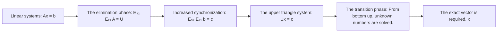

| Concepts | Form and sex | Core Role / Physical meaning |
| :--- | :--- | :--- |
| **The Pivots** | Non-zero critical elements on the corners of the elimination process | The elimination factor is not 0 |
| **The upper triangular matrix  $U$** | The main angle is zero. | Solving the equation of variance, laying the foundations for a reciprocal |
| **The primary elimination matrix  $E_{ij}$** | Changes in units  $(i, j)$  Located in  $-l_{ij}$ | Algebraically transformed lines with matrix multiplication |
| **The inverse of the primary matrix  $E_{ij}^{-1}$**| $(i, j)$  Position symbols are changed by negative positive  $+l_{ij}$ | Remove the elimination operation, add back the subtraction |
| **The permutation matrix  $P$** | Unit-by-unit relocation | The matrix is used to make the line exchange |
| **Combined Law** | $(AB)C = A(BC)$ | Allowing primary transformation to synthesize overall operations |

---

### Additional: Official reference and extended reading

1. **The main page of the MIT OpenCourseWare course**:   
   [MIT 18.06 Linear Algebra (Spring 2010)](https://ocw.mit.edu/courses/18-06-linear-algebra-spring-2010/)
2. **2nd: Video and official subtitle resources**:   
   [Lecture 2: Elimination with Matrices](https://ocw.mit.edu/courses/18-06-linear-algebra-spring-2010/resources/lecture-2-elimination-with-matrices/)
3. **MIT OCW Scholar's supporting lectures and course summaries**:   
   [Unit I: Session 2 - Elimination with Matrices Summary (PDF)](https://ocw.mit.edu/courses/18-06sc-linear-algebra-fall-2011/pages/ax-b-and-the-four-subspaces/elimination-with-matrices/)
4. **Recommended Teaching Materials**:   
   Gilbert Strang, *Introduction to Linear Algebra*, 4th/5th Edition, Section 2.2: "The Idea of Elimination", Section 2.3: "Elimination Using Matrices".

---

## The third is Matrix times and inverse.

> 📺 **Video link back**: [B Station 3 P: matrix times and inverse](https://www.bilibili.com/video/BV1ix411f7Yp/?p=3) (⏱ 46m 49s · 11 screenshots)  
> 📖 **Official material**: [MIT OCW correspondence and summary](https://ocw.mit.edu/courses/18-06-linear-algebra-spring-2010/resources/lecture-3-multiplication-and-inverse-matrices/)  
> 💡 **Key ideas** The five major points of view of the matrix multiplication: dot product, column combination, line combination, rank 1 and expansion) Gauss-Jordan inverse law.

---

### 1. Five ways to understand matrix multiplication

*reference timestamp: 00:01:20...  [Watch clip (P3 00:01:20)](https://www.bilibili.com/video/BV1ix411f7Yp/?p=3&t=80))*

In traditional algebraic curriculum, matrix multiplication is often simplified to a cold-ice numerical query and formula. However, Professor Strang notes: **The symbol of true mastery of linear algebra is the ability to switch freely between multiple viewpoints of matrix multiplication at will.** The different perspectives that make the proof of a theory that was previously extremely rigid, become visible.

Set the matrix  $A$  The shape of the  $m \times n$ The matrix.  $B$  The shape of the  $n \times p$ The internal dimensions of both must be equal to the same  $n$ The resulting matrix is  $C = AB$  The shape of the  $m \times p$.

#### 1.1 Method One: Regular dot product method (Row times Column)

*(reference timestamp: 00:04.30%)  [Watch clip (P3 00:04:30)](https://www.bilibili.com/video/BV1ix411f7Yp/?p=3&t=270))*

This is the most traditional method of calculating elements one by one:  
**$C$  The following article is in progress:  $i$  The line  $j$  Column elements  $c_{ij}$ It's equal to  $A$  The following article is in progress:  $i$  The  $B$  The following article is in progress:  $j$  dot product (inner product)**: 

$$
c_{ij} = (\text{row}_i \text{ of } A) \cdot (\text{col}_j \text{ of } B) = \sum_{k=1}^n a_{ik} b_{kj}
$$

For example, calculate a  $1 \times n$  The vector line is multiplied by one  $n \times 1$  The vector is a numerical scale.

*⏱ Timestamp: 00:04:30 · 📷 Lecture screenshot · [Watch clip (P3 00:04:30)](https://www.bilibili.com/video/BV1ix411f7Yp/?p=3&t=270)*

#### 1.2 Method 2: Calculate by column (The Column Way)

*reference timestamp: 00:09:40...  [Watch clip (P3 00:09:40)](https://www.bilibili.com/video/BV1ix411f7Yp/?p=3&t=580))*

Put the matrix in.  $B$  The following are the parallel vectors: $B = [b_1, b_2, \dots, b_p]$.

**Multiplication  $C$  And every row of a matrix is a matrix.  $A$  The columns are  $B$  Linear combination of weighted vectors**: 

$$
\boxed{\text{col}_j(AB) = A \cdot (\text{col}_j(B))}
$$

$$
\text{col}_j(AB) = b_{1j} (\text{col}_1 \text{ of } A) + b_{2j} (\text{col}_2 \text{ of } A) + \cdots + b_{nj} (\text{col}_n \text{ of } A)
$$

> **Key insight**:   
> $AB$  All the rows of vectors must fall completely into  $A$  In the spaces of the ranks. $AB$  The column space is impossible to exceed  $A$  The column space.

*⏱ Timestamp: 00:09:40 · 📷 Lecture screenshot · [Watch clip (P3 00:09:40)](https://www.bilibili.com/video/BV1ix411f7Yp/?p=3&t=580)*

#### 1.3 Method 3: The Row Way)

*(reference timestamp: 00:11:30)  [Watch clip (P3 00:11:30)](https://www.bilibili.com/video/BV1ix411f7Yp/?p=3&t=690))*

Put the matrix in.  $A$  The following are the most common lines of vectors:

**Multiplication  $C$  Every row of a matrix is a matrix.  $B$  The following  $A$  Linear combination of weights for the corresponding line vector**: 

$$
\boxed{\text{row}_i(AB) = (\text{row}_i(A)) \cdot B}
$$

$$
\text{row}_i(AB) = a_{i1} (\text{row}_1 \text{ of } B) + a_{i2} (\text{row}_2 \text{ of } B) + \cdots + a_{in} (\text{row}_n \text{ of } B)
$$

The first row of the second row changes to the elimination matrix  $E_{21} A$ In essence, it is a direct application of linear computing perspective.

*⏱ Timestamp: 00:11:30 · 📷 Lecture screenshot · [Watch clip (P3 00:11:30)](https://www.bilibili.com/video/BV1ix411f7Yp/?p=3&t=690)*

#### 1.4 Method 4: Columns times Rows and column times row

*reference timestamp: 13:50...  [Watch clip (P3 00:13:50)](https://www.bilibili.com/video/BV1ix411f7Yp/?p=3&t=830))*

This is the most shocking method, and it's ubiquitous in modern main component analysis (PCA) and singular value decomposition (SVD).

- One of them.  $m \times 1$  Let's say that the vector is a  $1 \times p$  The line vector, which is a complete  $m \times p$  The matrix!
- And this matrix is very special: all the rows are proportional to each other, and all the columns are proportional. **The rank of the matrix must be 1 (Rank 1 Matrix)**.

$$
\begin{bmatrix} 2 \\ 3 \\ 4 \end{bmatrix} \begin{bmatrix} 1 & 6 \end{bmatrix} = \begin{bmatrix} 2 & 12 \\ 3 & 18 \\ 4 & 24 \end{bmatrix}
$$

**The theory: matrix multiplication  $AB$  It can be expressed as  $A$  The following article is in progress:  $k$  Column with  $B$  The following article is in progress:  $k$  The linear outer area and**: 

$$
\boxed{AB = \sum_{k=1}^n (\text{col}_k \text{ of } A) \times (\text{row}_k \text{ of } B)}
$$

$$
AB = (\text{col}_1) (\text{row}_1) + (\text{col}_2) (\text{row}_2) + \cdots + (\text{col}_n) (\text{row}_n)
$$

And every full-size matrix is made of this.  $n$  The first is a very simple structure of the rank 1 block column!

*⏱ Timestamp: 00:13:50 · 📷 Lecture screenshot · [Watch clip (P3 00:13:50)](https://www.bilibili.com/video/BV1ix411f7Yp/?p=3&t=830)*

*⏱ Timestamp: 00:16:10 · 📷 Lecture screenshot · [Watch clip (P3 00:16:10)](https://www.bilibili.com/video/BV1ix411f7Yp/?p=3&t=970)*

#### 1.5 Method 5: Block multiplication by block

*reference timestamp: 1 8:40...  [Watch clip (P3 00:18:40)](https://www.bilibili.com/video/BV1ix411f7Yp/?p=3&t=1120))*

If the large matrix is divided into several submatrix blocks along rows and columns:

$$
A = \begin{bmatrix} A_1 & A_2 \\ A_3 & A_4 \end{bmatrix}, \quad B = \begin{bmatrix} B_1 & B_2 \\ B_3 & B_4 \end{bmatrix}
$$

The size of the pieces is compatible, **The block matrix can be used directly as a linear multiplication formula, like a normal numerical metric.**: 

$$
AB = \begin{bmatrix} A_1 B_1 + A_2 B_3 & A_1 B_2 + A_2 B_4 \\ A_3 B_1 + A_4 B_3 & A_3 B_2 + A_4 B_4 \end{bmatrix}
$$

This is the core method of sending large-scale matrix chips into CPU/GPU high-speed caching in distributed parallel computing and high-performance BLAS libraries (such as GEMM).

*⏱ Timestamp: 00:19:40 · 📷 Lecture screenshot · [Watch clip (P3 00:19:40)](https://www.bilibili.com/video/BV1ix411f7Yp/?p=3&t=1180)*

---

### 2. inverse matrix and invertible determinants

*reference timestamp: 00:24:20...  [Watch clip (P3 00:24:20)](https://www.bilibili.com/video/BV1ix411f7Yp/?p=3&t=1460))*

For one thing,  $n \times n$  The Front  $A$ If there is a class-like faction,  $A^{-1}$ It is a great way to make money.

$$
\boxed{A^{-1} A = I \quad \text{且} \quad A A^{-1} = I}
$$

The report says  $A$  Yes, I did. **The invertiblematrix is the invertible matrix.** or **The first is the non-singular matrix.**.

> **The important theorem of the Front**:   
> For finite-dimensional squares, the left and right inverse must be equal.  $BA = I$ And it's going to be automatic.  $AB = I$ At this point,  $B$  It's the only inverse matrix.  $A^{-1}$.

*⏱ Timestamp: 00:25:20 · 📷 Lecture screenshot · [Watch clip (P3 00:25:20)](https://www.bilibili.com/video/BV1ix411f7Yp/?p=3&t=1520)*

---

### The core of the odd matrix: existence of null space

*(reference timestamp: 00:28:40 ·)  [Watch clip (P3 00:28:40)](https://www.bilibili.com/video/BV1ix411f7Yp/?p=3&t=1720))*

When is a front? **There is no inverse matrix.**?

Professor Strang gives the most profitable judgement of the entire class:

> **The core judgment is based on theorem**:   
> **If there is a non-zero vector,  $x \neq 0$ It is a great way to make money.**
> $$Ax = 0$$
> **So the matrix.  $A$  It is absolutely impossible to have an inverse matrix! $A$  It must be a strange matrix.**

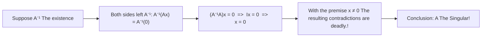

#### 3.1 Proof of the law against evidence

Suppose the inverse matrix  $A^{-1}$  There are:  
In the equation  $Ax = 0$  of both sides simultaneously to the left  $A^{-1}$: 

$$
A^{-1} (Ax) = A^{-1} 0 \implies (A^{-1} A) x = 0 \implies I x = 0 \implies \mathbf{x = 0}
$$

It's with the monkey. **nonzero** vector  $x$ The premise of the game is irreconcilable contradiction! $A^{-1}$  It's not possible.

#### 3.2 Explanation of geometry and column combinations

$Ax = 0$  What is the meaning of this?  
It is:

$$
x_1 (\text{col}_1) + x_2 (\text{col}_2) + \cdots + x_n (\text{col}_n) = 0
$$

This is clear: **$A$  There is a non-zero weight offset between the vectors, and the linearly dependent vector!**  
Since they can be offset by 0, they cannot be spread out over the whole  $n$  In the space, information is passed through  $A$  The map is followed by irreversible loss of information and collapse of dimension. Once vector is mapped to 0, no inverse matrix can restore it.

*⏱ Timestamp: 00:29:40 · 📷 Lecture screenshot · [Watch clip (P3 00:29:40)](https://www.bilibili.com/video/BV1ix411f7Yp/?p=3&t=1780)*

---

### 4. The Gauss-Jordan Elimination Law is reversed

*(reference timestamp: 00:36:00)  [Watch clip (P3 00:36:00)](https://www.bilibili.com/video/BV1ix411f7Yp/?p=3&t=2160))*

We know the existence of an inverse matrix, and how we can actually work out what is in numbers.  $A^{-1}$?

#### 4.1 Core ideas: simultaneous solution  $n$  A system of equations

By definition, $A A^{-1} = I$ If it's going to be  $A^{-1}$  The following is a list of the most common types: $A^{-1} = [x_1, x_2, \dots, x_n]$ The identity matrix is a vector of the unit  $e_1, e_2, \dots, e_n$: 

$$
A [x_1, x_2, \dots, x_n] = [e_1, e_2, \dots, e_n]
$$

This is actually equivalent to **At the same time  $n$  An independent system of linear equations**: 
$$Ax_1 = e_1, \quad Ax_2 = e_2, \quad \dots, \quad Ax_n = e_n$$

In the words of Goss-Royce, "I'm not going to be able to do this". **The first is a large augmented matrix.  $[A \mid I]$ Step by step, get it all done!**

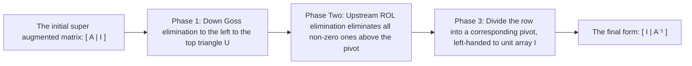

*⏱ Timestamp: 00:36:40 · 📷 Lecture screenshot · [Watch clip (P3 00:36:40)](https://www.bilibili.com/video/BV1ix411f7Yp/?p=3&t=2200)*

#### 4.2 Computational example derivation

in a book,  $2 \times 2$  The matrix is:

$$
A = \begin{bmatrix} 1 & 3 \\ 2 & 7 \end{bmatrix}
$$

1. **Building a Super Augmented Matrix**: 
   $$
   \left[ \begin{array}{cc|cc} 1 & 3 & 1 & 0 \\ 2 & 7 & 0 & 1 \end{array} \right]
   $$

2. **The first step is downward elimination.** Line 2 minus 2 times line 1:
   $$
   \left[ \begin{array}{cc|cc} 1 & 3 & 1 & 0 \\ 0 & 1 & -2 & 1 \end{array} \right]
   $$
   The left side is now in the shape of an upper triangle, with a second pivot being 1.

3. **The second step is to "leap up" (elimination)**: Delete 3 on line 1 above with line 2 (line 1 minus 3 times line 2)):
   $$
   \text{行}_1 - 3 \times \text{行}_2 = [1, 3, 1, 0] - 3 \times [0, 1, -2, 1] = [1, 0, \mathbf{7}, \mathbf{-3}]
   $$
   The whole matrix is:
   $$
   \left[ \begin{array}{cc|cc} \mathbf{1} & \mathbf{0} & 7 & -3 \\ \mathbf{0} & \mathbf{1} & -2 & 1 \end{array} \right]
   $$

The left-hand side is successful for the identity matrix  $I$ So the right side of this is obviously:

$$
\mathbf{A^{-1}} = \begin{bmatrix} 7 & -3 \\ -2 & 1 \end{bmatrix}
$$

The first is the "Certification of the State".

$$
A A^{-1} = \begin{bmatrix} 1 & 3 \\ 2 & 7 \end{bmatrix} \begin{bmatrix} 7 & -3 \\ -2 & 1 \end{bmatrix} = \begin{bmatrix} 7-6 & -3+3 \\ 14-14 & -6+7 \end{bmatrix} = \begin{bmatrix} 1 & 0 \\ 0 & 1 \end{bmatrix} = I
$$

*⏱ Timestamp: 00:43:50 · 📷 Lecture screenshot · [Watch clip (P3 00:43:50)](https://www.bilibili.com/video/BV1ix411f7Yp/?p=3&t=2630)*

#### 4.3 Why does Goss-Roll have to be effective? matrix Total algebra certification

*(reference timestamp: 00:46:00)  [Watch clip (P3 00:46:00)](https://www.bilibili.com/video/BV1ix411f7Yp/?p=3&t=2760))*

A series of prime-line transformations in a Gauss-Rohl elimination is essentially equal to the sequence of prime matrix multiplication on the left side of an augmented matrix. Note that the multiplicity of this series matrix is the total change matrix.  $E$: 

$$
E [A \mid I] = [EA \mid E]
$$

The left becomes the identity matrix because of the  $I$ It is:

$$
EA = I
$$

The inverse matrix is defined as the "reverse matrix". **This is the total transform matrix.  $E$  The only thing that is certain about life is that it's not fair.  $A^{-1}$** So the right hand gets  $EI = E$  Of course, that's what it is.  $A^{-1}$.

This is the complete set of strict algebraic closures to Gauss-Rohl's law of elimination.

*⏱ Timestamp: 00:46:20 · 📷 Lecture screenshot · [Watch clip (P3 00:46:20)](https://www.bilibili.com/video/BV1ix411f7Yp/?p=3&t=2780)*

---

### 5. Speaking of knowledge network and core approaches

#### 5.1 Overview of the five major points of view of matrix multiplication

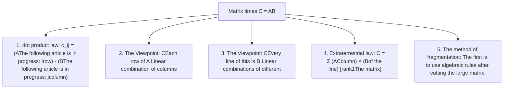

#### 5.2 Core concepts and algorithm quick-check tables

| The core theme | Mathematical expression | Core meaning / Engineering applications |
| :--- | :--- | :--- |
| **Column viewpoint times** | $\text{col}_j(AB) = A \cdot \text{col}_j(B)$ | The proof  $AB$  The column space is included in  $A$  In the column space |
| **Multiplication from the row perspective** | $\text{row}_i(AB) = \text{row}_i(A) \cdot B$ | Expression of the first line transformation (elimination and inversion) |
| **Extraterrestrial multiplication** | $AB = \sum \text{col}_k(A) \text{row}_k(B)$ | The theoretical mother of modern reduction technology (SVD/PCA) |
| **The Strange Matrix is based on** | $\exists x \neq 0, Ax = 0 \iff A \text{ 奇异}$ | null space is nonzero-valued with matrixxsingular |
| **The Law of the Cases of Gallup** | $[A \mid I] \to [I \mid A^{-1}]$ | The unified inverse algorithm, left-handed  $I$  The right side shows the opposite line. |

---

### Additional: Official reference and extended reading

1. **The main page of the MIT OpenCourseWare course**:   
   [MIT 18.06 Linear Algebra (Spring 2010)](https://ocw.mit.edu/courses/18-06-linear-algebra-spring-2010/)
2. **3 - Video and official subtitle resources**:   
   [Lecture 3: Multiplication and Inverse Matrices](https://ocw.mit.edu/courses/18-06-linear-algebra-spring-2010/resources/lecture-3-multiplication-and-inverse-matrices/)
3. **MIT OCW Scholar's supporting lectures and course summaries**:   
   [Unit I: Session 3 - Multiplication and Inverse Matrices Summary (PDF)](https://ocw.mit.edu/courses/18-06sc-linear-algebra-fall-2011/pages/ax-b-and-the-four-subspaces/multiplication-and-inverse-matrices/)
4. **Recommended Teaching Materials**:   
   Gilbert Strang, *Introduction to Linear Algebra*, 4th/5th Edition, Section 2.4: "Rules for Matrix Operations", Section 2.5: "Inverse Matrices".

---

## The fourth: LU decomposition of A

> 📺 **Video link back**: [The B-station 4 P:A is the LU split](https://www.bilibili.com/video/BV1ix411f7Yp/?p=4) (⏱ 49m 07s · 12 screenshots)  
> 📖 **Official material**: [MIT OCW correspondence and summary](https://ocw.mit.edu/courses/18-06-linear-algebra-spring-2010/resources/lecture-4-factorization-into-a-lu/)  
> 💡 **Key ideas** A = LU and A = LDU decomposition, multiplicative interference with independence of L, 1/3 n3 computational derivation, permutation matrix with PA = LU.

---

### 1. Core pre-replacement complete: inverse matrix of multiplication and transpose

*(reference timestamp: 00:00:26 · [Watch clip (P4 00:00:26)](https://www.bilibili.com/video/BV1ix411f7Yp/?p=4&t=26))*

Before we can formally break down the matrix into elimination, we need to reconcile two crucial inverse rules that run through all linear algebra: **The inverse of matrix multiplication** and **The inverse of matrixtranspose**.

#### 1.1 The inverse of multiplication: Why is the order reversed?

If the matrix  $A$  and  $B$  The invertiblematrix (the square of the equation) is equal to the product of the invertiblematrix.  $AB$  What is the inverse matrix?

The answer is: **It must be reversed in order** It is:

$$
\boxed{(AB)^{-1} = B^{-1} A^{-1}}
$$

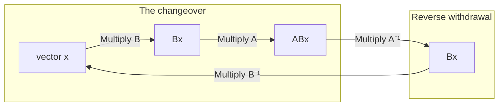

The algebraic validation of this rule is extremely direct, and only by using matrix multiplication combinations can the proof be verified that the multiplicity is an identity matrix.  $I$: 

$$
(AB) (B^{-1} A^{-1}) = A (B B^{-1}) A^{-1} = A I A^{-1} = A A^{-1} = I
$$

The same can be said for the unit line from the left:

$$
(B^{-1} A^{-1}) (AB) = B^{-1} (A^{-1} A) B = B^{-1} I B = B^{-1} B = I
$$

> **Gilbert Strang's classic life analogy: the law of disguise**  
> Action  $A$  The show is about the use of shoes and boots.  $B$  The name of the game is "Pumpkin-wearing".  $AB$  You're wearing your pants first, and then you're wearing shoes.  
> The first is that the government has to reverse this series of operations by night.  $(AB)^{-1}$ You have to take off your shoes first. $A^{-1}$ I'm not going to be able to get out of my pants. $B^{-1}$ The logic is not valid if the first thing to be done is to remove the coil. Therefore, the order of inversion must be the opposite of the right-hand sequence.

*⏱ Timestamp: 00:03:00 · 📷 Lecture screenshot · [Watch clip (P4 00:03:00)](https://www.bilibili.com/video/BV1ix411f7Yp/?p=4&t=180)*

This law can naturally be extended to any number of matrixs:

$$
(ABC \cdots K)^{-1} = K^{-1} \cdots C^{-1} B^{-1} A^{-1}
$$

#### 1.2 Reverse of transposematrix: freely interchangeable with transpose

*reference timestamp: 00:04:50...  [Watch clip (P4 00:04:50)](https://www.bilibili.com/video/BV1ix411f7Yp/?p=4&t=290))*

If the matrix  $A$  Invertible, its transposematrix  $A^T$  Is it reversible? inverse matrix  $(A^T)^{-1}$  And also with  $A^{-1}$  What is the connection?

The answer is very beautiful: **The inverse and transpose operations can be freely sequentialised**: 

$$
\boxed{(A^T)^{-1} = (A^{-1})^T}
$$

**The following is a list of the most common types of algebra:**:   
From the definition, known  $A$  Invertible, satisfied:

$$
A A^{-1} = I
$$

The transpose operation is performed simultaneously on both sides of the equation:

$$
(A A^{-1})^T = I^T
$$

Because the identity matrix  $I$  It's symmetric matrix.  $I^T = I$ The transpose formula for multiplication is also reversed in the same order: $(XY)^T = Y^T X^T$ The left-hand side of the equation is:

$$
(A^{-1})^T A^T = I
$$

Observation top: one matrix  $(A^{-1})^T$  Multiply  $A^T$  Equals to units  $I$ The only definition of an inverse matrix is that it must be  $A^T$  The inverse matrix! is thus proved:

$$
(A^T)^{-1} = (A^{-1})^T
$$

*⏱ Timestamp: 00:06:20 · 📷 Lecture screenshot · [Watch clip (P4 00:06:20)](https://www.bilibili.com/video/BV1ix411f7Yp/?p=4&t=380)*

This characteristic will play a crucial role in further discussions of the projection, least squares law and symmetrical positive definitematrix.

---

### 2. matrixelimination and  $A = LU$  The difference

*reference timestamp: 00:07:30...  [Watch clip (P4 00:07:30)](https://www.bilibili.com/video/BV1ix411f7Yp/?p=4&t=450))*

The elimination method is the cornerstone of the system of linear equations solution. In the second sentence, we learn to convert matrix into a triangle through a primary shift; and now we are going to re-understand the process in a pure matrix algebra.

#### 2.1 Transition from a primitive line to a matrix factor decomposition

Every line transformation in the elimination (such as the second row of a matrix minus the fourth by the first row of a Matrix) is essentially equal to multiplying an elementary elimination matrix on the left side of the matrix.  $E_{21}$: 

$$
E_{21} A = U
$$

where  $U$  The representative of the elimination is **The upper triangular matrix**.

In applied mathematics and numerical analysis, we are more eager to be shaped like  $A = \text{因子}_1 \times \text{因子}_2$  of **The following is a list of the most commonly used methods for calculating the value of a given number.**• To restore the above to the original matrix  $A$  The expression is left-handed.  $E_{21}^{-1}$: 

$$
A = E_{21}^{-1} U
$$

We define  $L = E_{21}^{-1}$ The most famous decomposition formula of all numerical algebra is given:

$$
\boxed{A = LU}
$$

- **$L$(Lower triangular matrix)** The following is a triangular matrix: the lower triangle matrix, where the main pair of angles are equal to 1 and the upper pair of angled lines are equal to 0. **The unit under the triangular matrix**.
- **$U$(Upper triangular matrix)** The upper triangular matrix, the pivot of elimination on the main diagonal line (pivot), and the bottom of the diagonal line is equal to 0.

*⏱ Timestamp: 00:09:00 · 📷 Lecture screenshot · [Watch clip (P4 00:09:00)](https://www.bilibili.com/video/BV1ix411f7Yp/?p=4&t=540)*

#### 2.2 $2 \times 2$  Specific examples

We're going to do this by a simple intuition.  $2 \times 2$  The matrix goes through this process:

$$
A = \begin{bmatrix} 2 & 1 \\ 8 & 7 \end{bmatrix}
$$

1. **First pivot and elimination multiples**:   
   The element in row 1 of line 1 is 2, which is the first pivot. To eliminate row 1 of row 8 of line 2 you need to calculate multiplication numbers: 
   $$l_{21} = \frac{8}{2} = 4$$
    The second line of the first row is subtracted by 4 times the first row.

2. **The elimination matrix  $E_{21}$  The upper triangular matrix  $U$**:   
   The first-line transform matrix to perform this operation is: 
   $$E_{21} = \begin{bmatrix} 1 & 0 \\ -4 & 1 \end{bmatrix}$$
    The Elimination: 
   $$E_{21} A = \begin{bmatrix} 1 & 0 \\ -4 & 1 \end{bmatrix} \begin{bmatrix} 2 & 1 \\ 8 & 7 \end{bmatrix} = \begin{bmatrix} 2 & 1 \\ 0 & 3 \end{bmatrix} = U$$
    The second pivot is given by the equation Pivot 2 = 3.

3. **Reversal and Construction  $L$**:   
   The elimination matrix  $E_{21}$  What is inverse matrix? The original matrix is "minus four times" and only "plus four times" is needed to undo this operation, so change the symbol of the non-reverse element directly: 
   $$L = E_{21}^{-1} = \begin{bmatrix} 1 & 0 \\ 4 & 1 \end{bmatrix}$$
   
4. **Verified  $A = LU$**: 
   $$LU = \begin{bmatrix} 1 & 0 \\ 4 & 1 \end{bmatrix} \begin{bmatrix} 2 & 1 \\ 0 & 3 \end{bmatrix} = \begin{bmatrix} (1\times 2) & (1\times 1) \\ (4\times 2 + 0) & (4\times 1 + 1\times 3) \end{bmatrix} = \begin{bmatrix} 2 & 1 \\ 8 & 7 \end{bmatrix} = A$$
    It's perfectly compatible! **The number of elimination times four is directly present.  $L$  of  $(2,1)$  Location**.

#### 2.3 Symmetrical pivot separation: $A = LDU$  The difference

*reference timestamp: 12:20...  [Watch clip (P4 00:12:20)](https://www.bilibili.com/video/BV1ix411f7Yp/?p=4&t=740))*

In  $A = LU$  in which, $L$  The main angle line is 1.  $U$  The pivot is the line of opposite angles  $d_1 = 2, d_2 = 3$ In some theoretical systems, especially in subsequent studies of real-symmetric matrix  $A = LDL^T$ ) , we want the two triangles up and down matrix to have full parity (all diagonals are 1).

The Commission has also adopted a number of measures to  $U$  The pivot on the opposite line is extracted separately to form a paired matrix  $D$(Diagonal matrix of pivots): 

$$
U = \begin{bmatrix} 2 & 1 \\ 0 & 3 \end{bmatrix} = \begin{bmatrix} 2 & 0 \\ 0 & 3 \end{bmatrix} \begin{bmatrix} 1 & 1/2 \\ 0 & 1 \end{bmatrix} = D U'
$$

The result is a more symmetrical breakdown:

$$
\boxed{A = L D U}
$$

where  $L$  The triangular matrix is the unit of length. $D$  The pivot matrix is the angular matrix. $U$  The unit triangular matrix.

$$
\begin{bmatrix} 2 & 1 \\ 8 & 7 \end{bmatrix} = \begin{bmatrix} 1 & 0 \\ 4 & 1 \end{bmatrix} \begin{bmatrix} 2 & 0 \\ 0 & 3 \end{bmatrix} \begin{bmatrix} 1 & 1/2 \\ 0 & 1 \end{bmatrix}
$$

*⏱ Timestamp: 00:12:20 · 📷 Lecture screenshot · [Watch clip (P4 00:12:20)](https://www.bilibili.com/video/BV1ix411f7Yp/?p=4&t=740)*

---

### 3. Why?  $A = LU$  is much better than  $EA = U$?

*reference timestamp: 00:15:40...  [Watch clip (P4 00:15:40)](https://www.bilibili.com/video/BV1ix411f7Yp/?p=4&t=940))*

Many beginners will ask a question: $EA = U$  and  $A = LU$  In mathematics, it's clear why modern numerical software and mathematicians are no exception.  $A = LU$?

Professor Strang gives one of the most profound insights in the entire class: **The first is that the number of matrix values in a given sequence is equal to the number of matrices. $E$  The multiplication of the number is cross-interference, and  $L$  The inverse multiplication of the numbers is a surprisingly pure number.**.

#### 3.1 Mixed effects of multiples: when  $E$  The time of the connection

Consider one.  $3 \times 3$  The elimination process (not considering line exchanges) is usually:
1. Delete the first item of line 2 with row 1  $E_{21}$)
2. Delete the first paragraph of line 3 in line 1  $E_{31}$ In this case, the value is 0, i.e. no operation required)
3. Subsection (3) of line 2 is deleted  $E_{32}$)

I finally got it.  $E_{32} E_{21} A = U$ The total transformation matrix is  $E = E_{32} E_{21}$.

The specific elimination steps are as follows:
- $E_{21}$ Line 2 minus 2 times line 1  $l_{21} = 2$)
- $E_{32}$ Line 3: Subtract 5 times line 2  $l_{32} = 5$)

The first matrix is as follows:

$$
E_{21} = \begin{bmatrix} 1 & 0 & 0 \\ -2 & 1 & 0 \\ 0 & 0 & 1 \end{bmatrix}, \quad E_{32} = \begin{bmatrix} 1 & 0 & 0 \\ 0 & 1 & 0 \\ 0 & -5 & 1 \end{bmatrix}
$$

Now multiply them and see.  $E = E_{32} E_{21}$  What will happen:

$$
E = \begin{bmatrix} 1 & 0 & 0 \\ 0 & 1 & 0 \\ 0 & -5 & 1 \end{bmatrix} \begin{bmatrix} 1 & 0 & 0 \\ -2 & 1 & 0 \\ 0 & 0 & 1 \end{bmatrix} = \begin{bmatrix} 1 & 0 & 0 \\ -2 & 1 & 0 \\ \mathbf{10} & -5 & 1 \end{bmatrix}
$$

**Watch out for the one that comes up.  $10$**!  
In  $E$  In the first column of line 3 of this article, a number that did not exist appears.  $10$ (by  $(-5) \times (-2)$  It's a great idea!  
This is because the effect of line 2 is indirectly and intermingled to line 3 when line 3 is reduced by two times the first line and then five times the second line. elimination There was mixing and contamination between multipliers.

*⏱ Timestamp: 00:19:10 · 📷 Lecture screenshot · [Watch clip (P4 00:19:10)](https://www.bilibili.com/video/BV1ix411f7Yp/?p=4&t=1150)*

#### 3.2 Miracles of reverse order multiplication: the multiplier is directly seated

Now, let's see.  $A = LU$  The lower triangular matrix in  $L$ The following is a list of the most common types of shoes:

$$
L = E^{-1} = (E_{32} E_{21})^{-1} = E_{21}^{-1} E_{32}^{-1}
$$

The inverse of each individual elimination matrix is simply a variable:

$$
E_{21}^{-1} = \begin{bmatrix} 1 & 0 & 0 \\ 2 & 1 & 0 \\ 0 & 0 & 1 \end{bmatrix}, \quad E_{32}^{-1} = \begin{bmatrix} 1 & 0 & 0 \\ 0 & 1 & 0 \\ 0 & 5 & 1 \end{bmatrix}
$$

Calculate their multiplication  $L$: 

$$
L = \begin{bmatrix} 1 & 0 & 0 \\ 2 & 1 & 0 \\ 0 & 0 & 1 \end{bmatrix} \begin{bmatrix} 1 & 0 & 0 \\ 0 & 1 & 0 \\ 0 & 5 & 1 \end{bmatrix} = \begin{bmatrix} 1 & 0 & 0 \\ \mathbf{2} & 1 & 0 \\ \mathbf{0} & \mathbf{5} & 1 \end{bmatrix}
$$

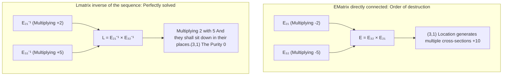

**Miracles are coming**: 
- That boring cross-section.  $10$  It's gone!
- Multiplying  $2$  It's a good place to sit.  $(2,1)$  Location.
- Multiplying  $5$  It's a good place to sit.  $(3,2)$  Location.
- $(3,1)$  The location is kept clean  $0$.

> **Railroad: When there is no line exchange, the number of elimination multiples directly constitutes  $L$**  
> As long as there is no row exchange in the elimination process, we use each of the multiples of the decimals to do the elimination.  $l_{ij}$ The triangular matrix is written directly into the triangular one without any matrix multiplication operations.  $L$  The following article is in progress:  $i$  The line  $j$  Get in line!  
> The computer records the multiples of the original calculations in the second half of the matrix during elimination, and when the elimination is complete, the second half is  $L$ The first half is  $U$ This is the secret of GOSE elimination algorithms for high storage and computing efficiency in industrial software.

*⏱ Timestamp: 00:23:00 · 📷 Lecture screenshot · [Watch clip (P4 00:23:00)](https://www.bilibili.com/video/BV1ix411f7Yp/?p=4&t=1380)*

---

### 4. The complexity of the algorithm for elimination of gases: $O(n^3)$  The calculation

*reference timestamp: 00:28:20...  [Watch clip (P4 00:28:20)](https://www.bilibili.com/video/BV1ix411f7Yp/?p=4&t=1700))*

When we're trying to solve a problem that contains  $n$  An unknown number. $n$  In a large linear system of equations, such as weather forecasts and structural mechanics simulations, the equation is used to describe the structure of the system.  $n = 100$  or  $n = 1000$ How many computations does a computer need to do?

#### 4.1 Typical operation definition and incremental costing

In numerical algebra, the most basic unit of operation is **One multiplier plus one decrease** (often referred to as a multiplication-decrease cycle, or Flop: Floating-point operation): 
$$\text{新元素} = \text{旧元素} - (\text{乘数} \times \text{对应行元素})$$

Consider a general  $n \times n$  The matrix  $A$: 

*⏱ Timestamp: 00:27:00 · 📷 Lecture screenshot · [Watch clip (P4 00:27:00)](https://www.bilibili.com/video/BV1ix411f7Yp/?p=4&t=1620)*

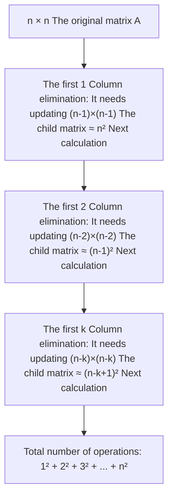

1. **The first is elimination.**: 
   - The first pivot is  $(1,1)$ The first line is shared  $n$  The element.
   - The goal is to bring down  $n-1$  The first row of the line is zero.
   - Each row needs to be multiplied by the first row  $n$  The element is reduced.
   - The only thing that needs to be updated is a size at the bottom right.  $(n-1) \times (n-1)$  The submatrix, the number of times the operation is approximately  $n^2$.

2. **The second is elimination.**: 
   - The second pivot is in place, and a smaller one needs to be updated.  $(n-2) \times (n-2)$  The submatrix, the number of times it is calculated  $(n-1)^2$.

3. **This is a very important step.**: 
   - The length of the submatrix is reduced in succession for each round: $n \to n-1 \to n-2 \to \cdots \to 1$.
   - The whole matrix  $A$  Translated into  $U$  The total number of operations is equal to the squares of each layer and: 
     $$\text{Total Cost}(A) \approx n^2 + (n-1)^2 + \cdots + 2^2 + 1^2 = \sum_{k=1}^n k^2$$

#### 4.2 The calculation of the score: $\frac{1}{3}n^3$  The origin of the name

*reference timestamp: 00:36:20...  [Watch clip (P4 00:36:20)](https://www.bilibili.com/video/BV1ix411f7Yp/?p=4&t=2180))*

The dispersed squares and  $\sum_{k=1}^n k^2$  Professor Strang inspired us to use continuous determinants to estimate extremely quickly:

$$
\sum_{k=1}^n k^2 \approx \int_0^n x^2 dx = \left[ \frac{1}{3} x^3 \right]_0^n = \mathbf{\frac{1}{3} n^3}
$$

The exact algebra of the queries and formulas is as follows:

$$
\frac{n(n+1)(2n+1)}{6} = \frac{1}{3}n^3 + \frac{1}{2}n^2 + \frac{1}{6}n
$$

When the matrix is large  $n$  The largest, lowest class  $\frac{1}{2}n^2$  and  $\frac{1}{6}n$  The main thing is that the  $\frac{1}{3}n^3$: 

- when  $n = 100$  Time: The number of operations is approximately  $\frac{1}{3} \times 10^6 \approx 33$  I've been through a million operations.
- when  $n = 1000$  Time: The number of operations is approximately  $\frac{1}{3} \times 10^9 \approx 3.3$  Millions of operations.
- **The matrix is 10 times larger and the computing time has been increased by 1000 times.** This is a multi-algorithm.  $O(n^3)$  The power and cost.

*⏱ Timestamp: 00:36:20 · 📷 Lecture screenshot · [Watch clip (P4 00:36:20)](https://www.bilibili.com/video/BV1ix411f7Yp/?p=4&t=2180)*

#### 4.3 Right-handed vector  $b$  The cost of calculating:  $O(n^2)$

*(reference timestamp: 00:39:00)  [Watch clip (P4 00:39:00)](https://www.bilibili.com/video/BV1ix411f7Yp/?p=4&t=2340))*

When solving the system  $Ax = b$  The right side of the augmented matrix has a vector column.  $b$  The new version of the software is available in a variety of formats.  $b$  How much is it going to cost?

1. **Forward elimination on  $b$)**: 
   - Step 1 Processing from 2 to  $n$  The number of people who are  $n-1$  The next operation;
   - Step 2 Processing from 3 to  $n$  The number of people who are  $n-2$  The next operation;
   - The total: $(n-1) + (n-2) + \cdots + 1 \approx \int_0^n x dx = \frac{1}{2} n^2$.

2. **The first is the "Back substitution":  $Ux = c$)**: 
   - The last line is clear.  $x_n$ The first line is replaced by the second.  $x_{n-1}$ And every layer is multiplied by a factor.
   - The cumulative expenditure is equal to  $\frac{1}{2} n^2$.

Therefore, **Treatment of right side vectors  $b$  And finally, the unknown number.  $x$  The total cost of the  $n^2$**!

| Calculation Stage | Operating objects | Gradual complexity | Typical expenses ($n=100$) |
| --- | --- | --- | --- |
| The matrix triangle decomposed $A = LU$) | The coefficient matrix  $A$ | $\approx \frac{1}{3} n^3$ | About 330,000 operations were performed. |
| The vector conversion and inversion ($Lc=b, Ux=c$) | Right Neck  $b$  The answer  $x$ | $\approx n^2$ | About 10,000 operations |

> **Key engineering revelations: recycling  $LU$  The difference**  
> If we want to solve multiple different stimuli or loads for the same structure/system, that's the same thing.  $A$ But there are many different  $b_1, b_2, \dots, b_m$ The most sensible way is to **It's just one expensive thing to do.  $A = LU$  The answer is: $\frac{1}{3}n^3$)** And then for each new  $b$  It's just cheap.  $n^2$  Finish the previous generation and the later generation. Do not reset augmented matrix elimination every time!

*⏱ Timestamp: 00:40:50 · 📷 Lecture screenshot · [Watch clip (P4 00:40:50)](https://www.bilibili.com/video/BV1ix411f7Yp/?p=4&t=2450)*

---

### 5. permutation matrix and line exchange: $PA = LU$

*(reference timestamp: 00:41:00 )  [Watch clip (P4 00:41:00)](https://www.bilibili.com/video/BV1ix411f7Yp/?p=4&t=2460))*

All the good things ahead  $A = LU$  The nature of the material is based on a premise: during the pivot elimination process, no pivot positions appear.  
But if during the elimination process, the current pivot position is exactly 0 (or very small), we have to select a line from the next row and switch it. **The first is the Permutation Matrix.**.

#### 5.1 The construction and quantity of the permutation matrix

The permutation matrix  $P$  The first is the identity matrix.  $I$ . Left times permutation matrix  $PA$  The result is that the  $A$  The corresponding lines are rearranged.

For the  $n \times n$  The linearity of the array, all possible lines of ordering are shared  $n!$  The following is a list of articles related to $n$  The first is the "Step by Step" (the "Step") and therefore exists.  $n!$  The first is a different permutation matrix.

For the  $3 \times 3$  matrix, total  $3! = 6$  The permutation matrix:

1. **The same thing happened with the first two games.**: 
   $$P_{1} = \begin{bmatrix} 1 & 0 & 0 \\ 0 & 1 & 0 \\ 0 & 0 & 1 \end{bmatrix}$$
2. **The two lines are interchanged in single-handedly (swap 2 rows, keep 1 row motionless)**: 
   - The first and second lines are exchanged: 
     $$P_{12} = \begin{bmatrix} 0 & 1 & 0 \\ 1 & 0 & 0 \\ 0 & 0 & 1 \end{bmatrix}$$
   - The first and third lines are replaced by the following: 
     $$P_{13} = \begin{bmatrix} 0 & 0 & 1 \\ 0 & 1 & 0 \\ 1 & 0 & 0 \end{bmatrix}$$
   - The second and third lines are replaced by the following: 
     $$P_{23} = \begin{bmatrix} 1 & 0 & 0 \\ 0 & 0 & 1 \\ 0 & 1 & 0 \end{bmatrix}$$
3. **The three-line rotation (all lines are bit shifts)**: 
   - Changes  $(1 \to 2 \to 3 \to 1)$: 
     $$P_{312} = \begin{bmatrix} 0 & 1 & 0 \\ 0 & 0 & 1 \\ 1 & 0 & 0 \end{bmatrix}$$
   - Reverse rotation  $(1 \to 3 \to 2 \to 1)$: 
     $$P_{231} = \begin{bmatrix} 0 & 0 & 1 \\ 1 & 0 & 0 \\ 0 & 1 & 0 \end{bmatrix}$$

*⏱ Timestamp: 00:43:20 · 📷 Lecture screenshot · [Watch clip (P4 00:43:20)](https://www.bilibili.com/video/BV1ix411f7Yp/?p=4&t=2600)*

#### 5.2 The best algebraic properties of the permutation matrix: $P^{-1} = P^T$

The permutation matrix has an extraordinary symmetry of beauty and excellence:

1. **Orthogonality and the Inverse as the Transpose**:   
   Each row of a permutation matrix happens to have only one, and the rest is zero. Its line vectors are vertically opposite each other and length 1.\[1\] Thus, the inverse matrix of any permutation Matrix equals its transposematrix:
   $$
   \boxed{P^{-1} = P^T \iff P^T P = I}
   $$
   This means that to cancel a complex line rearrangement, there is no need to work backwards at all, just transpose the permutation matrix along the main pair of angles!

2. **The number of algebraic groups is the same as the number of closed groups.**:   
   The multiplication of any two permutation matrix is still a permutation Matrix; the inverse of a permutations matrix is also still one of these six permutations.

*⏱ Timestamp: 00:45:50 · 📷 Lecture screenshot · [Watch clip (P4 00:45:50)](https://www.bilibili.com/video/BV1ix411f7Yp/?p=4&t=2750)*

#### 5.3 Complete elimination decomposition: $PA = LU$

*(reference timestamp: 00:46:40...)  [Watch clip (P4 00:46:40)](https://www.bilibili.com/video/BV1ix411f7Yp/?p=4&t=2800))*

The complete theory of Gauss' elimination is thus formally combined:

The invertible is the invertible.  $A$ Whether or not it needs to be switched in the elimination process, we can first use a total permutation matrix.  $P$  The first step is to adjust all of its lines in order for the most appropriate elimination, and then perform a non-reversal Goss elimination to obtain the standard  $L$  and  $U$.

This is the ultimate formula in scientific computation and engineering linear algebra:

$$
\boxed{PA = LU}
$$

The first is that the numbering software, like MATLAB, is not a function of the value.  `[L, U, P] = lu(A)` In the case of pivot not 0, if the absolute value is too small, to prevent a very small number being subtracted from causing floating-point error to be dramatically magnified, the algorithm will also actively perform\*\* partial pivot selection and record in  $P$  In the middle.

*⏱ Timestamp: 00:46:40 · 📷 Lecture screenshot · [Watch clip (P4 00:46:40)](https://www.bilibili.com/video/BV1ix411f7Yp/?p=4&t=2800)*

---

### 6. Speaking knowledge network and core formula quick search

#### 6.1 Solving the equation  $Ax = b$  The complete path and algorithm flow

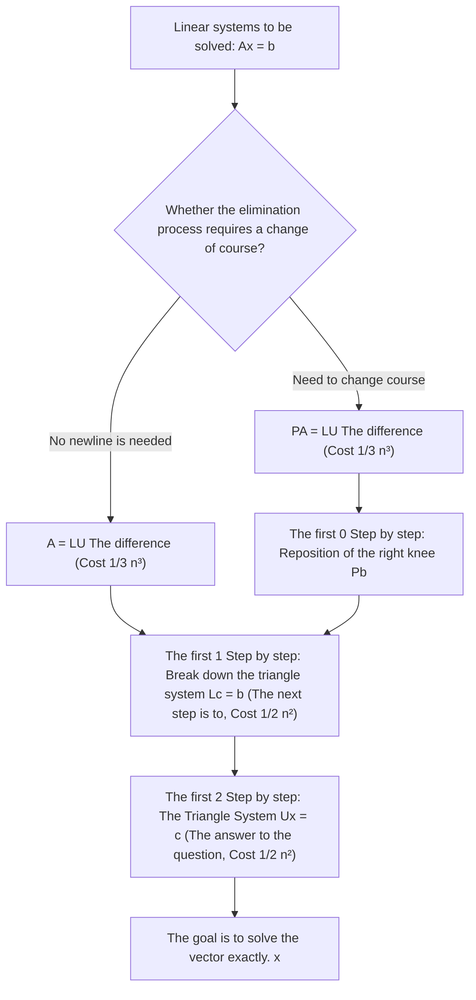

#### 6.2 Core theorem and formula counter-table

| Concepts and theories | Mathematical expression | The meaning of physics / geometry / algorithms |
| --- | --- | --- |
| **The inverse of a product** | $(AB)^{-1} = B^{-1} A^{-1}$ | The reverse of the order is reversed (the "Dry Shoes" rule) |
| **The inverse of transpose** | $(A^T)^{-1} = (A^{-1})^T$ | The inverse and transpose can be freely exchanged in order |
| **LU decomposition** | $A = LU$ | $L$  The first is the history of elimination. $U$  The final outcome of elimination |
| **LDU decomposition** | $A = L D U$ | pivot independently extracted to the right angle matrix  $D$ The two ends of the triangular matrix are equal to 1 |
| **The elimination calculation** | $\sum_{k=1}^n k^2 \approx \frac{1}{3} n^3$ | The elimination calculation costs are mainly in the left-hand matrix, where the total cost is calculated as a percentage of the total cost. $n$  Double the calculation times 8. |
| **Right end vector expense** | Previous generations + reversals  $\approx n^2$ | $b$  The cost of computing is only low and can be reused multiple times.  $LU$ |
| **Permutation matrix characteristics** | $P^{-1} = P^T$ | The inverse of the substitution is equal to the transpose; $n \times n$  The total  $n!$  The permutation matrix |
| **The complete elimination theorem** | $PA = LU$ | General Gaussian elimination matrix form after linear exchange |

---

### Additional: Official reference and extended reading

1. **The main page of the MIT OpenCourseWare course**:   
   [MIT 18.06 Linear Algebra (Spring 2010)](https://ocw.mit.edu/courses/18-06-linear-algebra-spring-2010/)
2. **4th: Video and official subtitle resources**:   
   [Lecture 4: Factorization into A = LU](https://ocw.mit.edu/courses/18-06-linear-algebra-spring-2010/resources/lecture-4-factorization-into-a-lu/)
3. **MIT OCW Scholar's supporting lectures and course summaries**:   
   [Unit I: Session 4 - Factorization into A = LU Summary (PDF)](https://ocw.mit.edu/courses/18-06sc-linear-algebra-fall-2011/pages/ax-b-and-the-four-subspaces/factorization-into-a-lu/)
4. **Recommended Teaching Materials**:   
   Gilbert Strang, *Introduction to Linear Algebra*, 4th/5th Edition, Section 2.6: "Elimination = Factorization ($A = LU$)".

---

## 5th: Transpose, replace and vector space

> 📺 **Video link back**: [B Station 5 P: Transpose, replace with vector space](https://www.bilibili.com/video/BV1ix411f7Yp/?p=5) (⏱ 47m 42s · 15 screenshots)  
> 📖 **Official material**: [MIT OCW correspondence and summary](https://ocw.mit.edu/courses/18-06-linear-algebra-spring-2010/resources/lecture-5-transposes-permutations-spaces-r-n/)  
> 💡 **Key ideas** The symmetric matrix is introduced with the substitution group, the strict algebraic formula of vector space, subspace and column space.

---

### 1. Turn of the presentation: From a vector to a space

*reference timestamp: 00:00:09...  [Watch clip (P5 00:00:09)](https://www.bilibili.com/video/BV1ix411f7Yp/?p=5&t=9))*

The core tasks of the previous sessions were to solve system of linear equations: elimination, matrix Multiplication, inverse matrix, and  $A=LU$  The following two topics are still to be discussed. **Replace with transpose** The first was the use of a new methodology to measure the size of the problem.

Before, we used to ask what a vector was, what a step elimination was. Then we asked, "What vectors could together make up a space? How can this space be created from a matrix?" This space and equation.  $Ax=b$  What's the connection?

The main line connects the two parts of this story: a matrix operation gives specific computations, and vector space organizes many computational results into one whole.

| Subjects | Questions to Answer | The relationship that we have here |
| --- | --- | --- |
| Replacement | How do you record the change in elimination? | $PA=LU$ |
| Transpose | How does the matrix change after a row and column exchange? | $(A^T)_{ij}=A_{ji}$ |
| The symmetry | How do you build a matrix that doesn't change after the transpose? | $(R^TR)^T=R^TR$ |
| vector space | How do we make sure that vector operations stay in the same set? | Closing of the addition and arbitrary real numbers |
| Subspace and Column Space | How do we get a complete space from several column vectors? | Take all linear combinations |

### 2. permutation matrix: incorporate the permutation into the elimination

*reference timestamp: 00:01:17...  [Watch clip (P5 00:01:17)](https://www.bilibili.com/video/BV1ix411f7Yp/?p=5&t=77))*

#### 2.1 pivot position is zero and does not represent a matrixxsingular

elimination requires that one available pivot be obtained at each pivot position. A matrix is entirely invertible and equations are completely solvable, but when elimination is performed in the current linear order, the pivot position happens to be zero.

This requires switching non-zero elements from the following line to continue elimination. It may be necessary to switch one or more times throughout the process; the theory must accommodate these situations and not just discuss matrix sequences that are appropriate for the correct solution.

The first sentence of the previous sentence is broken down as follows:

$$
A=LU.
$$

This is it.  $L$  is a triangular matrix below the unit: the main pair of angles are 1, above zero, and below record elimination multiples; $U$  The upper triangular matrix after elimination.

The permutation matrix is used when the line changes.  $P$  The sequence of the recording is rearranged and broken down into:

$$
\boxed{PA=LU}.
$$

I can take it  $P$  I'm going to try and get this right.  $A$ , and then click elimination  $L$  and  $U$  The actual computation can be done by switching the line with elimination, and ultimately  $P$  The first is the exchange rate. $L$  The multiples in the equation are also decomposed. $P=I$ And then back.  $A=LU$.

*⏱ Timestamp: 00:05:25 · 📷 Lecture screenshot · [Watch clip (P5 00:05:25)](https://www.bilibili.com/video/BV1ix411f7Yp/?p=5&t=325)*

#### 2.2 Algebraic validity and numerical precision are two things.

Strang specifically mentions MATLAB: When it checks pivot, it is not only concerned with whether the pivot is zero but also whether it is large enough. **A pivot near zero is bad for numerical calculations** In addition, the software is sometimes used in a purely algebraic way and does not require any switching.

This argument incorporates algebraic theory in which only the states of a string that must be switched to continue with a string are included; this does not mean that the actual solving process is switched only at zero times strictly on the pivot.

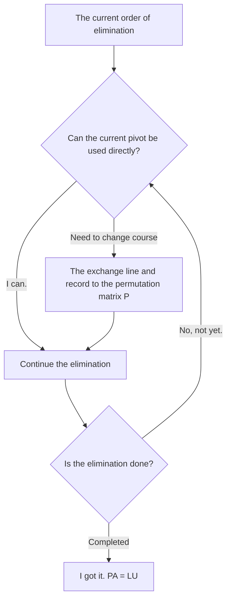

> **Editor's note** The following table shows the number of pivot points in a class: can the table directly use the zero-pivot judgment contained in this talk; in floating-point operations, it may also include consideration of pivot size.

#### 2.3 Permutation matrix is a row of rearranged identity matrix

The permutation matrix is derived from the identity matrix's line rearrangement.

In addition to switching two lines, a loop switch can be made.  $1\to2\to3\to4\to1$  The first, second and third lines can be switched at the same time. They are both in line rearrangement but differently rearranged.

$n$  The following are the rows:

$$
n!=n(n-1)(n-2)\cdots3\cdot2\cdot1.
$$

Therefore, $n\times n$  The permutation matrix is shared  $n!$  The scale contrast in the classroom is: four levels.  $4!=24$  One, five steps already.  $5!=120$  The number of stages is increased and it is no longer convenient to list them one by one.

#### 2.4 Why is the inverse of a permutation matrix equal to the transpose?

All permutation matrix are invertible because the row rearrangement can be revoked. For a permutation Matrix, this revokation operation is precisely given by Transpose:

$$
\boxed{P^{-1}=P^T},\qquad P^TP=I.
$$

The class explains this relationship as: multiplying the corresponding position 1 over 1 by a transpose, eventually restoring the identity matrix. Transpose rearranges the location of the array to the new position and returns it exactly in the order of its origin.

*⏱ Timestamp: 00:09:08 · 📷 Lecture screenshot · [Watch clip (P5 00:09:08)](https://www.bilibili.com/video/BV1ix411f7Yp/?p=5&t=548)*

Strang also reminds us that satisfying the transpose of a matrix by itself is equivalent to the identity matrix of a mattress, rather than a permutation matrix.

### 3. Transpose to symmetry: How to exchange column positions

*reference timestamp: 10:12...  [Watch clip (P5 00:10:12)](https://www.bilibili.com/video/BV1ix411f7Yp/?p=5&t=612))*

#### 3.1 Transpose of a rectangular matrix

Turns the rows of matrix into columns and columns. Examples in the classroom are:

$$
A=\begin{pmatrix}
1&3\\
2&3\\
4&1
\end{pmatrix},\qquad
A^T=\begin{pmatrix}
1&2&4\\
3&3&1
\end{pmatrix}.
$$

$A$  There are two three-row columns, so  $A^T$  There are two rows of three.  $(1,2,4)^T$  The first row after transpose, the second row  $(3,3,1)^T$  It's the second line.

**Transpose changes the position of the elements and the number of columns in the matrix.**  I'm going to go with one.  $m\times n$  The matrix, the shape of the transpose is  $n\times m$.

*⏱ Timestamp: 00:12:32 · 📷 Lecture screenshot · [Watch clip (P5 00:12:32)](https://www.bilibili.com/video/BV1ix411f7Yp/?p=5&t=752)*

#### 3.2 Transpose by the following symbol

If  $A_{ij}$  Indicates  $A$  The following article is in progress:  $i$  Go ahead and do it.  $j$  The column elements are:

$$
\boxed{(A^T)_{ij}=A_{ji}}.
$$

The next section after transpose  $i$  The line  $j$  The column, taken from the original matrix  $j$  The line  $i$  The elements of the column are interchanged; for a square, geometry is about the inversion of the main line.

#### 3.3 symmetric matrix: remains unchanged after transpose

A matrix satisfies:

$$
\boxed{A^T=A},
$$

It is called **The symmetric matrix** The shape must be the same, so it must be a square; the elements corresponding to both sides of the line are equal.

The following are examples of textbooks:

$$
S=\begin{pmatrix}
3&1&7\\
1&2&9\\
7&9&4
\end{pmatrix}.
$$

The seven of the upper right corner corresponds to the seven of the lower left corner, and the other non-reverse line positions are equal. The number on the main diagonal line remains at the same place when the switch is made.

*⏱ Timestamp: 00:13:50 · 📷 Lecture screenshot · [Watch clip (P5 00:13:50)](https://www.bilibili.com/video/BV1ix411f7Yp/?p=5&t=830)*

Strang here purposely states: The number in the example is positive, not because it is symmetric. **Symmetry is a position relation, defined as being constant only after transpose.**

There should also be a distinction between two relationships that have emerged: permutation matrix satisfaction  $P^T=P^{-1}$ The symmetric matrix satisfies  $A^T=A$ The first transpose gives an inverse matrix, and the second transpose returns itself.

### 4. Construct a symmetric matrix with a rectangular matrix

*reference timestamp: 00:14:43...  [Watch clip (P5 00:14:43)](https://www.bilibili.com/video/BV1ix411f7Yp/?p=5&t=883))*

#### 4.1 Asymmetric matrix, which can also produce symmetric multiplication

The rectangular matrix is not the same shape as before and after the switch, of course it is asymmetrical. But if you match a matrix with its switch, you can get symmetric matrix.

In this book, the teacher writes down a matrix of two or three rows.  $R$ Write a matrix of three rows with two rows  $R^T$: 

$$
R=\begin{pmatrix}
1&2&4\\
3&3&1
\end{pmatrix},\qquad
R^T=\begin{pmatrix}
1&3\\
2&3\\
4&1
\end{pmatrix}.
$$

The next calculation is  $R^TR$ The letter is in the shape of a triangle.  $R$  The piece that points to the two-line triangle should be noted when reading the board book, and cannot directly put the first three-line triangulations of the first paragraph.  $A$  The same symbol is used.

#### 4.2 See symmetry from numerical values

The first three lines were:

$$
1\cdot1+3\cdot3=10,\qquad
1\cdot2+3\cdot3=11,\qquad
1\cdot4+3\cdot1=7.
$$

For example,  $(1,2)$  The 11th position comes from  $(1,3)$  and  $(2,3)$  The inner product; $(2,1)$  The position exchanged the roles of these two vectors, resulting in an 11 still. 7 at the upper right corner and 7 at the lower left corner also have the same correspondence.

*⏱ Timestamp: 00:17:08 · 📷 Lecture screenshot · [Watch clip (P5 00:17:08)](https://www.bilibili.com/video/BV1ix411f7Yp/?p=5&t=1028)*

> **Editor's note** The following is a complete list of all entries for the same matrix multiplication, which makes it easy to check the table book derivation; no classroom examples have been replaced.

$$
R^TR=
\begin{pmatrix}
10&11&7\\
11&13&11\\
7&11&17
\end{pmatrix}.
$$

These even-pair numbers are not coincidental. They come from the same sum of squares multiplied by only the successive sequence of two rows exchanged.

#### 4.3 General proof with the transpose rule

The most direct way to prove a matrix symmetry is: **The first thing that I want to do is get a transpose and check if it's back on its own.**

Transpose has two rules:

$$
(AB)^T=B^TA^T,\qquad (A^T)^T=A.
$$

The first rule requires the order of multiplication to be reversed, as we have seen in the previous few lines.  $R^TR$  The top:

$$
(R^TR)^T
=R^T(R^T)^T
=R^TR.
$$

So for any real matrix,  $R$ Whether it is a faction or not, $R^TR$  symmetric matrix. This two-line certificate extends the previous value observations to the general situation.

*⏱ Timestamp: 00:19:30 · 📷 Lecture screenshot · [Watch clip (P5 00:19:30)](https://www.bilibili.com/video/BV1ix411f7Yp/?p=5&t=1170)*

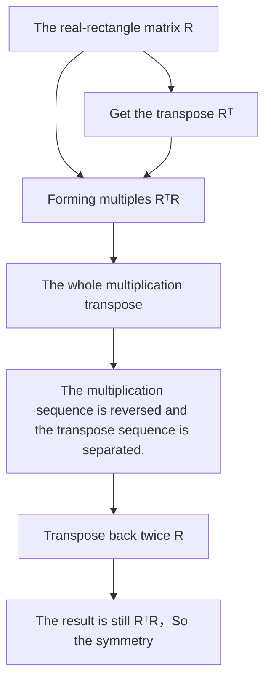

The class ended with the discussion of substitution, transpose and symmetry. Then began studying spaces made up of many vectors.

### 5. vector space: allows for all linear combinations

*reference timestamp: 00:20:17...  [Watch clip (P5 00:20:17)](https://www.bilibili.com/video/BV1ix411f7Yp/?p=5&t=1217))*

#### 5.1 The space shuttle can't just be a collection of random vectors

The most basic operations for vectors are two:

1. Add two vectors, for example  $v+w$.
2. So we're going to multiply a vector by a number, for example.  $3v$.

These numbers are commonly called **The scale** The second operation is called **Count the number** If a vector set is to be called a vector space, it must be able to add and multiply in it and have the result of the calculation remain in that set.

The combination of two operations is a linear combination:

$$
cv+dw.
$$

This is it.  $c,d$  The space shell has more content than the number of vector shells because it must contain all linear combinations that these vectors can generate.

#### 5.2 The best known example is the two-dimensional real vector space

$\mathbb R^2$  The class lists the set of all binary real vectors.

$$
\begin{pmatrix}3\\2\end{pmatrix},\qquad
\begin{pmatrix}0\\0\end{pmatrix},\qquad
\begin{pmatrix}\pi\\e\end{pmatrix}.
$$

This is it.  $\mathbb R$  The exponent is a real number, and the symbol 2 represents that each vector has two exponents. It contains infinitely many vectors, which are listed just to confirm what the object is.

The following are the most commonly used methods of calculating the value of a given quantity.

$$
\begin{pmatrix}3\\2\end{pmatrix}
+\begin{pmatrix}\pi\\e\end{pmatrix}
=\begin{pmatrix}3+\pi\\2+e\end{pmatrix}.
$$

So, the second is a binary real vector.  $\mathbb R^2$  In the mean. Any real number multiplied by a natural number is of the same nature.

In geometry, we can go from the origin to the point.  $(3,2)$  Draw an arrow that represents the first vector: vertical, 3 and 2 vectors.  $(\pi,e)$  The zero vector is located at the origin, and although there are no visible length arrows, it is a very important vector.

*⏱ Timestamp: 00:24:58 · 📷 Lecture screenshot · [Watch clip (P5 00:24:58)](https://www.bilibili.com/video/BV1ix411f7Yp/?p=5&t=1498)*

So it's usually said  $\mathbb R^2$  Yes, I did.  $xy$  The plane; algebraically speaking, it is a vector space that can contain all binary real vectors and their linear combination.

#### 5.3 Why can't the originals be removed from space?

If you can  $\mathbb R^2$  The original vector space is not a vector space.

First, as long as  $(3,2)^T$  In a set, multiplication must be allowed to multiply by zero:

$$
0\begin{pmatrix}3\\2\end{pmatrix}
=\begin{pmatrix}0\\0\end{pmatrix}.
$$

If zero vector is deleted, the result of this legitimate operation is outside the assembly. Second, a vector, instead of a vector, will get zero:

$$
\begin{pmatrix}3\\2\end{pmatrix}
+\begin{pmatrix}-3\\-2\end{pmatrix}
=\begin{pmatrix}0\\0\end{pmatrix}.
$$

It is impossible to remove it from the numbering or addition. **Each vector space must contain zero vectors.**

#### 5.4 3D and higher dimensions: see fractional numbers, not non-zero numbers

$\mathbb R^3$  The space is made up of all three dimensions real vectors.

$$
\begin{pmatrix}3\\2\\0\end{pmatrix}
$$

It belongs to  $\mathbb R^2$  Still  $\mathbb R^3$ The answer is:  $\mathbb R^3$ It has three dimensions, the last of which is actually zero; zero is still a legal dimension and cannot be considered as a cube without this dimension.

*⏱ Timestamp: 00:27:40 · 📷 Lecture screenshot · [Watch clip (P5 00:27:40)](https://www.bilibili.com/video/BV1ix411f7Yp/?p=5&t=1660)*

In general, $\mathbb R^n$  Includes all  $n$  The vectors of the real divisors. This course unifies them into a series vector; multiples and repeats are discussed later, and both the scales and the divisors in this talk take real numbers.

Strang mentioned that addition and multiplication of vector spaces must also meet the eight rules listed in the textbook. He did not go through them here, because those rules have already been established when we use familiar fractional operations. **Do you do the calculations in a selected set and do you still have results in that set?**

### Closure: Identifying a set of non-spatial layers by contrasting case

*reference timestamp: 00:29:51...  [Watch clip (P5 00:29:51)](https://www.bilibili.com/video/BV1ix411f7Yp/?p=5&t=1791))*

#### 6.1 Why is the first square not enough?

From  $\mathbb R^2$  The middle takes the first square and its boundary, i.e., both of these dimensions are nonnegative vectors:

$$
Q=\left\{\begin{pmatrix}x\\y\end{pmatrix}:x\geq0,\ y\geq0\right\}.
$$

This collection is doing well with the graphics.  $(3,2)^T$  and  $(5,6)^T$  The first is the Sagas, which remains in the first quadrant:

$$
\begin{pmatrix}3\\2\end{pmatrix}
+\begin{pmatrix}5\\6\end{pmatrix}
=\begin{pmatrix}8\\8\end{pmatrix}.
$$

The problem arises in numerical multiplication. To allow for any real number, it is necessary to allow negative numbers, such as those used in classrooms.  $-5$: 

$$
-5\begin{pmatrix}3\\2\end{pmatrix}
=\begin{pmatrix}-15\\-10\end{pmatrix}.
$$

The result is that the third quadrant has been removed.  $Q$  So, what is the meaning of this? $Q$ **Closed to the graph, but not closed to any real number** The vector space is not possible.

*⏱ Timestamp: 00:31:13 · 📷 Lecture screenshot · [Watch clip (P5 00:31:13)](https://www.bilibili.com/video/BV1ix411f7Yp/?p=5&t=1873)*

The closed loop is very specific here: the result remains in the set after selecting an operand within a set and completing the allowed operations. It says that the operations of these algebra are closed.

#### 6.2 A successful operation cannot prove closure

To prove the addition of a closed set, it is necessary to allow the collection to be **Any two** The sum of vectors is all contained in the set; to prove that a number is closed, it must be allowed **The real numbers** Including zero and negative numbers.

The first quadratic counterexample states: seeing only a few successful additionals, or testing only positive numbers, is not enough to prove that a set is a vector space. On the contrary, finding an allowed operation that crosses the boundary of the result is sufficient to negate the closure of the corresponding one.

Adding and multiplying together can be written as: for all  $v,w$  All real numbers in the set  $c,d$ All of them.  $cv+dw$  It's in the collection.

### 7. subspace: containing a vector, must contain all its multiples

*reference timestamp: 00:31:31...  [Watch clip (P5 00:31:31)](https://www.bilibili.com/video/BV1ix411f7Yp/?p=5&t=1891))*

#### 7.1 subspace is a small space that can still be created in large space

The first quadrant is a failed partial derivative of the equation.  $\mathbb R^2$  Take a smaller set, but you can still add and multiply it, and never leave the set.

This is a set of vector spaces that contains the same number of points.  $\mathbb R^2$  The name is  $\mathbb R^2$  of **Subspace**.

Do not consider a subspace array as any region. It must be closed under large-space operations and kept closed under those operations.

#### 7.2 A non-zero vector will produce a straight line

Suppose a subspace contains non-zero vectors  $v$ The number of times the closure is required to include:

$$
2v,\quad 0v,\quad \tfrac12v,\quad \tfrac34v,\quad -\tfrac12v,\quad -v,
$$

In geometry, these multiples fill a complete straight line through the origin: positive or negative direction, and no point can be missed.

Therefore, one cannot call a straight line subspace by just one vector arrow, a finite line segment or a single-way ray.

The next step is to check the addition. If both vectors are on this line, they can be written separately as  $cv$  and  $dv$ So, what?

$$
cv+dv=(c+d)v,
$$

The result is still on the same line. Thus, both multiplication and addition are checked, so that the entire line crossing the origin point is indeed a subspace.

#### 7.3 Why is the line not working after a horizontal?

The classroom also draws a null line in the diagram that does not pass through the original point. Although it is also a straight line, it cannot be a subspace: take any vector on the line, multiply by zero and get the origin; the original line is not on this null line.

*⏱ Timestamp: 00:35:41 · 📷 Lecture screenshot · [Watch clip (P5 00:35:41)](https://www.bilibili.com/video/BV1ix411f7Yp/?p=5&t=2141)*

Here is a very effective quick check: **Any subspace must contain a zero vector.**

> **Editor's note** The first quadrant of the previous section contains a zero vector, which still fails to be multiplied by negative numbers.  $\mathbb R^n$  In subspace, the closure of addition and multiplication by any real number is also checked; other vector space rules are calculated by inheritance using the original distribution.

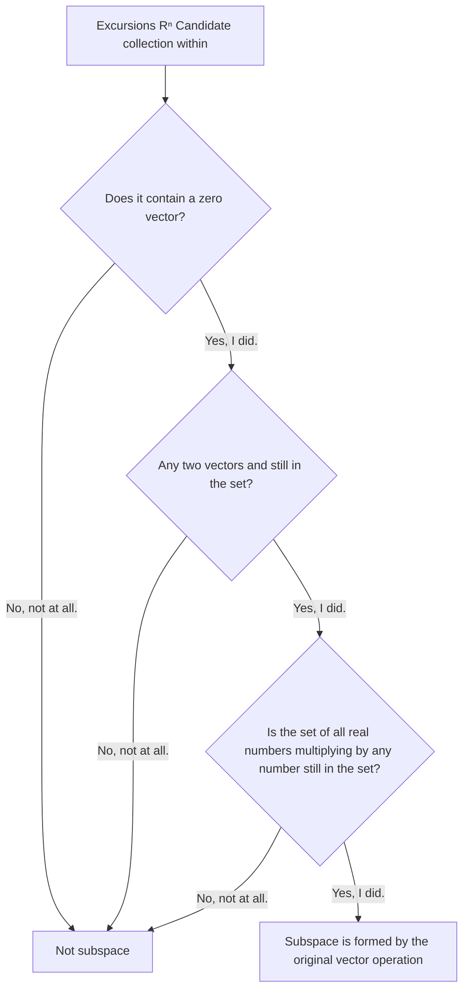

> **Editor's note** The diagram shows the classroom's thinking of subspaces as a check step. Assuming that the candidate set is in an existing vector space and uses the same set of vector operations.

### 8. Subspace overview of two- and three-dimensional space

*reference timestamp: 00:35:48...  [Watch clip (P5 00:35:48)](https://www.bilibili.com/video/BV1ix411f7Yp/?p=5&t=2148))*

#### 8.1 Two-dimensional only three-dimensive

$\mathbb R^2$  The subspace is divided into three categories:

| Type of the | What is a collection? | Why aren't calculations crossed? |
| --- | --- | --- |
| The whole thing  $\mathbb R^2$ | All binary quantity real vectors | Adding and multiplying still produce binary real vectors |
| The line crosses the original line | The real times of all non-zero vectors | The multiples are multiples plus multiples, and the multiples are still multiples |
| Zero subspace  $\{0\}$ | Only zero vectors | 0 plus zero is still zero, and any number multiplied by zero is still 0. |

The largest class is the entire space itself. Subspace allowed equals original space, and the parent class does not require it to be smaller. The smallest class contains only zero vectors; it is not a vacuum set but indeed has one vector.

Strang uses a very straightforward example to illustrate the zero subspace: adding a zero vector to itself, it still gets zero; multiplying by 17 also gets zero. Neither of the two required operations left this single-point set.

*⏱ Timestamp: 00:38:50 · 📷 Lecture screenshot · [Watch clip (P5 00:38:50)](https://www.bilibili.com/video/BV1ix411f7Yp/?p=5&t=2330)*

#### 8.2 A straight line in a plane with one-dimensional space

The line crossing the original point looks like  $\mathbb R^1$ Strang specifically points out that the two cannot be directly considered as the same set.

This line is located in  $\mathbb R^2$  In the middle, its vector has two divisors. $\mathbb R^1$  The vector is a single fraction. The geometry is close to each other, and does not represent the way the vector is represented.

This is a  $(3,2,0)^T$  The following example is a case of: do not remove the number of vectors because they can move in less directions, or because some fraction is zero.

#### 8.3 Three-dimensional: A plane that crosses the origin

$\mathbb R^3$  The four classes of subspace that react with the median are:

1. The whole thing  $\mathbb R^3$.
2. The first is the square of the distance from the origin.
3. The first is the line of sight.
4. Just include  $(0,0,0)^T$  The subspace is zero.

*⏱ Timestamp: 00:39:36 · 📷 Lecture screenshot · [Watch clip (P5 00:39:36)](https://www.bilibili.com/video/BV1ix411f7Yp/?p=5&t=2376)*

The two ends are still the whole space shell and the zero subspace shell, while the middle is a linear set of over-originals of different sizes. Two-dimensional, three-dimensive can be drawn; only after understanding these images can one continue to process high-dimension spaces that cannot be directly drawn.

### 9. column space: generates a complete subspace from the columns of the matrix

*reference timestamp: 39:47...  [Watch clip (P5 00:39:47)](https://www.bilibili.com/video/BV1ix411f7Yp/?p=5&t=2387))*

#### 9.1 Two-column vectors are not a space

The teacher returned to the previous matrix and re-recorded it as  $A$: 

$$
A=\begin{pmatrix}
1&3\\
2&3\\
4&1
\end{pmatrix}.
$$

The two columns are:

$$
a_1=\begin{pmatrix}1\\2\\4\end{pmatrix},\qquad
a_2=\begin{pmatrix}3\\3\\1\end{pmatrix}.
$$

Both rows are  $\mathbb R^3$  A vector in a set. If you put these two rows into one, it cannot be called a subspace because adding or multiplying will produce new vectors that must be admitted.

For example, it must contain a zero vector and also the sum of two columns explicitly mentioned in the class:

$$
a_1+a_2=\begin{pmatrix}4\\5\\5\end{pmatrix}.
$$

It must also contain the triple-three of a column plus one, and all other real-time multiples. **Take all the linear combinations of these two rows.**

#### 9.2 Definition of column space

The set of all linear combinations of columns in a matrix is called the **Column space** The classroom notes  $C(A)$: 

$$
\boxed{C(A)=\{c_1a_1+c_2a_2:\ c_1,c_2\in\mathbb R\}}.
$$

For more column matrices, the entire row can be included in a linear combination, and the coefficients can be any real number. The objects of the column space are still vectors whose fractional numbers are determined by the number of rows in the matrix.

*⏱ Timestamp: 00:42:55 · 📷 Lecture screenshot · [Watch clip (P5 00:42:55)](https://www.bilibili.com/video/BV1ix411f7Yp/?p=5&t=2575)*

Why is it that we can say that all linear combinations are subspaces? The reason for this class is that the necessary addition and multiplication results are already included.

> **Editor's note**: Expressing the argument in terms of coefficients makes the meaning of “all” easier to verify.

If you:

$$
u=c_1a_1+c_2a_2,\qquad
w=d_1a_1+d_2a_2,
$$

The two are in the same order:

$$
u+w=(c_1+d_1)a_1+(c_2+d_2)a_2,
$$

It is still a linear combination of the two rows.  $t$: 

$$
tu=(tc_1)a_1+(tc_2)a_2,
$$

The set is also still in this set. To take all coefficients to zero, the zero vector naturally contains it.

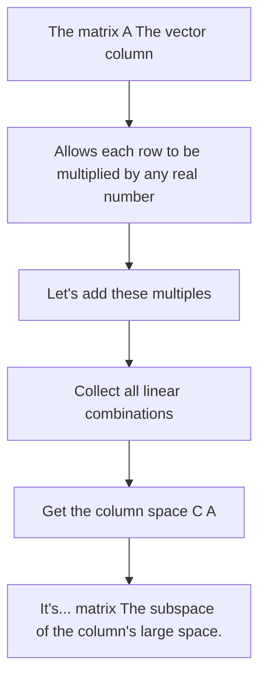

#### 9.3 These two columns fill a plane in 3D

In  $\mathbb R^3$  The picture is  $a_1$  and  $a_2$ The two lines are not on the same line crossing the origin. First allowing all their multiples, two lines are obtained; then allowing each of the two lines to be added by a vector to fill in the entire combination between them.

The result is that the **A plane through the original point** It contains these two columns, the two-column sum, the zero vector, and all other linear combinations; but it does not fill the whole.  $\mathbb R^3$.

*⏱ Timestamp: 00:45:19 · 📷 Lecture screenshot · [Watch clip (P5 00:45:19)](https://www.bilibili.com/video/BV1ix411f7Yp/?p=5&t=2719)*

Strang emphasizes that the image must be understood: column space is not a set of two arrows in a matrix, but an entire plane generated by a combination of all of them.

If two columns are located on the same line crossing the origin, their combination will only fill that line. This is because the two lines point in different directions. The shape of space depends on the relationship between the vectors, not simply the number of columns determined.

#### 9.4 Five ten-dimensional vectors, not five-dimension vectors

The class then moved the question to Gove: if there are five, what is the answer?  $\mathbb R^{10}$  What do you get from taking all the linear combinations of vectors, each with ten elements?

So it's a ten-dimensional vector, so this is the same thing as the ten-dimension vector.  $\mathbb R^{10}$  So if we have a subspace that can't be made up of five vectors because it has a combination of these, then this is going to be the same thing as a subsphere.  $\mathbb R^5$.

If they provide five independent directions, a five-dimensional plane of the set of vectors is obtained and must pass through the origin. But if all five vectors are on the same line, all combinations can only get that line. The actual situation depends on the five vectors themselves.

This high-dimensional example reminds us once again of three things:

| The information | It decides or limits what | Classroom examples |
| --- | --- | --- |
| The number of components per vector | The vector space | The quantity of vectors belongs to  $\mathbb R^{10}$ |
| It's a combination. vector Number | How many generating vectors are available for the combination | Five ten-dimensional vectors |
| The directional relationship between vectors | The actual size of the generated subspace | All the lines are in a straight line. |

#### 9.5 The next talk is to re-interpret the equation in this language

The following is a review of the presentation, which ends in column space:

$$
Ax=b.
$$

Now not only do we look at it as a linear equation, but we're ready to see if the linear combination of the column matrix can be reached.  $b$ The question of the mother.

> **Editor's note** For this case, the order  $x=(x_1,x_2)^T$ The matrix is multiplied by the  $Ax=x_1a_1+x_2a_2$ So, the monkey can find  $x$  I made it  $Ax=b$ The value of mercury is equal to mercury. $b$  Located in  $C(A)$ . This is the natural advance at the end of this statement, where the structure of column space, null space and the solution left for follow-up is discussed in full.

### 10. After-reading check: Connect the operations, sets and geometries

> **Editor's note** The following questions and answers are used for the review, as a learning aid based on the content of the presentation, not as classroom subjects arranged by the lecturer.

#### 10.1 Five inspection questions

**Question 1: What is the meaning of invertiblematrixelimination when it comes to zero pivot?**

The current sequence is not suitable for direct continuous elimination, and can be obtained by switching non-zero pivot.  $PA=LU$; matrix cannot be asserted to be irreversible by this zero pivot alone.

**Question 2: Why can't transpose be understood as a mercury-shaped mercury?**

Except for the  $m\times n$  Changes  $n\times m$ It also requires that each element is  $(i,j)$  Moving  $(j,i)$ The shape and position of the elements must be both correct.

**Question 3: The first quadrant contains zero vector, and can be added, so why not subspace?**

Because multiplication allows all real numbers. The positive vector multiplied by the negative number leaves the first quadrant, so multiplication by the closed one fails.

**Question 4: Is the set of only zero vectors too small to be called space?**

zero vector is zero. The sum of the multiples of subspace is still zero; the set is small but fully satisfies the requirements for closing operations.

**Question 5: Is the column space of a three-column two-column matrix necessarily the entire three-dimensional space?**

No. The two columns of this article generate a plane at a previous point; if the two columns co-line, only a straight line can be generated. The column vector has three points, indicating that column space is located  $\mathbb R^3$  It's not like it's equal to the whole  $\mathbb R^3$.

#### 10.2 Conflict of terms

| Chinese | English | The meaning of this speech |
| --- | --- | --- |
| The permutation matrix | permutation matrix | The identity matrix is a matrix obtained after the row rearrangement |
| The pivot | pivot | Key location elements used in elimination |
| Transpose | transpose | Exchange rows |
| The symmetric matrix | symmetric matrix | The matrix that remains unchanged after transpose |
| The scale, the number of times | scalar, scalar multiplication | The real numbers and their multiplication of vectors |
| Linear combination | linear combination | The vector multiplied by the real number |
| Closure | closure | The selected set is still in the selected set after the allowed operations are performed |
| vector space | vector space | Supports vector addition and multiplication of sets and satisfies the corresponding rules |
| Subspace | subspace | The vector space is located inside the existing vector space using the same calculation. |
| Column space | column space | The space that contains all linear combinations of the columns in a matrix |

### Additional: Official reference and extended reading

The following resources are all relevant to the content of this talk, so that it is easy to go back to verifying the raw material.

1. [The first is the study of linear algebra in a classroom.](https://ocw.mit.edu/courses/18-06-linear-algebra-spring-2010/) The program is available in English, French and Spanish.
2. [Lecture 5: Transposes, permutations, spaces Rⁿ](https://ocw.mit.edu/courses/18-06-linear-algebra-spring-2010/resources/lecture-5-transposes-permutations-spaces-r-n/) The main basis for the re-construction of the original translation is the official video pages and English subtitles.
3. [5th official subtitle VTT](https://ocw.mit.edu/courses/18-06-linear-algebra-spring-2010/eb5a7fe66ff6537aac15662f73d424b7_JibVXBElKL0.vtt) The code contains the original timecode; local data is also stored  `transcript.official.vtt`, `transcript.json`  and piece by piece  `transcript.txt`.
4. [18.06SC: Transposes, Permutations, Vector Spaces](https://ocw.mit.edu/courses/18-06sc-linear-algebra-fall-2011/pages/ax-b-and-the-four-subspaces/transposes-permutations-vector-spaces/) The official unit of learning, attached lectures, thesis and thesis explanations; used to verify the terminology and matrix examples.
5. [The official summary of the lecture PDF](https://ocw.mit.edu/courses/18-06sc-linear-algebra-fall-2011/33b21afab62ea8df6c7bd241240df60d_MIT18_06SCF11_Ses1.5sum.pdf) The following is a summary of the transpose, vector space, closure, subspace and column space.
6. [The official YouTube of MIT OCW is the same.](https://www.youtube.com/watch?v=JibVXBElKL0) The video link to the book is still directed at user-designated B station 5P.

**Author's signature and transcription** The original course was taught by Gilbert Strang, and the course materials were published by MIT OpenCourseWare; the book was translated into Chinese using the same official subtitles, structured and verified with reference to the official abstract symbols.  [Creative Commons Attribution–NonCommercial–ShareAlike 4.0(CC BY-NC-SA 4.0)](https://creativecommons.org/licenses/by-nc-sa/4.0/) Please keep the source, signature, license link and modification information.

---

