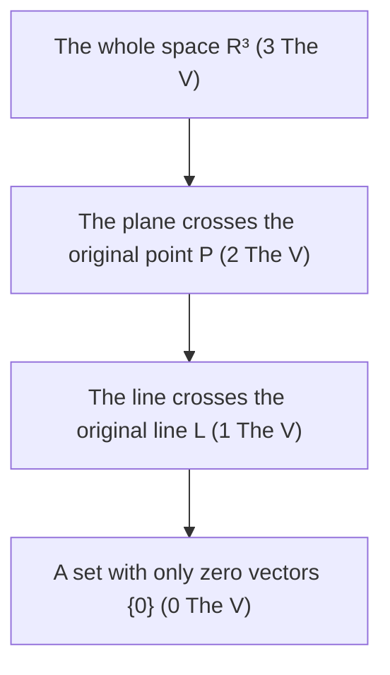
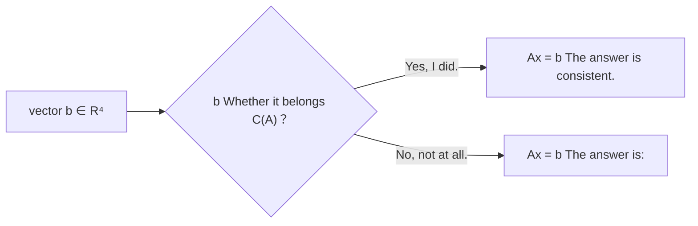
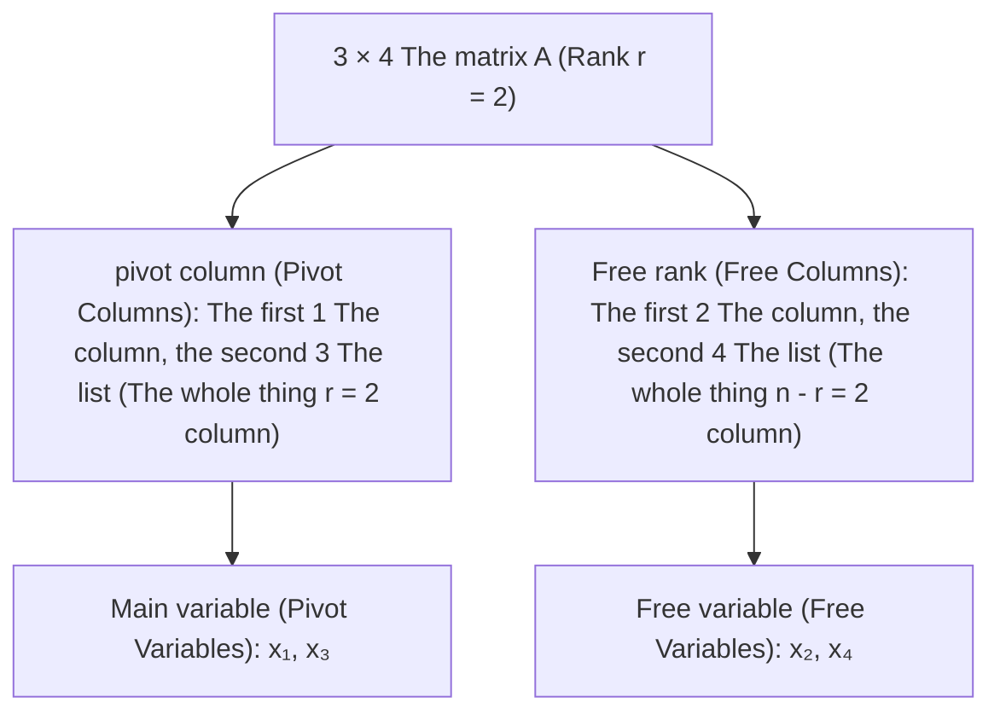
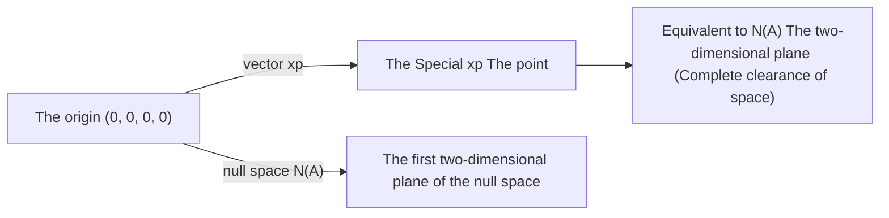
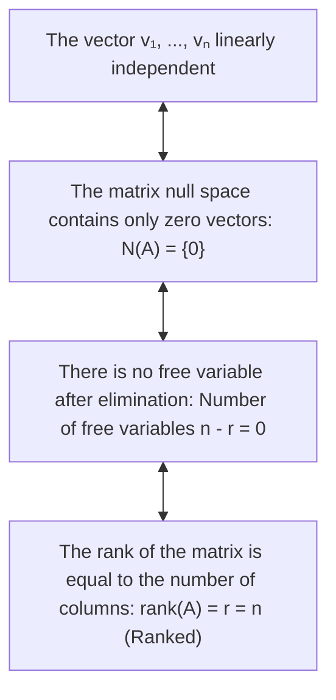
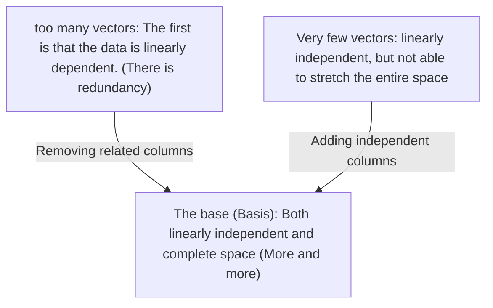
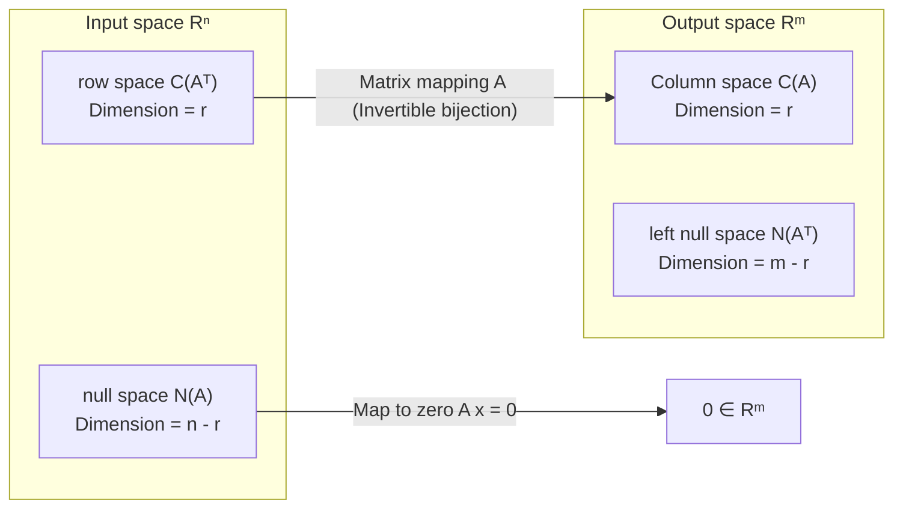
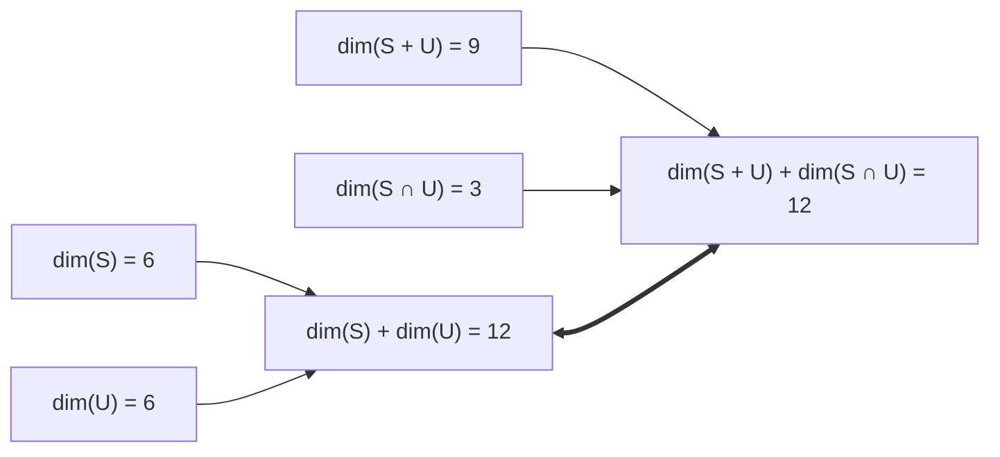
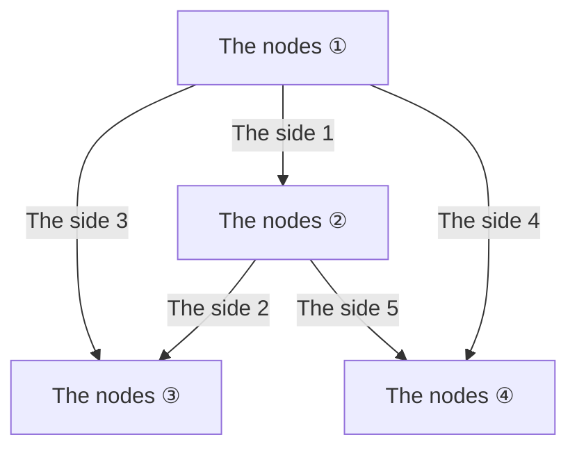
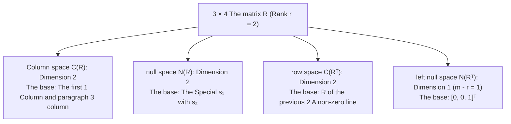

> **Lecture** The following is a list of the most common causes of death in children:  
> **The product** VideoBook: Video open source technology and e-books flow waterline  
> **Full size of book** The following are the main topics covered: 35 full-length editions; 5 major knowledge system modules; 357 original high definition tablets; 260 core introduction time frames.  
> **Video source**: [The official full set of Bilibili (BV1ix411f7Yp)](https://www.bilibili.com/video/BV1ix411f7Yp/) · [MIT OpenCourseWare 18.06 (Spring 2010)](https://ocw.mit.edu/courses/18-06-linear-algebra-spring-2010/)  
> **Copyright and licenses**: The text content and formula graphics are compiled and structured by MIT OCW Open Course Materials Translation, instructor Gilbert Strang, following  [CC BY-NC-SA 4.0](https://creativecommons.org/licenses/by-nc-sa/4.0/)  Knowledge Sharing License Agreement. Full bookshelf clips are taken from the official public lecture video.

---

> 📚 **Module overview**: crossing the barrier of prime algebra, constructing abstraction vector space and subspace theory; systematically solving equations  $Ax=0$  It's a very special, completely unknown.  $x = x_p + x_n$ The theory of linear algebra is also used in the analysis of the four fundamental subspaces of the matrix (column space, null space, row space, left null space) and the fundamental theorem of linear Algebra.

---

## The sixth lecture: column space and null space

> 📺 **Video link back**: [B Station 6 P: column space and null space](https://www.bilibili.com/video/BV1ix411f7Yp/?p=6) (⏱ 45m 58s · 10 screenshots)  
> 📖 **Official material**: [MIT OCW correspondence and summary](https://ocw.mit.edu/courses/18-06-linear-algebra-spring-2010/resources/lecture-6-column-space-and-nullspace/)  
> 💡 **Key ideas**: vector space theorem, R3 subspace form, intersection and conjugation theorem, Ax = b solvability theorem, null space is a rigorous proof of subspace.

---

### 1. Core nature of vector space: the closure of linear combination

*(reference timestamp: 00:01:00 )  [Watch clip (P6 00:01:00)](https://www.bilibili.com/video/BV1ix411f7Yp/?p=6&t=60))*

And at the end of this last talk, we're officially entering the heart of linear algebra. **The first is the vector space. **with** Subspace (subspace)** From this point on, there must be a critical shift in our thinking: we must not focus solely on individual vectors or specific numerical values but also on the calculation of the value of the data. **The whole vector set** The first is the "Golden Age".

What is vector space? Roughly speaking, vector space is a set of vectors within which we allow two basic algebraic operations:
1. **vector plus**: adding any two vectors in the set, and the result is still a part of the set;
2. **Numerical multiplication**: Any vector in a set multiplies the number of real numbers, and the result remains with that set.

The two laws are combined into one, and that is the same thing. **The closure of linear combinations**: 

$$
\forall v, w \in V, \quad \forall c, d \in \mathbb{R} \implies cv + dw \in V
$$

As long as a set is closed to any linear combination of real numbers and satisfies the eight standard algebraic axioms (algorithmic substitution law, conjugation law, zero vector existence, addition inverse existence, etc.), it is a valid real vector space.

*⏱ Timestamp: 00:03:10 · 📷 Lecture screenshot · [Watch clip (P6 00:03:10)](https://www.bilibili.com/video/BV1ix411f7Yp/?p=6&t=190)*

> \[!NOTE\] The inevitability of a zero vector is that we have the dimension given by the number-by-closure of any measure.  $c = 0$ The  $0 \cdot v = \mathbf{0}$ It means: **Any vector space or subspace must contain zero vectors without any conditions.  $\mathbf{0}$!**

---

### 2. $\mathbb{R}^3$  The whole subspace

*reference timestamp: 00:03:30...  [Watch clip (P6 00:03:30)](https://www.bilibili.com/video/BV1ix411f7Yp/?p=6&t=210))*

A vector space  $V$  of **Subspace (subspace)**, meaning that it lies in  $V$  A subset within a subset that itself is still an independent vector space under the addition and multiplication operations of the original space.

To create an intuitive image, we explore the three-dimensional real world.  $\mathbb{R}^3$- I'm going to.  $\mathbb{R}^3$  What geometric objects are inside the subspace that constitute a legitimate ZXQA?

Professor Strang lists the whole thing on a blackboard.  $\mathbb{R}^3$  The subspace is a type of ZXQA.

1. **The whole space  $\mathbb{R}^3$  The self** The result is a three-dimensional vector: any two three dimensional vectors plus one are three dimensive vectors, and any number multiplied by one is three dimensions.  $\mathbb{R}^3$  The first is subspace.
2. **All through the original  $(0, 0, 0)$  The plane  $P$**: 
   - If a plane does not pass through the origin, it does not contain a zero vector, so it is absolutely not subspace!
   - If the plane crosses a point of origin, and two vectors are added to it by the parallel quadratic law, their sides lie within the plane; any arbitrary stretching or reverse scaling is impossible to fly off the plane.
3. **All through the original  $(0, 0, 0)$  of the straight line  $L$**: 
   - The vector along the line, however it is scaled or combined with that line, always remains on the line.
4. **The normal subspace containing only zero vectors  $\mathbf{Z} = \{\mathbf{0}\}$**: 
   - The first is the "Closure" test. $\mathbf{0} + \mathbf{0} = \mathbf{0}$, $c \cdot \mathbf{0} = \mathbf{0}$ It is the lowest zero-dimensional subspace of dimension.

*⏱ Timestamp: 00:06:40 · 📷 Lecture screenshot · [Watch clip (P6 00:06:40)](https://www.bilibili.com/video/BV1ix411f7Yp/?p=6&t=400)*

---

### 3. Algebraic operations of subspace: merging and intersecting

*reference timestamp: 00:06:30...  [Watch clip (P6 00:06:30)](https://www.bilibili.com/video/BV1ix411f7Yp/?p=6&t=390))*

So let's say we are in the same mother space, for example.  $\mathbb{R}^3$ The subspace is legal.  $S_1$  and  $S_2$ We're going to explore whether the set of operations can create a new subspace:

#### 3.1 The merger of two subspaces  $S_1 \cup S_2$  is generally not a subspace

Consider two different lines that cross the origin  $L_1$  and  $L_2$ They are combined.  $L_1 \cup L_2$  The sum of all points on the two lines.
- In  $L_1$  Take a non-zero vector up  $v$; 
- In  $L_2$  Take a non-zero vector up  $w$; 
- They are  $v + w$  The equilateral quadrilateral line that is stretched along the two lines is not  $L_1$  Up, not up.  $L_2$  Up!
- Therefore, $v + w \notin L_1 \cup L_2$ The government has also been trying to prevent the spread of terrorism. **It's not usually subspace.**.

#### 3.2 Intersection of two subspaces  $S_1 \cap S_2$  must be a subspace

Suppose the plane  $P$  and straight lines  $L$  Yes, I did.  $\mathbb{R}^3$  The two subspaces explore their intersection.  $P \cap L$: 
- If the line is straight  $L$  Not on the plane  $P$  In the case of a single zero vector, since both must pass through the origin point, they are at least and only connected to the unique zero vector.  $\mathbf{0}$ The intersection is  $\{\mathbf{0}\}$ The subspace is legal.
- If the line is straight  $L$  It's just a matter of getting it right.  $P$  In the middle, the intersection is a straight line.  $L$  The subspace is legal.
- The intersection of two planes is usually a straight line through the origin, which remains subspace!

*⏱ Timestamp: 00:09:20 · 📷 Lecture screenshot · [Watch clip (P6 00:09:20)](https://www.bilibili.com/video/BV1ix411f7Yp/?p=6&t=560)*

> The strict algebraic proof of the intersectional theorem is that  $S$  and  $T$  It's vector space.  $V$  The two subspaces, let's take  $v, w \in S \cap T$  by measure  $c, d$: 
> 1. because  $v, w \in S$ and  $S$  So, what is the subspace?  $cv + dw \in S$; 
> 2. because  $v, w \in T$ and  $T$  So, what is the subspace?  $cv + dw \in T$; 
> 3. Therefore  $cv + dw \in S \cap T$ I'm not sure what the hell happened to you. **The intersection of any number of subspaces is always a subspace**.

---

### The column space of the matrix is 4.  $C(A)$)

*(reference timestamp: 00:10:00)  [Watch clip (P6 00:10:00)](https://www.bilibili.com/video/BV1ix411f7Yp/?p=6&t=600))*

Now, we're going to turn our eyes from geometric abstraction to the matrix itself.  $m \times n$  The matrix  $A$ The vector column belongs to  $\mathbb{R}^m$.

Consider the classic example of a matrix given by Professor Strang:

$$
A = \begin{bmatrix}
1 & 1 & 2 \\
2 & 1 & 3 \\
3 & 1 & 4 \\
4 & 1 & 5
\end{bmatrix}
$$

This is a  $4 \times 3$  The matrix:
- Each row vector has four dimensions, which is a four-dimensional space.  $\mathbb{R}^4$  The vector in the middle.
- The three vectors are:
  $$
  c_1 = \begin{bmatrix} 1 \\ 2 \\ 3 \\ 4 \end{bmatrix}, \quad
  c_2 = \begin{bmatrix} 1 \\ 1 \\ 1 \\ 1 \end{bmatrix}, \quad
  c_3 = \begin{bmatrix} 2 \\ 3 \\ 4 \\ 5 \end{bmatrix}
  $$

*⏱ Timestamp: 00:12:30 · 📷 Lecture screenshot · [Watch clip (P6 00:12:30)](https://www.bilibili.com/video/BV1ix411f7Yp/?p=6&t=750)*

#### 4.1 Strict definition of column space

> **Definition: column space  $C(A)$**  
> The matrix  $A$  The column space is written  $C(A)$ It was made by  $A$  The set of all linear combinations of vectors is given by the following formula:
> $$
> C(A) = \left\{ x_1 c_1 + x_2 c_2 + \cdots + x_n c_n \ \middle|\ x_i \in \mathbb{R} \right\} = \left\{ Ax \ \middle|\ x \in \mathbb{R}^n \right\}
> $$
> And the vectors are all  $\mathbb{R}^m$, so  **$C(A)$  Yes, I did.  $\mathbb{R}^m$  The subspace of a**.

In this case, $C(A)$  is the four-dimensional space  $\mathbb{R}^4$  The first is the subspace.

---

### 5. system of linear equations  $Ax = b$  The solvable nature of

*(reference timestamp: 00:16:30 ·)  [Watch clip (P6 00:16:30)](https://www.bilibili.com/video/BV1ix411f7Yp/?p=6&t=990))*

Why is column space so important? because it directly answers the fundamental question of linear algebra: **What about the right knee?  $b$ system of equations  $Ax = b$  You know what?**

The law of the set multiplied by a matrix and vector is:

$$
Ax = x_1 \begin{bmatrix} 1 \\ 2 \\ 3 \\ 4 \end{bmatrix} + x_2 \begin{bmatrix} 1 \\ 1 \\ 1 \\ 1 \end{bmatrix} + x_3 \begin{bmatrix} 2 \\ 3 \\ 4 \\ 5 \end{bmatrix} = \begin{bmatrix} b_1 \\ b_2 \\ b_3 \\ b_4 \end{bmatrix} = b
$$

So, if we solve equations, that means we can find a set of coefficients.  $x_1, x_2, x_3$ So the linear combination of these three columns is exactly equal to  $b$.

*⏱ Timestamp: 00:18:20 · 📷 Lecture screenshot · [Watch clip (P6 00:18:20)](https://www.bilibili.com/video/BV1ix411f7Yp/?p=6&t=1100)*

> Linear algebra is the fundamental determining principle of \[!IMPORTANT\]
> **system of linear equations  $Ax = b$  The solution is to use the right-hand vector  $b$  Located in the coefficient matrix  $A$  The column space  $C(A)$  In the middle.**

#### 5.1 The real dimension of the column space in this case

The three vectors are:
$$
c_3 = \begin{bmatrix} 2 \\ 3 \\ 4 \\ 5 \end{bmatrix} = \begin{bmatrix} 1 \\ 2 \\ 3 \\ 4 \end{bmatrix} + \begin{bmatrix} 1 \\ 1 \\ 1 \\ 1 \end{bmatrix} = c_1 + c_2
$$

The third column is completely the same as the first two. It's not working. column space Bringing any new direction:
- The first two rows are the same space as the third.
- The first two lines are not linearly independent from each other.
- Therefore, $C(A)$  It's a 4D space embedded in the universe.  $\mathbb{R}^4$  In the middle **Two-dimensional superplane**.

*⏱ Timestamp: 00:24:10 · 📷 Lecture screenshot · [Watch clip (P6 00:24:10)](https://www.bilibili.com/video/BV1ix411f7Yp/?p=6&t=1450)*

---

### 6. The Null Space of a Matrix (Nullspace,  $N(A)$)

*(reference timestamp: 00:28:40 ·)  [Watch clip (P6 00:28:40)](https://www.bilibili.com/video/BV1ix411f7Yp/?p=6&t=1720))*

Now we introduce the second critical subspace to be driven in tandem with the column space. **The first is the "Null Space".**.

#### 6.1 Definition of null space

> **Definition: null space  $N(A)$**  
> The matrix  $A$  The null space is written  $N(A)$ It's a system of linear equations.  $Ax = 0$  The vector of all  $x$  The following are the lists of the groups:
> $$
> N(A) = \left\{ x \in \mathbb{R}^n \ \middle|\ Ax = \mathbf{0} \right\}
> $$

The following is a list of the most common types of radiation exposure:
- The matrix  $A$  Yes, I did.  $m \times n$ (Line 3 in column 4);
- Unknown vector  $x = \begin{bmatrix} x_1 \\ x_2 \\ x_3 \end{bmatrix}$  There are three unknown numbers that belong to the  $\mathbb{R}^3$; 
- Output results  $\mathbf{0} = \begin{bmatrix} 0 \\ 0 \\ 0 \\ 0 \end{bmatrix}$  It belongs to  $\mathbb{R}^4$; 
- **Therefore, $N(A)$  Yes, I did.  $\mathbb{R}^n = \mathbb{R}^3$  The subset!**

*⏱ Timestamp: 00:30:40 · 📷 Lecture screenshot · [Watch clip (P6 00:30:40)](https://www.bilibili.com/video/BV1ix411f7Yp/?p=6&t=1840)*

---

### 7. null space is the strict proof of subspace with specific solutions

*(reference timestamp: 00:35:00)  [Watch clip (P6 00:35:00)](https://www.bilibili.com/video/BV1ix411f7Yp/?p=6&t=2100))*

Why all the content  $Ax = \mathbf{0}$  The solution of a set can be automatically formed into a vector space.

#### 7.1 Strict algebraic testing

According to the subspace judgement,  $x, y \in N(A)$ It's the  $Ax = \mathbf{0}$  and  $Ay = \mathbf{0}$: 
1. **The closure of the CAF**: 
   $$
   A(x + y) = Ax + Ay = \mathbf{0} + \mathbf{0} = \mathbf{0} \implies x + y \in N(A)
   $$
2. **Numbered closure**: 
   $$
   A(cx) = c(Ax) = c \cdot \mathbf{0} = \mathbf{0} \implies cx \in N(A)
   $$

It depends entirely on the matrix multiplication. **Linear distribution laws** This is a very rigorous proof!  $N(A)$  It is a vector space.

*⏱ Timestamp: 00:36:20 · 📷 Lecture screenshot · [Watch clip (P6 00:36:20)](https://www.bilibili.com/video/BV1ix411f7Yp/?p=6&t=2180)*

> \[WARNING\] The equation is not even.  $Ax = b$  The solution is not subspace!  $b \neq \mathbf{0}$ The survey  $Ax = b$  has solution set:
> - The zero vector  $\mathbf{0}$  I'm not sure why.  $A\mathbf{0} = \mathbf{0} \neq b$); 
> - If  $Ax_1 = b$  and  $Ax_2 = b$ The  $A(x_1 + x_2) = 2b \neq b$ Thus, the unpaired set of equations does not pass through the origin point and is by no means subspace (it is a parallel imitation space).

#### 7.2 Solve the null space of an instance matrix

For the matrix  $A = \begin{bmatrix} 1 & 1 & 2 \\ 2 & 1 & 3 \\ 3 & 1 & 4 \\ 4 & 1 & 5 \end{bmatrix}$ I'm not sure.

$$
Ax = x_1 \begin{bmatrix} 1 \\ 2 \\ 3 \\ 4 \end{bmatrix} + x_2 \begin{bmatrix} 1 \\ 1 \\ 1 \\ 1 \end{bmatrix} + x_3 \begin{bmatrix} 2 \\ 3 \\ 4 \\ 5 \end{bmatrix} = \begin{bmatrix} 0 \\ 0 \\ 0 \\ 0 \end{bmatrix}
$$

The first is that the relationship between the two groups is not so clear. $c_1 + c_2 = c_3$ It is:
$$
1 \cdot c_1 + 1 \cdot c_2 - 1 \cdot c_3 = \mathbf{0}
$$

The first is that the "simple" of the word is not a simple one.
$$
x = \begin{bmatrix} 1 \\ 1 \\ -1 \end{bmatrix}
$$

The solution is always the same as the number of times:
$$
x = c \begin{bmatrix} 1 \\ 1 \\ -1 \end{bmatrix}, \quad \forall c \in \mathbb{R}
$$

In three-dimensional space  $\mathbb{R}^3$  In the middle, all these vectors form a line through the origin. **Linear**!

*⏱ Timestamp: 00:41:50 · 📷 Lecture screenshot · [Watch clip (P6 00:41:50)](https://www.bilibili.com/video/BV1ix411f7Yp/?p=6&t=2510)*

---

### 8. Full Summary: The core contrast of column space and null space

*(reference timestamp: 00:45:00)  [Watch clip (P6 00:45:00)](https://www.bilibili.com/video/BV1ix411f7Yp/?p=6&t=2700))*

In this speech, the aim is to  $m \times n$  The matrix  $A$ We have two core subspaces:

| The core dimension | Column space  $C(A)$ | null space  $N(A)$ |
| :--- | :--- | :--- |
| **Geometrically Hosted Space** | Located in the output space  $\mathbb{R}^m$  In the middle | Located in the input space  $\mathbb{R}^n$  In the middle |
| **Algebraic definition** | Linear combination of all column vectors  $\{Ax \mid x \in \mathbb{R}^n\}$ | The complete solution to the quadratic equation  $\{x \mid Ax = \mathbf{0}\}$ |
| **The core mission** | The decision  $Ax = b$  I'm not sure. $b \in C(A)$) | The uniqueness and structural freedom of equations |
| **In this case,** | $\mathbb{R}^4$  The two-dimensional plane | $\mathbb{R}^3$  A straight line in the middle |

*⏱ Timestamp: 00:45:10 · 📷 Lecture screenshot · [Watch clip (P6 00:45:10)](https://www.bilibili.com/video/BV1ix411f7Yp/?p=6&t=2710)*

Next, we'll introduce a systematic Gaussian elimination algorithm that takes the main variable and the free variable and completely attacks the general matrix.  $Ax = 0$  The answer to the null space!

---

## Question 7: Ax = 0: main variable and specification

> 📺 **Video link back**: [B, P: Find Ax = 0: main variable, specification](https://www.bilibili.com/video/BV1ix411f7Yp/?p=7) (⏱ 43m 06s · 10 screenshots)  
> 📖 **Official material**: [MIT OCW correspondence and summary](https://ocw.mit.edu/courses/18-06-linear-algebra-spring-2010/resources/lecture-7-solving-ax-0-pivot-variables-special-solutions/)  
> 💡 **Key ideas** The following are the main variables: square matrixelimination, staircase matrix U, major variable and free variable, specification reverse algebra, most concise R with RN=\[-F; I\] constructions.

---

### 1. Long-dimensional matrixelimination: the birth of the ladder matrix U

*(reference timestamp: 00:01:00 )  [Watch clip (P7 00:01:00)](https://www.bilibili.com/video/BV1ix411f7Yp/?p=7&t=60))*

In the last lecture, we defined the null space of a matrix.  $N(A)$ I'm satisfied with that.  $Ax = \mathbf{0}$  The subspace that makes up all the vectors of a space, but we only figured out by eye-watching. **The first method to solve the problem is to create a systematic algorithm that is rigorous and efficient, which solves any long-term matrix (rectangular matrix). $A$  null space.**

The core algorithms we use are still **The first is the Gaussian Elimination.** But unlike the previous counter-matrix elimination, the long-lateral matrix elimination results will no longer be strict upper triangle arrays but rather a linear one. **The row echelon matrix is the "Echelon Matrix"**.

#### 1.1 Classics  $3 \times 4$  Example matrix

Consider the classic matrix that Professor Strang runs through:

$$
A = \begin{bmatrix}
1 & 2 & 2 & 2 \\
2 & 4 & 6 & 8 \\
3 & 6 & 8 & 10
\end{bmatrix}
$$

This is a  $3 \times 4$  The matrix $m = 3$  Go, go. $n = 4$  The unknown vector  $x \in \mathbb{R}^4$ Right-handed collarbone  $\mathbf{0} \in \mathbb{R}^3$.

The elimination steps are as follows:
1. **Determine whether line 1 (1) is pivoted**: $a_{11} = 1$ (not zero);
2. **Delete the elements below column 1**: 
   - The second row is subtracted  $2 \times$  First line: multiples  $l_{21} = 2$); 
   - Third row subtracted  $3 \times$  First line: multiples  $l_{31} = 3$); 

$$
A \xrightarrow{\text{消第 1 列}}
\begin{bmatrix}
\mathbf{1} & 2 & 2 & 2 \\
0 & 0 & 2 & 4 \\
0 & 0 & 2 & 4
\end{bmatrix}
$$

*⏱ Timestamp: 00:03:00 · 📷 Lecture screenshot · [Watch clip (P7 00:03:00)](https://www.bilibili.com/video/BV1ix411f7Yp/?p=7&t=180)*

---

### 2. Staircase shape, pivot column and free column

*(reference timestamp: 00:04.30%)  [Watch clip (P7 00:04:30)](https://www.bilibili.com/video/BV1ix411f7Yp/?p=7&t=270))*

Now consider the second row: all elements below the first row are zero!
- We cannot find non-zero elements as the second pivot in row 2.
- The second row and third row are both 0; the alternate operation cannot be saved.
- **Algorithmic decision: Move directly to the right to row 3!**

In row 3, the element of row 2 is  $2 \neq 0$ This is our place. **The second pivot** The second line is followed by the third line:
- Third row subtracted  $1 \times$  The second line is multiplication  $l_{32} = 1$): 

$$
U = \begin{bmatrix}
\mathbf{1} & 2 & 2 & 2 \\
0 & 0 & \mathbf{2} & 4 \\
0 & 0 & 0 & 0
\end{bmatrix}
$$

The matrix is shaped like a staircase, so it's called the "Strap" or "Straps". **The matrix of the ladder  $U$(Echelon Form)** The upper and lower steps are all 0..

*⏱ Timestamp: 00:06:50 · 📷 Lecture screenshot · [Watch clip (P7 00:06:50)](https://www.bilibili.com/video/BV1ix411f7Yp/?p=7&t=410)*

#### 2.1 Rank of matrix

> **Core definition: Rank of the matrix  $r$(Rank)**  
> The matrix  $A$  of rank  $r$  The matrix is equal to the after-elimination ladder  $U$  In the middle **The number of pivotes**.  
> In this case, the pivot number is 2, so  **$\text{rank}(A) = r = 2$**.

*⏱ Timestamp: 00:09:40 · 📷 Lecture screenshot · [Watch clip (P7 00:09:40)](https://www.bilibili.com/video/BV1ix411f7Yp/?p=7&t=580)*

- **The pivot columns**: columns containing pivot, corresponding to columns 1 and 3. **The main variable is pivot variables.**: $x_1, x_3$.
- **Free columns**: columns without pivot, corresponding to columns 2 and 4.. **Free variables (free variables)**: $x_2, x_4$.
- The number of free variables is always equal to  **$n - r = 4 - 2 = 2$**.

---

### 3. Finding Special Solutions

*(reference timestamp: 00:00 )  [Watch clip (P7 00:09:00)](https://www.bilibili.com/video/BV1ix411f7Yp/?p=7&t=540))*

Why do we differentiate between the main variable and the free variable? **We can assign any value to the free variable and then solve the main variable strictly and uniquely by reversing it.**

To find a set of null spaces, we use the simplest and most standard way to assign values to free variables: **Every time you make a free variable 1 the rest of the free variable is 0.**.

Because there are two free variables. $x_2, x_4$ We'll get two **The first is the "Special Solutions".**.

#### 3.1 First specification  $s_1$ The order:  $x_2 = 1, x_4 = 0$

Replace the free variable with a system of equations  $Ux = \mathbf{0}$: 

$$
\begin{bmatrix}
1 & 2 & 2 & 2 \\
0 & 0 & 2 & 4 \\
0 & 0 & 0 & 0
\end{bmatrix}
\begin{bmatrix}
x_1 \\ 1 \\ x_3 \\ 0
\end{bmatrix}
=
\begin{bmatrix}
0 \\ 0 \\ 0
\end{bmatrix}
$$

The following is the list of the most commonly used words in English:
1. The second line equation: $2x_3 + 4(0) = 0 \implies 2x_3 = 0 \implies \mathbf{x_3 = 0}$; 
2. The first line of equation: $1x_1 + 2(1) + 2(x_3) + 2(0) = 0 \implies x_1 + 2 = 0 \implies \mathbf{x_1 = -2}$.

The first is the following:

$$
s_1 = \begin{bmatrix} -2 \\ 1 \\ 0 \\ 0 \end{bmatrix}
$$

*⏱ Timestamp: 00:12:40 · 📷 Lecture screenshot · [Watch clip (P7 00:12:40)](https://www.bilibili.com/video/BV1ix411f7Yp/?p=7&t=760)*

#### 3.2 Second Special  $s_2$ The order:  $x_2 = 0, x_4 = 1$

The system of equations is a step-by-step  $Ux = \mathbf{0}$: 

$$
\begin{bmatrix}
1 & 2 & 2 & 2 \\
0 & 0 & 2 & 4 \\
0 & 0 & 0 & 0
\end{bmatrix}
\begin{bmatrix}
x_1 \\ 0 \\ x_3 \\ 1
\end{bmatrix}
=
\begin{bmatrix}
0 \\ 0 \\ 0
\end{bmatrix}
$$

The answer is:
1. The second line equation: $2x_3 + 4(1) = 0 \implies 2x_3 = -4 \implies \mathbf{x_3 = -2}$; 
2. The first line of equation: $1x_1 + 2(0) + 2(-2) + 2(1) = 0 \implies x_1 - 4 + 2 = 0 \implies \mathbf{x_1 = 2}$.

The second is the special:

$$
s_2 = \begin{bmatrix} 2 \\ 0 \\ -2 \\ 1 \end{bmatrix}
$$

*⏱ Timestamp: 00:15:30 · 📷 Lecture screenshot · [Watch clip (P7 00:15:30)](https://www.bilibili.com/video/BV1ix411f7Yp/?p=7&t=930)*

---

### 4. Complete structure and geometry of null space

*(reference timestamp: 00:16:30 ·)  [Watch clip (P7 00:16:30)](https://www.bilibili.com/video/BV1ix411f7Yp/?p=7&t=990))*

$Ax = \mathbf{0}$  The complete solution of the equation is an arbitrary linear combination of these two equations:

$$
x = c \begin{bmatrix} -2 \\ 1 \\ 0 \\ 0 \end{bmatrix} + d \begin{bmatrix} 2 \\ 0 \\ -2 \\ 1 \end{bmatrix}, \quad \forall c, d \in \mathbb{R}
$$

*⏱ Timestamp: 00:17:40 · 📷 Lecture screenshot · [Watch clip (P7 00:17:40)](https://www.bilibili.com/video/BV1ix411f7Yp/?p=7&t=1060)*

> \[!NOTE\] The null spacedimension theorem
> - null space  $N(A)$  The number of free variables in the singular is equal to the number of free  $n - r$; 
> - between the specialties must be linearly independent ((because each special is unique 1, and the other is 0), in its corresponding free variable position);
> - Therefore, **null space  $N(A)$  And the second is that the dimension of the equation is equal to  $n - r$**.
> - In this case, the dimension is  $4 - 2 = 2$ null space is 4D space  $\mathbb{R}^4$  The first two-dimensional plane through the center of the origin.

---

### 5. Line of simplified ladder form (Reduced Row Echelon Form, R)

*(reference timestamp: 00:19:30 · [Watch clip (P7 00:19:30)](https://www.bilibili.com/video/BV1ix411f7Yp/?p=7&t=1170))*

The elimination to the ladder  $U$  The solution is already there, but we can continue to simplify it upwards and get the purest matrix form of the whole linear generation. **Simplified staircase  $R = \text{rref}(A)$**.

Simplified rules:
1. **pivot to unification**: divides each row containing the pivot by its numeric value, making all pivot 1;
2. **Elimination upwards** Using the pivot line, all non-zero elements above the pivot are deleted to 0.

The shape of the stairs  $U$  Continue to work:
- The second row divided by pivot 2: the second row is changed to  $\begin{bmatrix} 0 & 0 & 1 & 2 \end{bmatrix}$; 
- Remove the third element from the first row by using the second line  $2 \times$  The second line:

$$
U = \begin{bmatrix}
1 & 2 & 2 & 2 \\
0 & 0 & 2 & 4 \\
0 & 0 & 0 & 0
\end{bmatrix}
\longrightarrow
\begin{bmatrix}
1 & 2 & 2 & 2 \\
0 & 0 & 1 & 2 \\
0 & 0 & 0 & 0
\end{bmatrix}
\xrightarrow{\text{向上消元}}
R = \begin{bmatrix}
\mathbf{1} & 2 & \mathbf{0} & -2 \\
\mathbf{0} & 0 & \mathbf{1} & 2 \\
0 & 0 & 0 & 0
\end{bmatrix}
$$

This is the MATLAB.  `rref(A)`  The final output matrix!

*⏱ Timestamp: 00:21:40 · 📷 Lecture screenshot · [Watch clip (P7 00:21:40)](https://www.bilibili.com/video/BV1ix411f7Yp/?p=7&t=1300)*

---

### 6. The second-mode formula for the fractional matrix view: $R = [I \quad F]$

*(reference timestamp: 00:24.30 )  [Watch clip (P7 00:24:30)](https://www.bilibili.com/video/BV1ix411f7Yp/?p=7&t=1470))*

I will  $R$  The pivot column is rearranged with the free column (which is equivalent to renumbered for unknown numbers):

$$
R_{\text{permuted}} = \begin{bmatrix}
I & F \\
0 & 0
\end{bmatrix}
$$

- $I$  Yes, I did.  $r \times r$  The identity matrix is  $r$  The pivot column is made up of a series of rows, which are  $2 \times 2$); 
- $F$  Yes, I did.  $r \times (n - r)$  The free block is a free column block, which is the free block.  $\begin{bmatrix} 2 & -2 \\ 0 & 2 \end{bmatrix}$ The following is a list of the most common types of data processing:
- Below is the complete line.

*⏱ Timestamp: 00:25:20 · 📷 Lecture screenshot · [Watch clip (P7 00:25:20)](https://www.bilibili.com/video/BV1ix411f7Yp/?p=7&t=1520)*

#### 6.1 null spacematrix  $N$  The magic of the construction

We put all the specials into a matrix, called **The null spacematrix  $N$(Nullspace Matrix)** And made it  $A N = 0$ It's the  $R N = 0$.

The following:
$$
N = \begin{bmatrix}
-F \\
I_{(n-r)}
\end{bmatrix}
$$

The first is the use of a block matrix to test directly:

$$
R N = \begin{bmatrix} I & F \end{bmatrix} \begin{bmatrix} -F \\ I \end{bmatrix} = I(-F) + F(I) = -F + F = \mathbf{0}!
$$

So multiply the constant is equal to zero matrix!

*⏱ Timestamp: 00:28:40 · 📷 Lecture screenshot · [Watch clip (P7 00:28:40)](https://www.bilibili.com/video/BV1ix411f7Yp/?p=7&t=1720)*

> \[!TIP\] The second-order algorithm for the heart of a particular solution is broken down into blocks in this case.  $F$  In line 1 is  $[2, -2]$ The second line is:  $[0, 2]$- According to the formula  $N = \begin{bmatrix} -F \\ I \end{bmatrix}$: 
> - The free part is the unit array.  $\begin{bmatrix} 1 & 0 \\ 0 & 1 \end{bmatrix}$ (Based on the  $x_2=1, x_4=0$  and  $x_2=0, x_4=1$); 
> - The main variable is directly taken  $-F$  has corresponding columns: $- \begin{bmatrix} 2 \\ 0 \end{bmatrix} = \begin{bmatrix} -2 \\ 0 \end{bmatrix}$  and  $- \begin{bmatrix} -2 \\ 2 \end{bmatrix} = \begin{bmatrix} 2 \\ -2 \end{bmatrix}$ We're going to have to come back and ask for it.  $s_1, s_2$  It's perfectly consistent!

---

### 7. Progressive instances with rank of transposematrix

*(reference timestamp: 00:33:00)  [Watch clip (P7 00:33:00)](https://www.bilibili.com/video/BV1ix411f7Yp/?p=7&t=1980))*

And then, Professor Strang gives us a further one.  $2 \times 3$  The matrix is a consolidation exercise:

$$
B = \begin{bmatrix}
1 & 2 & 3 \\
2 & 4 & 6
\end{bmatrix}
$$

- The second line is twice the first line;
- The second row after elimination is 0:
  $$
  U = \begin{bmatrix} \mathbf{1} & 2 & 3 \\ 0 & 0 & 0 \end{bmatrix} = R
  $$
- Rank of the matrix  $r = 1$ The first is the "Pivot" (one pivot).
- The number of free variables is  $n - r = 3 - 1 = 2$  I'm not sure. $x_2, x_3$  (i.e., free variable);
- The piece  $F = \begin{bmatrix} 2 & 3 \end{bmatrix}$; 
- The null space specification directly writes:
  $$
  s_1 = \begin{bmatrix} -2 \\ 1 \\ 0 \end{bmatrix}, \quad s_2 = \begin{bmatrix} -3 \\ 0 \\ 1 \end{bmatrix}
  $$
- null space  $N(B)$  is the three-dimensional space  $\mathbb{R}^3$  The second dimension of the plane.

*⏱ Timestamp: 00:38:00 · 📷 Lecture screenshot · [Watch clip (P7 00:38:00)](https://www.bilibili.com/video/BV1ix411f7Yp/?p=7&t=2280)*

---

### 8. Full text: The answer  $Ax = 0$  The standard flow line

1. **elimination to the ladder  $U$** Find the pivot number and get the rank of the matrix  $r$; 
2. **Distinguishing between the two types of variables**: 
   - The main variable $r$  A: The corresponding column containing the pivot;
   - The frequency of the variable $n - r$  (a) correspond to the rest of the column;
3. **The construction of the ladder simplifies  $R$** Unification pivot and upward elimination, identifying free segments  $F$; 
4. **Produced  $n - r$  The special** Passed by:  $N = \begin{bmatrix} -F \\ I \end{bmatrix}$  or alternate one free variable to 1, the rest to 0,
5. **Write a comment**: Deactivation of any linear combination in full null space  $N(A)$, its dimension is strictly equal to  $n - r$.

---

## 8th lecture: solution Ax = b: simplify the ladder R with a complete solution

> 📺 **Video link back**: [B Station 8 P: solution Ax = b: line simplified R with complete solution](https://www.bilibili.com/video/BV1ix411f7Yp/?p=8) (⏱ 47m 08s · 10 screenshots)  
> 📖 **Official material**: [MIT OCW correspondence and summary](https://ocw.mit.edu/courses/18-06-linear-algebra-spring-2010/resources/lecture-8-solving-ax-b-row-reduced-form-r/)  
> 💡 **Key ideas**: augmented matrix elimination, consistent Characteristic Conditions, xp specialisation and the imitation geometry of x=xp+xn completely, four main rank scenarios of the decomposition structure.

---

### 1. Non-sequential system of linear equations  $Ax = b$  augmented matrix elimination

*(reference timestamp: 00:01:00 )  [Watch clip (P8 00:01:00)](https://www.bilibili.com/video/BV1ix411f7Yp/?p=8&t=60))*

In the seventh lecture, we have completely conquered the system of equations.  $Ax = \mathbf{0}$  null space  $N(A)$ The first is the question of how to make a more general and realistic approach to engineering: **Non-sequential system of linear equations  $Ax = b$  The answer**.

We're continuing the previous  $3 \times 4$  The matrix  $A$ But the right side introduces a non-zero vector.  $b$: 

$$
\begin{bmatrix}
1 & 2 & 2 & 2 \\
2 & 4 & 6 & 8 \\
3 & 6 & 8 & 10
\end{bmatrix}
\begin{bmatrix} x_1 \\ x_2 \\ x_3 \\ x_4 \end{bmatrix}
=
\begin{bmatrix} b_1 \\ b_2 \\ b_3 \end{bmatrix}
$$

In order to keep the same operation on both ends during the elimination process, we will  $b$  The last line added in  $A$  Right side, constructed **The second is the augmented matrix. $[A \quad b]$**: 

$$
[A \quad b] =
\begin{bmatrix}
1 & 2 & 2 & 2 & b_1 \\
2 & 4 & 6 & 8 & b_2 \\
3 & 6 & 8 & 10 & b_3
\end{bmatrix}
$$

Execute line elimination:
1. Line 2 Subtracted  $2 \times$  Line 1: Right-handedness  $b_2 - 2b_1$; 
2. Line 3 Subtracted  $3 \times$  Line 1: Right-handedness  $b_3 - 3b_1$; 
3. Line 3 Subtract line 2: Right end point is changed to  $(b_3 - 3b_1) - (b_2 - 2b_1) = b_3 - b_2 - b_1$.

$$
\longrightarrow
\begin{bmatrix}
\mathbf{1} & 2 & 2 & 2 & b_1 \\
0 & 0 & \mathbf{2} & 4 & b_2 - 2b_1 \\
0 & 0 & 0 & 0 & b_3 - b_2 - b_1
\end{bmatrix}
= [U \quad c]
$$

*⏱ Timestamp: 00:03:30 · 📷 Lecture screenshot · [Watch clip (P8 00:03:30)](https://www.bilibili.com/video/BV1ix411f7Yp/?p=8&t=210)*

---

### 2. Solvability condition for system of equations (Solubility condition on b)

*(reference timestamp: 00:06:00)  [Watch clip (P8 00:06:00)](https://www.bilibili.com/video/BV1ix411f7Yp/?p=8&t=360))*

The last line after the elimination:
$$
0x_1 + 0x_2 + 0x_3 + 0x_4 = b_3 - b_2 - b_1
$$

If the left side is nonzero, for example 5), then a system of equations will appear.  $0 = 5$  The system of equations is a paradoxical system of equation. **Unknown**.

> \[!IMPORTANT\] Solvable necessary and sufficient condition system of equations  $Ax = b$  The necessary and sufficient condition is: **The elimination is where the left side of the line appears and the right end must be exactly zero!**
 In this case, it is necessary to meet:
> $$
> b_3 - b_2 - b_1 = 0 \iff b_1 + b_2 = b_3
> $$

*⏱ Timestamp: 00:06:50 · 📷 Lecture screenshot · [Watch clip (P8 00:06:50)](https://www.bilibili.com/video/BV1ix411f7Yp/?p=8&t=410)*

#### 2.1 The wonderful unification of linear and column points of view

Why is it so good?  $b_1 + b_2 = b_3$?
- From the \*\*row picture perspective\*\*: elimination reveals that line 1 plus line 2 of the matrix is exactly equal to line 3; so if the equation is solved, then the right end must also satisfy the first division plus the second division is equal to the third division!
- The first is the "Collum Picture" (column picture): $Ax = b$  It means  $b$  It's got to be in column space.  $C(A)$  In the middle.  $A$  The first and second values of all vectors in the array are exactly equal to the third values (e.g.,  $1+2=3, 2+4=6, 2+6=8, 2+8=10$ So any linear combination of them must also be satisfied  $b_1 + b_2 = b_3$ The two perspectives are perfectly consistent and perfectly embody the inner harmony of linear algebra.

*⏱ Timestamp: 00:09:50 · 📷 Lecture screenshot · [Watch clip (P8 00:09:50)](https://www.bilibili.com/video/BV1ix411f7Yp/?p=8&t=590)*

---

### 3. Ask for clarification  $x_p$(A Particular Solution)

*(reference timestamp: 00:11:00 · [Watch clip (P8 00:11:00)](https://www.bilibili.com/video/BV1ix411f7Yp/?p=8&t=660))*

Now suppose  $b$  The following are the most commonly used methods for calculating the value of a given currency:  $b = \begin{bmatrix} 1 \\ 5 \\ 6 \end{bmatrix}$ (Obviously)  $1 + 5 = 6$).

How can we find a specific solution?  $x_p$?

> **Standard recipe for specification of standard operating rules  $x_p$)**  
> **To set all free variables to zero!**  Then return the main variable to solve it.

In this case, the free variable is  $x_2$  and  $x_4$ The following is the text:
$$
x_2 = 0, \quad x_4 = 0
$$

system of equations after elimination  $[U \quad c]$  The main variable equation is simplified:
$$
\begin{cases}
x_1 + 2x_3 = b_1 = 1 \\
2x_3 = b_2 - 2b_1 = 5 - 2(1) = 3
\end{cases}
$$

The second method is:
$$
x_3 = \frac{3}{2}
$$
The first sentence is translated as:
$$
x_1 = 1 - 2\left(\frac{3}{2}\right) = -2
$$

And so we get a very clean specification:

$$
x_p = \begin{bmatrix} -2 \\ 0 \\ 3/2 \\ 0 \end{bmatrix}
$$

*⏱ Timestamp: 00:12:40 · 📷 Lecture screenshot · [Watch clip (P8 00:12:40)](https://www.bilibili.com/video/BV1ix411f7Yp/?p=8&t=760)*

The first is the proof of the original equation:
$$
-2 \begin{bmatrix} 1 \\ 2 \\ 3 \end{bmatrix} + 0 \begin{bmatrix} 2 \\ 4 \\ 6 \end{bmatrix} + \frac{3}{2} \begin{bmatrix} 2 \\ 6 \\ 8 \end{bmatrix} + 0 \begin{bmatrix} 2 \\ 8 \\ 10 \end{bmatrix}
= \begin{bmatrix} -2 + 3 \\ -4 + 9 \\ -6 + 12 \end{bmatrix}
= \begin{bmatrix} 1 \\ 5 \\ 6 \end{bmatrix} = b
$$
It's exactly right!

*⏱ Timestamp: 00:15:20 · 📷 Lecture screenshot · [Watch clip (P8 00:15:20)](https://www.bilibili.com/video/BV1ix411f7Yp/?p=8&t=920)*

---

### The Complete Solution: $x = x_p + x_n$

*(reference timestamp: 00:17:00 )  [Watch clip (P8 00:17:00)](https://www.bilibili.com/video/BV1ix411f7Yp/?p=8&t=1020))*

I found a solution.  $x_p$ So, what do we get from the system of equations? **All the answers (full answer)**?

The answer is: **Added null space  $N(A)$  any solution in  $x_n$!**

$$
\boxed{x_{\text{complete}} = x_p + x_n}
$$

The first is the "Stop-In" test.
$$
A(x_p + x_n) = Ax_p + Ax_n = b + \mathbf{0} = b
$$

The formula for solving the null space vector set in the 7th is as follows:

$$
x_{\text{complete}} = \begin{bmatrix} -2 \\ 0 \\ 3/2 \\ 0 \end{bmatrix} + c_1 \begin{bmatrix} -2 \\ 1 \\ 0 \\ 0 \end{bmatrix} + c_2 \begin{bmatrix} 2 \\ 0 \\ -2 \\ 1 \end{bmatrix}, \quad \forall c_1, c_2 \in \mathbb{R}
$$

*⏱ Timestamp: 00:18:00 · 📷 Lecture screenshot · [Watch clip (P8 00:18:00)](https://www.bilibili.com/video/BV1ix411f7Yp/?p=8&t=1080)*

#### 4.1 Fully solved geometric images

- null space  $N(A)$  The two-dimensional plane that crosses the origin of a point in four-dimension space;
- The complete set is **By the special points  $x_p$ 2D plane in full parallel with null space**; 
- The first is that the plane is completely dissolved without passing through the original point. $x = \mathbf{0}$  No, not at all.  $Ax = b$  So, what is the **The solution of a non-linear equation is absolutely not subspace.**!

*⏱ Timestamp: 00:23:00 · 📷 Lecture screenshot · [Watch clip (P8 00:23:00)](https://www.bilibili.com/video/BV1ix411f7Yp/?p=8&t=1380)*

---

### 5th matrix rank  $r$  The Four Classical Scenes with the Structure of Solving

*(reference timestamp: 00:25:00)  [Watch clip (P8 00:25:00)](https://www.bilibili.com/video/BV1ix411f7Yp/?p=8&t=1500))*

Give it any chance  $m \times n$  The matrix  $A$ The ranking is  $r$ The pivot numbers are obviously limited to the number of rows and columns: $r \le m$  and  $r \le n$.

According to  $r$  and  $m, n$  The system of linear equations is divided into four main categories:

#### 5.1 Case one: Full column rank,  $r = n < m$)

- **Features** The first is that the rows are pivoted. **There is no free variable**($n - r = 0$); 
- **null space** Null space is a zero vector  $N(A) = \{\mathbf{0}\}$; 
- **Simplified staircase**: $R = \begin{bmatrix} I \\ \mathbf{0} \end{bmatrix}$ (It's over there.)  $n \times n$  The following is a list of the most commonly used methods for calculating the number of units in a row.
- **The number of possible solutions**: **The only solution is 0 or 1.**.
  - If  $b \in C(A)$ And the only exception is that  $x = x_p$; 
  - If  $b \notin C(A)$ It's not clear.

*⏱ Timestamp: 00:27:30 · 📷 Lecture screenshot · [Watch clip (P8 00:27:30)](https://www.bilibili.com/video/BV1ix411f7Yp/?p=8&t=1650)*

#### 5.2 Situation 2: Full row rank,  $r = m < n$)

- **Features** The first is that the line has pivot. **No whole zero lines**; 
- **Column space** Column space: full of output space  $C(A) = \mathbb{R}^m$; 
- **Simplified staircase**: $R = \begin{bmatrix} I & F \end{bmatrix}$; 
- **Free variable** The existence  $n - m > 0$  The frequency of the variable is:
- **The number of possible solutions**: **Any right-handed edge  $b$ I'm not sure what the answer is. $\infty$  The answer is:**!

*⏱ Timestamp: 00:35:40 · 📷 Lecture screenshot · [Watch clip (P8 00:35:40)](https://www.bilibili.com/video/BV1ix411f7Yp/?p=8&t=2140)*

#### 5.3 Situation 3: The square is full of rank,  $r = m = n$)

- **Features** The Invertible Matrix: Flat and Invertible
- **Simplified staircase**: $R = I$; 
- **The number of possible solutions** The following is a list of  $b$ It's always been **The only solution** $x = A^{-1}b$.

#### 5.4 Situation 4: Not fully ranked $r < m$  and  $r < n$)

- **Features** The following is a list of the most commonly used free variables:
- **Simplified staircase**: $R = \begin{bmatrix} I & F \\ 0 & 0 \end{bmatrix}$; 
- **The number of possible solutions**: **0 or  $\infty$  The answer** (If you  $b \in C(A)$  The answer is infinite, or it's impossible.

---

### 6. Full-length final summary: structure that determines rank

| Rank size | $R$  The shape of the fragment | null space  $N(A)$ | The situation is resolved |
| :--- | :--- | :--- | :--- |
| **$r = m = n$** (From the ranking) | $I$ | Only zero vectors are included  $\{\mathbf{0}\}$ | I'm not going to  $b$  They're all there. **The only solution (1)** |
| **$r = n < m$** (Full rank) | $\begin{bmatrix} I \\ 0 \end{bmatrix}$ | Only zero vectors are included  $\{\mathbf{0}\}$ | **0 or 1 solution** |
| **$r = m < n$** (Full rank) | $\begin{bmatrix} I & F \end{bmatrix}$ | The dimension is  $n - m$  The space | I'm not going to  $b$  They're all there. **The answer is infinite. $\infty$)** |
| **$r < m, r < n$** (Not ranked) | $\begin{bmatrix} I & F \\ 0 & 0 \end{bmatrix}$ | The dimension is  $n - r$  The space | **0 or  $\infty$  The answer** |

*⏱ Timestamp: 00:43:20 · 📷 Lecture screenshot · [Watch clip (P8 00:43:20)](https://www.bilibili.com/video/BV1ix411f7Yp/?p=8&t=2600)*

These four scenarios will... linear algebra About system of equations The theory of solvency has come to a happy end!

---

## 9th: Linearly dependent, base and dimension

> 📺 **Video link back**: [B Station 9 P: linearly dependent, base and dimension](https://www.bilibili.com/video/BV1ix411f7Yp/?p=9) (⏱ 49m 58s · 10 screenshots)  
> 📖 **Official material**: [MIT OCW correspondence and summary](https://ocw.mit.edu/courses/18-06-linear-algebra-spring-2010/resources/lecture-9-independence-basis-and-dimension/)  
> 💡 **Key ideas** The following are the main types of geometry: linearly dependent strict definition, n\>m must be related to theorem, space-spatial basis, base (more or less gold set), dimension conservation and rank-zero decay theorem.

---

### 1. strict definition of linearly independent

*(reference timestamp: 00:01:00 )  [Watch clip (P9 00:01:00)](https://www.bilibili.com/video/BV1ix411f7Yp/?p=9&t=60))*

In the previous few lectures, we have often used intuitive expressions such as a string without extra columns or independent columns between columns. In this lecture, we will give a strict definition of three of the most central and refined concepts in all higher linear algebra: **The first is the linearly independent**, **The first is the "Base". **with** The first is the "Dimension".**.

First, give it away **linearly independent** The strict algebraic basis of:

> **The definition of a linearly independent is linear independence.**  
> Let's say there is a set of vectors.  $v_1, v_2, \dots, v_k$ If the scale is  $c_1, c_2, \dots, c_k$  The equation:
> $$
> c_1 v_1 + c_2 v_2 + \cdots + c_k v_k = \mathbf{0}
> $$
> **The only common solution is  $c_1 = c_2 = \cdots = c_k = 0$** And then we're going to have a group of vectors that is **The first is the linearly independent**.  
> If there is, **The incomplete is zero** The set of vectors is called the "vector" and the set of vector values are called the "Vector". **The first is linearly dependent.**.

*⏱ Timestamp: 00:03:00 · 📷 Lecture screenshot · [Watch clip (P9 00:03:00)](https://www.bilibili.com/video/BV1ix411f7Yp/?p=9&t=180)*

The nature of linearly dependent is: **At least one of these vectors can be written as a linear combination of the rest of the vectors.** For example, if  $c_1 \neq 0$ The following:
$$
v_1 = -\frac{c_2}{c_1}v_2 - \cdots - \frac{c_k}{c_1}v_k
$$
This means  $v_1$  It is a vector of polynomial surplus, and it does not bring any new geometric direction.

---

### 2. Linearly independent determinants from the matrix perspective

*reference timestamp: 00:05:30...  [Watch clip (P9 00:05:30)](https://www.bilibili.com/video/BV1ix411f7Yp/?p=9&t=330))*

vector  $v_1, \dots, v_n$  As columns, they are spelled as matrix  $A = \begin{bmatrix} v_1 & v_2 & \cdots & v_n \end{bmatrix}$ (sized to be  $m \times n$).

The linear combination equals the equation of a zero vector, which is exactly the matrix equation:

$$
A c = \mathbf{0}, \quad \text{其中 } c = \begin{bmatrix} c_1 \\ c_2 \\ \vdots \\ c_n \end{bmatrix}
$$

*⏱ Timestamp: 00:06:50 · 📷 Lecture screenshot · [Watch clip (P9 00:06:50)](https://www.bilibili.com/video/BV1ix411f7Yp/?p=9&t=410)*

> \[!IMPORTANT\] Matrix column is not related to theoretical matrix  $A$  The vector linearly independent column is only valid if and only if it satisfies one of the following equation conditions:
> 1. Equation of the form  $Ac = \mathbf{0}$  The only solution is zero;
> 2. There are no non-zero vectors in null space: $N(A) = \{\mathbf{0}\}$; 
> 3. After matrixelimination all columns are pivot columns, with no free variable;
> 4. The rank of the matrix is equal to the number of columns: $\text{rank}(A) = r = n$.

---

### 3. Geometrical images and critical inequalities: $n > m$  must be linearly dependent

*(reference timestamp: 00:10:00)  [Watch clip (P9 00:10:00)](https://www.bilibili.com/video/BV1ix411f7Yp/?p=9&t=600))*

Consider the geometry of space in Euclidean space:
- In the plane  $\mathbb{R}^2$  In: two nonlinear vectors are linearly independent; if there are three, the third vector must fall on the plane of the first two lines, so any three planes must be linearly dependent!
- In space  $\mathbb{R}^3$  In the middle: if three vectors do not meet, they are linearly independent; but given four 3D vectors, they must be linearly dependent!

*⏱ Timestamp: 00:11:40 · 📷 Lecture screenshot · [Watch clip (P9 00:11:40)](https://www.bilibili.com/video/BV1ix411f7Yp/?p=9&t=700)*

> \[!IMPORTANT\] Core theorem: The unknown number greater than the equation must be related if there is a  $n$  The vector is the  $m$  Space  $\mathbb{R}^m$ If you're  **$n > m$** So this is  $n$  The vector **It's bound to be linearly dependent.**!
> 
> **The proof** This is the  $n$  The individual vector is composed of  $m \times n$  The matrix  $A$.  
> The pivot number of matrixelimination  $r \le m$.  
> Number of free variables  $= n - r \ge n - m > 0$.  
> Because there is at least one free variable, a linear equation.  $Ax = \mathbf{0}$  There must be a non-zero solution!  
> So these vectors must be linearly dependent.

---

### Spanning a Space (spanning a space)

*(reference timestamp: 00:16:00 )  [Watch clip (P9 00:16:00)](https://www.bilibili.com/video/BV1ix411f7Yp/?p=9&t=960))*

The second core concept is **The first is the "Spanish" version.**.

> **The following is a list of the most common types of spanning:**  
> Let  $v_1, \dots, v_l$  A set of vectors. It consists of all possible linear combinations:
> $$
> \text{span}(v_1, \dots, v_l) = \left\{ c_1 v_1 + \cdots + c_l v_l \ \middle|\ c_i \in \mathbb{R} \right\}
> $$
> The vector is called by this group **The space is open**.  
> If a vector space is  $V$  The vector in the vector is a vector that represents the  $v_1, \dots, v_l$  And we call it a linear combination. **This group of vectors is space.  $V$**.

For example:
- The matrix  $A$  The vector array, which is naturally distributed  $A$  The column space  $C(A)$; 
- However, the row vectors may be too many (except for redundancies/related ones).  $\mathbb{R}^4$  The second row is a two-dimensional plane, but the third row is superfluous.

*⏱ Timestamp: 00:17:00 · 📷 Lecture screenshot · [Watch clip (P9 00:17:00)](https://www.bilibili.com/video/BV1ix411f7Yp/?p=9&t=1020)*

---

### Base: The set of gold vectors just arrived.

*(reference timestamp: 00:22:00)  [Watch clip (P9 00:22:00)](https://www.bilibili.com/video/BV1ix411f7Yp/?p=9&t=1320))*

The first two concepts are now perfectly combined. Too many vectors will destroy the irrelevance; too few vectors cannot be spread out into space.

We are looking for a **The same thing happened with the newly-created "Clean" series.** Oh, that's it. **The first is the "Base".**.

> **The basic definition of authority: base of vector space**  
> vector space  $V$  A set of vectors  $v_1, v_2, \dots, v_d$  The name  $V$  of one **The first is the "Base".** The following two conditions shall be met:
> 1. **The first is the linearly independent** The vector is not redundant.
> 2. **The whole space is spaced out.**: Any vector in space can be generated by their linear combination.

*⏱ Timestamp: 00:23:40 · 📷 Lecture screenshot · [Watch clip (P9 00:23:40)](https://www.bilibili.com/video/BV1ix411f7Yp/?p=9&t=1420)*

#### 5.1 Example of Standard Basis

In the Outer Space  $\mathbb{R}^3$  The most classic and obvious of these is the unit vector for three-dimensional coordinate axis directions:

$$
e_1 = \begin{bmatrix} 1 \\ 0 \\ 0 \end{bmatrix}, \quad
e_2 = \begin{bmatrix} 0 \\ 1 \\ 0 \end{bmatrix}, \quad
e_3 = \begin{bmatrix} 0 \\ 0 \\ 1 \end{bmatrix}
$$

And then, you know, I'm going to have to sort them out in a row and that's the identity matrix.  $I$!
- They are linearly independent. $I c = \mathbf{0} \implies c = \mathbf{0}$); 
- The arbitrary vector  $\begin{bmatrix} x \\ y \\ z \end{bmatrix} = x e_1 + y e_2 + z e_3$  The only way to do this is to combine them together.

*⏱ Timestamp: 00:27:10 · 📷 Lecture screenshot · [Watch clip (P9 00:27:10)](https://www.bilibili.com/video/BV1ix411f7Yp/?p=9&t=1630)*

---

### 6-6. dimension (Dimension): The only thing that's not variable

*(reference timestamp: 31:00 )  [Watch clip (P9 00:31:00)](https://www.bilibili.com/video/BV1ix411f7Yp/?p=9&t=1860))*

A vector space can have tens of millions of sets of completely different bases (e.g., rotating the coordinate axis at any angle gives a whole new set of bases).

However, all the groups have a common divine and inviolable nature:

> The only major theorem of dimension is that the fundamental 
> **A vector space  $V$  The number of vectors contained in any two sets of bases must be strictly equal!**

This fixed number of vectors determined by the nature of space is defined as the number of vector spaces. **The first is the "Dimension".**.

> **The definition of a dimension is:**  
> vector space  $V$  The dimension is written  $\dim(V)$ It's equal to **The number of vectors that make up any set of bases in the space**.

*⏱ Timestamp: 00:32:00 · 📷 Lecture screenshot · [Watch clip (P9 00:32:00)](https://www.bilibili.com/video/BV1ix411f7Yp/?p=9&t=1920)*

Professor Strang stressed that:
- We can say rank of the matrix, but we cannot say rank of space.
- We can say the dimension of subspace, but we can't really say the dimension in a matrix.  $m \times n$  The following is a list of the
- **Rank belongs to the Matrix, Dimension belongs to Space!**

*⏱ Timestamp: 00:35:40 · 📷 Lecture screenshot · [Watch clip (P9 00:35:40)](https://www.bilibili.com/video/BV1ix411f7Yp/?p=9&t=2140)*

---

### 7. base and dimension of the matrix fundamental subspace

*(reference timestamp: 00:38:00)  [Watch clip (P9 00:38:00)](https://www.bilibili.com/video/BV1ix411f7Yp/?p=9&t=2280))*

Now we're going to apply the grand theory of this talk to the column space that was built in the previous one.  $C(A)$  with null space  $N(A)$  The top:

#### 7.1 column space  $C(A)$  The basis and dimension

Set the matrix  $A$  The ranking is  $r$ (Elimination is achieved through  $r$  pivots):
- The elimination process is identified  $r$  I'm not a man. **The pivot columns**; 
- The free column can be completely expressed by a linear pivot;
- The pivot columns are linearly independent of each other and spaced out into the space that all the column vectors can generate.
- **The Matrix  $A$  The pivot column, which forms the column space  $C(A)$  A group of people!**
- **The dimension of the column space is strictly equal to the rank of the matrix**: 
  $$
  \boxed{\dim(C(A)) = r}
  $$

*⏱ Timestamp: 00:41:20 · 📷 Lecture screenshot · [Watch clip (P9 00:41:20)](https://www.bilibili.com/video/BV1ix411f7Yp/?p=9&t=2480)*

#### 7.2 null space  $N(A)$  The basis and dimension

In the seventh, we're going to solve for every free variable that has a value of 1 and every other free variable that is a value of 0.  $n - r$  The special  $s_1, \dots, s_{n-r}$: 
- Each specification has 1 at its corresponding free variable position, and the remaining specification is 0 at that position; this ensures **The difference between the two is necessarily linearly independent.**!
- Any solution in null space is this.  $n - r$  The formula is a linear combination of the following:
- **Conclusion: Specialisation is a form of null space  $N(A)$  A group of people!**
- **The dimension of a null space is strictly equal to the number of free variables**: 
  $$
  \boxed{\dim(N(A)) = n - r}
  $$

*⏱ Timestamp: 00:46:10 · 📷 Lecture screenshot · [Watch clip (P9 00:46:10)](https://www.bilibili.com/video/BV1ix411f7Yp/?p=9&t=2770)*

---

### The ultimate theorem of rank-zero decay is the Rank-Nullity Theorem.

The two dimensions of subspace are added together:

$$
\boxed{\dim(C(A)) + \dim(N(A)) = r + (n - r) = n}
$$

The output space is  $r$  The pivot dimension is kept, and the input space remains  $n - r$  A free dimension is compressed to a zero vector. The two dimensions and the perfect perfect are equal to the whole dimension of the input variable  $n$!

---

## 10th: Four fundamental subspaces

> 📺 **Video link back**: [B Station 10 P:four fundamental subspaces](https://www.bilibili.com/video/BV1ix411f7Yp/?p=10) (⏱ 49m 11s · 10 screenshots)  
> 📖 **Official material**: [MIT OCW correspondence and summary](https://ocw.mit.edu/courses/18-06-linear-algebra-spring-2010/resources/lecture-10-the-four-fundamental-subspaces/)  
> 💡 **Key ideas** The first part of the basic theorem, The Big Picture, the big picture, row space primary variability, left null space Gauss-Jordan matrix E, 3x3 matrix space.

---

### 1. The Holy Grail of the Core of Linear Algebra: Four fundamental subspaces

*(reference timestamp: 00:01:00 )  [Watch clip (P10 00:01:00)](https://www.bilibili.com/video/BV1ix411f7Yp/?p=10&t=60))*

If all linear algebra has a single sub-space, the four fundamental subspaces are the four giant supporting pillars of the sub-sphere.

For any one of them  $m \times n$  The real matrix  $A$($m$  Going  $n$  The row, rank is  $r$ The natural sub-space is accompanied by four closely related subspaces:

1. **column space (Column Space)** The following is a note:  $C(A)$; 
2. **The first is the "Null Space".** The following is a note:  $N(A)$; 
3. **The first is the "Row Space".** The column space of the transposematrix is written as:  $C(A^T)$; 
4. **The first is the left null space.**: null space, transposed to matrix, recorded  $N(A^T)$.

*⏱ Timestamp: 00:03:00 · 📷 Lecture screenshot · [Watch clip (P10 00:03:00)](https://www.bilibili.com/video/BV1ix411f7Yp/?p=10&t=180)*

---

### 2. Why is left null space called left null space?

*reference timestamp: 00:06:30...  [Watch clip (P10 00:06:30)](https://www.bilibili.com/video/BV1ix411f7Yp/?p=10&t=390))*

Why the null space of transposematrix  $N(A^T)$  What is the name of a left null space string?

By definition, $y \in N(A^T)$  It means:
$$
A^T y = \mathbf{0}
$$

The transpose is simultaneously taken from both sides:
$$
(A^T y)^T = \mathbf{0}^T \implies y^T (A^T)^T = \mathbf{0}^T \implies \boxed{y^T A = \mathbf{0}^T}
$$

At this point, the vector is going  $y^T$ **Located in the matrix  $A$  Left side of**!
- Normal null space  $Ax = \mathbf{0}$  seeks **Linear combination of vectors is zero**($x$  And the right hand.
- left null space  $y^T A = \mathbf{0}^T$  seeks **Linear combination of vectors is zero**($y$  Go to the left!

*⏱ Timestamp: 00:07:30 · 📷 Lecture screenshot · [Watch clip (P10 00:07:30)](https://www.bilibili.com/video/BV1ix411f7Yp/?p=10&t=450)*

---

### The Big Picture is a magnificent overview of the four major subspaces.

*(reference timestamp: 00:10:00)  [Watch clip (P10 00:10:00)](https://www.bilibili.com/video/BV1ix411f7Yp/?p=10&t=600))*

This is the world-famous classic diagram of the Matrix by Professor Gilbert Strang.  $A$  It's like a bridge that will enter space.  $\mathbb{R}^n$  With the output space  $\mathbb{R}^m$  The following is a list of the most common types of cancer:

*⏱ Timestamp: 00:10:40 · 📷 Lecture screenshot · [Watch clip (P10 00:10:40)](https://www.bilibili.com/video/BV1ix411f7Yp/?p=10&t=640)*

#### dimension The fundamental theorem of linear algebra, Part 1)

| Subspace name | The sign | Host space | The first is the "Dimension". | A set of standards |
| :--- | :--- | :--- | :--- | :--- |
| **row space** | $C(A^T)$ | $\mathbb{R}^n$ | $\mathbf{r}$ | Simplified staircase  $R$  of the previous  $r$  A non-zero line |
| **null space** | $N(A)$ | $\mathbb{R}^n$ | $\mathbf{n - r}$ | The equation is equal to  $n - r$  The special |
| **Column space** | $C(A)$ | $\mathbb{R}^m$ | $\mathbf{r}$ | The original matrix  $A$  of  $r$  The pivot column |
| **left null space** | $N(A^T)$ | $\mathbb{R}^m$ | $\mathbf{m - r}$ | The elimination matrix  $E$  After the full-scale response  $m - r$  Going |

The first is the "Consistency of Dimensions".
- In the input space  $\mathbb{R}^n$  Medium: $r + (n - r) = n$; 
- In the output space  $\mathbb{R}^m$  Medium: $r + (m - r) = m$!

*⏱ Timestamp: 00:14:40 · 📷 Lecture screenshot · [Watch clip (P10 00:14:40)](https://www.bilibili.com/video/BV1ix411f7Yp/?p=10&t=880)*

---

### 4. row space and its optimal base: deep geometry of the primary line transformation

*(reference timestamp: 00:20:00)  [Watch clip (P10 00:20:00)](https://www.bilibili.com/video/BV1ix411f7Yp/?p=10&t=1200))*

When the inverse or long-scale matrix performs a primary line transformation, the elimination method is  $A$  Scaling  $U$  Or the shortest  $R$  When:
- **The column space has changed!** $C(A) \neq C(R)$ The column of the original matrix is  $R$  The column is not the same space.
- **But row space stays absolutely the same!**  Because each step in the elimination operation is a linear combination of lines; every row of the new matrix is a combination of the original matrix rows, and vice versa.

$$
\boxed{C(A^T) = C(U^T) = C(R^T)}
$$

*⏱ Timestamp: 00:20:50 · 📷 Lecture screenshot · [Watch clip (P10 00:20:50)](https://www.bilibili.com/video/BV1ix411f7Yp/?p=10&t=1250)*

#### 4.1 How to select the cleanest row space base?

Since  $C(A^T) = C(R^T)$ and  $R$  The following are the most common types of pivotidentity matrix structures:
- $R$  of the previous  $r$  The non-zero line, pivot position 1, up and down are all 0;
- These are not zeroes, obviously. **linearly independent**; 
- They can be combined.  $R$  The whole line of the  $A$  All the lines;
- **Conclusion: Simplified Staircase  $R$  of the previous  $r$  A nonzero line that directly constitutes a row space  $C(A^T)$  The best of the best!**

*⏱ Timestamp: 00:26:00 · 📷 Lecture screenshot · [Watch clip (P10 00:26:00)](https://www.bilibili.com/video/BV1ix411f7Yp/?p=10&t=1560)*

---

### 5. Attack the left null space  $N(A^T)$ The Gauss-Jordan unified algorithm

*(reference timestamp: 00:30:00)  [Watch clip (P10 00:30:00)](https://www.bilibili.com/video/BV1ix411f7Yp/?p=10&t=1800))*

We've all got the bases of column space, null space and row space. **left null space  $N(A^T)$**.

How can we systematically seek satisfaction from all  $y^T A = \mathbf{0}^T$  The vector  $y$?

The Gauss-Jordan elimination method: we remember the process of elimination as an invertiblematrix  $E$ It is a great way to make money.
$$
E A = R
$$

We're going to use the identity matrix.  $I$  It's a good one.  $A$  On the right, to the augmented matrix  $[A \quad I]$  The following is the list of the most commonly used methods:

$$
\begin{bmatrix} A & I \end{bmatrix} \xrightarrow{\text{消元}} \begin{bmatrix} R & E \end{bmatrix}
$$

*⏱ Timestamp: 00:30:50 · 📷 Lecture screenshot · [Watch clip (P10 00:30:50)](https://www.bilibili.com/video/BV1ix411f7Yp/?p=10&t=1850)*

#### 5.1 Left null space specification behind the zeros

If the matrix is  $A$  of rank  $r < m$ The stairs are simple.  $R$  The bottom of the earth will surely appear.  $m - r$  I'm not a man. **Full line**.

The matrix is multiplied by:
$$
E A = \begin{bmatrix} \text{前 } r \text{ 行非零} \\ \mathbf{0}^T \\ \vdots \\ \mathbf{0}^T \end{bmatrix}
$$

This is clear: **The elimination matrix  $E$  The end of  $m - r$  Go, ride on.  $A$  The left side of the page is given a zero line.  $\mathbf{0}^T$!**

because  $E$  is an invertible square composed of prime-variable matrix multiples, all of which are linearly independent. **The elimination matrix  $E$  The end of  $m - r$  Line, directly constituting left null space  $N(A^T)$  A group of people!**

*⏱ Timestamp: 00:37:30 · 📷 Lecture screenshot · [Watch clip (P10 00:37:30)](https://www.bilibili.com/video/BV1ix411f7Yp/?p=10&t=2250)*

---

### 6. Go beyond  $\mathbb{R}^n$ A new vector space and subspace system

*(reference timestamp: 00:43:00)  [Watch clip (P10 00:43:00)](https://www.bilibili.com/video/BV1ix411f7Yp/?p=10&t=2580))*

In the second half of his speech, Professor Strang expanded his perspective further: **The vector does not have to be a row of numbers!**

As long as the axioms of vector space plus multiplication are satisfied, any set of mathematical objects can be a vector space.

#### 6.1 All  $3 \times 3$  Vector space of a real matrix  $M$

Consider all  $3 \times 3$  The set of matrix  $M$: 
- Any two  $3 \times 3$  The matrix is still  $3 \times 3$  The matrix;
- The scale is still  $3 \times 3$  The matrix;
- The zero vector is  $3 \times 3$  The whole matrix is zero.

It's dimension.  $3 \times 3$  In the matrix, we need and only need to fill in 9 independent numbers.
$$
\boxed{\dim(M) = 9}
$$
Its standard base consists of nine basic matrixs (one in each position and the rest 0).

*⏱ Timestamp: 00:43:50 · 📷 Lecture screenshot · [Watch clip (P10 00:43:50)](https://www.bilibili.com/video/BV1ix411f7Yp/?p=10&t=2630)*

#### 6.2 Subspace within the matrix space

In  $M$  Inside, we can define a variety of exciting subspaces:
1. **The symmetric matrix subspace is the symmetrical matrix space.  $S$)**: 
   - satisfies  $A^T = A$; 
   - The opposite triangle has three independent elements on the line, and the upper triangle has 3 independent elements (the lower triangle is forced symmetrically);
   - $\dim(S) = 3 + 3 = \mathbf{6}$.
2. **The upper triangular matrix is the subspace of the upper triangle matrix.  $U$)**: 
   - The main angle line and above can be filled in arbitrarily, with zero below the main angle line;
   - $\dim(U) = 3 + 2 + 1 = \mathbf{6}$.
3. **The first is the diagonal matrix of the angle matrix subspace.  $D$)**: 
   - The symmetric matrix is a triangular matrix. $D = S \cap U$; 
   - The main line has three free elements;
   - $\dim(D) = \dim(S \cap U) = \mathbf{3}$.
4. **Subspace and  $S + U$**: 
   - The formula for dimension is: $\dim(S + U) = \dim(S) + \dim(U) - \dim(S \cap U) = 6 + 6 - 3 = \mathbf{9} = \dim(M)$!
   - This means: **Any of these  $3 \times 3$  The matrix can be written as a symmetric matrix with the sum of an upper triangular matrix!**

*⏱ Timestamp: 00:48:40 · 📷 Lecture screenshot · [Watch clip (P10 00:48:40)](https://www.bilibili.com/video/BV1ix411f7Yp/?p=10&t=2920)*

This marks our understanding of vector space, which has completely removed the narrow arrow-pointed line or the number-pointed list line and is now the grand hall of modern algebra!

---

## 11th: Matrix space, rank 1 matrix and small world map

> 📺 **Video link back**: [B Station 11 P: matrix space, rank 1 matrix and small world map](https://www.bilibili.com/video/BV1ix411f7Yp/?p=11) (⏱ 45m 42s · 10 screenshots)  
> 📖 **Official material**: [MIT OCW correspondence and summary](https://ocw.mit.edu/courses/18-06-linear-algebra-spring-2010/resources/lecture-11-matrix-spaces-rank-1-small-world-graphs/)  
> 💡 **Key ideas** Subspace and dimension formula, differential equation solution function space, rank 1 extra-dimensional atomic blocks A = uvT, fraction and sub-plane for 0, small world map.

---

### 1. Deepening of matrix space systems: basis and dimension

*(reference timestamp: 00:01:00 )  [Watch clip (P11 00:01:00)](https://www.bilibili.com/video/BV1ix411f7Yp/?p=11&t=60))*

At the end of last week's talk, we took a revolutionary step: to bring together all the people in this country.  $3 \times 3$  The set of matrix is considered a legitimate real vector space  $M$ In this space:
- The vector vector is the  $3 \times 3$  The matrix;
- matrix multiplication acts as vector multiplication, and matrix multiplying functions of quantity multiplied by real numbers;
- Because of one  $3 \times 3$  The matrix is completely determined by nine independent numeric values, whose dimensions are strictly:
  $$
  \dim(M) = 9
  $$

Its standard base is 9 basic matrix  $E_{ij}$  The following is a list of the countries in which the  $i$  The line  $j$  The remaining whole is 0.

*⏱ Timestamp: 00:03:00 · 📷 Lecture screenshot · [Watch clip (P11 00:03:00)](https://www.bilibili.com/video/BV1ix411f7Yp/?p=11&t=180)*

#### 1.1 Key baseline of subspace

In the Mother Space  $M$  Inside, we focus on three classic subspaces:

1. **The symmetric matrix subspace  $S$(Symmetric Matrices)**: 
   - satisfies  $A^T = A$; 
   - The main diagonal line has three independent elements, above the diagonal line there are three independent elements (locked by symmetry below);
   - A set of bases contains 6 matrix: 3 opposite-angle position bases such as  $\operatorname{diag}(1, 0, 0)$ The first is the "Triple Equation" (Triple equation), and three non-contradictory symmetrical bases (Tripe equation) as shown in Figure 1.  $(1,2)$  and  $(2,1)$  1 and 0;
   - Therefore, **$\dim(S) = 6$**.

2. **The upper triangular matrix subspace  $U$(Upper Triangular Matrices)**: 
   - The main angle line and above can be filled in with any real number, under the main angle line strictly zero;
   - A set of foundations consists of six matrixs (3 in diagonal, 2 above line 1 and 1 above line 2);
   - Therefore, **$\dim(U) = 6$**.

*⏱ Timestamp: 00:06:50 · 📷 Lecture screenshot · [Watch clip (P11 00:06:50)](https://www.bilibili.com/video/BV1ix411f7Yp/?p=11&t=410)*

---

### 2. the intersection of subspace and its integration with dimension

*(reference timestamp: 00:00 )  [Watch clip (P11 00:09:00)](https://www.bilibili.com/video/BV1ix411f7Yp/?p=11&t=540))*

The following is a list of the most common types of subspace:

#### 2.1 Intersecting space  $S \cap U$

matrix if both are  $S$ (symmetry) and belongs to  $U$ (Over the triangle):
- The upper triangle requires that the underlying pair of angles be zero;
- The symmetry requires that the upper and lower sides of the main pair are equal to the bottom, so that the top must be zero;
- **The intersection is actually a matrix subspace.  $D$(Diagonal Matrices)!**
$$
S \cap U = D, \quad \dim(S \cap U) = \mathbf{3}
$$

#### 2.2 and space  $S + U$

The matrix is composed of all possible and constituent sets in these two subspaces:
$$
S + U = \{A + B \mid A \in S, B \in U\}
$$
Any of these  $3 \times 3$  matrix can be broken down into a sum of one symmetric matrix and one upper triangle matrix, so:
$$
S + U = M, \quad \dim(S + U) = \mathbf{9}
$$

*⏱ Timestamp: 00:10:40 · 📷 Lecture screenshot · [Watch clip (P11 00:10:40)](https://www.bilibili.com/video/BV1ix411f7Yp/?p=11&t=640)*

#### 2.3 The classic dimension-containing formula

$$
\boxed{\dim(S) + \dim(U) = \dim(S + U) + \dim(S \cap U)}
$$
The following is a list of the most commonly used numerical values:
$$
6 + 6 = 9 + 3 = 12
$$
This formula is true for any two subspaces of an arbitrarily finite vector space!

*⏱ Timestamp: 00:13:30 · 📷 Lecture screenshot · [Watch clip (P11 00:13:30)](https://www.bilibili.com/video/BV1ix411f7Yp/?p=11&t=810)*

---

### 3. differential equation to solve the vector space nature of space

*(reference timestamp: 00:15:00)  [Watch clip (P11 00:15:00)](https://www.bilibili.com/video/BV1ix411f7Yp/?p=11&t=900))*

The power and versatility of linear algebra is far beyond the matrix. Consider the classical linear coefficient differential equation:

$$
\frac{d^2 y}{dx^2} + y = 0 \quad (y'' + y = 0)
$$

In calculus, we know that it is defined as:
$$
y(x) = c_1 \cos(x) + c_2 \sin(x), \quad \forall c_1, c_2 \in \mathbb{R}
$$

The first is the linear algebra, which is a high-dimensional view of the linear:
- The set of all solutions to the equation forms a valid real vector space!
- Verification of closure: If  $y_1, y_2$  If the solution is true, then any linear combination  $c y_1 + d y_2$  The same thing happened to the other two.
- $\cos(x)$  and  $\sin(x)$  The linearly independent and the complete set of solutions;
- Therefore, **$\{\cos(x), \sin(x)\}$  A group of people who understand space**!
- **The dimension of the space is strictly equal to 2.** (This corresponds exactly to the number 2 of the differential equation.)

We can also select a set of multiples of other sets of equations: $\{e^{ix}, e^{-ix}\}$ There are many options, but the dimension is always 2.

*⏱ Timestamp: 00:16:40 · 📷 Lecture screenshot · [Watch clip (P11 00:16:40)](https://www.bilibili.com/video/BV1ix411f7Yp/?p=11&t=1000)*

---

### 4. rank 1 matrix: The basic blocks of all matrices

*(reference timestamp: 00:20:00)  [Watch clip (P11 00:20:00)](https://www.bilibili.com/video/BV1ix411f7Yp/?p=11&t=1200))*

Now back to matrix theory. In linear algebra, the simplest and most fundamental non-zero matrix is **The first is the rank 1 matrix.**.

#### 4.1 Structural theorems of rank 1 matrix

> **Theorem: the square of the rank 1 matrix is represented by**  
> Any matrix with a rank of 1  $A$ And then we can just break it down into a row vector.  $u$  with a line vector  $v^T$  The area of the outer:
> $$
> \boxed{A = u v^T}
> $$

For example, take a vector  $u = \begin{bmatrix} 2 \\ 3 \end{bmatrix}$  with the line vector  $v^T = \begin{bmatrix} 1 & 4 & 5 \end{bmatrix}$: 

$$
A = \begin{bmatrix} 2 \\ 3 \end{bmatrix} \begin{bmatrix} 1 & 4 & 5 \end{bmatrix}
= \begin{bmatrix}
2 \cdot 1 & 2 \cdot 4 & 2 \cdot 5 \\
3 \cdot 1 & 3 \cdot 4 & 3 \cdot 5
\end{bmatrix}
= \begin{bmatrix}
2 & 8 & 10 \\
3 & 12 & 15
\end{bmatrix}
$$

- Watch: The second line is exactly the first line  $1.5$  The two lines are all in the same place.  $v^T = \begin{bmatrix} 1 & 4 & 5 \end{bmatrix}$  The first is the "Goldilocks" in a one-dimensional row space.
- Observation: The second row is 4 times the first, and the third row is 5 times the first.  $u = \begin{bmatrix} 2 \\ 3 \end{bmatrix}$  Zhang's 1-D column space up!
- row spacedimension  $= 1$ The column spacedimension  $= 1$ Ranked at 1.

*⏱ Timestamp: 00:21:40 · 📷 Lecture screenshot · [Watch clip (P11 00:21:40)](https://www.bilibili.com/video/BV1ix411f7Yp/?p=11&t=1300)*

#### 4.2 Why is the rank 1 matrix so important?

Because **The rank 1 matrix is the atomic component of all matrix building blocks.**!

The following is a list of the most common types of matrix elimination: **Any ranking is  $r$  The matrix can be broken down into  $r$  The sum of the rank 1 matrix**: 
$$
A = u_1 v_1^T + u_2 v_2^T + \cdots + u_r v_r^T
$$

> \[!WARNING\] The rank 1 matrix set is not a subspace! When two rank 1 matrices are added, the resulting rank usually jumps to 2 ((or becomes 0)) matrix. **The total rank 1 matrix does not constitute a vectorsubspace**.

*⏱ Timestamp: 00:25:20 · 📷 Lecture screenshot · [Watch clip (P11 00:25:20)](https://www.bilibili.com/video/BV1ix411f7Yp/?p=11&t=1520)*

---

### Subspace examples: sub-dimensional and super-plane to 0

*(reference timestamp: 00:28:00)  [Watch clip (P11 00:28:00)](https://www.bilibili.com/video/BV1ix411f7Yp/?p=11&t=1680))*

Exploring the Fourth Dimension of Space  $\mathbb{R}^4$  All vectors satisfying the following algebraic constraints  $v = \begin{bmatrix} v_1 \\ v_2 \\ v_3 \\ v_4 \end{bmatrix}$: 

$$
v_1 + v_2 + v_3 + v_4 = 0
$$

This is what makes  $\mathbb{R}^4$  What is the dimension of a subspace?

#### 5.1 Seconds from the null space perspective

The first is the formula for the matrix.

$$
Av = \begin{bmatrix} 1 & 1 & 1 & 1 \end{bmatrix} \begin{bmatrix} v_1 \\ v_2 \\ v_3 \\ v_4 \end{bmatrix} = [0]
$$

- This is a  $1 \times 4$  The matrix (x) is a row of 4
- The set is the matrix.  $A = \begin{bmatrix} 1 & 1 & 1 & 1 \end{bmatrix}$  of **null space  $N(A)$**!
- Rank of the matrix  $r = 1$ (Only the first is listed as pivot, and the next 3 are free columns);
- The dimension of a null space is given by the rank-zero-ratio theorem:
  $$
  \dim(N(A)) = n - r = 4 - 1 = \mathbf{3}
  $$

This is a 3D superplane embedded in 4D Euclidean space!

*⏱ Timestamp: 00:30:20 · 📷 Lecture screenshot · [Watch clip (P11 00:30:20)](https://www.bilibili.com/video/BV1ix411f7Yp/?p=11&t=1820)*

#### 5.2 Find a set of null spaces

The frequency of the variable  $(v_2, v_3, v_4)$  Take it  $(1, 0, 0), (0, 1, 0), (0, 0, 1)$ by  $v_1 = -v_2 - v_3 - v_4$  Quickly solve 3 vector:

$$
s_1 = \begin{bmatrix} -1 \\ 1 \\ 0 \\ 0 \end{bmatrix}, \quad
s_2 = \begin{bmatrix} -1 \\ 0 \\ 1 \\ 0 \end{bmatrix}, \quad
s_3 = \begin{bmatrix} -1 \\ 0 \\ 0 \\ 1 \end{bmatrix}
$$

These three specialties are independent of each other, and form an entire 3D subspace.

At the same time, the row space of the matrix  $C(A^T)$  It is  $\begin{bmatrix} 1 \\ 1 \\ 1 \\ 1 \end{bmatrix}$  The first is the one-dimensional line. **row space this line with null space this three-dimensional super plane, which is strictly vertical in geometric terms with orthogonal!**

*⏱ Timestamp: 00:36:20 · 📷 Lecture screenshot · [Watch clip (P11 00:36:20)](https://www.bilibili.com/video/BV1ix411f7Yp/?p=11&t=2180)*

---

### 6. Introduction to Graphs and Networks: Small-World Graphs

*(reference timestamp: 00:40:00 ·)  [Watch clip (P11 00:40:00)](https://www.bilibili.com/video/BV1ix411f7Yp/?p=11&t=2400))*

In the end, Professor Strang introduces the most widely used network model array in modern applied mathematics. **The following table shows the results of the survey.**.

A diagram consists of two basic sets:
1. **The number of nodes in the set** For example, computers on the network, power stations in the grid, people in relationships;
2. **The next step is to add the edges.** Connecting two nodes: a connection line representing communication lines, transmission cables or friendship.

*⏱ Timestamp: 00:43:50 · 📷 Lecture screenshot · [Watch clip (P11 00:43:50)](https://www.bilibili.com/video/BV1ix411f7Yp/?p=11&t=2630)*

#### 6.1 The Watts–Strogatz Small-World Network Model

Professor Strang specifically mentions the famous Small World Graphs and Six Degrees of Separation theory:
- In a circular network, everyone is connected to only the nearest neighbour and the transmission of information is very slow (average path length);
- If a random number of shortcuts were added between distant nodes, the overall connectivity of the network would have resulted in a sharp decrease in the average shortest path of a cyclonic mutant node while maintaining extremely high local congestion!
- The World Wide Web, the neural synaptic network and airline routes all follow the rules of small world charts.

Next story (Twelve) We will be pouring the four basic subspaces of linear algebra into a graph and network, all with the theory of calculus, to uncover the magnificent chapter that connects matrix (Incidence Matrix)

---

## 12: Charts, networks and linkages matrix

> 📺 **Video link back**: [B, 12 P: Map of the network and associated matrix](https://www.bilibili.com/video/BV1ix411f7Yp/?p=12) (⏱ 47m 42s · 10 screenshots)  
> 📖 **Official material**: [MIT OCW correspondence and summary](https://ocw.mit.edu/courses/18-06-linear-algebra-spring-2010/resources/lecture-12-graphs-networks-incidence-matrices/)  
> 💡 **Key ideas** The following are the topological models of networks: 5x4 matrix A, power differential equation e = Ax, K.C.L. with circuit current, Rank-Nullity proof of the Eura formula, ATCAx = f.

---

### 1. Network abstraction of the real world engineering and physical: graph model

*(reference timestamp: 00:01:00 )  [Watch clip (P12 00:01:00)](https://www.bilibili.com/video/BV1ix411f7Yp/?p=12&t=60))*

One of the most brilliant applications of linear algebra in engineering is to solve problems that are not solved by a single linear algebras. **The physical network (networks) **abstraction can be used as a tool for the expansion of electrical networks, urban water supply networks, building infrastructure, Internet and traffic flows.** The following is a list of the most common types of cancer:**.

In this talk, Professor Strang introduces a classic graph model that contains \*\*4 nodes\*\* and \*\*5 edges\*\*:

- The node collection: $\{1, 2, 3, 4\}$($n = 4$); 
- The first is the linearity of the arrow with a side-by-side set of 5 lines. $m = 5$); 
  - Page one: $1 \to 2$
  - Side two: $2 \to 3$
  - Side three: $1 \to 3$ (The sides 1 and 2 form a triangle circle)
  - Page four: $1 \to 4$
  - Page five: $2 \to 4$

*⏱ Timestamp: 00:03:00 · 📷 Lecture screenshot · [Watch clip (P12 00:03:00)](https://www.bilibili.com/video/BV1ix411f7Yp/?p=12&t=180)*

---

### The incident matrix is a series of events that occurred in the first half of the year.  $A$) is constructed

*(reference timestamp: 00:00:00)  [Watch clip (P12 00:05:00)](https://www.bilibili.com/video/BV1ix411f7Yp/?p=12&t=300))*

How do you transform a topological graph into a matrix that can be computed in linear algebra?

We build **The incident matrix is a series of events that occurred in the early 2000s. $A$**: 
- **The Rows: Representative** The following:  $m = 5$  The line is 5 lines, so there are 5 lines.
- **Columns representing nodes** The following:  $n = 4$  The point is the four columns.
- **The rules of matrix elements** For the side:  $k$  From the node  $i$  Pointing to the node  $j$: 
  - The start node column is shown in Figure 1.  $i$  (column)  **$-1$**; 
  - The end node column is shown in Figure 1.  $j$  (column)  **$+1$**; 
  - The remaining unconnected node columns are filled  **$0$**.

The following is a list of links to the full text of this article.  $5 \times 4$  The matrix is linked:

$$
A = \begin{bmatrix}
-1 & 1 & 0 & 0 & \text{ (边 1: } 1 \to 2) \\
0 & -1 & 1 & 0 & \text{ (边 2: } 2 \to 3) \\
-1 & 0 & 1 & 0 & \text{ (边 3: } 1 \to 3) \\
-1 & 0 & 0 & 1 & \text{ (边 4: } 1 \to 4) \\
0 & -1 & 0 & 1 & \text{ (边 5: } 2 \to 4)
\end{bmatrix}
$$

It's a good idea to have one in each row.  $-1$  And one  $+1$ The rest is 0.

*⏱ Timestamp: 00:06:50 · 📷 Lecture screenshot · [Watch clip (P12 00:06:50)](https://www.bilibili.com/video/BV1ix411f7Yp/?p=12&t=410)*

---

### 3. null space  $N(A)$  The power of the node is given by the potential

*(reference timestamp: 00:00 )  [Watch clip (P12 00:09:00)](https://www.bilibili.com/video/BV1ix411f7Yp/?p=12&t=540))*

Now, the deep physical meaning of four fundamental subspaces is beginning to surface.

Unknown vector  $x = \begin{bmatrix} x_1 \\ x_2 \\ x_3 \\ x_4 \end{bmatrix} \in \mathbb{R}^4$  Indicates **The power at each node (potentials)**.

Calculating the multiplication of matrix vectors  $Ax$: 

$$
Ax =
\begin{bmatrix}
-1 & 1 & 0 & 0 \\
0 & -1 & 1 & 0 \\
-1 & 0 & 1 & 0 \\
-1 & 0 & 0 & 1 \\
0 & -1 & 0 & 1
\end{bmatrix}
\begin{bmatrix} x_1 \\ x_2 \\ x_3 \\ x_4 \end{bmatrix}
=
\begin{bmatrix}
x_2 - x_1 \\
x_3 - x_2 \\
x_3 - x_1 \\
x_4 - x_1 \\
x_4 - x_2
\end{bmatrix}
= e
$$

> [!NOTE] $Ax$  The physical nature of the electrical power difference 
> **The matrix  $A$  It's a differential!** $Ax$  computes exactly **The power difference between the two ends of the network is:  $e = Ax$)**!

*⏱ Timestamp: 00:10:40 · 📷 Lecture screenshot · [Watch clip (P12 00:10:40)](https://www.bilibili.com/video/BV1ix411f7Yp/?p=12&t=640)*

#### 3.1 Solving null space  $Ax = \mathbf{0}$

$$
Ax = \mathbf{0} \iff
\begin{cases}
x_2 - x_1 = 0 \\
x_3 - x_2 = 0 \\
x_3 - x_1 = 0 \\
x_4 - x_1 = 0 \\
x_4 - x_2 = 0
\end{cases}
\iff x_1 = x_2 = x_3 = x_4
$$

All nodes must be strictly equal! All decompositions of null space are:

$$
x = c \begin{bmatrix} 1 \\ 1 \\ 1 \\ 1 \end{bmatrix}, \quad \forall c \in \mathbb{R}
$$

- null space  $N(A)$  It's one-dimensional. **$\dim(N(A)) = 1$**; 
- The physical meaning: **The absolute numerical value of the voltage has no physical meaning, and only a relatively low voltage can drive physical flow!**  If all nodes are connected at 100 volts, the power difference within the network is completely unchanged.
- In order to eliminate this one-dimensional freedom, engineers must be in the circuit. **The first is the "Grounding".** The power output of a reference node is 0 (for example,  $x_4 = 0$).

*⏱ Timestamp: 00:14:20 · 📷 Lecture screenshot · [Watch clip (P12 00:14:20)](https://www.bilibili.com/video/BV1ix411f7Yp/?p=12&t=860)*

---

### 4. Rank and row space of the matrix: tree (Trees) topology

*(reference timestamp: 00:19:00)  [Watch clip (P12 00:19:00)](https://www.bilibili.com/video/BV1ix411f7Yp/?p=12&t=1140))*

The rank-zero theorem states that:
$$
\text{rank}(A) = r = n - \dim(N(A)) = 4 - 1 = \mathbf{3}
$$

Matrix of the relationship  $A$  And the rank of 3-- that means  $A$  Only three of the five linear vectors are linearly independent!

What lines are relevant? Observe the closed circuit consisting of nodes 1, 2, and 3:
- Side one:  $x_2 - x_1$ (line 1);
- Side two:  $x_3 - x_2$ (Line 2)
- Side three:  $x_3 - x_1$ (Verse 3); It is obvious:
$$
\text{行 1} + \text{行 2} = (x_2 - x_1) + (x_3 - x_2) = x_3 - x_1 = \text{行 3}!
$$
Line 3 is completely superfluous, and it corresponds to one of the networks **The loop is closed.**!

> The tree and the row space theorem
> - **The linkage diagram without rings is called Tree (Tree)**; 
> - The number of edges contained in the tree is always equal to  **$\text{Nodes} - 1 = 4 - 1 = 3$**; 
> - **The corresponding tree rows must be linearly independent in the associated matrix, forming a group of row spaces!**

*⏱ Timestamp: 00:20:40 · 📷 Lecture screenshot · [Watch clip (P12 00:20:40)](https://www.bilibili.com/video/BV1ix411f7Yp/?p=12&t=1240)*

---

### 5. left null space  $N(A^T)$  The KCL is the same as the KHL.

*(reference timestamp: 00:25:00)  [Watch clip (P12 00:25:00)](https://www.bilibili.com/video/BV1ix411f7Yp/?p=12&t=1500))*

Now we're looking at the transposematrix.  $A^T$ The unknown vector.  $y = \begin{bmatrix} y_1 \\ y_2 \\ y_3 \\ y_4 \\ y_5 \end{bmatrix} \in \mathbb{R}^5$  Indicates **The current flowing through the sides of the stream**.

Write the equation  $A^T y = \mathbf{0}$: 

$$
A^T y =
\begin{bmatrix}
-1 & 0 & -1 & -1 & 0 \\
1 & -1 & 0 & 0 & -1 \\
0 & 1 & 1 & 0 & 0 \\
0 & 0 & 0 & 1 & 1
\end{bmatrix}
\begin{bmatrix} y_1 \\ y_2 \\ y_3 \\ y_4 \\ y_5 \end{bmatrix}
=
\begin{bmatrix}
-y_1 - y_3 - y_4 \\
y_1 - y_2 - y_5 \\
y_2 + y_3 \\
y_4 + y_5
\end{bmatrix}
=
\begin{bmatrix} 0 \\ 0 \\ 0 \\ 0 \end{bmatrix}
$$

The first is the following:
- Line 1: The current leaving node 1 is equal to 0;
- Line 2: The current flowing into node 2 is equal to the current flowing out of node 2;
- Line 3 and 4: Net current at nodes 3 and 4 is 0.

This is what physics is all about. **The current law of Kirchhoff, KCL)**!
$$
\boxed{A^T y = \mathbf{0} \iff \text{每个节点满足电荷守恒 / 电流守恒}}
$$

*⏱ Timestamp: 00:26:00 · 📷 Lecture screenshot · [Watch clip (P12 00:26:00)](https://www.bilibili.com/video/BV1ix411f7Yp/?p=12&t=1560)*

#### 5.1 Solve left null space: loop currents

left null space  $N(A^T)$  What is the dimension of this?
$$
\dim(N(A^T)) = m - r = 5 - 3 = \mathbf{2}
$$

The two degrees of freedom come from the web.  **The two independent loops are closed.**!

1. **The first circle is a small triangle made up of sides 1, 2, and 3.**: 
   - The first unit of circular flow is the 1 (right), 2 (right) and 3 (reverse) lines.
   $$
   y_{(1)} = \begin{bmatrix} 1 \\ 1 \\ -1 \\ 0 \\ 0 \end{bmatrix}
   $$
2. **The second circle is a small triangle consisting of sides 3, 5, and 4.**: 
   - The following is a list of the most common types of flowing water in the world:
   $$
   y_{(2)} = \begin{bmatrix} 0 \\ 0 \\ 1 \\ -1 \\ 1 \end{bmatrix}
   $$

Any current vector that satisfies the constant charge at a node can be broken down into linear combinations of these two independent circuit currents!

*⏱ Timestamp: 00:31:40 · 📷 Lecture screenshot · [Watch clip (P12 00:31:40)](https://www.bilibili.com/video/BV1ix411f7Yp/?p=12&t=1900)*

*⏱ Timestamp: 00:35:40 · 📷 Lecture screenshot · [Watch clip (P12 00:35:40)](https://www.bilibili.com/video/BV1ix411f7Yp/?p=12&t=2140)*

---

### 6. Topological wonders: linear algebra proving the formula of Eura

*(reference timestamp: 00:39:00)  [Watch clip (P12 00:39:00)](https://www.bilibili.com/video/BV1ix411f7Yp/?p=12&t=2340))*

The first is the dimension theory.
- Number of nodes  $n = \text{Nodes}$; 
- The number of sides  $m = \text{Edges}$; 
- Rank of the matrix  $r = \text{Nodes} - 1$; 
- The number of independent circuits (numbers of faces) $l = \dim(N(A^T)) = m - r = \text{Edges} - (\text{Nodes} - 1)$.

The equation is slightly moved:
$$
\text{Loops} = \text{Edges} - \text{Nodes} + 1
$$
$$
\boxed{\text{Nodes} - \text{Edges} + \text{Loops} = 1}
$$

Add the infinite outer plane  $F = \text{Loops} + 1$ The first is the study of topology. **The Oral Factor Formula**: 
$$
\mathbf{V - E + F = 2}
$$
The subspacedimension theorem of linear algebra proves in such a pure way that deep topological geometry is possible!

*⏱ Timestamp: 00:40:20 · 📷 Lecture screenshot · [Watch clip (P12 00:40:20)](https://www.bilibili.com/video/BV1ix411f7Yp/?p=12&t=2420)*

---

### 7. The total systemic equations of physical networks: $A^T C A x = f$

*(reference timestamp: 00:43:00)  [Watch clip (P12 00:43:00)](https://www.bilibili.com/video/BV1ix411f7Yp/?p=12&t=2580))*

Finally, we're going to tie all the physical laws in this diagram together into one complete system:

1. **Geometric topological relationships**: $e = Ax$ (Very low power)
2. **The laws of physics (Ohm's Law)**: $y = C e = C A x$ (In which the matrix is angled)  $C$  The electrical conductivity of the lines;
3. **The equation of the node balance**: $A^T y = f$ (In the past,  $f$  The power supply to the nodes is injected externally.

The first two models are replaced by the third, which is the process of getting control over all engineering networks. **The main equation**: 

$$
\boxed{(A^T C A) x = f}
$$

The matrix  $K = A^T C A$  It's not. **The symmetrical positive semidefinitematrix is the** (localized into strict symmetry) positive definite This elegant symmetrical form is ubiquitous in limited metaanalysis, elasticity, hydrodynamics, and neurological network (GNN Turapras)!

*⏱ Timestamp: 00:45:10 · 📷 Lecture screenshot · [Watch clip (P12 00:45:10)](https://www.bilibili.com/video/BV1ix411f7Yp/?p=12&t=2710)*

---

## 13th: First Test of Rehabilitation

> 📺 **Video link back**: [B Station 13 P: First Test and Review](https://www.bilibili.com/video/BV1ix411f7Yp/?p=13) (⏱ 47m 35s · 10 screenshots)  
> 📖 **Official material**: [MIT OCW correspondence and summary](https://ocw.mit.edu/courses/18-06-linear-algebra-spring-2010/resources/lecture-13-quiz-1-review/)  
> 💡 **Key ideas** The two modules are: the nodal net, the ladder form completely deconstructing the real war; B2 = 0; zero matrix rank is unequal r≤n/2 proof; false hypothesis analysis; reverse construct subspacematrix.

---

### 1. First test: Quiz 1) Analysis of the whole scene

*(reference timestamp: 00:01:00 )  [Watch clip (P13 00:01:00)](https://www.bilibili.com/video/BV1ix411f7Yp/?p=13&t=60))*

This is the first review of MIT 18.06 course. In this class, Professor Gilbert Strang systematically reviews all core essences from lecture one to twelfth and conducts a full-scale series and high-intensity test on knowledge points through typical period trials, classic counterexamples and judgments.

The test covers two core modules:
1. **The first module is Lec 01 ~ Lec 05.** The following are the lines and columns of a system of equations: $Ax = b$ Goss elimination, Primary matrix, inverse matrix, symmetric matrix and  $A = LU$ / $PA = LU$  The following is a list of the topics covered:
2. **The second module is Lec 06 ~ Lec 12)**: vector space and subspace, column space  $C(A)$  with null space  $N(A)$ The matrix of the ladder with special and complete solutions  $x = x_p + x_n$ linearly independent, base with dimension, four fundamental subspaces (basic theorem part one), matrix space and network association matrix.

*⏱ Timestamp: 00:03:00 · 📷 Lecture screenshot · [Watch clip (P13 00:03:00)](https://www.bilibili.com/video/BV1ix411f7Yp/?p=13&t=180)*

---

### 2. Classic major: Complete dissolution of the matrix of ladders with four subspace dissections

*(reference timestamp: 00:03:00)  [Watch clip (P13 00:03:00)](https://www.bilibili.com/video/BV1ix411f7Yp/?p=13&t=180))*

Professor Strang gives a typical elimination terminal matrix.  $U$ (It's actually already in the very low-row echelon form.)  $R$): 

$$
A \xrightarrow{\text{消元}} R = \begin{bmatrix}
\mathbf{1} & 2 & \mathbf{0} & 1 \\
\mathbf{0} & 0 & \mathbf{1} & 3 \\
0 & 0 & 0 & 0
\end{bmatrix}
$$

This is a  $3 \times 4$  The matrix $m = 3, n = 4$).

#### 2.1 Rank and variable division

- **The first is the "Pivots".** The first line of the first line is 1 and the third line of the second line is 3 (the same as 1);
- **Rank of the matrix**: $\text{rank}(R) = r = \mathbf{2}$; 
- **pivot column** The first column, the third column.  $\implies$  The main variable is  $x_1, x_3$; 
- **Free rank** The second row, the fourth  $\implies$  The free variable is  $x_2, x_4$ (numbers of free variables)  $= n - r = 4 - 2 = \mathbf{2}$).

#### 2.2 Solve the null space  $N(R)$  The differential vector

by  $Rx = \mathbf{0}$: 
1. What is it?  $x_2 = 1, x_4 = 0$: 
   - The second line: $x_3 + 3(0) = 0 \implies x_3 = 0$; 
   - The first line: $x_1 + 2(1) + 0 + 1(0) = 0 \implies x_1 = -2$; 
   - The first is the following: $s_1 = \begin{bmatrix} -2 \\ 1 \\ 0 \\ 0 \end{bmatrix}$.
2. What is it?  $x_2 = 0, x_4 = 1$: 
   - The second line: $x_3 + 3(1) = 0 \implies x_3 = -3$; 
   - The first line: $x_1 + 2(0) + 0 + 1(1) = 0 \implies x_1 = -1$; 
   - The second exception: $s_2 = \begin{bmatrix} -1 \\ 0 \\ -3 \\ 1 \end{bmatrix}$.

$$
N(R) = \left\{ c_1 \begin{bmatrix} -2 \\ 1 \\ 0 \\ 0 \end{bmatrix} + c_2 \begin{bmatrix} -1 \\ 0 \\ -3 \\ 1 \end{bmatrix} \ \middle|\ c_1, c_2 \in \mathbb{R} \right\}
$$

*⏱ Timestamp: 00:06:50 · 📷 Lecture screenshot · [Watch clip (P13 00:06:50)](https://www.bilibili.com/video/BV1ix411f7Yp/?p=13&t=410)*

#### 2.3 Full resolution of the solver system of equations

Examining the equation  $Rx = d$ The right side of the neck is  $d = \begin{bmatrix} 1 \\ 2 \\ 0 \end{bmatrix}$ (Find paragraph 3 of this article)  $0 = 0$  The solvency of consistent conditions:
- **The following is a list of articles related to  $x_p$** To force the free variable to zero: $x_2 = 0, x_4 = 0$; 
- The following is a list of the most common types of cancer: $x_1 = 1, x_3 = 2$; 
- So, what?  $x_p = \begin{bmatrix} 1 \\ 0 \\ 2 \\ 0 \end{bmatrix}$; 
- **Fully understood**: 
  $$
  \boxed{x_{\text{complete}} = x_p + x_n = \begin{bmatrix} 1 \\ 0 \\ 2 \\ 0 \end{bmatrix} + c_1 \begin{bmatrix} -2 \\ 1 \\ 0 \\ 0 \end{bmatrix} + c_2 \begin{bmatrix} -1 \\ 0 \\ -3 \\ 1 \end{bmatrix}}
  $$

*⏱ Timestamp: 00:09:50 · 📷 Lecture screenshot · [Watch clip (P13 00:09:50)](https://www.bilibili.com/video/BV1ix411f7Yp/?p=13&t=590)*

#### 2.4 Write the four fundamental subspaces of the matrix

Note: For the simplified ladder matrix  $R$  The third line of the sequence gives a base to the left null space directly.  $[0, 0, 1]^T$!

*⏱ Timestamp: 00:13:30 · 📷 Lecture screenshot · [Watch clip (P13 00:13:30)](https://www.bilibili.com/video/BV1ix411f7Yp/?p=13&t=810)*

---

### 3. Classic big question 2: a matrix with zero squares $B^2 = \mathbf{0}$)

*(reference timestamp: 00:18:00 )  [Watch clip (P13 00:18:00)](https://www.bilibili.com/video/BV1ix411f7Yp/?p=13&t=1080))*

This is a highly inspirational high-frequency test in linear algebra competitions and interim exams:

> **The Problem**: let  $B$  It's one.  $n \times n$  The real line, known.  $B^2 = \mathbf{0}$ (i.e.  $B$  The matrix is zero.
> 1. Column space  $C(B)$  with null space  $N(B)$  What is the relationship between these two?
> 2. The matrix  $B$  What is the maximum possible rank?

*⏱ Timestamp: 00:19:20 · 📷 Lecture screenshot · [Watch clip (P13 00:19:20)](https://www.bilibili.com/video/BV1ix411f7Yp/?p=13&t=1160)*

#### 3.1 Strict proof of the relationship

Let's take any vector in the column space  $y \in C(B)$: 
- According to the definition of column space, there is a vector  $x \in \mathbb{R}^n$ And made it  $y = Bx$; 
- Examining the Matrix  $B$  The effect  $y$  The effect is:
  $$
  By = B(Bx) = B^2 x = \mathbf{0} x = \mathbf{0}
  $$
- satisfies  $By = \mathbf{0}$  The following is a description: **vector  $y$  It's the matrix.  $B$  of null space  $N(B)$!**

This is a very strong proof:
$$
\boxed{C(B) \subseteq N(B)}
$$
**The column space is completely contained in null space!**  matrix output vector, all considered by matrix itself to be the dead end of null space.

#### 3.2 Rank derivatives

The subset has no dimension beyond the mother set:
$$
\dim(C(B)) \le \dim(N(B))
$$
The formula for the substitution dimension: $\dim(C(B)) = r$  and  $\dim(N(B)) = n - r$: 
$$
r \le n - r \implies 2r \le n \implies \boxed{r \le \frac{n}{2}}
$$

> \[!IMPORTANT\] The top of the matrix rank is zero 
> **If you have one  $n \times n$  The Front is Satisfied  $B^2 = \mathbf{0}$ The rank of the matrix cannot exceed half the number of steps: $r \le n/2$!**
 For example,  $3 \times 3$  In the matrix, rank can only be 0 or 1, and it cannot be 2 or 3!

*⏱ Timestamp: 00:22:40 · 📷 Lecture screenshot · [Watch clip (P13 00:22:40)](https://www.bilibili.com/video/BV1ix411f7Yp/?p=13&t=1360)*

---

### Conceptual analysis and classical judgement (True or False)

*(reference timestamp: 00:25:00)  [Watch clip (P13 00:25:00)](https://www.bilibili.com/video/BV1ix411f7Yp/?p=13&t=1500))*

Strang clears the cognitive gaps of his classmates with a series of useful judgments:

#### 4.1 Judgment Question 1: The number of equations less than the unknown

> **Subject:** System of equations  $Ax = b$  Yes, I did.  $m$  The equation and the  $n$  An unknown number, known  $m < n$.  
> 1. For any  $b$, $Ax = b$  Is there any way?  
> 2. $Ax = \mathbf{0}$  Is there a non-zero?

- **The first question is: false!**  Although there are many unknowns, the linear vectors between lines may be linearly dependent (e.g., two lines completely contradict or parallel).  $b$  It's ruined. consistent Sex. system of equations It may not work out.
- **The second question is: True!**  The equation is always consistent (at least zero solutions) because  $r \le m < n$, number of free variables  $n - r \ge n - m > 0$ There is at least one free variable, and there must be a non-zero specification!

#### 4.2 Judgment Question 2: Do the four major subspaces represent the same matrix as a multiple of each other?

> **Subject:** If the matrix:  $A$  and the matrix  $B$  So if we have the same four fundamental subspaces, then  $A$  It must be.  $B$  multiplied by a constant ($A = c B$ What is it?

- **The answer is: Big mistake, false!**
- **The most common example** Let's take two different invertibles  $n \times n$  The first is the identity matrix.  $I$  And then there's the invertiblematrix, which is asymmetrical as  $\begin{bmatrix} 1 & 1 \\ 0 & 1 \end{bmatrix}$): 
  - The column space is the whole.  $\mathbb{R}^n$; 
  - The row space is the whole.  $\mathbb{R}^n$; 
  - Theirs. null space There's only zero. vector  $\{\mathbf{0}\}$; 
  - They have zero vectors in their left null space.  $\{\mathbf{0}\}$; 
  - The four major subspaces are the same, but they're clearly not multiples!

*⏱ Timestamp: 00:27:10 · 📷 Lecture screenshot · [Watch clip (P13 00:27:10)](https://www.bilibili.com/video/BV1ix411f7Yp/?p=13&t=1630)*

*⏱ Timestamp: 00:32:00 · 📷 Lecture screenshot · [Watch clip (P13 00:32:00)](https://www.bilibili.com/video/BV1ix411f7Yp/?p=13&t=1920)*

---

### Reverse construct: Matrix constructing specified subspace

*(reference timestamp: 00:38:00)  [Watch clip (P13 00:38:00)](https://www.bilibili.com/video/BV1ix411f7Yp/?p=13&t=2280))*

This is a test of the supreme limits of understanding subspace. **Subspace requirements, as opposed to matrix requests**!

> **Subject:** Trying to build one  $3 \times 3$  The real matrix  $A$ And made it:
> 1. Column space  $C(A)$  Contains vector  $\begin{bmatrix} 1 \\ 1 \\ 1 \end{bmatrix}$; 
> 2. null space  $N(A)$  Contains vector  $\begin{bmatrix} 1 \\ 2 \\ 3 \end{bmatrix}$.

*⏱ Timestamp: 00:39:40 · 📷 Lecture screenshot · [Watch clip (P13 00:39:40)](https://www.bilibili.com/video/BV1ix411f7Yp/?p=13&t=2380)*

#### 5.1 Use of the rank 1 matrix extra-number method

The following outline is provided as an overview of and topical guide to mining:  $A$  It is a rank 1 matrix:
$$
A = u v^T, \quad \text{其中 } u = \begin{bmatrix} 1 \\ 1 \\ 1 \end{bmatrix}
$$
The  $A$  All the rows are  $u$  The column space contains the number of times that the column space is  $u$”!

Now consider the requirements of null space: need  $A x = \mathbf{0}$ In the meantime,  $x = \begin{bmatrix} 1 \\ 2 \\ 3 \end{bmatrix}$: 
$$
A x = (u v^T) x = u (v^T x) = \mathbf{0}
$$
because  $u \neq \mathbf{0}$ The first is the "inner product".
$$
v^T x = 0 \iff v_1(1) + v_2(2) + v_3(3) = 0
$$

We just need to find a way to  $\begin{bmatrix} 1 \\ 2 \\ 3 \end{bmatrix}$  The vertical dot product is a line vector of 0.  $v^T$  So, for example, take  $v^T = \begin{bmatrix} -2 & 1 & 0 \end{bmatrix}$ (Because  $-2(1) + 1(2) + 0(3) = 0$).

I will  $u$  and  $v^T$  The following is a list of the most common types:
$$
A = \begin{bmatrix} 1 \\ 1 \\ 1 \end{bmatrix} \begin{bmatrix} -2 & 1 & 0 \end{bmatrix}
=
\begin{bmatrix}
-2 & 1 & 0 \\
-2 & 1 & 0 \\
-2 & 1 & 0
\end{bmatrix}
$$

The first is the "Certification of the Code".
1. The vector array is all  $\begin{bmatrix} 1 \\ 1 \\ 1 \end{bmatrix}$  The multiples of $C(A)$  satisfies the requirement;
2. $A \begin{bmatrix} 1 \\ 2 \\ 3 \end{bmatrix} = \begin{bmatrix} -2 + 2 + 0 \\ -2 + 2 + 0 \\ -2 + 2 + 0 \end{bmatrix} = \begin{bmatrix} 0 \\ 0 \\ 0 \end{bmatrix}$, $N(A)$  The first is the reverse construction, which was completed in two rows of drive and a clean profit landing.

---

### 6. Full summary and test recommendations

*(reference timestamp: 00:46:00)  [Watch clip (P13 00:46:00)](https://www.bilibili.com/video/BV1ix411f7Yp/?p=13&t=2760))*

At the end of his lecture, Professor Strang gives the golden principle for dealing with linear algebra tests:
1. **Get the rank of the cell matrix  $r$** The pivot number determines the dimensions of all subspaces.
2. **The concept of distinction** Rank belongs to the matrix, Dimension belongs to space.
3. **The Four Great Subspace Theorems are used by the** The dimension is constant.  $r + (n - r) = n$  and  $r + (m - r) = m$; 
4. **Geometric intuition and exaggeration**: $A = u v^T$  It is the most powerful tool for analyzing and constructing a low rank matrix.

The second module has been completed and the first one is a complete success story.

*⏱ Timestamp: 00:46:10 · 📷 Lecture screenshot · [Watch clip (P13 00:46:10)](https://www.bilibili.com/video/BV1ix411f7Yp/?p=13&t=2770)*

---

