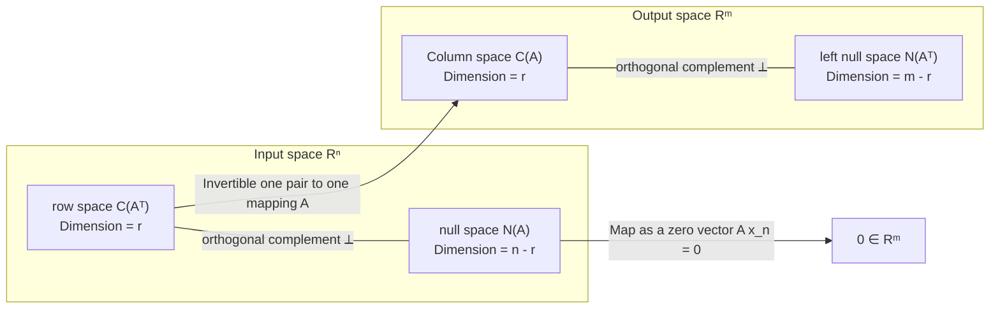
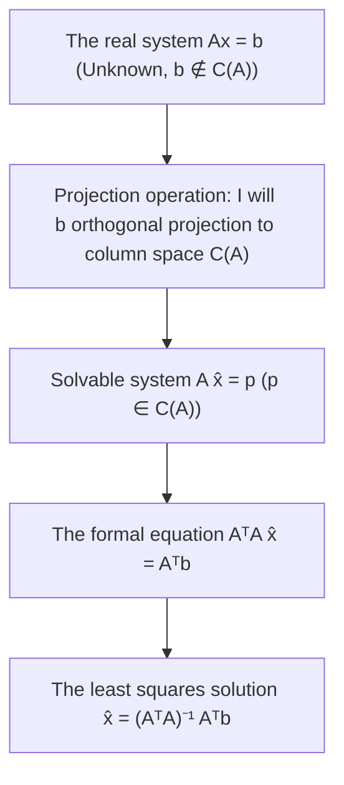
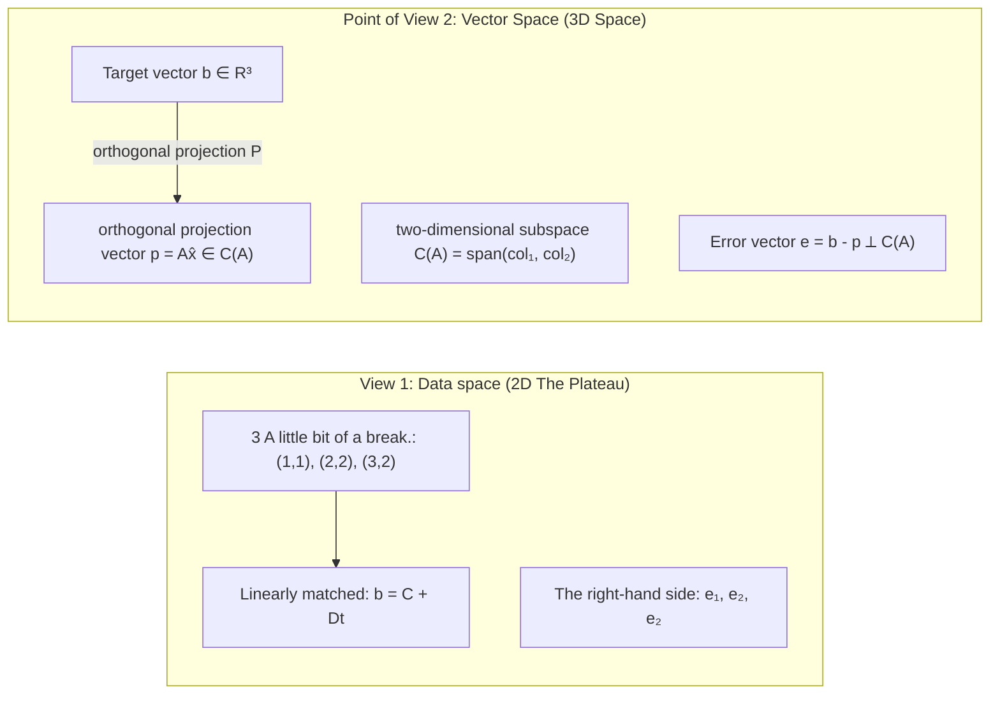
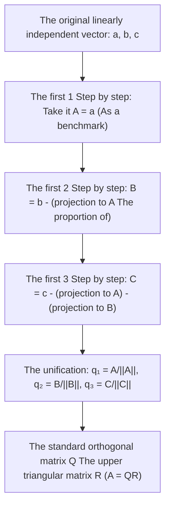
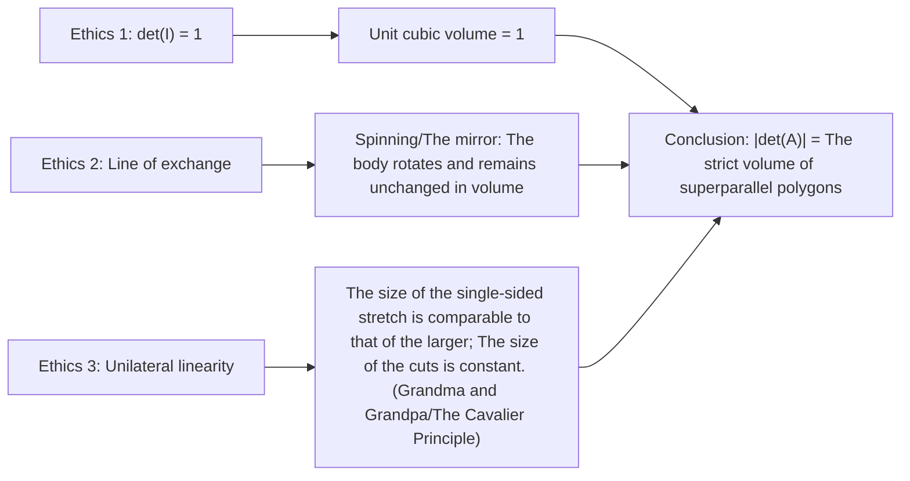

> **Lecture** The following is a list of the most common causes of death in children:  
> **The product** VideoBook: Video open source technology and e-books flow waterline  
> **Full size of book** The following are the main topics covered: 35 full-length editions; 5 major knowledge system modules; 357 original high definition tablets; 260 core introduction time frames.  
> **Video source**: [The official full set of Bilibili (BV1ix411f7Yp)](https://www.bilibili.com/video/BV1ix411f7Yp/) · [MIT OpenCourseWare 18.06 (Spring 2010)](https://ocw.mit.edu/courses/18-06-linear-algebra-spring-2010/)  
> **Copyright and licenses**: The text content and formula graphics are compiled and structured by MIT OCW Open Course Materials Translation, instructor Gilbert Strang, following  [CC BY-NC-SA 4.0](https://creativecommons.org/licenses/by-nc-sa/4.0/)  Knowledge Sharing License Agreement. Full bookshelf clips are taken from the official public lecture video.

---

> 📚 **Module overview**: We introduce inner products and the geometry of orthogonality, establish the orthogonal-complement relationships among the four fundamental subspaces, and develop subspace projections and the projection matrix  $P = A(A^T A)^{-1}A^T$, leading to least-squares solutions of inconsistent systems, a central problem in data science. We then study Gram–Schmidt orthogonalization and the  $A = QR$  factorization, followed by the three defining properties of determinants, cofactor expansion, and the interpretation of determinants as volume.

---

## 14th lecture: orthogonal vectors and orthogonal subspace

> 📺 **Video link back**: [B Station 14 P: orthogonal vectors and orthogonal subspace](https://www.bilibili.com/video/BV1ix411f7Yp/?p=14) (⏱ 49m 37s · 10 screenshots)  
> 📖 **Official material**: [MIT OCW correspondence and summary](https://ocw.mit.edu/courses/18-06-linear-algebra-spring-2010/resources/lecture-14-orthogonal-vectors-and-subspaces/)  
> 💡 **Key ideas**: Orthogonality and the Pythagorean theorem; the row space and null space as orthogonal complements; Part II of the Fundamental Theorem; and an introduction to inconsistent systems and normal equations.

---

### 1. Vector Orthogonality and the Pythagorean Theorem

*(reference timestamp: 00:01:00 )  [Watch clip (P14 00:01:00)](https://www.bilibili.com/video/BV1ix411f7Yp/?p=14&t=60))*

In the second half of this course, we turn to one of linear algebra’s most useful and geometrically compelling ideas: **orthogonality**.

Orthogonality generalizes perpendicularity to higher-dimensional spaces. Two vectors  $x, y \in \mathbb{R}^n$ are orthogonal if and only if **their dot product is zero**: 

$$
x^T y = 0 \quad \left(\text{等价于 } y^T x = 0\right)
$$

In component form:
$$
x^T y = x_1 y_1 + x_2 y_2 + \cdots + x_n y_n = 0
$$

*⏱ Timestamp: 00:03:30 · 📷 Lecture screenshot · [Watch clip (P14 00:03:30)](https://www.bilibili.com/video/BV1ix411f7Yp/?p=14&t=210)*

#### 1.1 Why Does a Zero Dot Product Mean a Right Angle?

The Pythagorean theorem states that the sum of the squares of a right triangle’s two legs equals the square of its hypotenuse. If  $x$  and  $y$  are the legs, the hypotenuse is  $x + y$ (or  $x - y$).

In  $\mathbb{R}^n$ , the vector  $x$  has squared length (squared norm):
$$
\|x\|^2 = x^T x = x_1^2 + x_2^2 + \cdots + x_n^2
$$

if and only if  $x \perp y$ , the Pythagorean identity holds:
$$
\|x\|^2 + \|y\|^2 = \|x + y\|^2
$$

Expand the inner product on the right:
$$
\begin{aligned}
\|x + y\|^2 &= (x + y)^T (x + y) \\
&= x^T x + x^T y + y^T x + y^T y \\
&= \|x\|^2 + 2 x^T y + \|y\|^2
\end{aligned}
$$

Cancel  $\|x\|^2 + \|y\|^2$ from both sides to obtain:
$$
2 x^T y = 0 \implies \boxed{x^T y = 0}
$$

This derivation shows that **a zero dot product is equivalent to the Pythagorean identity in any finite-dimensional space**. In particular, the zero vector  $\mathbf{0}$  is orthogonal to every vector because  $\mathbf{0}^T y = 0$.

*⏱ Timestamp: 00:06:50 · 📷 Lecture screenshot · [Watch clip (P14 00:06:50)](https://www.bilibili.com/video/BV1ix411f7Yp/?p=14&t=410)*

---

### 2. Orthogonal Subspaces

*reference timestamp: 00:08:30...  [Watch clip (P14 00:08:30)](https://www.bilibili.com/video/BV1ix411f7Yp/?p=14&t=510))*

We now extend orthogonality from two vectors to two subspaces:

> **Definition: orthogonal subspaces**: let  $V$  and  $W$  are subspaces of the same Euclidean space  $\mathbb{R}^n$ . If for every  $v \in V$  and every  $w \in W$ we have  $v^T w = 0$, the subspaces  $V$  and  $W$ **are orthogonal to each other**, written  $V \perp W$.

*⏱ Timestamp: 00:10:50 · 📷 Lecture screenshot · [Watch clip (P14 00:10:50)](https://www.bilibili.com/video/BV1ix411f7Yp/?p=14&t=650)*

#### 2.1 Are the Classroom Wall and Floor Orthogonal Subspaces?

Professor Strang gives an intuitive counterexample: **Are the vertical blackboard wall and the classroom floor orthogonal subspaces?**

In everyday language, we say that the wall and floor are perpendicular ($90^\circ$). But in linear algebra:
- The wall contains vectors in every direction along its plane.
- The floor contains vectors in every direction along its plane.
- Their **line of intersection** contains nonzero vectors belonging to both planes.
- If a nonzero vector  $v$  belongs to both planes, orthogonality of the two subspaces would require  $v^T v = \|v\|^2 = 0$, which forces  $v = \mathbf{0}$!

Therefore, the wall and floor **are not orthogonal subspaces**!

> **Key conclusion**: If two subspaces  $V$  and  $W$  are orthogonal, their intersection contains only the zero vector:
> $$
> V \perp W \implies V \cap W = \{\mathbf{0}\}
> $$

*⏱ Timestamp: 00:14:20 · 📷 Lecture screenshot · [Watch clip (P14 00:14:20)](https://www.bilibili.com/video/BV1ix411f7Yp/?p=14&t=860)*

---

### orthogonality of four fundamental subspaces: The second part of the fundamental theorem

*(reference timestamp: 00:20:00)  [Watch clip (P14 00:20:00)](https://www.bilibili.com/video/BV1ix411f7Yp/?p=14&t=1200))*

In the 10th lecture, we studied the dimension relations of four fundamental subspaces (the first part of the basic theorem).

$$
\boxed{\text{行空间 } C(A^T) \perp \text{零空间 } N(A) \quad \left(\text{在 } \mathbb{R}^n \text{ 中}\right)}
$$
$$
\boxed{\text{列空间 } C(A) \perp \text{左零空间 } N(A^T) \quad \left(\text{在 } \mathbb{R}^m \text{ 中}\right)}
$$

#### 3.1 Strict proof: Why is row space vertically in null space?

The definition of a null space is: $x \in N(A)$  The system of equations  $Ax = \mathbf{0}$  Founded:

$$
Ax = \begin{bmatrix} \text{row}_1 \\ \text{row}_2 \\ \vdots \\ \text{row}_m \end{bmatrix} x = \begin{bmatrix} \text{row}_1 \cdot x \\ \text{row}_2 \cdot x \\ \vdots \\ \text{row}_m \cdot x \end{bmatrix} = \begin{bmatrix} 0 \\ 0 \\ \vdots \\ 0 \end{bmatrix}
$$

This is clear.  $x$  Vertical to the matrix  $A$  of **Each line**!

*⏱ Timestamp: 00:21:40 · 📷 Lecture screenshot · [Watch clip (P14 00:21:40)](https://www.bilibili.com/video/BV1ix411f7Yp/?p=14&t=1300)*

And row space  $C(A^T)$  The arbitrary vector in  $v$  It's all this.  $m$  Linear combination of a linear vector:
$$
v = c_1 \text{row}_1 + c_2 \text{row}_2 + \cdots + c_m \text{row}_m = A^T c
$$

Therefore, computing  $v$  and  $x$  The inner product:
$$
v^T x = (A^T c)^T x = c^T A x = c^T (Ax) = c^T \mathbf{0} = 0
$$

The  $v$  and  $x$  So we're going to prove that the vector is an arbitrary vector in each subspace. **Each vector in a row space is strictly vertical to each vector in the null space**!

I agree, let's get the matrix  $A$  It was replaced by  $A^T$ It was immediately proven. **The column space is left null space.  $\mathbb{R}^m$  The two sides are orthogonal**!

*⏱ Timestamp: 00:26:00 · 📷 Lecture screenshot · [Watch clip (P14 00:26:00)](https://www.bilibili.com/video/BV1ix411f7Yp/?p=14&t=1560)*

---

### 4. Orthogonal Complements

*(reference timestamp: 00:28:00)  [Watch clip (P14 00:28:00)](https://www.bilibili.com/video/BV1ix411f7Yp/?p=14&t=1680))*

The row space and the null space are not only orthogonal, but they're also  $\mathbb{R}^n$  The first is the "Fireflowers" and the second is the "Crowned Fires".
- The row spacedimension: $\dim C(A^T) = r$
- The null spacedimension: $\dim N(A) = n - r$
- The two dimensions are: $r + (n - r) = n$

This means: **null space included  $\mathbb{R}^n$  In the row space orthogonal all vectors** There's no fish out of the net.

> **The definition of an orthogonal complement**: in  $\mathbb{R}^n$  In the middle, with subspace  $V$  The set of all orthogonal vectors is called the  $V$  The following is a list of the most common types of orthogonal complement (or orthogonal)  $V^\perp$.
> $$
> C(A^T)^\perp = N(A), \quad N(A)^\perp = C(A^T)
> $$
> In  $\mathbb{R}^m$  Medium:
> $$
> C(A)^\perp = N(A^T), \quad N(A^T)^\perp = C(A)
> $$

*⏱ Timestamp: 00:31:30 · 📷 Lecture screenshot · [Watch clip (P14 00:31:30)](https://www.bilibili.com/video/BV1ix411f7Yp/?p=14&t=1890)*

---

### 5. Linear algebra upgrades the rectangle of a big picture with  $\perp$)

*(reference timestamp: 00:34:00)  [Watch clip (P14 00:34:00)](https://www.bilibili.com/video/BV1ix411f7Yp/?p=14&t=2040))*

Now we can upgrade the macro-large picture of the 10th to include **orthogonal complement rectangular symbols** The fundamental theorem of linear algebra, part two, is as follows:

Each vector  $x \in \mathbb{R}^n$  It's all the same. orthogonal Split it into one. row space A weight and a... null space Size:
$$
x = x_r + x_n, \quad x_r \in C(A^T), \; x_n \in N(A)
$$
When the matrix acts on  $x$  When:
$$
A x = A (x_r + x_n) = A x_r + A x_n = A x_r + \mathbf{0} = A x_r
$$
**The entire null space is directly compressed to zero, and there are one-to-one invertible binary rays between row space and column space!**

*⏱ Timestamp: 00:36:20 · 📷 Lecture screenshot · [Watch clip (P14 00:36:20)](https://www.bilibili.com/video/BV1ix411f7Yp/?p=14&t=2180)*

---

### 6. inconsistentsystem of equations  $Ax = b$  and an Introduction to Orthogonal Projection

*(reference timestamp: 00:40:00 ·)  [Watch clip (P14 00:40:00)](https://www.bilibili.com/video/BV1ix411f7Yp/?p=14&t=2400))*

In engineering and real-science experiments, we often encounter a small unknown number of superconducting system of equations equations that measure extremely many (and even more). $m > n$ For example: 100 measurement points, with only two unknown parameters. $b$  It's almost impossible to fall by accident.  $A$  The column space  $C(A)$  In the interior:
$$
b \notin C(A) \implies Ax = b \text{ 无解！}
$$

If we can't get an accurate answer, what is the best strategy? 
**Looking for the closest  $b$  The answer  $\hat{x}$ And made it  $A\hat{x}$  As close as possible  $b$!**

Geometrically, $A\hat{x}$  Must be in column space  $C(A)$  In the middle. Keep your distance.  $\|b - A\hat{x}\|$  The smallest. $A\hat{x}$  It must be  $b$  In the column space  $C(A)$  Upstairs **orthogonal projection vector  $p$**: 
$$
p = A \hat{x} \in C(A)
$$
Error vector  $e = b - p = b - A\hat{x}$  The column space must be vertical  $C(A)$: 
$$
e \in C(A)^\perp = N(A^T) \implies A^T e = \mathbf{0}
$$

I will  $e = b - A\hat{x}$  The following is a list of the most common types:
$$
A^T (b - A\hat{x}) = \mathbf{0} \implies \boxed{A^T A \hat{x} = A^T b}
$$
This group of critical equations is called **The system of equations**!

*⏱ Timestamp: 00:43:10 · 📷 Lecture screenshot · [Watch clip (P14 00:43:10)](https://www.bilibili.com/video/BV1ix411f7Yp/?p=14&t=2590)*

---

### 7. matrix  $A^T A$  The nature and invertible characteristics of the

*(reference timestamp: 00:45:00)  [Watch clip (P14 00:45:00)](https://www.bilibili.com/video/BV1ix411f7Yp/?p=14&t=2700))*

Equation  $A^T A \hat{x} = A^T b$  The original matrix  $A$  The size of the algebraic structure is excellent:
1. **The size symmetry** If:  $A$  Yes, I did.  $m \times n$  The long-shaped matrix,  $A^T A$  It will be  $n \times n$  The army of the enemy;
2. **Matrix symmetry**: $(A^T A)^T = A^T (A^T)^T = A^T A$ So, what is the  $A^T A$  It's always a symmetric matrix.

#### 7.1 $A^T A$  When is the invertible?

The best estimate is to be found.  $\hat{x} = (A^T A)^{-1} A^T b$, $A^T A$  It must be invertible. Under what conditions is it invertible?

> **The key theorem**: $A^T A$  The invertible $n \times n$  Full rank) and only  $A$  of **Linearly independent vector** (i.e.  $A$  The ranking is  $n$ Null space contains only zero vectors  $N(A) = \{\mathbf{0}\}$).

**The evidence** Suppose there is a vector  $x$  It's a good idea.  $A^T A x = \mathbf{0}$- The left side is equal.  $x^T$: 
$$
x^T (A^T A x) = 0 \implies (A x)^T (A x) = 0 \implies \|A x\|^2 = 0 \implies A x = \mathbf{0}
$$
The  $A$  The linearly independent, equations  $Ax = \mathbf{0}$  The answer is  $x = \mathbf{0}$ So, what?  $A^T A x = \mathbf{0}$  It's just a simple explanation.  $A^T A$  The null space contains only zero vectors, and the resulting value is zero. **$A^T A$  It's bound to reverse!**

Next, we will be fully engaged in the geometric derivation and projection matrix of subspace projection with least squares law.  $P$.

*⏱ Timestamp: 00:48:30 · 📷 Lecture screenshot · [Watch clip (P14 00:48:30)](https://www.bilibili.com/video/BV1ix411f7Yp/?p=14&t=2910)*

---

## Lecture 15: Subspace Projections

> 📺 **Video link back**: [B Station 15 P: Subspaceprojection](https://www.bilibili.com/video/BV1ix411f7Yp/?p=15) (⏱ 48m 50s · 10 screenshots)  
> 📖 **Official material**: [MIT OCW correspondence and summary](https://ocw.mit.edu/courses/18-06-linear-algebra-spring-2010/resources/lecture-15-projections-onto-subspaces/)  
> 💡 **Key ideas**: Projection onto a line, P=aaᵀ/aᵀa; projection onto a higher-dimensional subspace, P=A(AᵀA)⁻¹Aᵀ; symmetry; and idempotence, P²=P.

---

### 1. The geometric motives of projection: Why do we need a projection?

*(reference timestamp: 00:01:00 )  [Watch clip (P15 00:01:00)](https://www.bilibili.com/video/BV1ix411f7Yp/?p=15&t=60))*

system of linear equations, in practical applications, due to measurement error, excessive equations or noise interference  $Ax = b$  Often **Unknown**($b$  Not in the matrix.  $A$  The column space  $C(A)$  The question of science and engineering, however, must be answered. We cannot change objective physical data, but we can do this: 
**In the column space  $C(A)$  Looking for a  $b$  Distance from nearest vector  $p$ (projection) and then to solve the consistent equation.  $A\hat{x} = p$!**

This is the core mission of projection. To fully master high-dimensional subspace projection, we have to start with the simplest possible projecting method: **One-dimensional linear projection** The first step is to upgrade.

*⏱ Timestamp: 00:03:20 · 📷 Lecture screenshot · [Watch clip (P15 00:03:20)](https://www.bilibili.com/video/BV1ix411f7Yp/?p=15&t=200)*

---

### 2. One-dimensional straight line projection: measurements  $\hat{x}$  with vector  $p$

*(reference timestamp: 00:04:00)  [Watch clip (P15 00:04:00)](https://www.bilibili.com/video/BV1ix411f7Yp/?p=15&t=240))*

The first vector is the original and known vectors.  $a$  The line is subspace  $L$ Give the arbitrary vector  $b$ Please.  $b$  The projection on the line  $p$: 
- Since  $p$  It will be a straight line.  $a$  The number of times a scale is multiplied by:
  $$
  p = \hat{x} a
  $$
- From  $b$  to  $p$  The error vector is written as  $e$: 
  $$
  e = b - p = b - \hat{x} a
  $$
- The geometry of projection is **The foot.** Error vector:  $e$  It must be in a straight line.  $a$  Vertically!
  $$
  a \perp e \iff a^T e = 0
  $$

I will  $e = b - \hat{x} a$  The following is a list of the most common types of orthogonal conditions:
$$
a^T (b - \hat{x} a) = 0 \implies a^T b - \hat{x} (a^T a) = 0
$$

because  $a \neq \mathbf{0}$, measured  $a^T a = \|a\|^2 > 0$ And then we'll solve the prime numbers right away.  $\hat{x}$: 
$$
\boxed{\hat{x} = \frac{a^T b}{a^T a}}
$$

So we get the projection vector.  $p$: 
$$
\boxed{p = a \hat{x} = a \frac{a^T b}{a^T a}}
$$

> **Triangulation Contrast**: $\frac{a^T b}{\|a\| \|b\|} = \cos \theta$ So, what?  $\|p\| = \|b\| \cos \theta$, measured  $\hat{x} = \frac{\|b\|}{\|a\|} \cos \theta$ The algebraic formula is perfectly in line with the projection of the prime triangle!

*⏱ Timestamp: 00:06:40 · 📷 Lecture screenshot · [Watch clip (P15 00:06:40)](https://www.bilibili.com/video/BV1ix411f7Yp/?p=15&t=400)*

---

### 3. One-dimensional projection matrix  $P$

*reference timestamp: 00:08:30...  [Watch clip (P15 00:08:30)](https://www.bilibili.com/video/BV1ix411f7Yp/?p=15&t=510))*

The essence of linear algebra is: **Convert geometric operations into matrix conversions** We want to find a matrix.  $P$ So that the vector is a random variable.  $b$ I'm going to ride.  $P$  It's a direct output of its projection.  $p$: 
$$
p = P b
$$

The projection vectorexpression above is an adjustment of the multiplication to the combined order:
$$
p = a \left(\frac{a^T b}{a^T a}\right) = \frac{a (a^T b)}{a^T a} = \left(\frac{a a^T}{a^T a}\right) b
$$

And then we got **One-dimensional projection matrix** The expression:
$$
\boxed{P = \frac{a a^T}{a^T a}}
$$

#### 3.1 A Common Pitfall: Why the Numerator and Denominator Contain  $a$  Can't you make a deal?
- **The dividend  $a^T a$**  is a row vector multi-column vector (inner product), resulting in one **The number of people who have been killed**; 
- **The molecule  $a a^T$**  The result is a linear vector multiplied by the vector (s)  $n \times n$  of **The Front** (rank to 1)! A matrix divided by a number makes perfect sense, but you can never arbitrarily divide vectors from the matrix molecules!

*⏱ Timestamp: 00:09:40 · 📷 Lecture screenshot · [Watch clip (P15 00:09:40)](https://www.bilibili.com/video/BV1ix411f7Yp/?p=15&t=580)*

#### 3.2 The two fundamental properties of the projection matrix

Any projection matrix has the following two deterministic algebraic characteristics:

1. **The first is the symmetry.**: 
   $$
   P^T = \left(\frac{a a^T}{a^T a}\right)^T = \frac{(a a^T)^T}{a^T a} = \frac{(a^T)^T a^T}{a^T a} = \frac{a a^T}{a^T a} = P
   $$
2. **The first is the idea of a "simple" relationship. $P^2 = P$)**: projection has landed on the line once, again projection remains in place!
   $$
   P^2 = \left(\frac{a a^T}{a^T a}\right) \left(\frac{a a^T}{a^T a}\right) = \frac{a (a^T a) a^T}{(a^T a)^2} = \frac{(a^T a) \cdot (a a^T)}{(a^T a)^2} = \frac{a a^T}{a^T a} = P
   $$

In addition, the column space of a projection matrix is defined by  $a$  the line spanned by  $L$ The ranking  $\text{rank}(P) = 1$.

*⏱ Timestamp: 00:14:10 · 📷 Lecture screenshot · [Watch clip (P15 00:14:10)](https://www.bilibili.com/video/BV1ix411f7Yp/?p=15&t=850)*

---

### 4. Why expand the problem to multi-dimensional higher-order subspace?

*(reference timestamp: 00:19:00)  [Watch clip (P15 00:19:00)](https://www.bilibili.com/video/BV1ix411f7Yp/?p=15&t=1140))*

In reality, the inconsistentsystem of equations  $Ax = b$  The coefficient matrix  $A$  There are usually multiple vectors in the array. $n > 1$).
$b$  Yes, I did.  $\mathbb{R}^m$  The vector measured in the  $A$  The vector column  $a_1, a_2, \dots, a_n$  Chang became a  $n$  Subspace and column space  $C(A)$.

when  $b \notin C(A)$  When the $Ax = b$  We're going to take it.  $b$  The projection is made up of the whole row vector **The two-dimensional superplane** Up!

*⏱ Timestamp: 00:19:50 · 📷 Lecture screenshot · [Watch clip (P15 00:19:50)](https://www.bilibili.com/video/BV1ix411f7Yp/?p=15&t=1190)*

---

### 5. Geometry and algebra derivation of multi-dimensional subspace projection

*(reference timestamp: 00:24:00 )  [Watch clip (P15 00:24:00)](https://www.bilibili.com/video/BV1ix411f7Yp/?p=15&t=1440))*

Suppose the matrix  $A = \begin{bmatrix} a_1 & a_2 & \cdots & a_n \end{bmatrix}$  vector linearly independent. They are subspaces (column space)  $C(A)$ The first is the "Settings".  $p$  For the  $b$  In the  $C(A)$  The projection vector above.

because  $p \in C(A)$, $p$  The linear combination of the columns is:
$$
p = \hat{x}_1 a_1 + \hat{x}_2 a_2 + \cdots + \hat{x}_n a_n = A \hat{x}
$$
The coefficient vector  $\hat{x} = \begin{bmatrix} \hat{x}_1 & \hat{x}_2 & \cdots & \hat{x}_n \end{bmatrix}^T$  It's the best weight we can look for.

*⏱ Timestamp: 00:26:20 · 📷 Lecture screenshot · [Watch clip (P15 00:26:20)](https://www.bilibili.com/video/BV1ix411f7Yp/?p=15&t=1580)*

#### 5.1 Error vector perpendicular to the whole plane

Connected  $b$  Projection and  $p$  The error vector is:
$$
e = b - p = b - A \hat{x}
$$
$e$  It must be vertical inside the plane. **Each of these vectors**: 
$$
\begin{cases}
a_1^T (b - A\hat{x}) = 0 \\
a_2^T (b - A\hat{x}) = 0 \\
\vdots \\
a_n^T (b - A\hat{x}) = 0
\end{cases}
$$

I'm going to take this  $n$  The equation is written in the form of a very beautiful matrix:
$$
\begin{bmatrix} a_1^T \\ a_2^T \\ \vdots \\ a_n^T \end{bmatrix} (b - A\hat{x}) = \begin{bmatrix} 0 \\ 0 \\ \vdots \\ 0 \end{bmatrix} \implies \boxed{A^T (b - A\hat{x}) = \mathbf{0}}
$$

The first is the Divine Equation. **The system of equations**: 
$$
\boxed{A^T A \hat{x} = A^T b}
$$

> **The 14th edition of the Big Picture**: $A^T e = \mathbf{0}$  It means  $e \in N(A^T)$ (Error in left null space)  $p \in C(A)$... because of  $C(A) \perp N(A^T)$ The error vector is natural and must fall into the space complementary to the column space orthogonal!

*⏱ Timestamp: 00:30:10 · 📷 Lecture screenshot · [Watch clip (P15 00:30:10)](https://www.bilibili.com/video/BV1ix411f7Yp/?p=15&t=1810)*

---

### 6. High-dimensional projection matrix  $P$  The core formula

*(reference timestamp: 00:33:00)  [Watch clip (P15 00:33:00)](https://www.bilibili.com/video/BV1ix411f7Yp/?p=15&t=1980))*

when  $A$  The first example of this is linearly independent.  $A^T A$  Must be reversible. Undo the best coefficient vector:
$$
\hat{x} = (A^T A)^{-1} A^T b
$$

I will  $\hat{x}$  Reverse projection vector  $p = A\hat{x}$: 
$$
p = A \hat{x} = \underbrace{A (A^T A)^{-1} A^T}_{P} b
$$

So we have a whole application of mathematics. **High-dimensional projection matrix major formula**: 
$$
\boxed{P = A (A^T A)^{-1} A^T}
$$

#### 6.1 Perfect unification of one-dimensional formulas with high-dimension formulas
- when  $A$  There's only one row.  $a$  When:
  $$
  P = a (a^T a)^{-1} a^T = \frac{a a^T}{a^T a}
  $$
  The high-dimensional formula is completely self-sufficient in its one-dimension degradation to the previous scale deduction method!

*⏱ Timestamp: 00:34:50 · 📷 Lecture screenshot · [Watch clip (P15 00:34:50)](https://www.bilibili.com/video/BV1ix411f7Yp/?p=15&t=2090)*

---

### 7. Testing the two major iron laws of a high-dimensional projection matrix

*reference timestamp: 00:36:30...  [Watch clip (P15 00:36:30)](https://www.bilibili.com/video/BV1ix411f7Yp/?p=15&t=2190))*

No matter how complex the formula, it must satisfy the inherent properties of the projection matrix:

1. **The symmetry  $P^T = P$**: 
   $$
   \begin{aligned}
   P^T &= \left[ A (A^T A)^{-1} A^T \right]^T = (A^T)^T \left[(A^T A)^{-1}\right]^T A^T \\
   &= A \left[(A^T A)^T\right]^{-1} A^T = A (A^T A)^{-1} A^T = P
   \end{aligned}
   $$
2. **Equal health  $P^2 = P$**: 
   $$
   \begin{aligned}
   P^2 &= \left[ A (A^T A)^{-1} A^T \right] \left[ A (A^T A)^{-1} A^T \right] \\
   &= A (A^T A)^{-1} \underbrace{\left(A^T A\right) (A^T A)^{-1}}_{I} A^T \\
   &= A (A^T A)^{-1} A^T = P
   \end{aligned}
   $$

The middle  $(A^T A) (A^T A)^{-1}$  Perfectly compensated in units  $I$!

*⏱ Timestamp: 00:37:30 · 📷 Lecture screenshot · [Watch clip (P15 00:37:30)](https://www.bilibili.com/video/BV1ix411f7Yp/?p=15&t=2250)*

---

### 8. Two extreme exceptions and the law of least squares

*(reference timestamp: 00:41:00 )  [Watch clip (P15 00:41:00)](https://www.bilibili.com/video/BV1ix411f7Yp/?p=15&t=2460))*

#### 8.1 Special case 1: If  $A$  The person is frontal and invertible.
If you  $A$  Yes, I did.  $n \times n$  In this case, the invertible square is equal to the whole of the column space.  $\mathbb{R}^n$ Any vector  $b$  The projection matrix should not be changed in the column space itself, which is  $P = I$).

Algebra is validated:
$$
P = A (A^T A)^{-1} A^T = A A^{-1} (A^T)^{-1} A^T = I \cdot I = I
$$
The formula is perfectly intuitive!

#### 8.2 Special case 2: If  $b$  The vertical is in column space. $b \in N(A^T)$)
This time  $A^T b = \mathbf{0}$ The substitution formula is immediately available.  $p = P b = \mathbf{0}$ The projection point is degraded to the original one!

#### 8.3 The introduction of the law of least squares
Next talk (Lecture 16) we will apply this powerful set of projection theories to the most important questions in statistics and data science: **The least squares law is used to apply the data of the sparse points in a straight line.** When given a set of experimental observations  $(t_i, b_i)$  So how do we find the best line through a projection matrix?

*⏱ Timestamp: 00:43:20 · 📷 Lecture screenshot · [Watch clip (P15 00:43:20)](https://www.bilibili.com/video/BV1ix411f7Yp/?p=15&t=2600)*

---

## 16th: The projection matrix and the law of least squares

> 📺 **Video link back**: [B Station 16 P: projection matrix and least squares](https://www.bilibili.com/video/BV1ix411f7Yp/?p=16) (⏱ 47m 58s · 10 screenshots)  
> 📖 **Official material**: [MIT OCW correspondence and summary](https://ocw.mit.edu/courses/18-06-linear-algebra-spring-2010/resources/lecture-16-projection-matrices-and-least-squares/)  
> 💡 **Key ideas** The following are the results: scatter points fit real warfare, formal equations solve for best linearity, equivalence of calculus with linear algebra geometry projection, ATA invertible finite theorem.

---

### 1. Reviewing the projection matrix and complementary projection

*(reference timestamp: 00:01:00 )  [Watch clip (P16 00:01:00)](https://www.bilibili.com/video/BV1ix411f7Yp/?p=16&t=60))*

In the 15th lecture, we derive that any vector is a function of the length of the line.  $b$  orthogonal projection to the matrix  $A$  The column space  $C(A)$  The projection matrix above:
$$
P = A (A^T A)^{-1} A^T
$$
The projection vector is  $p = P b$ The remainder of the error vector is:
$$
e = b - p = b - P b = (I - P) b
$$

The matrix  $I - P$  It's also legal. projection matrix \# It's gonna be \# vector  $b$  The projection to the column space orthogonal is complemented by a spatial array **left null space  $N(A^T)$**  Upstairs.
- Obviously  $(I - P)^T = I^T - P^T = I - P$ (symmetry)
- $(I - P)^2 = I - 2P + P^2 = I - 2P + P = I - P$ (Equal)

*⏱ Timestamp: 00:03:10 · 📷 Lecture screenshot · [Watch clip (P16 00:03:10)](https://www.bilibili.com/video/BV1ix411f7Yp/?p=16&t=190)*

---

### 2. Classic data fit problem: finding the best fit line

*reference timestamp: 00:05:30...  [Watch clip (P16 00:05:30)](https://www.bilibili.com/video/BV1ix411f7Yp/?p=16&t=330))*

Suppose data is observed at three time points in an experiment.  $(t, b)$: 
- $t_1 = 1, \; b_1 = 1$
- $t_2 = 2, \; b_2 = 2$
- $t_3 = 3, \; b_3 = 2$

The three spots are obvious. **The Internet** (The slope of the line is 1, after the first two points, and then the slope is 1.  $t=3$  The time should be 3, but the actual observation value is 2.
$$
b = C + D t
$$
The data is represented by a straight line that can be crossed as well as possible.

*⏱ Timestamp: 00:06:50 · 📷 Lecture screenshot · [Watch clip (P16 00:06:50)](https://www.bilibili.com/video/BV1ix411f7Yp/?p=16&t=410)*

---

### 3. Express the problem of suitability as a matrix equation  $Ax = b$

*(reference timestamp: 00:00 )  [Watch clip (P16 00:09:00)](https://www.bilibili.com/video/BV1ix411f7Yp/?p=16&t=540))*

If a straight line can pass perfectly through these three points, then the coordinates of the three points are substituted for equations:
$$
\begin{cases}
C + 1 \cdot D = 1 \\
C + 2 \cdot D = 2 \\
C + 3 \cdot D = 2
\end{cases}
$$

Write it in a compact matrix:
$$
\underbrace{\begin{bmatrix} 1 & 1 \\ 1 & 2 \\ 1 & 3 \end{bmatrix}}_{A} \underbrace{\begin{bmatrix} C \\ D \end{bmatrix}}_{x} = \underbrace{\begin{bmatrix} 1 \\ 2 \\ 2 \end{bmatrix}}_{b}
$$

This is a  $3 \times 2$  The superconducting system of equations (s) has 3 equations, only 2 unknowns  $C$  and  $D$ The vector is not connected to the data.  $b = \begin{bmatrix} 1 & 2 & 2 \end{bmatrix}^T$ **Not in the** The matrix  $A$  In the column space, system of equations **The answer is not clear.**!

*⏱ Timestamp: 00:10:40 · 📷 Lecture screenshot · [Watch clip (P16 00:10:40)](https://www.bilibili.com/video/BV1ix411f7Yp/?p=16&t=640)*

---

### 4. Two very different geometrical landscapes

*reference timestamp: 13:30...  [Watch clip (P16 00:13:30)](https://www.bilibili.com/video/BV1ix411f7Yp/?p=16&t=810))*

Professor Strang emphasizes the understanding of least squares here. **Two key geometrical points of view**: 

| The View | Space | Geometrical view |
| :--- | :--- | :--- |
| **View 1: Data space** | Two-dimensional plane  $(t, b)$ | The data points are separated by three separate data points, and a straight line runs through them.  $e_i = b_i - (C + D t_i)$  It's the same as every point in a straight line. **Vertical and vertical deviations**. |
| **Viewpoint 2: Vector and Subspace** | 3D space  $\mathbb{R}^3$ | Target vector  $b \in \mathbb{R}^3$ The matrix.  $A$  The two columns of the two-dimensional plane  $C(A)$.$b$  The world is not so flat. $p$  Yes, I did.  $b$  On the plane **Vertical foot**! |

*⏱ Timestamp: 00:15:20 · 📷 Lecture screenshot · [Watch clip (P16 00:15:20)](https://www.bilibili.com/video/BV1ix411f7Yp/?p=16&t=920)*

---

### 5. Establishment and resolution of formal system of equations

*(reference timestamp: 00:18:30)  [Watch clip (P16 00:18:30)](https://www.bilibili.com/video/BV1ix411f7Yp/?p=16&t=1110))*

The best solution is based on the principle of orthogonal projection.  $\hat{x} = \begin{bmatrix} \hat{C} \\ \hat{D} \end{bmatrix}$  The formal equation must be fulfilled:
$$
A^T A \hat{x} = A^T b
$$

We're going to take a step by step and calculate the matrix multiplication on the left and right sides:
$$
A^T A = \begin{bmatrix} 1 & 1 & 1 \\ 1 & 2 & 3 \end{bmatrix} \begin{bmatrix} 1 & 1 \\ 1 & 2 \\ 1 & 3 \end{bmatrix} = \begin{bmatrix} 1+1+1 & 1+2+3 \\ 1+2+3 & 1^2+2^2+3^2 \end{bmatrix} = \begin{bmatrix} 3 & 6 \\ 6 & 14 \end{bmatrix}
$$

The right end:
$$
A^T b = \begin{bmatrix} 1 & 1 & 1 \\ 1 & 2 & 3 \end{bmatrix} \begin{bmatrix} 1 \\ 2 \\ 2 \end{bmatrix} = \begin{bmatrix} 1+2+2 \\ 1+4+6 \end{bmatrix} = \begin{bmatrix} 5 \\ 11 \end{bmatrix}
$$

The first is that the systematic solution of the original problem is extremely clean.  $2 \times 2$  The symmetrical positive definitesystem of equations:
$$
\begin{bmatrix} 3 & 6 \\ 6 & 14 \end{bmatrix} \begin{bmatrix} \hat{C} \\ \hat{D} \end{bmatrix} = \begin{bmatrix} 5 \\ 11 \end{bmatrix}
$$

*⏱ Timestamp: 00:20:10 · 📷 Lecture screenshot · [Watch clip (P16 00:20:10)](https://www.bilibili.com/video/BV1ix411f7Yp/?p=16&t=1210)*

#### 5.1 Optimal parameters to be solved

The system of equations:
$$
\begin{cases}
3 \hat{C} + 6 \hat{D} = 5 \\
6 \hat{C} + 14 \hat{D} = 11
\end{cases}
$$

So we're going to multiply the first equation by 2: $6\hat{C} + 12\hat{D} = 10$ The two-dimensional decrease:
$$
2\hat{D} = 1 \implies \boxed{\hat{D} = \frac{1}{2}}
$$
The first equation is replaced by:
$$
3\hat{C} + 3 = 5 \implies 3\hat{C} = 2 \implies \boxed{\hat{C} = \frac{2}{3}}
$$

The best linear equation is therefore:
$$
\boxed{b = \frac{2}{3} + \frac{1}{2} t}
$$

*⏱ Timestamp: 00:25:30 · 📷 Lecture screenshot · [Watch clip (P16 00:25:30)](https://www.bilibili.com/video/BV1ix411f7Yp/?p=16&t=1530)*

---

### 6. Verify the projection vector and orthogonality of residues

*(reference timestamp: 00:28:00)  [Watch clip (P16 00:28:00)](https://www.bilibili.com/video/BV1ix411f7Yp/?p=16&t=1680))*

With the optimum line, we calculate the projection vector for the projection of the line at three points.  $p = A\hat{x}$): 
- $t=1$: $p_1 = \frac{2}{3} + \frac{1}{2}(1) = \frac{7}{6}$
- $t=2$: $p_2 = \frac{2}{3} + \frac{1}{2}(2) = \frac{10}{6}$
- $t=3$: $p_3 = \frac{2}{3} + \frac{1}{2}(3) = \frac{13}{6}$

The projection vector is therefore:
$$
p = \begin{bmatrix} 7/6 \\ 10/6 \\ 13/6 \end{bmatrix}
$$

The error vector  $e = b - p$: 
$$
e = \begin{bmatrix} 1 \\ 2 \\ 2 \end{bmatrix} - \begin{bmatrix} 7/6 \\ 10/6 \\ 13/6 \end{bmatrix} = \begin{bmatrix} -1/6 \\ 2/6 \\ -1/6 \end{bmatrix}
$$

*⏱ Timestamp: 00:29:50 · 📷 Lecture screenshot · [Watch clip (P16 00:29:50)](https://www.bilibili.com/video/BV1ix411f7Yp/?p=16&t=1790)*

#### 6.1 Miraculous orthogonal testing

Error vector  $e$  Is it really vertical to column space?  $C(A)$?
1. with  $A$  The first row of  $\begin{bmatrix} 1 & 1 & 1 \end{bmatrix}^T$  The dot product:
   $$
   1 \cdot \left(-\frac{1}{6}\right) + 1 \cdot \left(\frac{2}{6}\right) + 1 \cdot \left(-\frac{1}{6}\right) = 0 \quad (\checkmark)
   $$
   **The meaning of statistics** This is a clear indication that the deficit is strictly zero. $\sum e_i = 0$ The average deviation of the line is zero!
2. with  $A$  The second row of  $\begin{bmatrix} 1 & 2 & 3 \end{bmatrix}^T$  The dot product:
   $$
   1 \cdot \left(-\frac{1}{6}\right) + 2 \cdot \left(\frac{2}{6}\right) + 3 \cdot \left(-\frac{1}{6}\right) = -\frac{1}{6} + \frac{4}{6} - \frac{3}{6} = 0 \quad (\checkmark)
   $$

The two inner products are strictly zero! $e$  The two bases in the plane are completely vertical, and algebra is perfectly consistent with geometry.

*⏱ Timestamp: 00:32:40 · 📷 Lecture screenshot · [Watch clip (P16 00:32:40)](https://www.bilibili.com/video/BV1ix411f7Yp/?p=16&t=1960)*

---

### 7. The amazing equivalence of the point of view of calculus

*(reference timestamp: 00:34:00)  [Watch clip (P16 00:34:00)](https://www.bilibili.com/video/BV1ix411f7Yp/?p=16&t=2040))*

How did Gauss and Legendre first solve least squares without using linear algebra?
$$
E(C, D) = \|e\|^2 = (C + D - 1)^2 + (C + 2D - 2)^2 + (C + 3D - 2)^2
$$

The value of the parameter is the smallest.  $C$  and  $D$  The following is a list of the most commonly used methods for calculating the value of a currency.
$$
\frac{\partial E}{\partial C} = 2(C + D - 1) + 2(C + 2D - 2) + 2(C + 3D - 2) = 0
$$
The following is a list of the topics covered: $3C + 6D = 5$!

Yes, I did.  $D$  The following is a list of the most common causes of death:
$$
\frac{\partial E}{\partial D} = 2(C + D - 1)(1) + 2(C + 2D - 2)(2) + 2(C + 3D - 2)(3) = 0
$$
The following is a list of the topics covered: $6C + 14D = 11$!

**The differential equation for the derivative of a linear algebra is similar to the formal system of equations for the geometric projection of linear algebras.**
 Linear algebra avoids the cumbersome geometrical differentiation of all dimensions by unifying them with geometric intuition.

*⏱ Timestamp: 00:35:50 · 📷 Lecture screenshot · [Watch clip (P16 00:35:50)](https://www.bilibili.com/video/BV1ix411f7Yp/?p=16&t=2150)*

---

### The matrix 8.  $A^T A$  The ultimate proof of the invertible theorem

*(reference timestamp: 00:41:00 )  [Watch clip (P16 00:41:00)](https://www.bilibili.com/video/BV1ix411f7Yp/?p=16&t=2460))*

normal equations  $A^T A \hat{x} = A^T b$  The only way to guarantee the solution is:  $A^T A$ **Invertible**.

> **The Big Theory**: $A^T A$  invertible, when and only when  $A$  The vector linearly independent column is null space  $N(A) = \{\mathbf{0}\}$).

**The evidence is clear.** Suppose there is a vector:  $x$  It's a good idea.  $A^T A x = \mathbf{0}$- Both sides left.  $x^T$: 
$$
x^T (A^T A x) = 0 \implies (A x)^T (A x) = 0 \implies \|A x\|^2 = 0
$$
In real vector space, the square of the length of a vector is zero and must be a zero vector:
$$
A x = \mathbf{0}
$$
The matrix is assumed to be  $A$  The linearly independent columns of a row have zero vectors in their null space, so:
$$
x = \mathbf{0}
$$
This proves the equation.  $A^T A x = \mathbf{0}$  The only thing that is not clear is the simple zero solution, so  $A^T A$  The linearly independent, quadratic  $A^T A$  It is certainly true. **Filled with rank but inverse matrix**!

The next one, 17th, is to explore the matrix.  $A$  When the rows are not only linearly independent, but also orthogonal to each other (or standard orthogonal basis), they can be used for a number of different functions. $A^T A$  It's going to be a decaying identity matrix.  $I$ The first time I saw this, I was surprised to learn that the next day, when all the equations were instantaneously converted into constants.

*⏱ Timestamp: 00:43:00 · 📷 Lecture screenshot · [Watch clip (P16 00:43:00)](https://www.bilibili.com/video/BV1ix411f7Yp/?p=16&t=2580)*

---

## Lecture 17: Orthogonal Matrices and Gram–Schmidt Orthogonalization

> 📺 **Video link back**: [B Station 17 P:orthogonal matrix with Gram-Schmitt orthogonalization](https://www.bilibili.com/video/BV1ix411f7Yp/?p=17) (⏱ 48m 59s · 10 screenshots)  
> 📖 **Official material**: [MIT OCW correspondence and summary](https://ocw.mit.edu/courses/18-06-linear-algebra-spring-2010/resources/lecture-17-orthogonal-matrices-and-gram-schmidt/)  
> 💡 **Key ideas** The standard orthogonal base and the orthogonal matrix Q, formal equations for solving x̂=QTb, Gram-Schmidt orthogonalization algorithm, A=QR triangle decomposition.

---

### 1. Standard orthogonal vectors (Orthonormal Vectors)

*(reference timestamp: 00:01:00 )  [Watch clip (P17 00:01:00)](https://www.bilibili.com/video/BV1ix411f7Yp/?p=17&t=60))*

In the previous few sessions, we found that whether projection or least squares fit, the core bottleneck is in computing an inverse matrix.  $(A^T A)^{-1}$ The first is that the new system will be able to use a special base, which can be used for a variety of purposes.  $A^T A$  It's a direct result. **The identity matrix  $I$** If you're not going to do it, then all the complicated inverse operations will be smothering!

The idea behind this dream is that the world will be a better place. **The standard orthogonal vectors are ortho-normal vectors.** The set of vectors is  $q_1, q_2, \dots, q_n$: 
1. **orthogonal to each other** The dot product between different vectors is 0;
2. **Unit length** Each vector has its own dot product of 1 (length 1)

The term "Kronecker delta" is used to denote the following:
$$
q_i^T q_j = \delta_{ij} = \begin{cases} 0, & i \neq j \\ 1, & i = j \end{cases}
$$

*⏱ Timestamp: 00:03:30 · 📷 Lecture screenshot · [Watch clip (P17 00:03:30)](https://www.bilibili.com/video/BV1ix411f7Yp/?p=17&t=210)*

---

### The matrix  $Q$  Definition with orthogonal matrix

*(reference timestamp: 00:00:00)  [Watch clip (P17 00:05:00)](https://www.bilibili.com/video/BV1ix411f7Yp/?p=17&t=300))*

Let's just write these standard orthogonal vectors as column vectors into matrix.  $Q = \begin{bmatrix} q_1 & q_2 & \cdots & q_n \end{bmatrix}$ Calculating multiplication:  $Q^T Q$: 
$$
Q^T Q = \begin{bmatrix} q_1^T \\ q_2^T \\ \vdots \\ q_n^T \end{bmatrix} \begin{bmatrix} q_1 & q_2 & \cdots & q_n \end{bmatrix} = \begin{bmatrix} q_1^T q_1 & q_1^T q_2 & \cdots & q_1^T q_n \\ q_2^T q_1 & q_2^T q_2 & \cdots & q_2^T q_n \\ \vdots & \vdots & \ddots & \vdots \\ q_n^T q_1 & q_n^T q_2 & \cdots & q_n^T q_n \end{bmatrix} = \begin{bmatrix} 1 & 0 & \cdots & 0 \\ 0 & 1 & \cdots & 0 \\ \vdots & \vdots & \ddots & \vdots \\ 0 & 0 & \cdots & 1 \end{bmatrix} = I
$$
**As long as the columns are standard orthogonal vectors, whether they are long or flat, $Q^T Q = I$  It's a permanent thing!**

#### 2.1 Strict definition of orthogonal matrix
if and only if  $Q$  For the **The Front**($n \times n$ (see also:
$$
Q^T Q = I \implies \boxed{Q^{-1} = Q^T}
$$
> **The definition of an orthogonal matrix** A real line with a standard orthogonal row vector is called **The first is the orthogonal matrix.** The inverse matrix is the transposematrix!

*(Note: Although the columns are called orthogonal matrix matrices, they must be uniformly orthogonal.*

*⏱ Timestamp: 00:06:50 · 📷 Lecture screenshot · [Watch clip (P17 00:06:50)](https://www.bilibili.com/video/BV1ix411f7Yp/?p=17&t=410)*

#### 2.2 Classic orthogonal matrix examples

1. **The two-dimensional rotating matrix** The plane vector is rotated by the time-points  $\theta$  The corner:
   $$
   Q = \begin{bmatrix} \cos \theta & -\sin \theta \\ \sin \theta & \cos \theta \end{bmatrix}, \quad Q^{-1} = Q^T = \begin{bmatrix} \cos \theta & \sin \theta \\ -\sin \theta & \cos \theta \end{bmatrix}
   $$
2. **The reflection matrix** The mirror reflects a certain axis:
   $$
   Q = \begin{bmatrix} 0 & 1 \\ 1 & 0 \end{bmatrix}, \quad Q = \begin{bmatrix} \cos 2\theta & \sin 2\theta \\ \sin 2\theta & -\cos 2\theta \end{bmatrix}
   $$
3. **The Adama Matrix is a series of computer simulations.** The elements are all:  $\pm 1$ (The conversion coefficient is  $1/2$): 
   $$
   Q = \frac{1}{2} \begin{bmatrix} 1 & 1 & 1 & 1 \\ 1 & -1 & 1 & -1 \\ 1 & 1 & -1 & -1 \\ 1 & -1 & -1 & 1 \end{bmatrix}
   $$

*⏱ Timestamp: 00:10:40 · 📷 Lecture screenshot · [Watch clip (P17 00:10:40)](https://www.bilibili.com/video/BV1ix411f7Yp/?p=17&t=640)*

---

### 3. How the orthogonal standard base is to be thoroughly simplified into projection and least squares

*(reference timestamp: 00:15:00)  [Watch clip (P17 00:15:00)](https://www.bilibili.com/video/BV1ix411f7Yp/?p=17&t=900))*

So let's say we want to take a vector.  $b$  projection to the matrix  $Q$  The subspace is a general formula for the projection matrix.
$$
P = A (A^T A)^{-1} A^T
$$
I will  $A$  Replace the standard orthogonal matrix with a row vector  $Q$: 
$$
P = Q (Q^T Q)^{-1} Q^T = Q (I)^{-1} Q^T = \boxed{Q Q^T}
$$
The most difficult challenge was the question of reversal.  $(A^T A)^{-1}$  The matrix of direct transformation into a constant is gone!

If  $Q$  The other side.  $P = Q Q^T = I$ (Projection to the whole space is itself)

*⏱ Timestamp: 00:16:30 · 📷 Lecture screenshot · [Watch clip (P17 00:16:30)](https://www.bilibili.com/video/BV1ix411f7Yp/?p=17&t=990)*

#### 3.1 Complete solution of the formal equation least squares

In the law of least squares, a formal system of equations is:
$$
A^T A \hat{x} = A^T b \implies Q^T Q \hat{x} = Q^T b \implies I \hat{x} = Q^T b
$$
The answer is simple: **The matrix is inverted with absolutely no elimination.**: 
$$
\boxed{\hat{x} = Q^T b}
$$

The first is the following:
$$
\hat{x}_i = q_i^T b
$$
This reveals a remarkable mathematical fact: 
**The standard orthogonal basis for each coordinate is the  $\hat{x}_i$  It depends on the base vector.  $q_i$  With the Goals  $b$  The inner product!**
 The whole thing is divided into two parts. **The first is the "Coupled"** The Fourier series uses this great orthogonal decomposition property in functional space.

*⏱ Timestamp: 00:20:40 · 📷 Lecture screenshot · [Watch clip (P17 00:20:40)](https://www.bilibili.com/video/BV1ix411f7Yp/?p=17&t=1240)*

---

### 4. The Gram–Schmidt Orthogonalization Algorithm

*(reference timestamp: 00:24:00 )  [Watch clip (P17 00:24:00)](https://www.bilibili.com/video/BV1ix411f7Yp/?p=17&t=1440))*

Since the standard orthogonal base is so strong, if the initial given base vector  $a, b, c$  It's just a normal linearly independent vector -- neither orthogonal nor long, but 1) how do we systematically construct them into standard orthogonal bases?  $q_1, q_2, q_3$?

This is the famous **The first is the Gram-Schmidt orthogonalization.**!

#### 4.1 Step 1 and step 2: Create each other's orthogonal  $A$  and  $B$

- **The first vector** Directly Reserved  $a$  The first orthogonal direction is marked as  $A$: 
  $$
  A = a
  $$
- **Second vector** We need to find one with  $A$  Vertical vector  $B$- I'm going to get vector.  $b$  The first is the "Blood of the World".  $A$  The projection ratio, and the vertical to  $A$  The vertical error rate of the projection formula is 15.
  $$
  \boxed{B = b - \frac{A^T b}{A^T A} A}
  $$

Testing  $B$  The vertical  $A$: 
$$
A^T B = A^T b - \frac{A^T b}{A^T A} (A^T A) = A^T b - A^T b = 0 \quad (\checkmark)
$$
The geometrical intuition is perfectly consistent with algebraic validation!

*⏱ Timestamp: 00:26:10 · 📷 Lecture screenshot · [Watch clip (P17 00:26:10)](https://www.bilibili.com/video/BV1ix411f7Yp/?p=17&t=1570)*

#### 4.2 Step 3: Construct the third orthogonal vectors  $C$

For the third vector  $c$ It must be vertical at the same time.  $A$  and  $B$ (i.e., vertically from  $A, B$  The first is that the process is very natural: **From  $c$  It's a very important thing to do.  $A$  projection in the direction and  $B$  Directional projection**!
$$
\boxed{C = c - \frac{A^T c}{A^T A} A - \frac{B^T c}{B^T B} B}
$$

The test:  $A$  and  $B$  As inner product, due to  $A^T B = 0$ and  $B$  Related items are being multiplied  $A^T$  inner product is all strictly zero!

If there are more vectors, this is how it is pushed: subtract from the new vector its projection in all the direction of the constructed orthogonal.

*⏱ Timestamp: 00:30:40 · 📷 Lecture screenshot · [Watch clip (P17 00:30:40)](https://www.bilibili.com/video/BV1ix411f7Yp/?p=17&t=1840)*

---

### 5. A Worked Numerical Example

*(reference timestamp: 00:35:00)  [Watch clip (P17 00:35:00)](https://www.bilibili.com/video/BV1ix411f7Yp/?p=17&t=2100))*

Professor Strang gives a vivid concrete example of an algorithm: input two unrelated vectors:
$$
a = \begin{bmatrix} 1 \\ 1 \\ 1 \end{bmatrix}, \quad b = \begin{bmatrix} 1 \\ 0 \\ 2 \end{bmatrix}
$$

1. **Construction  $A$**: 
   $$
   A = a = \begin{bmatrix} 1 \\ 1 \\ 1 \end{bmatrix}
   $$
   Square  $A^T A = 1^2 + 1^2 + 1^2 = 3$.
2. **Construction  $B$** Calculating the inner product  $A^T b = 1(1) + 1(0) + 1(2) = 3$ The projection coefficient: $\frac{A^T b}{A^T A} = \frac{3}{3} = 1$ The substitution formula:
   $$
   B = b - 1 \cdot A = \begin{bmatrix} 1 \\ 0 \\ 2 \end{bmatrix} - \begin{bmatrix} 1 \\ 1 \\ 1 \end{bmatrix} = \begin{bmatrix} 0 \\ -1 \\ 1 \end{bmatrix}
   $$
   The first is the test of orthogonality. $A^T B = 1(0) + 1(-1) + 1(1) = 0$ That's right.

*⏱ Timestamp: 00:36:50 · 📷 Lecture screenshot · [Watch clip (P17 00:36:50)](https://www.bilibili.com/video/BV1ix411f7Yp/?p=17&t=2210)*

#### 5.1 Unified orthogonal vectors

The following is a list of the most commonly used methods:
$$
\|A\| = \sqrt{1^2 + 1^2 + 1^2} = \sqrt{3}, \quad \|B\| = \sqrt{0^2 + (-1)^2 + 1^2} = \sqrt{2}
$$

Unitary:
$$
q_1 = \frac{A}{\|A\|} = \frac{1}{\sqrt{3}} \begin{bmatrix} 1 \\ 1 \\ 1 \end{bmatrix}, \quad q_2 = \frac{B}{\|B\|} = \frac{1}{\sqrt{2}} \begin{bmatrix} 0 \\ -1 \\ 1 \end{bmatrix}
$$

So we get the standard orthogonal matrix:
$$
Q = \begin{bmatrix} 1/\sqrt{3} & 0 \\ 1/\sqrt{3} & -1/\sqrt{2} \\ 1/\sqrt{3} & 1/\sqrt{2} \end{bmatrix}
$$

*⏱ Timestamp: 00:41:20 · 📷 Lecture screenshot · [Watch clip (P17 00:41:20)](https://www.bilibili.com/video/BV1ix411f7Yp/?p=17&t=2480)*

---

### 6. The matrix decomposes the new peaks: $A = QR$  The difference

*(reference timestamp: 00:44:00)  [Watch clip (P17 00:44:00)](https://www.bilibili.com/video/BV1ix411f7Yp/?p=17&t=2640))*

The Goss elimination law is similar to the  $A = LU$  The difference is: **The Gram-Smileton orthogonalization process is a linear algebra that decomposes metals at another base level. $A = QR$  The difference**!

The matrix  $A$  Columns with matrix  $Q$  What is the algebraic relationship between columns?
- $a_1$  Only by  $q_1$  It consists of: $a_1 = (q_1^T a_1) q_1$; 
- $a_2$  by  $q_1$  and  $q_2$  The linear combination is: $a_2 = (q_1^T a_2) q_1 + (q_2^T a_2) q_2$; 
- $a_3$  Only by  $q_1, q_2, q_3$  The resulting combination does not contain any key vectors behind it!

This means connecting  $A$  and  $Q$  The coefficient matrix  $R$  It must be a **The upper triangular matrix (Upper Triangular Matrix)**!
$$
A = Q R \implies \begin{bmatrix} a_1 & a_2 & \cdots & a_n \end{bmatrix} = \begin{bmatrix} q_1 & q_2 & \cdots & q_n \end{bmatrix} \begin{bmatrix} q_1^T a_1 & q_1^T a_2 & \cdots & q_1^T a_n \\ 0 & q_2^T a_2 & \cdots & q_2^T a_n \\ \vdots & \vdots & \ddots & \vdots \\ 0 & 0 & \cdots & q_n^T a_n \end{bmatrix}
$$

because  $Q^T Q = I$ The two sides are left-handed.  $Q^T$: 
$$
Q^T A = Q^T (Q R) = I R \implies \boxed{R = Q^T A}
$$
The elements of the angular line are  $r_{ii} = q_i^T a_i = \|A_i\| > 0$ So, as long as  $A$  The linearly independent columns of the $R$  The top triangle is strictly invertible.

The next chapter of the book, which is now called Orthogonality, will be followed by a third and final chapter. **The first is the "Determinant".**!

*⏱ Timestamp: 00:46:50 · 📷 Lecture screenshot · [Watch clip (P17 00:46:50)](https://www.bilibili.com/video/BV1ix411f7Yp/?p=17&t=2810)*

---

## 18th: The core nature of the determinant

> 📺 **Video link back**: [B Station 18 P: The core nature of the determinant](https://www.bilibili.com/video/BV1ix411f7Yp/?p=18) (⏱ 48m 49s · 10 screenshots)  
> 📖 **Official material**: [MIT OCW correspondence and summary](https://ocw.mit.edu/courses/18-06-linear-algebra-spring-2010/resources/lecture-18-properties-of-determinants/)  
> 💡 **Key ideas** The three main definitions of the determinant I are: 1 , linear change, single-linearity), elimination invariance, det, AB, Det, A, Det, B, Det, AT, Det, and A.

---

### 1. Why do we use the formulation of the formaldehyde rather than the death mark?

*(reference timestamp: 00:01:00 )  [Watch clip (P18 00:01:00)](https://www.bilibili.com/video/BV1ix411f7Yp/?p=18&t=60))*

In traditional algebraic teaching materials, determinants are often used as a terrifying way to describe the  $n!$  The complete sequence formula or the intricate opening scene is a startling sight for beginners. However, Professor Gilbert Strang demonstrates an unparalleled modern mathematical idea: 
**The first is that the three most fundamental formal properties of Properties 1, 2, 3 are not a deadly formula, but rather a basic one.**
 All other computational techniques with important theorems (nature 4 to 10) can be derived naturally from these three most basic rules.

The determinant will be a  $n \times n$  The Front  $A$  The map is a real number, and it's written as  $\det(A)$  or  $|A|$.

---

### 2. The three basic definitions of ethics: Properties 1, 2, 3)

*(reference timestamp: 00:03:00)  [Watch clip (P18 00:03:00)](https://www.bilibili.com/video/BV1ix411f7Yp/?p=18&t=180))*

#### Type 1: The determinant of the identity matrix is 1.
$$
\det(I) = 1
$$
This is the determinant of the whole determinant theory (i.e., in a two-dimensional space, for example, a square area with a unit vector adjacent to it is 1.

#### Type 2: Interchange of any two lines, determinant variable
When a line is exchanged for the matrix, the value of the determinant multiplies by  $-1$: 
$$
\det \begin{bmatrix} c & d \\ a & b \end{bmatrix} = - \det \begin{bmatrix} a & b \\ c & d \end{bmatrix}
$$
- The permutation matrix  $P$  The determinant of the line is determined by the number of times it exchanges: if the pair is exchanged multiple times,  $\det(P) = 1$ If we exchange odd numbers,  $\det(P) = -1$.

*⏱ Timestamp: 00:03:10 · 📷 Lecture screenshot · [Watch clip (P18 00:03:10)](https://www.bilibili.com/video/BV1ix411f7Yp/?p=18&t=190)*

#### Type 3: about each linear sexual behavior in a row

It is important to pay close attention to: **The determinant as a whole is not linear** (In general, the  $\det(A+B) \neq \det(A) + \det(B)$ But, you know, **When all the remaining rows are fixed, the determinant has strict linear operation properties for any single row**: 

1. **Linear number multiplied by the exponential factor (natural 3a)**: 
   $$
   \det \begin{bmatrix} t a & t b \\ c & d \end{bmatrix} = t \det \begin{bmatrix} a & b \\ c & d \end{bmatrix}
   $$
2. **The single-line vector plus the divider (natural 3b)**: 
   $$
   \det \begin{bmatrix} a + a' & b + b' \\ c & d \end{bmatrix} = \det \begin{bmatrix} a & b \\ c & d \end{bmatrix} + \det \begin{bmatrix} a' & b' \\ c & d \end{bmatrix}
   $$

The definition of determinant is the only one that has been determined solely by these three basic axioms.

*⏱ Timestamp: 00:07:30 · 📷 Lecture screenshot · [Watch clip (P18 00:07:30)](https://www.bilibili.com/video/BV1ix411f7Yp/?p=18&t=450)*

---

### 3. Derivative properties derived from the three axioms (Properties 4 to 7)

*(reference timestamp: 00:11:00 · [Watch clip (P18 00:11:00)](https://www.bilibili.com/video/BV1ix411f7Yp/?p=18&t=660))*

#### Type 4: If two lines are exactly the same, then the determinant is 0.

**The proof of elegance** The Matrix:  $A$  The following article is in progress:  $i$  Line with paragraph  $j$  The line is exactly the same. **Sexuality 2** The exchange rate  $i$  Line with paragraph  $j$  The line, the determinant must be denoted: $\det(A) = -\det(A)$ However, since the two lines are exactly the same, the matrix obtained after the exchange is still  $A$!
$$
\det(A) = -\det(A) \implies 2 \det(A) = 0 \implies \boxed{\det(A) = 0}
$$

*⏱ Timestamp: 00:11:50 · 📷 Lecture screenshot · [Watch clip (P18 00:11:50)](https://www.bilibili.com/video/BV1ix411f7Yp/?p=18&t=710)*

#### The characteristic 5: elimination operation (doubling and subtracting) does not change the determinant!

*(reference timestamp: 00:130.)  [Watch clip (P18 00:14:30)](https://www.bilibili.com/video/BV1ix411f7Yp/?p=18&t=870))*

The core operation of Gaussian elimination is to subtract multiples from one line to another (e.g.,  $\text{row}_2 - l \cdot \text{row}_1$ (ii) Does this operation change the value of the determinant? **Not at all!**

**The proof** Use of: **Sex 3b** The second line is broken:
$$
\det \begin{bmatrix} a & b \\ c - l a & d - l b \end{bmatrix} = \det \begin{bmatrix} a & b \\ c & d \end{bmatrix} + \det \begin{bmatrix} a & b \\ -l a & -l b \end{bmatrix}
$$
The second one on the right is based on **Sex 3a** The Causes  $-l$: 
$$
-l \det \begin{bmatrix} a & b \\ a & b \end{bmatrix}
$$
The two lines are exactly the same, according to **Sexuality 4** So, this is the same thing as 0!
$$
\boxed{\det \begin{bmatrix} a & b \\ c - l a & d - l b \end{bmatrix} = \det \begin{bmatrix} a & b \\ c & d \end{bmatrix}}
$$

> **The computational significance of the shocking** Gauss elimination method simplifies matrix to upper triangular matrix scale  $U$  The first is the elimination of all the steps. **The value of the determinant is always constant** We don't have to do complex determinant formula calculations, elimination is the fastest optimal algorithm for determinant calculation.

*⏱ Timestamp: 00:15:20 · 📷 Lecture screenshot · [Watch clip (P18 00:15:20)](https://www.bilibili.com/video/BV1ix411f7Yp/?p=18&t=920)*

#### Sixth property: the whole zero line leads to a determinant of 0.

If the matrix has an integer of 0, then **Sex 3a**, choose a scalar  $t = 0$ The number of times the 0 is:
$$
\det(A) = 0 \cdot \det(A') = \mathbf{0}
$$
Or consider it as a zero-line generated by the same elimination of two lines, with a value that must be 0.

*⏱ Timestamp: 00:19:10 · 📷 Lecture screenshot · [Watch clip (P18 00:19:10)](https://www.bilibili.com/video/BV1ix411f7Yp/?p=18&t=1150)*

#### Character 7: The determinant of a triangular matrix is the product of the principal angular elements

*(reference timestamp: 00:22:00)  [Watch clip (P18 00:22:00)](https://www.bilibili.com/video/BV1ix411f7Yp/?p=18&t=1320))*

Set the matrix  $U$  For an upper triangular matrix (or lower triangular) the angular element is pivoted  $d_1, d_2, \dots, d_n$: 
$$
U = \begin{bmatrix} d_1 & * & \cdots & * \\ 0 & d_2 & \cdots & * \\ \vdots & \vdots & \ddots & \vdots \\ 0 & 0 & \cdots & d_n \end{bmatrix}
$$

1. If all the angles pivot  $d_i \neq 0$ The first is the use of Gauss-Roll as a top elimination **Sexuality 5** The resulting non-zero elements can be removed from the diagonal line and transformed into a diagonal matrix without changing the determinant. **Sex 3a** The pivot factors are presented separately from each row.  $d_1, d_2, \dots, d_n$: 
   $$
   \det(U) = (d_1 d_2 \cdots d_n) \det(I)
   $$
   The final **Sexuality 1**($\det(I) = 1$ (A) The following is provided:
   $$
   \boxed{\det(U) = d_1 d_2 \cdots d_n}
   $$
2. If there is a pivot  $d_k = 0$ Elimination must produce a whole zero line, and the determinant is 0, so the formula for multiplication is still perfect!

*⏱ Timestamp: 00:23:40 · 📷 Lecture screenshot · [Watch clip (P18 00:23:40)](https://www.bilibili.com/video/BV1ix411f7Yp/?p=18&t=1420)*

---

### 4. Strangeness of determinants and matrix: nature 8

*(reference timestamp: 00:27:00 )  [Watch clip (P18 00:27:00)](https://www.bilibili.com/video/BV1ix411f7Yp/?p=18&t=1620))*

> **Sex 8** The Front:  $A$  Invertible (non-extreme) and just  $\det(A) \neq 0$; $A$  It's weird and just right.  $\det(A) = 0$.

**Proving the framework** The following is a list of the countries in Africa:  $A$  Run Goss elimination:
$$
P A = L U
$$
- If  $A$  The process of elimination is invertible.  $n$  A non-zero pivot  $d_1, \dots, d_n$ At this point,  $\det(A) = \pm \prod d_i \neq 0$; 
- If  $A$  The first is that the "pivot" of elimination will be missing.  $n$  The line becomes a zero, and then  $\det(A) = 0$.

This provides a whole new measure of whether the matrix is ranked.

*⏱ Timestamp: 00:28:10 · 📷 Lecture screenshot · [Watch clip (P18 00:28:10)](https://www.bilibili.com/video/BV1ix411f7Yp/?p=18&t=1690)*

---

### The Big Ten: Nature 9

*(reference timestamp: 00:32:00)  [Watch clip (P18 00:32:00)](https://www.bilibili.com/video/BV1ix411f7Yp/?p=18&t=1920))*

> **Sexuality 9** The determinant of the multiplication of two matrix is equal to the multiplication by its respective determinant:
> $$
> \boxed{\det(A B) = \det(A) \det(B)}
> $$

It is one of the most incredible, beautiful properties of a determinant. The matrix multiplication itself is extremely complex (which is intertwined with the linearity), but its determinant is exactly equal!

#### 5.1 Important conclusions
1. **the determinant of the inverse matrix**: 
   $$
   A A^{-1} = I \implies \det(A) \det(A^{-1}) = \det(I) = 1 \implies \boxed{\det(A^{-1}) = \frac{1}{\det(A)}}
   $$
2. **Determinants of matrix powers**: $\det(A^k) = (\det A)^k$.
3. **The determinant of the orthogonal matrix** If you:  $Q$  And the other one is orthogonal matrix.  $Q^T Q = I \implies (\det Q)^2 = 1 \implies \boxed{\det(Q) = \pm 1}$!

*⏱ Timestamp: 00:33:50 · 📷 Lecture screenshot · [Watch clip (P18 00:33:50)](https://www.bilibili.com/video/BV1ix411f7Yp/?p=18&t=2030)*

#### 5.2 A Critical Beginner Mistake to Avoid $\det(2A)$  What's that?

*(reference timestamp: 00:38:00)  [Watch clip (P18 00:38:00)](https://www.bilibili.com/video/BV1ix411f7Yp/?p=18&t=2280))*

Many people will come out of their mouths. $\det(2A) = 2 \det(A)$”, **This is a serious mistake!**
 According to **Sex 3a** So, dividing the number by 2 over a matrix means that the matrix is **Each line** So we're going to multiply that by 2.  $n$  The line, each line must present a factor of 2:
$$
\boxed{\det(2 A) = 2^n \det(A)}
$$
More generally, for any measure  $c$: 
$$
\det(c A) = c^n \det(A)
$$
And in geometry, if you are one  $n$  The first is that the two sides of the box are doubled.  $n$  The volume will increase  $2^n$  Double that!

*⏱ Timestamp: 00:39:20 · 📷 Lecture screenshot · [Watch clip (P18 00:39:20)](https://www.bilibili.com/video/BV1ix411f7Yp/?p=18&t=2360)*

---

### 6. Transpose constancy: nature 10

*(reference timestamp: 00:43:00)  [Watch clip (P18 00:43:00)](https://www.bilibili.com/video/BV1ix411f7Yp/?p=18&t=2580))*

> **Sex 10** The determinant of the transposematrix is equal to the determinant of its original matrix:
> $$
> \boxed{\det(A^T) = \det(A)}
> $$

**The proof** Using the elimination method: decomposition  $P A = L U$ The transpose is on both sides: $A^T P^T = U^T L^T$ The determinant:
- It has been proven before  $\det(P) = \det(P^T) = \pm 1$; 
- $L$  The unit is a triangular matrix, so the main angle line is equal to 1.  $\det(L) = \det(L^T) = 1$; 
- $U$  It's the upper triangle matrix. The diagonal is pivot, so  $\det(U) = \det(U^T) = \prod d_i$ The two types of comparison:
$$
\det(P) \det(A) = \det(L) \det(U) = \det(U^T) \det(L^T) = \det(A^T) \det(P^T)
$$
The symbols are removed and immediately proved.  $\boxed{\det(A^T) = \det(A)}$!

> **The final argument for equal rights and equality of opportunity** Because:  $\det(A^T) = \det(A)$, **All previously described properties for the type of colony (Party 2 to Nature 6) are automatically applied to colony!**
 The number of columns exchanged, the number of column multiples subtracted and the determinant unchanged, both columns with the same determinant as 0, and the whole zero-column determinant as 0.

Next, we'll take the complete determinant formula and algebraic subatomic formulas from these 10 major properties!

*⏱ Timestamp: 00:44:50 · 📷 Lecture screenshot · [Watch clip (P18 00:44:50)](https://www.bilibili.com/video/BV1ix411f7Yp/?p=18&t=2690)*

---

## 19th: Determinant formula and algebraic subatomic

> 📺 **Video link back**: [B 19 P: determinant formula and algebraic subatomic](https://www.bilibili.com/video/BV1ix411f7Yp/?p=19) (⏱ 53m 08s · 10 screenshots)  
> 📖 **Official material**: [MIT OCW correspondence and summary](https://ocw.mit.edu/courses/18-06-linear-algebra-spring-2010/resources/lecture-19-determinant-formulas-and-cofactors/)  
> 💡 **Key ideas** The following are the main formulae for single-line subdivision, full-order n! and algebraic subset definitions with linear development theorems, triangular matrix cyclic succession rows.

---

### 1. Expression of the general term exploring determinants: from a linear separation to a single linear separator

*(reference timestamp: 00:01:00 )  [Watch clip (P19 00:01:00)](https://www.bilibili.com/video/BV1ix411f7Yp/?p=19&t=60))*

In the previous talk, we have established a system of determinant formalization through the ten principles of beauty. **The formula for the derivation of specific numerical values is a large formula with algebraic sub-forms (Cofactors)**.

We'll start with the simplest.  $2 \times 2$  The matrix is well known:
$$
\det \begin{bmatrix} a & b \\ c & d \end{bmatrix} = ad - bc
$$
How did this formula come about naturally from the previous one, "one-line nature" (the third nature)?

The first line is divided into two vector sums: $\begin{bmatrix} a & b \end{bmatrix} = \begin{bmatrix} a & 0 \end{bmatrix} + \begin{bmatrix} 0 & b \end{bmatrix}$: 
$$
\det \begin{bmatrix} a & b \\ c & d \end{bmatrix} = \det \begin{bmatrix} a & 0 \\ c & d \end{bmatrix} + \det \begin{bmatrix} 0 & b \\ c & d \end{bmatrix}
$$
Then the second line continues to split, and the whole thing splits.  $2^2 = 4$  It's a very simple basic matrix!

*⏱ Timestamp: 00:03:20 · 📷 Lecture screenshot · [Watch clip (P19 00:03:20)](https://www.bilibili.com/video/BV1ix411f7Yp/?p=19&t=200)*

#### 1.1 Who will survive?

In the four separate matrix:
$$
\det \begin{bmatrix} a & b \\ c & d \end{bmatrix} = \det \begin{bmatrix} a & 0 \\ c & 0 \end{bmatrix} + \det \begin{bmatrix} a & 0 \\ 0 & d \end{bmatrix} + \det \begin{bmatrix} 0 & b \\ c & 0 \end{bmatrix} + \det \begin{bmatrix} 0 & b \\ 0 & d \end{bmatrix}
$$
- The second row of the first matrix is 0 ((strange, determinant 0);
- The first row of the fourth matrix is 0 ((strange, determinant 0);
- **Only two columns of matrix in different rows can survive!**

The remaining two matrix elements are extracted from non-zero:
$$
\det \begin{bmatrix} a & 0 \\ 0 & d \end{bmatrix} = ad \det \begin{bmatrix} 1 & 0 \\ 0 & 1 \end{bmatrix} = ad \cdot (+1)
$$
$$
\det \begin{bmatrix} 0 & b \\ c & 0 \end{bmatrix} = bc \det \begin{bmatrix} 0 & 1 \\ 1 & 0 \end{bmatrix} = bc \cdot (-1)
$$
The two combined are the familiar magical results: $ad - bc$!

*⏱ Timestamp: 00:07:40 · 📷 Lecture screenshot · [Watch clip (P19 00:07:40)](https://www.bilibili.com/video/BV1ix411f7Yp/?p=19&t=460)*

---

### 2. Jump to  $3 \times 3$  Six survivors of the matrix:27 column

*(reference timestamp: 00:10:00)  [Watch clip (P19 00:10:00)](https://www.bilibili.com/video/BV1ix411f7Yp/?p=19&t=600))*

If you do  $3 \times 3$  Each row of the matrix is divided by the same tri-linear distribution:
- The first line is divided into three vectors;
- The second line is divided into three vectors;
- The third row is divided into three vectors; the total will be  $3 \times 3 \times 3 = 3^3 = 27$  It's a little matrix!

However, the report is not yet available. **The vast majority of matrixs are directly folded because they contain full zero columns or repeated columns (determinant is 0).** To make the determinant nonzero, **Each row, each row must be chosen in the right way and only one element is selected.**: 
- The first line has three options;
- The second row can only be selected from the remaining two rows;
- The third row can only be selected from the last remaining 1 rows;

So in 27 matrixs, **It's just that  $3! = 3 \times 2 \times 1 = 6$  The matrix is alive!**

$$
\begin{aligned}
\det(A) &= a_{11} a_{22} a_{33} \det(I) + a_{12} a_{23} a_{31} \det(P_1) + a_{13} a_{21} a_{32} \det(P_2) \\
&\quad + a_{11} a_{23} a_{32} \det(P_3) + a_{12} a_{21} a_{33} \det(P_4) + a_{13} a_{22} a_{31} \det(P_5)
\end{aligned}
$$
The three corresponding pair substitutions are symbols of the  $+$ The symbols are:  $-$).

*⏱ Timestamp: 00:12:10 · 📷 Lecture screenshot · [Watch clip (P19 00:12:10)](https://www.bilibili.com/video/BV1ix411f7Yp/?p=19&t=730)*

---

### The Big Formula (WEB is a popular game in the United States.

*(reference timestamp: 00:16:00 )  [Watch clip (P19 00:16:00)](https://www.bilibili.com/video/BV1ix411f7Yp/?p=19&t=960))*

Now, we can apply this law to any arbitrary  $n \times n$  The matrix!

> **The Big Formula of the determinant whole ordering formula**: 
> $$
> \boxed{\det(A) = \sum_{\text{all } P} (\det P) \, a_{1 \alpha} a_{2 \beta} \cdots a_{n \omega}}
> $$
> The following are the results:
> 1. Search and navigate from the index  $(1, 2, \dots, n)$  to  $(\alpha, \beta, \dots, \omega)$  of **All of them.  $n!$  Full list**; 
> 2. Each factor contains a value of **The same line and the different rows are just right.  $n$  The element**; 
> 3. Each symbol is determined by the determinant of its corresponding permutation matrix.  $\det(P) \in \{+1, -1\}$  The only ruling is that the odd substitution is positive and the odd substitute is negative.

when  $n=4$  The total  $4! = 24$  The following is a list of the  $n=10$  The total  $10! = 3,628,800$  This makes it clear that the full-arranged formula is suitable for algebranometric extrapolation, and that a numerical calculation for a large matrix would result in an index explosion.

*⏱ Timestamp: 00:17:30 · 📷 Lecture screenshot · [Watch clip (P19 00:17:30)](https://www.bilibili.com/video/BV1ix411f7Yp/?p=19&t=1050)*

---

### 4. The birth and construction of the cofactors

*(reference timestamp: 00:22:00)  [Watch clip (P19 00:22:00)](https://www.bilibili.com/video/BV1ix411f7Yp/?p=19&t=1320))*

And since the big formula is  $n!$  So, can we reconstruct code like a programmer and put an item that contains some element in the same line? **Factoring out a common factor**?

The first line element, for example, is in the whole  $n!$  The following items:
- Included  $a_{11}$  Common items  $(n-1)!$  The first one.
- Included  $a_{12}$  Common items  $(n-1)!$  The first one.
- ...
- Included  $a_{1n}$  Common items  $(n-1)!$  I'm not sure.

We're all going to multiply  $a_{11}$  The sum of all the remaining elements in its brackets is defined as  $a_{11}$  of **Algebraic subsets**, written  $C_{11}$!
$$
\det(A) = a_{11} C_{11} + a_{12} C_{12} + \cdots + a_{1n} C_{1n}
$$

*⏱ Timestamp: 00:23:10 · 📷 Lecture screenshot · [Watch clip (P19 00:23:10)](https://www.bilibili.com/video/BV1ix411f7Yp/?p=19&t=1390)*

#### 4.1 Standard rules of algebraic subatim

Algebraic subsets  $C_{ij}$  The second part of the equation is called the multiplication.

1. **Positive and negative signs** The oddity of the coordinates is determined by:
   $$
   (-1)^{i+j}
   $$
   The chessboard-shaped alternation is shown in the negative distribution:
   $$
   \begin{bmatrix} + & - & + & \cdots \\ - & + & - & \cdots \\ + & - & + & \cdots \\ \vdots & \vdots & \vdots & \ddots \end{bmatrix}
   $$
2. **Sub-determinant  $M_{ij}$** The matrix is the original **The first  $i$  Line with paragraph  $j$  The list is completely cut.** And then the rest of it.  $(n-1) \times (n-1)$  The determinant of the submatrix!

$$
\boxed{C_{ij} = (-1)^{i+j} \det(M_{ij})}
$$

*⏱ Timestamp: 00:30:20 · 📷 Lecture screenshot · [Watch clip (P19 00:30:20)](https://www.bilibili.com/video/BV1ix411f7Yp/?p=19&t=1820)*

---

### Theorem 5 - Theorem 5 is a linear equation.

*(reference timestamp: 00:35:00)  [Watch clip (P19 00:35:00)](https://www.bilibili.com/video/BV1ix411f7Yp/?p=19&t=2100))*

So we have the most commonly used opening rule for a small-to-medium matrix:

> **Laplace's Theorem** The Front:  $A$  The determinant is equal to the sum of the elements in an arbitrarily selected row and their corresponding algebraic sub-multiplications:
> $$
> \boxed{\det(A) = \sum_{j=1}^n a_{ij} C_{ij} \quad (\text{按第 } i \text{ 行展开})}
> $$
> The transpose is unchanged.  $\det(A^T) = \det(A)$ The following is the complete equation of the function:
> $$
> \boxed{\det(A) = \sum_{i=1}^n a_{ij} C_{ij} \quad (\text{按第 } j \text{ 列展开})}
> $$

**Problem-solving approach** If a row or column contains a large number of 0, the choice of which row or columns to open, most multiplication items can be decreased very quickly by zero.

*⏱ Timestamp: 00:36:10 · 📷 Lecture screenshot · [Watch clip (P19 00:36:10)](https://www.bilibili.com/video/BV1ix411f7Yp/?p=19&t=2170)*

---

### 6. The three major algorithms are more efficient than Wu

*(reference timestamp: 00:40:00 ·)  [Watch clip (P19 00:40:00)](https://www.bilibili.com/video/BV1ix411f7Yp/?p=19&t=2400))*

So far, we have mastered three different ways of calculating determinants:

| The method | core mechanism | Complexity of calculations | Best use case |
| :--- | :--- | :--- | :--- |
| **The elimination pivot method** | Goss elimination for the top three  $U$ Multiply  $\det = \pm \prod d_i$ | $\approx \frac{1}{3} n^3$ | **Computers with large numerical calculations preferred** |
| **Full array of major formulas** | $n!$  Full ranking of the topics | $O(n!)$ | **Theoretical proofs, analysis of the structure of a sparse matrix** |
| **Algebraic subtraction is introduced** | The recursion decreases to  $(n-1) \times (n-1)$ | $O(n!)$ | **Multi-zero/linear computation, relational derivation and derivative** |

*⏱ Timestamp: 00:41:40 · 📷 Lecture screenshot · [Watch clip (P19 00:41:40)](https://www.bilibili.com/video/BV1ix411f7Yp/?p=19&t=2500)*

---

### 7. Peak application: a triangular matrix with cyclically moving push columns

*(reference timestamp: 00:45:00)  [Watch clip (P19 00:45:00)](https://www.bilibili.com/video/BV1ix411f7Yp/?p=19&t=2700))*

Professor Strang demonstrates the immense power of algebraic subatomic systems with a highly inspirational\*\* triangular matrix family\*\*\*\* $A_n$  For the  $n \times n$  The sides, the main diagonal and the adjacent upper-downer diagonal are all 1, with the remaining positions being all 0:
$$
A_1 = \begin{bmatrix} 1 \end{bmatrix}, \quad A_2 = \begin{bmatrix} 1 & 1 \\ 1 & 1 \end{bmatrix}, \quad A_3 = \begin{bmatrix} 1 & 1 & 0 \\ 1 & 1 & 1 \\ 0 & 1 & 1 \end{bmatrix}, \quad A_4 = \begin{bmatrix} 1 & 1 & 0 & 0 \\ 1 & 1 & 1 & 0 \\ 0 & 1 & 1 & 1 \\ 0 & 0 & 1 & 1 \end{bmatrix}
$$

We're here to ask for a determinant.  $|A_n|$: 
- Yes, I did.  $A_n$  The first line of algebraic subatomic form is:
  - The first element is  $a_{11} = 1$ The size of the row 1 is divided by the number of rows.  $(n-1)$  The determinant of the matrix is  $|A_{n-1}|$; 
  - The second element is  $a_{12} = 1$ The symbols are  $(-1)^{1+2} = -1$ After dividing the second row of line 1 further, the first row of the new matrix is followed by the first element 1, with only the first element being 1.  $(n-2)$  The synchronous matrix  $|A_{n-2}|$!

So we get a beautiful, absolute second-order linear regression relation:
$$
\boxed{|A_n| = |A_{n-1}| - |A_{n-2}|}
$$

*⏱ Timestamp: 00:46:50 · 📷 Lecture screenshot · [Watch clip (P19 00:46:50)](https://www.bilibili.com/video/BV1ix411f7Yp/?p=19&t=2810)*

#### 7.1 Magic cyclical cycle

We calculated the values of the first few small sizes:
- $|A_1| = 1$
- $|A_2| = 1 \cdot 1 - 1 \cdot 1 = 0$
- $|A_3| = |A_2| - |A_1| = 0 - 1 = -1$
- $|A_4| = |A_3| - |A_2| = -1 - 0 = -1$
- $|A_5| = |A_4| - |A_3| = -1 - (-1) = 0$
- $|A_6| = |A_5| - |A_4| = 0 - (-1) = 1$
- $|A_7| = |A_6| - |A_5| = 1 - 0 = 1$ (Return to the beginning!)

The whole series of numbers is presented with a wonderful oscillating rhythm that has a cycle of six:
$$
\mathbf{1, \quad 0, \quad -1, \quad -1, \quad 0, \quad 1, \quad 1, \quad 0, \dots}
$$

Algebraic subatomic formulae make a seemingly complex  $n$  The matrix determinant is a wonderful dissociative dynamic system symphony!

Next, we'll move the algebraic subset to the extreme right. **Cramer's Rule, the inverse matrix formula is a simple formula for the formulation of the  $n$  Size of the volume**!

*⏱ Timestamp: 00:51:20 · 📷 Lecture screenshot · [Watch clip (P19 00:51:20)](https://www.bilibili.com/video/BV1ix411f7Yp/?p=19&t=3080)*

---

## 20th: Klem's Law, the inverse matrix and volume

> 📺 **Video link back**: [B 20 P: Klem's Law, Inverse Matrix and Volume](https://www.bilibili.com/video/BV1ix411f7Yp/?p=20) (⏱ 50m 49s · 10 screenshots)  
> 📖 **Official material**: [MIT OCW correspondence and summary](https://ocw.mit.edu/courses/18-06-linear-algebra-spring-2010/resources/lecture-20-cramers-rule-inverse-matrix-and-volume/)  
> 💡 **Key ideas** Inverse matrix expression formula A−1 = 1/det A) CT, Klem's law solves the system of equations, superparallel hexagonal geometry volume, and then decides to multiply the area of a two-dimensional triangle by three-dimension vector forks.

---

### 1. The formula for the exponential algebra of an inverse matrix: $A^{-1} = \frac{1}{\det(A)} C^T$

*(reference timestamp: 00:01:00 )  [Watch clip (P20 00:01:00)](https://www.bilibili.com/video/BV1ix411f7Yp/?p=20&t=60))*

In the third lecture, we learned about the Gauss-Rohl method of elimination.  $[A \; I] \to [I \; A^{-1}]$  So we're going to solve the inverse matrix.  $2 \times 2$  The inverse matrix formula of the matrix:
$$
\begin{bmatrix} a & b \\ c & d \end{bmatrix}^{-1} = \frac{1}{ad - bc} \begin{bmatrix} d & -b \\ -c & a \end{bmatrix}
$$
Now, with the 19th algebraic subset, we're going to extend this formula to **The number of arbitrary steps  $n \times n$  The Front**!

> **The inverse matrix is the major formula**: 
> $$
> \boxed{A^{-1} = \frac{1}{\det(A)} C^T}
> $$
> where  $C$  It's a matrix.  $A$  The first is the number of subsets of all algebraic **Algebraic submatrix** The cofactor matrix is the transpose.  $C^T$  The history of the **Adjugate Matrix, written by  $\text{adj}(A)$)**.

*⏱ Timestamp: 00:03:30 · 📷 Lecture screenshot · [Watch clip (P20 00:03:30)](https://www.bilibili.com/video/BV1ix411f7Yp/?p=20&t=210)*

---

### The matrix is multiplied by the miracle: $A C^T = (\det A) I$

*(reference timestamp: 00:06:00)  [Watch clip (P20 00:06:00)](https://www.bilibili.com/video/BV1ix411f7Yp/?p=20&t=360))*

To prove this formula, we calculate the matrix times  $A C^T$: 
$$
\begin{bmatrix} a_{11} & a_{12} & \cdots & a_{1n} \\ a_{21} & a_{22} & \cdots & a_{2n} \\ \vdots & \vdots & \ddots & \vdots \\ a_{n1} & a_{n2} & \cdots & a_{nn} \end{bmatrix} \begin{bmatrix} C_{11} & C_{21} & \cdots & C_{n1} \\ C_{12} & C_{22} & \cdots & C_{n2} \\ \vdots & \vdots & \ddots & \vdots \\ C_{1n} & C_{2n} & \cdots & C_{nn} \end{bmatrix}
$$
Watch out for this  $C^T$  The following article is in progress:  $j$  The right row is the matrix.  $C$  The following article is in progress:  $j$  Go on!

#### The main angular element: the Laplace is just about to open!
When calculating the multiplication of  $i$  Line with paragraph  $i$  The following is a list of the most common types of radiation:
$$
(A C^T)_{ii} = a_{i1} C_{i1} + a_{i2} C_{i2} + \cdots + a_{in} C_{in}
$$
I'm not sure what the problem is. **The theory of the law is based on the laws of the law.** That's right, that's what it is. **The matrix  $A$  The determinant  $\det(A)$** So, every point on the right angle is equal to  $\det(A)$!

*⏱ Timestamp: 00:07:40 · 📷 Lecture screenshot · [Watch clip (P20 00:07:40)](https://www.bilibili.com/video/BV1ix411f7Yp/?p=20&t=460)*

#### 2.2 Non-paired angular elements: two lines of the same phantom matrix unfold

*(reference timestamp: 00:11:00 · [Watch clip (P20 00:11:00)](https://www.bilibili.com/video/BV1ix411f7Yp/?p=20&t=660))*

When calculating non-rectangular elements (e.g., line 1 over row 2):
$$
(A C^T)_{12} = a_{11} C_{21} + a_{12} C_{22} + \cdots + a_{1n} C_{2n}
$$
The elements here come from  $A$  of **Line 1** But the algebraic subset is **Line 2** This is equivalent to calculating the determinant of a new matrix: **The second line was forced to be replaced by the first.**!
$$
\det \begin{bmatrix} a_{11} & a_{12} & \cdots & a_{1n} \\ a_{11} & a_{12} & \cdots & a_{1n} \\ \vdots & \vdots & \ddots & \vdots \end{bmatrix}
$$
This new matrix has **The two lines are exactly the same.** Matrix determinant of the same line according to nature 4. **Strictly 0**!

So the non-parallel elements of a multiplication matrix are **It's all 0**!
$$
A C^T = \begin{bmatrix} \det(A) & 0 & \cdots & 0 \\ 0 & \det(A) & \cdots & 0 \\ \vdots & \vdots & \ddots & \vdots \\ 0 & 0 & \cdots & \det(A) \end{bmatrix} = \det(A) I
$$
The two sides are separated by a scale  $\det(A)$ I'm going to get a certificate right away.  $A^{-1} = \frac{1}{\det(A)} C^T$!

*⏱ Timestamp: 00:12:20 · 📷 Lecture screenshot · [Watch clip (P20 00:12:20)](https://www.bilibili.com/video/BV1ix411f7Yp/?p=20&t=740)*

---

### Cramer's Rule: The answer is 3.  $Ax = b$

*(reference timestamp: 00:16:00 )  [Watch clip (P20 00:16:00)](https://www.bilibili.com/video/BV1ix411f7Yp/?p=20&t=960))*

The invertiblesystem of equations  $Ax = b$ Theoretical explanation is  $x = A^{-1} b$ The matrix formula is replaced with:
$$
x = \frac{1}{\det(A)} C^T b
$$
The value of each vector is the  $x_j$: 
$$
x_j = \frac{b_1 C_{1j} + b_2 C_{2j} + \cdots + b_n C_{nj}}{\det(A)}
$$
The molecule is  $b$  The ratio of  $j$  The sum of the multiplications of the array of algebras. matrix  $A$  of **The first  $j$  Replace the column with a right-hand vector  $b$**  The determinant of the next new matrix is unfolding!

> **Cramer's Rule is a rule of thumb.** Remember:  $B_j$  to transform the matrix  $A$  The following article is in progress:  $j$  The column is replaced by  $b$  The resulting matrix is the number of unknowns  $j$  The following are the results:
> $$
> \boxed{x_j = \frac{\det(B_j)}{\det(A)}}
> $$

*⏱ Timestamp: 00:18:10 · 📷 Lecture screenshot · [Watch clip (P20 00:18:10)](https://www.bilibili.com/video/BV1ix411f7Yp/?p=20&t=1090)*

#### 3.1 A step by step theological proof of Professor Strang

*(reference timestamp: 00:22:00)  [Watch clip (P20 00:22:00)](https://www.bilibili.com/video/BV1ix411f7Yp/?p=20&t=1320))*

Gilbert Strang presents on blackboard the purest, most intuitive proof of Klem's law in the world: to solve  $x_1$  For example, construct a special matrix multiplication:
$$
A \begin{bmatrix} x_1 & 0 & 0 \\ x_2 & 1 & 0 \\ x_3 & 0 & 1 \end{bmatrix} = \begin{bmatrix} A x & a_2 & a_3 \end{bmatrix} = \begin{bmatrix} b & a_2 & a_3 \end{bmatrix} = B_1
$$
The second matrix on the left is only placed in row 1 with an unknown vector  $x$, the rest of the column is taken from the unit matrix. Both sides are taken from determinant (using legal reasoning)  $\det(MN) = \det(M)\det(N)$): 
$$
\det(A) \cdot \det \begin{bmatrix} x_1 & 0 & 0 \\ x_2 & 1 & 0 \\ x_3 & 0 & 1 \end{bmatrix} = \det(B_1)
$$
Since the matrix in the middle is a lower triangular matrix, its determinant is the product of angles: $x_1 \cdot 1 \cdot 1 = x_1$!
$$
\det(A) \cdot x_1 = \det(B_1) \implies \boxed{x_1 = \frac{\det(B_1)}{\det(A)}}
$$
A matrix multiplied by a row, and the proof was completed in an instant!

*⏱ Timestamp: 00:23:40 · 📷 Lecture screenshot · [Watch clip (P20 00:23:40)](https://www.bilibili.com/video/BV1ix411f7Yp/?p=20&t=1420)*

#### 3.2 Numerical Practice: Avoid Cramer’s Rule in Engineering Computations

I'm going to ask you one.  $n$  The system of equations, and the Klemm's law, require calculation  $n+1$  The determinant. If the method of elimination is used to calculate the determinant, the total computation is  $(n+1) \times \frac{1}{3} n^3 \approx \frac{1}{3} n^4$; if direct to augmented matrix Goss elimination only  $\frac{1}{3} n^3$!
**The Klemm rule is a more slow numerical process than Gauss' elimination.  $n$  The second** It is a refined algebraic formula, but it is not suitable for large-scale engineering applications.

*⏱ Timestamp: 00:29:10 · 📷 Lecture screenshot · [Watch clip (P20 00:29:10)](https://www.bilibili.com/video/BV1ix411f7Yp/?p=20&t=1750)*

---

### The determinant's geometric soul: the volume of a high-dimensional box

*(reference timestamp: 00:32:00)  [Watch clip (P20 00:32:00)](https://www.bilibili.com/video/BV1ix411f7Yp/?p=20&t=1920))*

What is the most fundamental geometric meaning of determinant? 
**absolute value of the determinant  $|\det(A)|$ The volume of a parallel polygon (or superparallel six-plane, Box) with vectors in each row or column of the matrix!**

In a two-dimensional plane, the area of a parallel quadratic matrix with two lines is equal to the square root of the sum of the squares of the lengths of the two matrices.  $|\det(A)|$ In three-dimensional space, the volume of a matrix triangle with parallel six-sided sides is equal to  $|\det(A)|$.

*⏱ Timestamp: 00:34:20 · 📷 Lecture screenshot · [Watch clip (P20 00:34:20)](https://www.bilibili.com/video/BV1ix411f7Yp/?p=20&t=2060)*

#### 4.1 Why does volume fit the determinant's three-clause definition of ethics?

1. **The identity matrix**: $I$  The lines are standard orthogonal bases, surrounded by unit cubic feet, and the volume is clearly  $1 = \det(I)$; 
2. **The orthogonal matrix** If the behavior is orthogonal to each other, then the vector is an orthogonal matrix.  $Q$ The box is a cube with an arbitrary curve rotating, and its volume remains 1.  $Q^T Q = I \implies (\det Q)^2 = 1 \implies |\det Q| = 1$; 
3. **The cutting changes (wrongly)** The elimination operation  $\text{row}_2 - l \cdot \text{row}_1$  In geometry, the area of a parallel quadrant remains unchanged according to the classical Cavalier principle (Zoo's principle) and this perfectly confirms that elimination does not change determinant.

*⏱ Timestamp: 00:39:10 · 📷 Lecture screenshot · [Watch clip (P20 00:39:10)](https://www.bilibili.com/video/BV1ix411f7Yp/?p=20&t=2350)*

---

### 5. The formula for the area of a plane arbitrary triangle

*(reference timestamp: 00:43:00)  [Watch clip (P20 00:43:00)](https://www.bilibili.com/video/BV1ix411f7Yp/?p=20&t=2580))*

The first one on the plane is from the beginning.  $(0,0)$, $(x_1, y_1)$  and  $(x_2, y_2)$  The triangle with the sum of its points is half a quadrangle:
$$
\text{面积} = \frac{1}{2} \left| \det \begin{bmatrix} x_1 & y_1 \\ x_2 & y_2 \end{bmatrix} \right|
$$

If the top of a triangle does not pass through its original point, then the three peaks are  $(x_1, y_1), (x_2, y_2), (x_3, y_3)$ The next step is to:  $z=1$  The first time I saw a movie, it was the second time I've seen one. **3D Z-square coordinate triangle area formula**: 
$$
\boxed{\text{面积} = \frac{1}{2} \left| \det \begin{bmatrix} x_1 & y_1 & 1 \\ x_2 & y_2 & 1 \\ x_3 & y_3 & 1 \end{bmatrix} \right|}
$$
If the determinant remains unchanged and the third row on the right is subtracted from lines 2 and 3, respectively, then the first row becomes  $\begin{bmatrix} 1 & 0 & 0 \end{bmatrix}^T$ The formula decays back to the second-dimensional determinant after the original!

*⏱ Timestamp: 00:44:30 · 📷 Lecture screenshot · [Watch clip (P20 00:44:30)](https://www.bilibili.com/video/BV1ix411f7Yp/?p=20&t=2670)*

---

### 6. 3D vector forks multiplied by cross product with right hand system

*(reference timestamp: 00:48:00)  [Watch clip (P20 00:48:00)](https://www.bilibili.com/video/BV1ix411f7Yp/?p=20&t=2880))*

Two vectors in three-dimensional space  $u, v \in \mathbb{R}^3$  The length of the forks (x) $u \times v$  It's a vertical line from  $u$  and  $v$  The length of the new vector is equal to  $u$  and  $v$  The area of the parallel quadrangular shape, which is determined by the right hand.

In algebra, forking can be done by a **Form determinant** The definition is:
$$
u \times v = \det \begin{bmatrix} \mathbf{i} & \mathbf{j} & \mathbf{k} \\ u_1 & u_2 & u_3 \\ v_1 & v_2 & v_3 \end{bmatrix} = (u_2 v_3 - u_3 v_2) \mathbf{i} + (u_3 v_1 - u_1 v_3) \mathbf{j} + (u_1 v_2 - u_2 v_1) \mathbf{k}
$$

This perfectly demonstrates the power of algebraic subatomic:
- The first line of the imaginary vector  $\mathbf{i}, \mathbf{j}, \mathbf{k}$  The three coefficients that are being developed and developed are the same as the forks multiplied by the three spatial axes!
- If the first line is replaced by a specific vector, then the next line is replaced with a particular vector.  $w$ The  $w \cdot (u \times v)$  The absolute value of the triangle is equal to the absolute value of all three squares.  $u, v, w$  The volume of a three-dimensional parallel six-plane with three vectors!

So far, **The third module, orthogonality, projection and determinant, is a great achievement!**
 Next, we'll be going over the final crown of all linear algebra. **eigenvalue and eigenvector (Eigenvalues & Eigenvectors)**!

*⏱ Timestamp: 00:49:50 · 📷 Lecture screenshot · [Watch clip (P20 00:49:50)](https://www.bilibili.com/video/BV1ix411f7Yp/?p=20&t=2990)*

---

