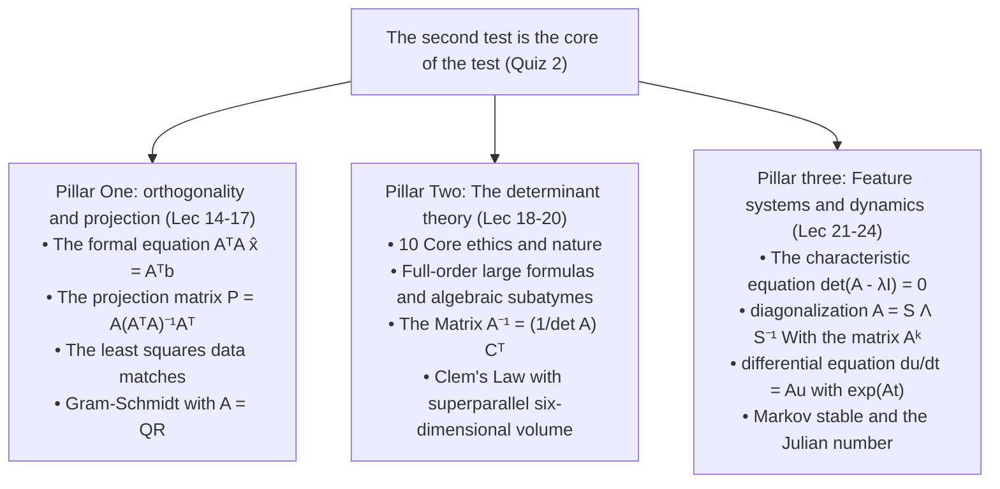

> **Lecture** The following is a list of the most common causes of death in children:  
> **The product** VideoBook: Video open source technology and e-books flow waterline  
> **Full size of book** The following are the main topics covered: 35 full-length editions; 5 major knowledge system modules; 357 original high definition tablets; 260 core introduction time frames.  
> **Video source**: [The official full set of Bilibili (BV1ix411f7Yp)](https://www.bilibili.com/video/BV1ix411f7Yp/) · [MIT OpenCourseWare 18.06 (Spring 2010)](https://ocw.mit.edu/courses/18-06-linear-algebra-spring-2010/)  
> **Copyright and licenses**: The text content and formula graphics are compiled and structured by MIT OCW Open Course Materials Translation, instructor Gilbert Strang, following  [CC BY-NC-SA 4.0](https://creativecommons.org/licenses/by-nc-sa/4.0/)  Knowledge Sharing License Agreement. Full bookshelf clips are taken from the official public lecture video.

---

> 📚 **Module overview** Eigenvalue and eigenvector: the core tools for exploring dynamic linear systems evolution; illustrating similar diagonalization  $A = S\Lambda S^{-1}$⁇ Matrix multiplication and differential equations (Fibonacci sequence); establish the matrix index  $e^{At}$  The determination of the stability of a dynamical system with a constant differential equation; extended to the Markov stable transform and the Z-scale numbers; deepened real symmetric matrix spectral theorem  $A = Q\Lambda Q^T$  The four laws of differentiation of equations with the positive definitematrix.

---

## eigenvalue and eigenvector

> 📺 **Video link back**: [B Station 21 P: eigenvalue and eigenvector](https://www.bilibili.com/video/BV1ix411f7Yp/?p=21) (⏱ 51m 03s · 10 screenshots)  
> 📖 **Official material**: [MIT OCW correspondence and summary](https://ocw.mit.edu/courses/18-06-linear-algebra-spring-2010/resources/lecture-21-eigenvalues-and-eigenvectors/)  
> 💡 **Key ideas**: Geometric meaning of Ax = λx Det: A - λI) = 0 characteristic equation Sign and determinant properties Spinning and projection matrix spectral analysis

---

### 1. The soul of dynamical systems: what is the eigenvalue and the eigenvector?

*(reference timestamp: 00:01:00 )  [Watch clip (P21 00:01:00)](https://www.bilibili.com/video/BV1ix411f7Yp/?p=21&t=60))*

In the first two decades, we studied mostly static. system of equations  $Ax = b$ From the 21st, we will introduce the most grandiose and dynamic core of linear algebra. **eigenvalue (Eigenvalues) and eigenvector (Eigenvectors)**.

The matrix is usually  $A$  Multiply by a vector  $x$  When the $Ax$  The vector will change direction and point to a completely new space location.  $x$: 
**The matrix  $A$  The new vectors that are created after they have been applied to them  $Ax$  Still with the original vector  $x$  Keep it in the same straight line (strictly parallel)!**

$$
\boxed{Ax = \lambda x}
$$
The following are the results:
- Non-zero vector  $x$  The matrix  $A$  of **The first is the eigenvector.**; 
- Scaling factor scales  $\lambda$  The corresponding **The first is the "Eigenvalue"**.

> **The core philosophy** Eigenvector: an eigenvector is a matrix-converting solid-state linear array that remains unchanged in the underlying direction; eigenvalue is the frequency of stretching along the axis if  $\lambda < 0$  The reverse is the case if  $\lambda = 0$  The first is the pressure to zero.

*⏱ Timestamp: 00:03:10 · 📷 Lecture screenshot · [Watch clip (P21 00:03:10)](https://www.bilibili.com/video/BV1ix411f7Yp/?p=21&t=190)*

---

### 2. Feature equations and two-step algorithms for solving them

*reference timestamp: 00:05:30...  [Watch clip (P21 00:05:30)](https://www.bilibili.com/video/BV1ix411f7Yp/?p=21&t=330))*

In the equation  $Ax = \lambda x$  in which, $\lambda$  and  $x$  The first is that the left side of the neck is not visible.
$$
Ax - \lambda x = \mathbf{0} \implies \boxed{(A - \lambda I) x = \mathbf{0}}
$$

According to the definition, eigenvector  $x$  It must be **Non-zero vector**($x \neq \mathbf{0}$ This means a system of linear equations.  $(A - \lambda I)x = \mathbf{0}$  It must be **Not a zero** The necessary and sufficient condition for non-zero existence is: **The coefficient matrix  $A - \lambda I$  It must be a singular matrix.** According to the previous statement, the determinant of an odd matrix must be strictly zero:

$$
\boxed{\det(A - \lambda I) = 0}
$$
This is about  $\lambda$  of  $n$  Multiple equation called matrix  $A$  of **The following is a list of characters that first appeared in the serial in the serial.**.

#### The standard query process:
1. **Step one: ask for the eigenvalue** Calculating polynomial equations  $\det(A - \lambda I) = 0$ I'm going to get out.  $n$  A eigenvalue  $\lambda_1, \dots, \lambda_n$; 
2. **Step two: ask for the eigenvector** The first is the "Greatest Day of the Year".  $\lambda_i$  Find the null space by going back to the original equation  $N(A - \lambda_i I)$  The key vector is the derivative of a function whose value is defined by G.Elimination  $x_i$.

*⏱ Timestamp: 00:07:30 · 📷 Lecture screenshot · [Watch clip (P21 00:07:30)](https://www.bilibili.com/video/BV1ix411f7Yp/?p=21&t=450)*

---

### 3. Intuitive geometry examples: projection matrix and permutation matrix

*(reference timestamp: 00:00 )  [Watch clip (P21 00:09:00)](https://www.bilibili.com/video/BV1ix411f7Yp/?p=21&t=540))*

Professor Strang notes that for matrix with distinct geometric meanings, we don't even need to list algebraic numbers and we can kill eigenvalue and eigenvector in seconds with a geometric intuition!

#### 3.1 projection matrix  $P$
Let  $P$  A projection matrix is a projection mattress to a plane projection.
- If vector  $x$  projection has done nothing about it: $Px = 1 \cdot x \implies \mathbf{\lambda = 1}$ All the vectors in this plane are all of them!  $\lambda = 1$  The eigenvector.
- If vector  $x$  Vertically to the plane, projection operations directly pressurise it to zero: $Px = \mathbf{0} = 0 \cdot x \implies \mathbf{\lambda = 0}$ The plane vector is a linear vector.  $\lambda = 0$  The eigenvector.
- **Conclusion** The eigenvalue of any projection matrix can only be  $\mathbf{1}$  or  $\mathbf{0}$!

*⏱ Timestamp: 00:11:10 · 📷 Lecture screenshot · [Watch clip (P21 00:11:10)](https://www.bilibili.com/video/BV1ix411f7Yp/?p=21&t=670)*

#### 3.2 Permutation matrix  $P = \begin{bmatrix} 0 & 1 \\ 1 & 0 \end{bmatrix}$

*reference timestamp: 13:30...  [Watch clip (P21 00:13:30)](https://www.bilibili.com/video/BV1ix411f7Yp/?p=21&t=810))*

The matrix exchanges two coordinates of the two-dimensional vector: $P \begin{bmatrix} x_1 \\ x_2 \end{bmatrix} = \begin{bmatrix} x_2 \\ x_1 \end{bmatrix}$.
- If the vector is equal to two, for example  $x = \begin{bmatrix} 1 \\ 1 \end{bmatrix}$ And the exchange is still  $\begin{bmatrix} 1 \\ 1 \end{bmatrix}$: 
  $$
  P \begin{bmatrix} 1 \\ 1 \end{bmatrix} = 1 \cdot \begin{bmatrix} 1 \\ 1 \end{bmatrix} \implies \mathbf{\lambda_1 = 1}
  $$
- If the two vectors are opposite, for example  $x = \begin{bmatrix} -1 \\ 1 \end{bmatrix}$ And then the exchange became  $\begin{bmatrix} 1 \\ -1 \end{bmatrix} = -1 \cdot \begin{bmatrix} -1 \\ 1 \end{bmatrix}$: 
  $$
  P \begin{bmatrix} -1 \\ 1 \end{bmatrix} = -1 \cdot \begin{bmatrix} -1 \\ 1 \end{bmatrix} \implies \mathbf{\lambda_2 = -1}
  $$

*⏱ Timestamp: 00:15:30 · 📷 Lecture screenshot · [Watch clip (P21 00:15:30)](https://www.bilibili.com/video/BV1ix411f7Yp/?p=21&t=930)*

---

### The two main constants of trace and determinant are the determinant.

*(reference timestamp: 00:18:00 )  [Watch clip (P21 00:18:00)](https://www.bilibili.com/video/BV1ix411f7Yp/?p=21&t=1080))*

The permutation matrix is shown below.  $P$  eigenvalue  $\lambda_1 = 1, \lambda_2 = -1$: 
- They are: $1 + (-1) = 0$ It is exactly equal to the sum of the principal angular elements in the matrix.  $0 + 0 = 0$!
- The following are the numbers: $1 \times (-1) = -1$ It's the same as determinant of a matrix.  $0 \cdot 0 - 1 \cdot 1 = -1$!

It is not a coincidence, but an eternal creation of all factions. **The two main eigenvalue principles are consistent.**: 

> **Theorem 1 (the trace is constant)** The sum of all eigenvalues is equal to the sum of the principal angular elements of the array, called the matrix **The following is a list of the most common types of cancer:**: 
> $$
> \boxed{\sum_{i=1}^n \lambda_i = \text{trace}(A) = a_{11} + a_{22} + \cdots + a_{nn}}
> $$

> **Theorem 2 (determinant constant)** The equation of the function is equal to the square root of all eigenvalues. **determinant**: 
> $$
> \boxed{\prod_{i=1}^n \lambda_i = \det(A)}
> $$

These two theorems are to test whether the eigenvalue calculation is correct for the ultimate arithmetic!

*⏱ Timestamp: 00:19:40 · 📷 Lecture screenshot · [Watch clip (P21 00:19:40)](https://www.bilibili.com/video/BV1ix411f7Yp/?p=21&t=1180)*

---

### 5. A Worked Numerical Example

*(reference timestamp: 00:23:00)  [Watch clip (P21 00:23:00)](https://www.bilibili.com/video/BV1ix411f7Yp/?p=21&t=1380))*

Set the matrix  $A = \begin{bmatrix} 3 & 1 \\ 1 & 3 \end{bmatrix}$ We're going to go through two steps:

1. **Write a characteristic equation**: 
   $$
   \det(A - \lambda I) = \det \begin{bmatrix} 3 - \lambda & 1 \\ 1 & 3 - \lambda \end{bmatrix} = (3 - \lambda)^2 - 1 = \lambda^2 - 6\lambda + 8 = 0
   $$
   Factor decomposition:
   $$
   (\lambda - 4)(\lambda - 2) = 0 \implies \boxed{\lambda_1 = 4, \quad \lambda_2 = 2}
   $$
   **Seconds of the countdown**: 
   - $\lambda_1 + \lambda_2 = 4 + 2 = 6 = \text{trace}(A) = 3 + 3$ ($\checkmark$); 
   - $\lambda_1 \lambda_2 = 4 \times 2 = 8 = \det(A) = 9 - 1 = 8$ ($\checkmark$).

*⏱ Timestamp: 00:25:20 · 📷 Lecture screenshot · [Watch clip (P21 00:25:20)](https://www.bilibili.com/video/BV1ix411f7Yp/?p=21&t=1520)*

#### 5.1 Resolve the corresponding eigenvector

- **For the  $\lambda_1 = 4$**: 
  $$
  (A - 4I) x = \begin{bmatrix} -1 & 1 \\ 1 & -1 \end{bmatrix} \begin{bmatrix} x_1 \\ x_2 \end{bmatrix} = \begin{bmatrix} 0 \\ 0 \end{bmatrix} \implies \boxed{x_1 = \begin{bmatrix} 1 \\ 1 \end{bmatrix}}
  $$
- **For the  $\lambda_2 = 2$**: 
  $$
  (A - 2I) x = \begin{bmatrix} 1 & 1 \\ 1 & 1 \end{bmatrix} \begin{bmatrix} x_1 \\ x_2 \end{bmatrix} = \begin{bmatrix} 0 \\ 0 \end{bmatrix} \implies \boxed{x_2 = \begin{bmatrix} -1 \\ 1 \end{bmatrix}}
  $$

Note: Due to  $A$  Yes, I did. **The symmetric matrix**($A^T = A$ It's two eigenvectors  $x_1$  and  $x_2$  The inner product  $1(-1) + 1(1) = 0$, **They're strictly orthogonal.** This is the 25th prediction of the great law of symmetric matrix spectral theory.

*⏱ Timestamp: 00:28:40 · 📷 Lecture screenshot · [Watch clip (P21 00:28:40)](https://www.bilibili.com/video/BV1ix411f7Yp/?p=21&t=1720)*

---

### 6. the matrix parity theorem (Shifting Property)

*(reference timestamp: 00:30:30 ·)  [Watch clip (P21 00:30:30)](https://www.bilibili.com/video/BV1ix411f7Yp/?p=21&t=1830))*

If the matrix is known  $A$  The eigenvalues and eigenvectors, the constant multiples of an identity matrix plus a matrix  $cI$ (Matrix plane) What changes will the characteristic system make?

Let  $Ax = \lambda x$: 
$$
(A + cI) x = Ax + cIx = \lambda x + cx = \boxed{(\lambda + c) x}
$$

> **Key conclusions** Add to the Front:  $cI$, **The eigenvector is completely unchanged, and each eigenvalue is strictly horizontal.  $+c$!**
 For example, the matrix above  $A = \begin{bmatrix} 3 & 1 \\ 1 & 3 \end{bmatrix} = \begin{bmatrix} 0 & 1 \\ 1 & 0 \end{bmatrix} + 3I$ The previous permutation matrixeigenvalue is  $1, -1$ Added  $3I$  The new eigenvalue is then immediately transformed into a  $1+3=4$  and  $-1+3=2$ The results are not much worse than what we just calculated!

*⏱ Timestamp: 00:32:10 · 📷 Lecture screenshot · [Watch clip (P21 00:32:10)](https://www.bilibili.com/video/BV1ix411f7Yp/?p=21&t=1930)*

---

### 7. Strange situations and counter-intuitive phenomena

*(reference timestamp: 00:36:00)  [Watch clip (P21 00:36:00)](https://www.bilibili.com/video/BV1ix411f7Yp/?p=21&t=2160))*

#### 7.1 Multiple eigenvalue: 90° rotating matrix  $Q$
Consider the orthogonal matrix of a 90-degree rotation of the clock:
$$
Q = \begin{bmatrix} 0 & -1 \\ 1 & 0 \end{bmatrix}
$$
In the two-dimensional solid plane, any non-zero vector rotation after 90 degrees is completely altered, and cannot be parallel to the original direction! The real eigenvector does not seem to exist.

Algebraic questions:
$$
\det(Q - \lambda I) = \lambda^2 + 1 = 0 \implies \boxed{\lambda = \pm i}
$$
It's falling apart. **Multiple domains**!
- The eigenvalue is a pure null number: $\lambda_1 = i, \lambda_2 = -i$; 
- The test: $\text{trace} = 0 = i + (-i)$, $\det = 1 = i(-i) = -i^2 = 1$; 
- This shows that a real symmetric matrix has real eigenvalue, whereas a non-symmetric mattress (especially opposite to the name ⁇ orthogonal rotation) is easily generated by multiple resonant eigenvalues.

*⏱ Timestamp: 00:38:40 · 📷 Lecture screenshot · [Watch clip (P21 00:38:40)](https://www.bilibili.com/video/BV1ix411f7Yp/?p=21&t=2320)*

#### 7.2 Loss matrix: Defective Matrix: lack of eigenvector

*(reference timestamp: 00:42:00 · [Watch clip (P21 00:42:00)](https://www.bilibili.com/video/BV1ix411f7Yp/?p=21&t=2520))*

And then look at an upper triangular matrix that looks like it's harmless to humans:
$$
A = \begin{bmatrix} 3 & 1 \\ 0 & 3 \end{bmatrix}
$$
- Diagonal eigenvalue: $\lambda_1 = 3, \lambda_2 = 3$ (Renewed root eigenvalue);
- The eigenvector is a function of the equation.
  $$
  (A - 3I)x = \begin{bmatrix} 0 & 1 \\ 0 & 0 \end{bmatrix} \begin{bmatrix} x_1 \\ x_2 \end{bmatrix} = \begin{bmatrix} 0 \\ 0 \end{bmatrix} \implies x_2 = 0, \quad x_1 \text{ 自由}
  $$
  The only way to find a linearly independent eigenvector is: $x_1 = \begin{bmatrix} 1 \\ 0 \end{bmatrix}$!

This is a **Over-eigenvalue and not aligned  $n$  linearly independent eigenvector** The matrix, which is called in mathematics **The loss matrix (defective matrix)**. They cannot perform similar diagonalization.

The next talk (Lecture 22) will be a deep exploration of how to use the Internet.  $n$  The first is that the matrix diagonalization is a completely unrelated eigenvector.  $A = S \Lambda S^{-1}$ And the second matrix is high-frequency.  $A^k$!

*⏱ Timestamp: 00:44:20 · 📷 Lecture screenshot · [Watch clip (P21 00:44:20)](https://www.bilibili.com/video/BV1ix411f7Yp/?p=21&t=2660)*

---

## 22nd: Diagonalization and the Matrix

> 📺 **Video link back**: [B Station 22 P: Matrix Diagonalization and A sequence](https://www.bilibili.com/video/BV1ix411f7Yp/?p=22) (⏱ 47m 18s · 10 screenshots)  
> 📖 **Official material**: [MIT OCW correspondence and summary](https://ocw.mit.edu/courses/18-06-linear-algebra-spring-2010/resources/lecture-22-diagonalization-and-powers-of-a/)  
> 💡 **Key ideas** Similar diagonalization A = SΛS−1, matrix array Ak, one-phase differential equation uk = Aku0, Fibonacci number line derivation.

---

### 1. Why do you want to use matrix diagonalization?

*(reference timestamp: 00:01:00 )  [Watch clip (P22 00:01:00)](https://www.bilibili.com/video/BV1ix411f7Yp/?p=22&t=60))*

In scientific computing and engineering modeling, a system evolves discrete over time:
$$
u_{k+1} = A u_k \implies u_k = A^k u_0
$$
High-performance computing matrix  $A^k$ (e.g.  $A^{100}$ If the matrix is a normal non-parallel matrix, and the fractions are intertwined, it is difficult to see long-term evolutionary trends. **If the matrix is a diagonal matrix,  $\Lambda$**: 
$$
\Lambda = \begin{bmatrix} \lambda_1 & & \\ & \lambda_2 & \\ & & \ddots \end{bmatrix} \implies \Lambda^k = \begin{bmatrix} \lambda_1^k & & \\ & \lambda_2^k & \\ & & \ddots \end{bmatrix}
$$
The slope of a matrix for calculating angles is simply to multiply the dimensions of each line by an angle, simple and extreme!

**The ultimate goal of diagonalization is to transform a complex matrix into a simple diagonal matrix by converting the base of an eigenvector.**

---

### 2. the eigenvector matrix  $S$  with the core equation  $A S = S \Lambda$

*(reference timestamp: 00:03:00)  [Watch clip (P22 00:03:00)](https://www.bilibili.com/video/BV1ix411f7Yp/?p=22&t=180))*

Set the matrix  $A$  Owned  $n$  A linearly independent eigenvector  $x_1, x_2, \dots, x_n$ The following is a list of the most common types of eigenvalue:  $\lambda_1, \lambda_2, \dots, \lambda_n$ I'm not sure.
$$
A x_1 = \lambda_1 x_1, \quad A x_2 = \lambda_2 x_2, \quad \dots, \quad A x_n = \lambda_n x_n
$$

We're going to do this.  $n$  The vector column is written in a row and then sorted into a line. **The eigenvector matrix  $S$**: 
$$
S = \begin{bmatrix} x_1 & x_2 & \cdots & x_n \end{bmatrix}
$$
Now we're looking at matrix multiplication.  $A S$: 
$$
A S = A \begin{bmatrix} x_1 & x_2 & \cdots & x_n \end{bmatrix} = \begin{bmatrix} A x_1 & A x_2 & \cdots & A x_n \end{bmatrix} = \begin{bmatrix} \lambda_1 x_1 & \lambda_2 x_2 & \cdots & \lambda_n x_n \end{bmatrix}
$$

*⏱ Timestamp: 00:03:40 · 📷 Lecture screenshot · [Watch clip (P22 00:03:40)](https://www.bilibili.com/video/BV1ix411f7Yp/?p=22&t=220)*

#### 2.1 The  $\lambda$  Extract as a paired matrix  $\Lambda$

Note the matrix on the far right: each row is a prime eigenvector multiplied by a measure. According to the sub-block matrix multiplication, this equals exactly:
$$
\begin{bmatrix} \lambda_1 x_1 & \lambda_2 x_2 & \cdots & \lambda_n x_n \end{bmatrix} = \begin{bmatrix} x_1 & x_2 & \cdots & x_n \end{bmatrix} \begin{bmatrix} \lambda_1 & 0 & \cdots & 0 \\ 0 & \lambda_2 & \cdots & 0 \\ \vdots & \vdots & \ddots & \vdots \\ 0 & 0 & \cdots & \lambda_n \end{bmatrix}
$$

So we have the most sacred, the most elegant of all characteristic theories. **The matrix-level basic formula**: 
$$
\boxed{A S = S \Lambda}
$$
where  $\Lambda$  The main paired matrix is the paired matrice of the eigenvalue!

*⏱ Timestamp: 00:07:30 · 📷 Lecture screenshot · [Watch clip (P22 00:07:30)](https://www.bilibili.com/video/BV1ix411f7Yp/?p=22&t=450)*

---

### 3. Similar diagonalization decomposition formula

*(reference timestamp: 00:10:30)  [Watch clip (P22 00:10:30)](https://www.bilibili.com/video/BV1ix411f7Yp/?p=22&t=630))*

If this is  $n$  The eigenvector is **linearly independent** Oh, well, then the flank.  $S$  Yes, I did. **The invertiblematrix**($S^{-1}$  It exists!  $A S = S \Lambda$  Both ends are simultaneously left-handed  $S^{-1}$: 
$$
\boxed{S^{-1} A S = \Lambda}
$$
Or go right on both ends at the same time.  $S^{-1}$ Get the matrix.  $A$  of **The first is the "Scream" and the second is the "Diagonalization".**: 
$$
\boxed{A = S \Lambda S^{-1}}
$$

> **Meaning of Mathematics** Linear transformation is defined by a matrix under the standard rectangle basis  $A$  indicates; if the switch is to a silicon natural base with an eigenvector as the coordinate axis, this change directly degrades into the purest scalar transformation along each axis  $\Lambda$!

*⏱ Timestamp: 00:11:20 · 📷 Lecture screenshot · [Watch clip (P22 00:11:20)](https://www.bilibili.com/video/BV1ix411f7Yp/?p=22&t=680)*

---

### 4. The second-mapping matrix high frequency: $A^k = S \Lambda^k S^{-1}$

*reference timestamp: 00:14:00...  [Watch clip (P22 00:14:00)](https://www.bilibili.com/video/BV1ix411f7Yp/?p=22&t=840))*

Now let's look at the calculations.  $A^2$  What will happen:
$$
A^2 = (S \Lambda S^{-1}) (S \Lambda S^{-1}) = S \Lambda \underbrace{(S^{-1} S)}_{I} \Lambda S^{-1} = S \Lambda^2 S^{-1}
$$
The middle  $S^{-1} S$  The momentum of the coup is wiped out in units!

The following is a list of the most common types of  $k$  The next step:
$$
\boxed{A^k = S \Lambda^k S^{-1}}
$$
This means:
1. **$A^k$  The eigenvector and the original matrix  $A$  It's exactly the same.** (Eigenvector matrix is still the same as  $S$); 
2. **$A^k$  The original eigenvalue is directly the same as the original eigen value.  $k$  The next one.**($\lambda_i^k$)!

#### 4.1 Dynamic system stability guidelines (stability)

when  $k \to \infty$  When the system is in state  $u_k = A^k u_0$  The price of the product will be based on the size of the eigenvalue:
$$
\lim_{k \to \infty} A^k = \mathbf{O} \iff \text{对所有特征值，均有 } \boxed{|\lambda_i| < 1}
$$
Just one of them. eigenvalue  $|\lambda| > 1$ The system will be uncontrolled along the direction of the characteristic.

*⏱ Timestamp: 00:15:40 · 📷 Lecture screenshot · [Watch clip (P22 00:15:40)](https://www.bilibili.com/video/BV1ix411f7Yp/?p=22&t=940)*

---

### 5. When can matrix be diagonalization?

*(reference timestamp: 00:19:30 · [Watch clip (P22 00:19:30)](https://www.bilibili.com/video/BV1ix411f7Yp/?p=22&t=1170))*

Not all diagonalizations can be used. The key is adequate and necessary:

> **Necessary and sufficient condition**: $n \times n$  The matrix  $A$  diagonalization, when and only  $A$  Owned  **$n$  A linearly independent eigenvector** (Geometrical weights are equal to algebraic weights)

> **The theory of the absolute zero-root** If:  $n \times n$  The matrix  $A$  Owned  **$n$  Different eigenvalue.**($\lambda_1 \neq \lambda_2 \neq \cdots \neq \lambda_n$ (A) and this  $n$  The eigenvector must be linearly independent, and the vector is not bound to linearity. **The matrix  $A$  Must be diagonalization!**

**The concept of caution**: 
- **Invertible  $\neq$  The diagonalization**!
  - The invertible is concerned about whether there is zero eigenvalue $\lambda \neq 0 \iff$  The invertible;
  - Diagonalization concerns whether the eigenvector is sufficient, even if it is a positive or negative.  $\lambda = 0$  diagonalization (e.g. Zmatrix is already right in the corner).

*⏱ Timestamp: 00:20:50 · 📷 Lecture screenshot · [Watch clip (P22 00:20:50)](https://www.bilibili.com/video/BV1ix411f7Yp/?p=22&t=1250)*

---

### 6. System of equations solving mechanism

*(reference timestamp: 00:25:00)  [Watch clip (P22 00:25:00)](https://www.bilibili.com/video/BV1ix411f7Yp/?p=22&t=1500))*

Considering the system of differential evolution  $u_{k+1} = A u_k$ I'm going to start the process.  $u_0$  The first is the "Eigenvector" base.
$$
u_0 = c_1 x_1 + c_2 x_2 + \cdots + c_n x_n = S c
$$
The coefficient vector is  $c = S^{-1} u_0$  The only certainty.

When you multiply the sides  $A$  When:
$$
u_1 = A u_0 = c_1 A x_1 + \cdots + c_n A x_n = c_1 \lambda_1 x_1 + \cdots + c_n \lambda_n x_n
$$
Every time  $A$ The number of characters is multiplied by the corresponding  $\lambda_i$: 
$$
\boxed{u_k = A^k u_0 = c_1 \lambda_1^k x_1 + c_2 \lambda_2^k x_2 + \cdots + c_n \lambda_n^k x_n}
$$
The evolution of the high-dimensional system, completely broken down into  $n$  The first is the independent one-dimensional pure geometry of growth/depression.

*⏱ Timestamp: 00:26:30 · 📷 Lecture screenshot · [Watch clip (P22 00:26:30)](https://www.bilibili.com/video/BV1ix411f7Yp/?p=22&t=1590)*

---

### 7th century classical application: Fibonacci numbers divided by gold

*(reference timestamp: 00:30:30 ·)  [Watch clip (P22 00:30:30)](https://www.bilibili.com/video/BV1ix411f7Yp/?p=22&t=1830))*

The Fibonacci sequence is defined as:
$$
F_0 = 0, \quad F_1 = 1, \quad F_{k+2} = F_{k+1} + F_k
$$
The first few lines are: $0, 1, 1, 2, 3, 5, 8, 13, 21, 34, 55, \dots$. This is a two-step measure-exclude equation. How to find a pass-through item formula with linear algebra  $F_{100}$?

#### 7.1 Upgrading techniques: constructing state vectors
Introduce the state vector  $u_k = \begin{bmatrix} F_{k+1} \\ F_k \end{bmatrix}$ The following is the state of the moment:
$$
u_{k+1} = \begin{bmatrix} F_{k+2} \\ F_{k+1} \end{bmatrix} = \begin{bmatrix} F_{k+1} + F_k \\ F_{k+1} \end{bmatrix}
$$
Write it as a matrix multiplied by:
$$
\begin{bmatrix} F_{k+2} \\ F_{k+1} \end{bmatrix} = \underbrace{\begin{bmatrix} 1 & 1 \\ 1 & 0 \end{bmatrix}}_{A} \begin{bmatrix} F_{k+1} \\ F_k \end{bmatrix} \implies \boxed{u_{k+1} = A u_k}
$$
The second step of the scale is a momentary shift that we know as one.  $2 \times 2$  The initial vector is the matrix system.  $u_0 = \begin{bmatrix} 1 \\ 0 \end{bmatrix}$.

*⏱ Timestamp: 00:32:10 · 📷 Lecture screenshot · [Watch clip (P22 00:32:10)](https://www.bilibili.com/video/BV1ix411f7Yp/?p=22&t=1930)*

#### 7.2 Solve the equation of dividing eigenvalue by gold

*(reference timestamp: 00:37:00 )  [Watch clip (P22 00:37:00)](https://www.bilibili.com/video/BV1ix411f7Yp/?p=22&t=2220))*

Computing with a matrix  $A = \begin{bmatrix} 1 & 1 \\ 1 & 0 \end{bmatrix}$  The characteristic equation:
$$
\det(A - \lambda I) = \det \begin{bmatrix} 1 - \lambda & 1 \\ 1 & -\lambda \end{bmatrix} = (1 - \lambda)(-\lambda) - 1 = \lambda^2 - \lambda - 1 = 0
$$
Using the second equation, we can find a root formula:
$$
\boxed{\lambda_1 = \frac{1 + \sqrt{5}}{2} \approx 1.618 \quad (\text{黄金分割比 } \phi)}
$$
$$
\boxed{\lambda_2 = \frac{1 - \sqrt{5}}{2} \approx -0.618}
$$
The test: $\lambda_1 + \lambda_2 = 1 = \text{trace}(A)$; $\lambda_1 \lambda_2 = -1 = \det(A)$ It's perfect!

*⏱ Timestamp: 00:38:20 · 📷 Lecture screenshot · [Watch clip (P22 00:38:20)](https://www.bilibili.com/video/BV1ix411f7Yp/?p=22&t=2300)*

#### 7.3 eigenvectors and initial decomposition

*(reference timestamp: 00:42:30...)  [Watch clip (P22 00:42:30)](https://www.bilibili.com/video/BV1ix411f7Yp/?p=22&t=2550))*

For each eigenvalue, ask for answers.  $(A - \lambda I)x = \mathbf{0}$: 
$$
\begin{bmatrix} 1 - \lambda & 1 \\ 1 & -\lambda \end{bmatrix} \begin{bmatrix} x_1 \\ x_2 \end{bmatrix} = \begin{bmatrix} 0 \\ 0 \end{bmatrix} \implies x_1 - \lambda x_2 = 0 \implies \boxed{x = \begin{bmatrix} \lambda \\ 1 \end{bmatrix}}
$$
So, here's what we need:
$$
x_1 = \begin{bmatrix} \lambda_1 \\ 1 \end{bmatrix}, \quad x_2 = \begin{bmatrix} \lambda_2 \\ 1 \end{bmatrix}
$$

The first value  $u_0 = \begin{bmatrix} 1 \\ 0 \end{bmatrix}$  The first is the "Eigenvector".
$$
\begin{bmatrix} 1 \\ 0 \end{bmatrix} = c_1 \begin{bmatrix} \lambda_1 \\ 1 \end{bmatrix} + c_2 \begin{bmatrix} \lambda_2 \\ 1 \end{bmatrix} \implies \begin{cases} c_1 \lambda_1 + c_2 \lambda_2 = 1 \\ c_1 + c_2 = 0 \end{cases}
$$
The  $c_2 = -c_1$ The first is: $c_1 (\lambda_1 - \lambda_2) = 1$ Because...  $\lambda_1 - \lambda_2 = \frac{1+\sqrt{5}}{2} - \frac{1-\sqrt{5}}{2} = \sqrt{5}$: 
$$
c_1 = \frac{1}{\sqrt{5}}, \quad c_2 = -\frac{1}{\sqrt{5}}
$$

*⏱ Timestamp: 00:43:50 · 📷 Lecture screenshot · [Watch clip (P22 00:43:50)](https://www.bilibili.com/video/BV1ix411f7Yp/?p=22&t=2630)*

---

### The final birth of the Binet's Formula.

*(reference timestamp: 00:47:00)  [Watch clip (P22 00:47:00)](https://www.bilibili.com/video/BV1ix411f7Yp/?p=22&t=2820))*

According to the formula for decomposition  $u_k = c_1 \lambda_1^k x_1 + c_2 \lambda_2^k x_2$: 
$$
\begin{bmatrix} F_{k+1} \\ F_k \end{bmatrix} = \frac{1}{\sqrt{5}} \lambda_1^k \begin{bmatrix} \lambda_1 \\ 1 \end{bmatrix} - \frac{1}{\sqrt{5}} \lambda_2^k \begin{bmatrix} \lambda_2 \\ 1 \end{bmatrix}
$$
The second line of the scale is extracted directly from the famous **The closed formula**: 
$$
\boxed{F_k = \frac{1}{\sqrt{5}} \left[ \left(\frac{1+\sqrt{5}}{2}\right)^k - \left(\frac{1-\sqrt{5}}{2}\right)^k \right]}
$$

The  $|\lambda_2| = | -0.618 | < 1$ And then,  $k$  The second is the increase in  $\lambda_2^k$  The index is moving to zero!
$$
F_k \approx \frac{1}{\sqrt{5}} \left(\frac{1+\sqrt{5}}{2}\right)^k
$$
This is a stark proof: **Fibonacci numbers are numbered  $k$  The concept is that the purely gold partition index growth! It's only possible to get absolutely accurate integers from the first four-by-five.**

So we're going to extend the differential equation to the continuum-time physics world. **Linear differential equations grouped with matrix indices  $\exp(At)$**!

*⏱ Timestamp: 00:48:30 · 📷 Lecture screenshot · [Watch clip (P22 00:48:30)](https://www.bilibili.com/video/BV1ix411f7Yp/?p=22&t=2910)*

---

## 23rd: Differential equation and matrix index  $\exp(At)$

> 📺 **Video link back**: [B stands at 23 P: differential equation with matrix index exp ((At))](https://www.bilibili.com/video/BV1ix411f7Yp/?p=23) (⏱ 50m 58s · 10 screenshots)  
> 📖 **Official material**: [MIT OCW correspondence and summary](https://ocw.mit.edu/courses/18-06-linear-algebra-spring-2010/resources/lecture-23-differential-equations-and-exp-at/)  
> 💡 **Key ideas** The first step is the linear differential equation group du/dt = Au, matrix index e^{At} = S e^{Λt} S−1 ≈ approximate stability of the dynamical system solution.

---

### 1. From the discrete differential equation to the continuous differential equations

*(reference timestamp: 00:01:00 )  [Watch clip (P23 00:01:00)](https://www.bilibili.com/video/BV1ix411f7Yp/?p=23&t=60))*

So we've been working on a one-step differential equation.  $u_{k+1} = A u_k$ In this talk, we are fully engaging the characteristic system in a continuous physical world of sovereignty equations. **Linear differential equations of a phase constant**: 
$$
\boxed{\frac{du}{dt} = A u}
$$
where  $u(t) = \begin{bmatrix} u_1(t) \\ u_2(t) \\ \vdots \\ u_n(t) \end{bmatrix}$  The state vector is the evolutionary vector of time. $A$  Yes, I did.  $n \times n$  The constant coefficient matrix.  $u(0) = u_0$  How to get a solution  $u(t)$?

#### 1.1 Miracles of pure index solving

In a one-dimensional calculus, the equation is  $\frac{du}{dt} = a u$  The solution is a pure index function  $u(t) = e^{a t} u(0)$ For the multi-vector equation, we also have a bold form of conjecture. **The evolution of pure indices by a constant direction vector**: 
$$
u(t) = e^{\lambda t} x
$$
The first is the solution to the equation.
- The left-hand side shows the time: $\frac{du}{dt} = \lambda e^{\lambda t} x$; 
- The matrix on the right is multiplied by: $A u(t) = A (e^{\lambda t} x) = e^{\lambda t} (Ax)$.

The non-zero scale factor on both sides is eliminated  $e^{\lambda t}$ from both sides to obtain:
$$
\lambda x = A x \iff \boxed{A x = \lambda x}
$$
**This is a pure mathematical miracle!  $\lambda$  It's a matrix.  $A$  The equation of the eigenvalue and the fixed constant direction vector  $x$  It's a corresponding eigenvector!**

*⏱ Timestamp: 00:03:20 · 📷 Lecture screenshot · [Watch clip (P23 00:03:20)](https://www.bilibili.com/video/BV1ix411f7Yp/?p=23&t=200)*

---

### 2. The classical second-order fluid/density conjugation model

*(reference timestamp: 00:00:00)  [Watch clip (P23 00:05:00)](https://www.bilibili.com/video/BV1ix411f7Yp/?p=23&t=300))*

Professor Strang introduced a highly intuitive physical model: the problem of diffusion of two containers permeating each other.
$$
\begin{cases}
\frac{du_1}{dt} = -u_1 + 2u_2 \\
\frac{du_2}{dt} = u_1 - 2u_2
\end{cases}
\implies \frac{du}{dt} = \underbrace{\begin{bmatrix} -1 & 2 \\ 1 & -2 \end{bmatrix}}_{A} u
$$
The initial state is set to: $u(0) = \begin{bmatrix} 1 \\ 0 \end{bmatrix}$.

Watch the matrix  $A$  The following are the main features:
- The sum of the elements in each row is zero. $-1 + 1 = 0$, $2 - 2 = 0$); 
- Physical meaning: the total matter of two containers is constant, and the quantity of water in a container is equal to the amount of water. $\frac{d(u_1 + u_2)}{dt} = 0$ The total quality of the system is increasing and decreasing!

*⏱ Timestamp: 00:06:50 · 📷 Lecture screenshot · [Watch clip (P23 00:06:50)](https://www.bilibili.com/video/BV1ix411f7Yp/?p=23&t=410)*

#### 2.1 Solve the eigenvalue with the eigenvector

Calculating the matrix  $A$ ♪ The signs and the signs ♪ determinant :
- The trail: $\text{trace}(A) = -1 + (-2) = -3$; 
- The determinant: $\det(A) = (-1)(-2) - (2)(1) = 2 - 2 = 0$ (Linearly dependent, singular)

The first is the principle of conservation, which states:
$$
\begin{cases} \lambda_1 + \lambda_2 = -3 \\ \lambda_1 \lambda_2 = 0 \end{cases} \implies \boxed{\lambda_1 = 0, \quad \lambda_2 = -3}
$$

The answer is to find the corresponding eigenvector:
- **For the  $\lambda_1 = 0$** (Null space specification):
  $$
  A x_1 = \begin{bmatrix} -1 & 2 \\ 1 & -2 \end{bmatrix} x_1 = \mathbf{0} \implies \boxed{x_1 = \begin{bmatrix} 2 \\ 1 \end{bmatrix}}
  $$
- **For the  $\lambda_2 = -3$**: 
  $$
  (A + 3I) x_2 = \begin{bmatrix} 2 & 2 \\ 1 & 1 \end{bmatrix} x_2 = \mathbf{0} \implies \boxed{x_2 = \begin{bmatrix} -1 \\ 1 \end{bmatrix}}
  $$

*⏱ Timestamp: 00:11:40 · 📷 Lecture screenshot · [Watch clip (P23 00:11:40)](https://www.bilibili.com/video/BV1ix411f7Yp/?p=23&t=700)*

---

### 3. The differential and stable evolution of linear differential equations

*reference timestamp: 00:14:00...  [Watch clip (P23 00:14:00)](https://www.bilibili.com/video/BV1ix411f7Yp/?p=23&t=840))*

The linear superposition of the equation using characteristic solutions is:
$$
u(t) = c_1 e^{\lambda_1 t} x_1 + c_2 e^{\lambda_2 t} x_2 = c_1 e^{0 \cdot t} \begin{bmatrix} 2 \\ 1 \end{bmatrix} + c_2 e^{-3t} \begin{bmatrix} -1 \\ 1 \end{bmatrix}
$$
The  $e^{0 \cdot t} = 1$ The first is **The first step is to create a stable state that does not change over time.** The second is **Transit State, which declines rapidly over time**!

Substitute the initial value  $u(0) = \begin{bmatrix} 1 \\ 0 \end{bmatrix}$: 
$$
c_1 \begin{bmatrix} 2 \\ 1 \end{bmatrix} + c_2 \begin{bmatrix} -1 \\ 1 \end{bmatrix} = \begin{bmatrix} 1 \\ 0 \end{bmatrix} \implies \begin{cases} 2c_1 - c_2 = 1 \\ c_1 + c_2 = 0 \end{cases} \implies c_1 = \frac{1}{3}, \quad c_2 = -\frac{1}{3}
$$

The substitution is defined precisely:
$$
u(t) = \frac{1}{3} \begin{bmatrix} 2 \\ 1 \end{bmatrix} - \frac{1}{3} e^{-3t} \begin{bmatrix} -1 \\ 1 \end{bmatrix}
$$

when  $t \to \infty$  When the $e^{-3t} \to 0$: 
$$
\lim_{t \to \infty} u(t) = \begin{bmatrix} 2/3 \\ 1/3 \end{bmatrix}
$$
The two containers are  $2:1$  The result is a thermodynamic balance.

*⏱ Timestamp: 00:15:30 · 📷 Lecture screenshot · [Watch clip (P23 00:15:30)](https://www.bilibili.com/video/BV1ix411f7Yp/?p=23&t=930)*

---

### 4. The Biggest theorem of continuous system stability: Stability

*(reference timestamp: 00:19:00)  [Watch clip (P23 00:19:00)](https://www.bilibili.com/video/BV1ix411f7Yp/?p=23&t=1140))*

For any  $n$  Linear differential equations  $\frac{du}{dt} = Au$ When  $t \to \infty$  When will the solution decline to zero (and become almost stable)?

The following is a list of the most common causes of death in the United States. $u(t) = \sum c_i e^{\lambda_i t} x_i$ If you  $\lambda = \alpha + i \beta$  The number of digits is:
$$
|e^{\lambda t}| = |e^{(\alpha + i\beta)t}| = |e^{\alpha t}| \cdot |e^{i\beta t}| = e^{\alpha t} \cdot 1 = e^{\text{Re}(\lambda) t}
$$

> **Continuity system is becoming more stable Necessary and sufficient condition** The matrix:  $A$  of **All eigenvalue are strictly negative.**: 
> $$
> \boxed{\text{Re}(\lambda_i) < 0 \quad (\forall i = 1, \dots, n)}
> $$

#### The main contrast between separation and continuous stability:
- **Differential differential equations  $u_{k+1} = A u_k$** What is important:  $|\lambda| < 1$ (located in the reverse plane) **Inside the unit circle**); 
- **Continuous differential equation  $\frac{du}{dt} = Au$** What is important:  $\text{Re}(\lambda) < 0$ (located in the reverse plane) **Left half open**)!

*⏱ Timestamp: 00:20:10 · 📷 Lecture screenshot · [Watch clip (P23 00:20:10)](https://www.bilibili.com/video/BV1ix411f7Yp/?p=23&t=1210)*

#### 4.1 Secondary determination of the secondary real matrix
For the  $2 \times 2$  The matrix, the characteristic equation is  $\lambda^2 - \text{trace}(A) \lambda + \det(A) = 0$ The real parts of two roots are negative integers, equal to:
$$
\boxed{\text{trace}(A) < 0 \quad \text{且} \quad \det(A) > 0}
$$
As long as the test marks are measured with two determinants, we can instantly assert stability without having to root them out!

*⏱ Timestamp: 00:24:40 · 📷 Lecture screenshot · [Watch clip (P23 00:24:40)](https://www.bilibili.com/video/BV1ix411f7Yp/?p=23&t=1480)*

---

### 5. Decompression mechanism: Diagonalization under the base of the eigenvector

*reference timestamp: 00:29:30...  [Watch clip (P23 00:29:30)](https://www.bilibili.com/video/BV1ix411f7Yp/?p=23&t=1770))*

Why is it possible for an eigenvector to completely solve a differential equation using matrix-like diagonalization?  $A = S \Lambda S^{-1}$ The variable is replaced by:
$$
u(t) = S v(t) \iff v(t) = S^{-1} u(t)
$$
The first equation is:
$$
S \frac{dv}{dt} = A S v \implies \frac{dv}{dt} = S^{-1} A S v = \boxed{\Lambda v}
$$

The  $\Lambda$  It's the angle matrix. It was supposed to be interwoven.  $n$  The equation is a linear equation. **The whole thing was broken in a moment.  $n$  A one-dimensional scale equation that is completely independent of each other**: 
$$
\frac{dv_i}{dt} = \lambda_i v_i \implies v_i(t) = e^{\lambda_i t} v_i(0)
$$
I'm going to get out.  $v(t)$  Then left.  $S$  The first is the transition to the original coordinate system: $u(t) = S v(t) = S e^{\Lambda t} S^{-1} u(0)$.

*⏱ Timestamp: 00:30:50 · 📷 Lecture screenshot · [Watch clip (P23 00:30:50)](https://www.bilibili.com/video/BV1ix411f7Yp/?p=23&t=1850)*

---

### 6. The matrix index  $\exp(At)$  Definition and nature

*(reference timestamp: 00:35:00)  [Watch clip (P23 00:35:00)](https://www.bilibili.com/video/BV1ix411f7Yp/?p=23&t=2100))*

We are familiar with Taylor-Class numbers in metrical calculus:
$$
e^{a t} = 1 + a t + \frac{(a t)^2}{2!} + \frac{(a t)^3}{3!} + \cdots = \sum_{k=0}^\infty \frac{(a t)^k}{k!}
$$
The scale  $a$  The matrix is changed.  $A$ Definition of the **The matrix is a matrix of exponential numbers.**: 
$$
\boxed{e^{At} = I + At + \frac{(At)^2}{2!} + \frac{(At)^3}{3!} + \cdots = \sum_{k=0}^\infty \frac{A^k t^k}{k!}}
$$
Because of the exponent of the gradient  $k!$  The growth is terrifying, and the level of terrorism is unlikely to be seen on any real front.  $A$  and any time  $t$  It's a perfectly good thing!

*⏱ Timestamp: 00:36:20 · 📷 Lecture screenshot · [Watch clip (P23 00:36:20)](https://www.bilibili.com/video/BV1ix411f7Yp/?p=23&t=2180)*

#### 6.1 Spekulation formula for the matrix index

The  $A^k = S \Lambda^k S^{-1}$ And then he added it to every single one of them:
$$
e^{At} = S \left( I + \Lambda t + \frac{(\Lambda t)^2}{2!} + \cdots \right) S^{-1} = \boxed{S e^{\Lambda t} S^{-1}}
$$
In this case, the index of a matrix is directly proportional to the parameters of each pair of elements:
$$
e^{\Lambda t} = \begin{bmatrix} e^{\lambda_1 t} & 0 & \cdots & 0 \\ 0 & e^{\lambda_2 t} & \cdots & 0 \\ \vdots & \vdots & \ddots & \vdots \\ 0 & 0 & \cdots & e^{\lambda_n t} \end{bmatrix}
$$

The first-order differential equation has a very strong and powerful value. **The United Nations is a powerful force.**: 
$$
\boxed{u(t) = e^{At} u(0)}
$$

*⏱ Timestamp: 00:41:10 · 📷 Lecture screenshot · [Watch clip (P23 00:41:10)](https://www.bilibili.com/video/BV1ix411f7Yp/?p=23&t=2470)*

---

### 7. higher-order Decline of one equation to one step system of equations

*(reference timestamp: 00:46:00)  [Watch clip (P23 00:46:00)](https://www.bilibili.com/video/BV1ix411f7Yp/?p=23&t=2760))*

In physics (such as Newton's second law, the hypotenuse, RLC oscillating circuit) the most common is a two-phase differential equation:
$$
y'' + b y' + k y = 0
$$
How do we solve this problem with our powerful matrix toolkit? **Increasing dimension to reduce the order**!

Definition of the state vector:
$$
u(t) = \begin{bmatrix} y'(t) \\ y(t) \end{bmatrix}
$$
The following is a list of the most common causes:
$$
u'(t) = \begin{bmatrix} y'' \\ y' \end{bmatrix} = \begin{bmatrix} -b y' - k y \\ y' \end{bmatrix} = \begin{bmatrix} -b & -k \\ 1 & 0 \end{bmatrix} \begin{bmatrix} y' \\ y \end{bmatrix} = A u
$$
The Matrix  $A = \begin{bmatrix} -b & -k \\ 1 & 0 \end{bmatrix}$  The characteristic equation is:
$$
\det(A - \lambda I) = \lambda^2 + b\lambda + k = 0
$$
This is exactly the same as the auxiliary characteristic equation of the classical constant differential equation! Any higher-order singular differential equations can be reduced to a standard first-order matrix differential system by adding a state variable.

Next, we're going to extend the feature system to probability transfer of the world map. **The Markov matrix (Markov Matrices) with the number of degrees of Zyri**!

*⏱ Timestamp: 00:46:50 · 📷 Lecture screenshot · [Watch clip (P23 00:46:50)](https://www.bilibili.com/video/BV1ix411f7Yp/?p=23&t=2810)*

---

## 24th: The Markov matrix and the Julian number

> 📺 **Video link back**: [B Station 24 P: Markov matrix and the number of degrees of Z](https://www.bilibili.com/video/BV1ix411f7Yp/?p=24) (⏱ 50m 58s · 10 screenshots)  
> 📖 **Official material**: [MIT OCW correspondence and summary](https://ocw.mit.edu/courses/18-06-linear-algebra-spring-2010/resources/lecture-24-markov-matrices-fourier-series/)  
> 💡 **Key ideas** The following are the probability vectors with λ = 1 eigenvalue, the Pellon-Frobenius theorem, infinite winner product with function orthogonal projection, and the Polaris coefficient of degree.

---

### 1. The process of random evolution with the Markov matrix

*(reference timestamp: 00:01:00 )  [Watch clip (P24 00:01:00)](https://www.bilibili.com/video/BV1ix411f7Yp/?p=24&t=60))*

In probability theory, economics, and page ranking (Google PageRank) and statistical physics, system states often shift between states according to the laws of probability. The core mathematical tools for describing this state shift are: **The Markov Matrix is a series of three computer games.**.

A front  $A$  To become a Markov matrix, the two main formal conditions must be met:
1. **Non-negative elements**:Each element in the matrix is greater than zero (probability nonnegative):
   $$
   a_{ij} \ge 0 \quad (\forall i, j)
   $$
2. **Preservation of column sums**: **The value of each element in the matrix is exactly 1.** (The probability of a system starting from one state and moving to all possible states is 100%):
   $$
   \sum_{i=1}^n a_{ij} = 1 \quad (\forall j = 1, \dots, n)
   $$

*⏱ Timestamp: 00:03:30 · 📷 Lecture screenshot · [Watch clip (P24 00:03:30)](https://www.bilibili.com/video/BV1ix411f7Yp/?p=24&t=210)*

---

### 2. The two major theorems of the Marxist matrix of eigenvalue

*reference timestamp: 00:05:30...  [Watch clip (P24 00:05:30)](https://www.bilibili.com/video/BV1ix411f7Yp/?p=24&t=330))*

The unique elegance of the Markov matrix is due to its system of features:

> **Theorem 1**: $\lambda = 1$ **The value of any Markov matrix is always the eigenvalue.**!

> **Theory 2**: Absolute value of all other eigenvalues (modular length) **All less than equal to 1.** (For the correct Markov matrix, the rest is  $|\lambda_i| < 1$): 
> $$
> |\lambda_i| \le 1
> $$

The differential equation is defined in paragraph 22 as follows:
$$
u_k = A^k u_0 = c_1 (1)^k x_1 + c_2 \lambda_2^k x_2 + \cdots + c_n \lambda_n^k x_n
$$
The number of steps  $k \to \infty$  When:
- because  $|\lambda_i| < 1$ All the instantaneous nodes  $\lambda_i^k \to 0$  They all died.
- Only the first  $c_1 (1)^k x_1 = c_1 x_1$  Stand up and be counted!
- **Conclusion: The system must be constrained at an index rate to a single steady-state distribution that does not change over time (Steady State). $x_1$!**

#### 2.1 Why  $\lambda = 1$  The great proof of Professor Strang's existence

Examining the Matrix  $A - I$ The following is a list of the countries  $A$  After the sum of elements in each row is 1, minus the identity matrix, **The New Matrix  $A - I$  The sum of the elements in each row is exactly  $1 - 1 = 0$** That means that you're going to  $A - I$  The following is a list of the most commonly used terms in the English language.
$$
\begin{bmatrix} 1 & 1 & \cdots & 1 \end{bmatrix} (A - I) = \mathbf{0}^T
$$
The transpose is on both sides:
$$
(A - I)^T \begin{bmatrix} 1 \\ 1 \\ \vdots \\ 1 \end{bmatrix} = \mathbf{0}
$$
This shows that the whole 1 vector is a transposematrix.  $A^T$  The eigenvector belongs to the eigenvalue 1! because the quadrant has the same determinant as the transposematrix: $\det(A - I) = \det((A - I)^T) = 0$ So, what?  $A - I$  It's a weird matrix. **$\lambda = 1$  It's the original matrix.  $A$  eigenvalue!**

*⏱ Timestamp: 00:07:40 · 📷 Lecture screenshot · [Watch clip (P24 00:07:40)](https://www.bilibili.com/video/BV1ix411f7Yp/?p=24&t=460)*

---

### 3. The model of population mobility dynamics is in effect

*(reference timestamp: 00:11:00 · [Watch clip (P24 00:11:00)](https://www.bilibili.com/video/BV1ix411f7Yp/?p=24&t=660))*

Professor Strang gives a vivid example of the population flow in two cities: California (California) and Massachusetts (Massachusetts).
- Residents of California: 90% stay in California, 10% move to Massachusetts;
- The state's population is about 20 percent, moving to California and 80 percent staying in Massachusetts.

The transfer matrix is:
$$
u_{k+1} = \underbrace{\begin{bmatrix} 0.9 & 0.2 \\ 0.1 & 0.8 \end{bmatrix}}_{A} u_k
$$
Check it out: $0.9 + 0.1 = 1$, $0.2 + 0.8 = 1$ This is a standard Markov matrix!

The matrix is marked as: $\text{trace}(A) = 0.9 + 0.8 = 1.7$ Because there must be one. eigenvalue  $\lambda_1 = 1$ The second eigenvalue is calculated by the principle of constant observance:
$$
\lambda_1 + \lambda_2 = 1.7 \implies 1 + \lambda_2 = 1.7 \implies \boxed{\lambda_2 = 0.7}
$$
The  $|0.7| < 1$, certifies all other eigenvalues strictly less than 1!

*⏱ Timestamp: 00:11:50 · 📷 Lecture screenshot · [Watch clip (P24 00:11:50)](https://www.bilibili.com/video/BV1ix411f7Yp/?p=24&t=710)*

#### 3.1 The relative population of the last stable

Looking for a corresponding stable eigenvalue  $\lambda_1 = 1$  The eigenvector:
$$
(A - I) x_1 = \begin{bmatrix} -0.1 & 0.2 \\ 0.1 & -0.2 \end{bmatrix} \begin{bmatrix} x_{\text{cal}} \\ x_{\text{mass}} \end{bmatrix} = \begin{bmatrix} 0 \\ 0 \end{bmatrix}
$$
Get the equation  $-0.1 x_{\text{cal}} + 0.2 x_{\text{mass}} = 0 \implies x_{\text{cal}} = 2 x_{\text{mass}}$ I'm not going to say anything.
$$
x_1 = \begin{bmatrix} 2 \\ 1 \end{bmatrix} \quad \left(\text{概率归一化为 } \begin{bmatrix} 2/3 \\ 1/3 \end{bmatrix}\right)
$$
**The final conclusion** The California population will remain stable at a rate of about 10% after many years of yearly shifting, regardless of the initial population distribution.  **2/3** The population of Massachusetts is stable at  **1/3**!

*⏱ Timestamp: 00:16:30 · 📷 Lecture screenshot · [Watch clip (P24 00:16:30)](https://www.bilibili.com/video/BV1ix411f7Yp/?p=24&t=990)*

#### 3.2 Primary decline in evolutionary computation

The first of these is the following: $u_0 = \begin{bmatrix} 0 \\ 1000 \end{bmatrix}$.
- The first year: $u_1 = A u_0 = \begin{bmatrix} 200 \\ 800 \end{bmatrix}$; 
- The second year: $u_2 = A u_1 = \begin{bmatrix} 0.9(200) + 0.2(800) \\ 0.1(200) + 0.8(800) \end{bmatrix} = \begin{bmatrix} 340 \\ 660 \end{bmatrix}$; 
- The long-term limit:  $(0.7)^k \to 0$ The population of the country is about  $u_\infty = \begin{bmatrix} 667 \\ 333 \end{bmatrix}$.

*⏱ Timestamp: 00:23:10 · 📷 Lecture screenshot · [Watch clip (P24 00:23:10)](https://www.bilibili.com/video/BV1ix411f7Yp/?p=24&t=1390)*

---

### 4. Point of View jump: Standard orthogonal base and the number of layers

*(reference timestamp: 00:29:00)  [Watch clip (P24 00:29:00)](https://www.bilibili.com/video/BV1ix411f7Yp/?p=24&t=1740))*

In the second half of the course, Professor Strang made a magnificent interdisciplinary connection: **The first step is to jump from a finite-dimensional orthogonal base to infinite-dimension function space with the analysis of the curve.**

The Commission has also adopted a resolution on the  $q_1, q_2, \dots, q_n$  Yes, I did.  $\mathbb{R}^n$  The standard orthogonal base in the $q_i^T q_j = \delta_{ij}$ (~) to be an arbitrary vector  $v$  The first is the orthogonal:
$$
v = c_1 q_1 + c_2 q_2 + \cdots + c_n q_n
$$
Both sides are equal.  $q_i^T$: 
$$
q_i^T v = c_1 (q_i^T q_1) + \cdots + c_i (q_i^T q_i) + \cdots = c_i \cdot 1 \implies \boxed{c_i = q_i^T v}
$$
Each base coefficient is instantaneously decomposed by a dot product, and the fractions are independent of each other.

*⏱ Timestamp: 00:29:40 · 📷 Lecture screenshot · [Watch clip (P24 00:29:40)](https://www.bilibili.com/video/BV1ix411f7Yp/?p=24&t=1780)*

---

### 5. Crossing to infinity: a function is a vector, and the score is an inner product

*(reference timestamp: 00:34:30)  [Watch clip (P24 00:34:30)](https://www.bilibili.com/video/BV1ix411f7Yp/?p=24&t=2070))*

If the space dimension is from  $n$  The next step is to go infinitely far:
- **vector  $v$** $\longrightarrow$ **function  $f(x)$**; 
- Dispersion dot product  $\sum v_i w_i$ $\longrightarrow$ **Continuous interval points  $\int f(x) g(x) dx$**!

In the districts  $[-\pi, \pi]$  So, the two functions **inner product** Defined as:
$$
\boxed{\langle f, g \rangle = \int_{-\pi}^\pi f(x) g(x) dx}
$$
If the inner product score is zero, two functions are **orthogonal to each other**!

*⏱ Timestamp: 00:35:20 · 📷 Lecture screenshot · [Watch clip (P24 00:35:20)](https://www.bilibili.com/video/BV1ix411f7Yp/?p=24&t=2120)*

---

### 6. The orthogonal base system of the curve

*(reference timestamp: 00:40:00 ·)  [Watch clip (P24 00:40:00)](https://www.bilibili.com/video/BV1ix411f7Yp/?p=24&t=2400))*

In the districts  $[-\pi, \pi]$  The famous triangle family of functions:
$$
\{1, \; \cos x, \; \sin x, \; \cos 2x, \; \sin 2x, \; \dots, \; \cos n x, \; \sin n x, \; \dots\}
$$
The group is a great **The orthogonal base is infinite**!

*⏱ Timestamp: 00:41:10 · 📷 Lecture screenshot · [Watch clip (P24 00:41:10)](https://www.bilibili.com/video/BV1ix411f7Yp/?p=24&t=2470)*

#### 6.1 Scores for orthogonality testing

1. The function is orthogonal to the arbitrary n-function and the n-function is orthoginal:
   $$
   \int_{-\pi}^\pi \sin mx \cos nx \, dx = 0 \quad (\forall m, n)
   $$
2. The two strings are orthogonal to each other (or between strings of different frequencies):
   $$
   \int_{-\pi}^\pi \cos mx \cos nx \, dx = 0 \quad (m \neq n)
   $$
3. The same frequency of growth squared (inner product):
   $$
   \int_{-\pi}^\pi \cos^2 mx \, dx = \pi, \quad \int_{-\pi}^\pi \sin^2 mx \, dx = \pi, \quad \int_{-\pi}^\pi 1^2 \, dx = 2\pi
   $$

*⏱ Timestamp: 00:45:50 · 📷 Lecture screenshot · [Watch clip (P24 00:45:50)](https://www.bilibili.com/video/BV1ix411f7Yp/?p=24&t=2750)*

---

### 7. The essence of linear algebra in the formula for the derivation of the number of curve degrees

*(reference timestamp: 00:48:00)  [Watch clip (P24 00:48:00)](https://www.bilibili.com/video/BV1ix411f7Yp/?p=24&t=2880))*

To solve for any quadratic countable function  $f(x)$  The number of degrees of the curve is:
$$
f(x) = a_0 + \sum_{n=1}^\infty a_n \cos n x + \sum_{n=1}^\infty b_n \sin n x
$$

Requires a residual coefficient  $a_n$ The dot product projection method, which is completely based on the O-space:  $\cos nx$  As an inner product (punctuation), all other objects except the object itself are deleted by orthogonality to 0:
$$
\int_{-\pi}^\pi f(x) \cos n x \, dx = a_n \int_{-\pi}^\pi \cos^2 n x \, dx = a_n \cdot \pi
$$
The first is the direct export of famous **The formula for the coefficient of radiation**: 
$$
\boxed{a_n = \frac{1}{\pi} \int_{-\pi}^\pi f(x) \cos n x \, dx}
$$
I agree:
$$
\boxed{b_n = \frac{1}{\pi} \int_{-\pi}^\pi f(x) \sin n x \, dx}
$$

> **The mathematical unification that shocked** The analysis of the algebraic nature of a crystal in a micro-pointer is not only an abstract, but also a very mysterious one. **Projection decomposition under standard orthogonal basis  $c_i = \frac{q_i^T v}{q_i^T q_i}$  The natural manifestation of the infinite Wilbur space** Linear algebra will be dissociated and continuous in a single boiler.

The next one (see section 24b) is the second phase (eigenvalue, differential equation and orthogonality). **General review and classical essay series**!

*⏱ Timestamp: 00:49:30 · 📷 Lecture screenshot · [Watch clip (P24 00:49:30)](https://www.bilibili.com/video/BV1ix411f7Yp/?p=24&t=2970)*

---

## 24b: Second Test General Review

> 📺 **Video link back**: [B Station 25 P: Second Testing General Review](https://www.bilibili.com/video/BV1ix411f7Yp/?p=25) (⏱ 47m 08s · 10 screenshots)  
> 📖 **Official material**: [MIT OCW correspondence and summary](https://ocw.mit.edu/courses/18-06-linear-algebra-spring-2010/resources/lecture-24b-quiz-2-review/)  
> 💡 **Key ideas** The four major subspace sequences, projection and the least squares of the formal equations, three-dimensional triangulation matrix determinant, eigenvalue and eigenvector

---

### 1. A second test-core grid map

*(reference timestamp: 00:01:00 )  [Watch clip (P25 00:01:00)](https://www.bilibili.com/video/BV1ix411f7Yp/?p=25&t=60))*

This is the most divided critical review of MIT 18.06 in the entire course. The quiz 2 will be a comprehensive review of all core knowledge points from 14 to 24.

*⏱ Timestamp: 00:03:10 · 📷 Lecture screenshot · [Watch clip (P25 00:03:10)](https://www.bilibili.com/video/BV1ix411f7Yp/?p=25&t=190)*

---

### 2. Exam Practice I: Orthogonal Projections onto Subspaces and Projection Matrices

*(reference timestamp: 00:00:00)  [Watch clip (P25 00:05:00)](https://www.bilibili.com/video/BV1ix411f7Yp/?p=25&t=300))*

> **The Reason**: two linearly independent vectors in a given three-dimensional space  $a_1, a_2$  The two-dimensional subspace of the Zhengzhou  $S$: 
> $$
> a_1 = \begin{bmatrix} 1 \\ 0 \\ 0 \end{bmatrix}, \quad a_2 = \begin{bmatrix} 1 \\ 1 \\ 0 \end{bmatrix}
> $$
> Any objective vector in a given space  $b = \begin{bmatrix} b_1 \\ b_2 \\ b_3 \end{bmatrix}$.

1. **Constructing a column matrix  $A$**: 
   $$
   A = \begin{bmatrix} a_1 & a_2 \end{bmatrix} = \begin{bmatrix} 1 & 1 \\ 0 & 1 \\ 0 & 0 \end{bmatrix}
   $$
2. **Calculating the projection matrix  $P$** Calculation:  $A^T A$: 
   $$
   A^T A = \begin{bmatrix} 1 & 0 & 0 \\ 1 & 1 & 0 \end{bmatrix} \begin{bmatrix} 1 & 1 \\ 0 & 1 \\ 0 & 0 \end{bmatrix} = \begin{bmatrix} 1 & 1 \\ 1 & 2 \end{bmatrix}
   $$
   The Reversal:
   $$
   (A^T A)^{-1} = \begin{bmatrix} 2 & -1 \\ -1 & 1 \end{bmatrix}
   $$
   Calculating the all-power formula  $P = A (A^T A)^{-1} A^T$: 
   $$
   P = \begin{bmatrix} 1 & 1 \\ 0 & 1 \\ 0 & 0 \end{bmatrix} \begin{bmatrix} 2 & -1 \\ -1 & 1 \end{bmatrix} \begin{bmatrix} 1 & 0 & 0 \\ 1 & 1 & 0 \end{bmatrix} = \begin{bmatrix} 1 & 0 & 0 \\ 0 & 1 & 0 \\ 0 & 0 & 0 \end{bmatrix}
   $$

The geometry of the subspace is exactly what it is.  $xy$  Coordinate plane! Any vector will be  $b$  projection to  $xy$  On the plane, nature is to keep the first two dimensions, and the third dimension pressed to 0. Matrix computation is not at all uncomfortable with geometric intuition.

*⏱ Timestamp: 00:07:30 · 📷 Lecture screenshot · [Watch clip (P25 00:07:30)](https://www.bilibili.com/video/BV1ix411f7Yp/?p=25&t=450)*

#### 2.1 Eigenvalue of the projection matrix with eigenvector

The Matrix  $P = \begin{bmatrix} 1 & 0 & 0 \\ 0 & 1 & 0 \\ 0 & 0 & 0 \end{bmatrix}$  The eigenvalue and the eigenvector:
- matrix is the angle matrix! The diagonal element is eigenvalue:
  $$
  \lambda_1 = 1, \quad \lambda_2 = 1, \quad \lambda_3 = 0
  $$
- It belongs to  $\lambda = 1$  The characteristic space is the entire 2-dimensional projection plane.  $xy$  plane (x, x, y) is the number of vectors that are not variable;
- It belongs to  $\lambda = 0$  The eigenvector is the vertical vector of the plane  $\begin{bmatrix} 0 \\ 0 \\ 1 \end{bmatrix}$ (direct pressure to zero)
- **The nature of verification**: $P^T = P$, $P^2 = P$, $\text{rank}(P) = 1 + 1 = 2$.

*⏱ Timestamp: 00:12:10 · 📷 Lecture screenshot · [Watch clip (P25 00:12:10)](https://www.bilibili.com/video/BV1ix411f7Yp/?p=25&t=730)*

---

### 3. Exam Practice II: Gram–Schmidt Orthogonalization and  $A = QR$

*(reference timestamp: 00:16:00 )  [Watch clip (P25 00:16:00)](https://www.bilibili.com/video/BV1ix411f7Yp/?p=25&t=960))*

> **Practical exercises** The matrix is:  $A$  The vector column  $a_1, a_2$  orthogonalization is a standard orthogonal basis  $q_1, q_2$.

- **The first vector**: 
  $$
  A_1 = a_1 = \begin{bmatrix} 1 \\ 0 \\ 0 \end{bmatrix}, \quad \|A_1\| = 1 \implies q_1 = \begin{bmatrix} 1 \\ 0 \\ 0 \end{bmatrix}
  $$
- **Second vector** Subtract from  $A_1$  Direction projection:
  $$
  A_2 = a_2 - \frac{A_1^T a_2}{A_1^T A_1} A_1 = \begin{bmatrix} 1 \\ 1 \\ 0 \end{bmatrix} - \frac{1}{1} \begin{bmatrix} 1 \\ 0 \\ 0 \end{bmatrix} = \begin{bmatrix} 0 \\ 1 \\ 0 \end{bmatrix}
  $$
  Growing up  $\|A_2\| = 1 \implies q_2 = \begin{bmatrix} 0 \\ 1 \\ 0 \end{bmatrix}$.

Written  $A = QR$  The answer is:
$$
\begin{bmatrix} 1 & 1 \\ 0 & 1 \\ 0 & 0 \end{bmatrix} = \underbrace{\begin{bmatrix} 1 & 0 \\ 0 & 1 \\ 0 & 0 \end{bmatrix}}_{Q} \underbrace{\begin{bmatrix} 1 & 1 \\ 0 & 1 \end{bmatrix}}_{R}
$$
The upper triangular matrix  $R = Q^T A$  The two-dimensional element of the pair is positive (x). $1, 1$ The invertible and orthogonality are obvious.

*⏱ Timestamp: 00:16:40 · 📷 Lecture screenshot · [Watch clip (P25 00:16:40)](https://www.bilibili.com/video/BV1ix411f7Yp/?p=25&t=1000)*

---

### 4. Exam Practice III: Systems of Differential Equations and Asymptotic Stability

*(reference timestamp: 21:00 )  [Watch clip (P25 00:21:00)](https://www.bilibili.com/video/BV1ix411f7Yp/?p=25&t=1260))*

> **The Reason** Set up a continuous time system  $\frac{du}{dt} = A u$ The coefficient matrix is:
> $$
> A = \begin{bmatrix} 0 & 1 \\ -2 & -3 \end{bmatrix}
> $$
> 1. The system is becoming more stable when the  $t \to \infty$  The time  $u(t) \to \mathbf{0}$)?
> 2. Ask for a given initial value  $u(0) = \begin{bmatrix} 1 \\ 0 \end{bmatrix}$  The following is the explicit solution:

#### 4.1 Stability of second-square measurements
The calculation of the mark and determinant:
$$
\text{trace}(A) = 0 + (-3) = -3 < 0 \quad (\checkmark)
$$
$$
\det(A) = 0(-3) - (1)(-2) = 2 > 0 \quad (\checkmark)
$$
The result is negative and determinant positive. **The real part of the eigenvalue must be strictly negative, and the system must be almost stable!**

The characteristic equation:
$$
\lambda^2 - \text{trace} \lambda + \det = \lambda^2 + 3\lambda + 2 = (\lambda + 1)(\lambda + 2) = 0
$$
The answer is two negative roots:
$$
\boxed{\lambda_1 = -1, \quad \lambda_2 = -2}
$$

*⏱ Timestamp: 00:22:20 · 📷 Lecture screenshot · [Watch clip (P25 00:22:20)](https://www.bilibili.com/video/BV1ix411f7Yp/?p=25&t=1340)*

#### 4.2 eigenvector and Specialized Equipping

- **For the  $\lambda_1 = -1$**: 
  $$
  (A + I) x_1 = \begin{bmatrix} 1 & 1 \\ -2 & -2 \end{bmatrix} x_1 = \mathbf{0} \implies x_1 = \begin{bmatrix} -1 \\ 1 \end{bmatrix}
  $$
- **For the  $\lambda_2 = -2$**: 
  $$
  (A + 2I) x_2 = \begin{bmatrix} 2 & 1 \\ -2 & -1 \end{bmatrix} x_2 = \mathbf{0} \implies x_2 = \begin{bmatrix} -1 \\ 2 \end{bmatrix}
  $$

The general solution is:
$$
u(t) = c_1 e^{-t} \begin{bmatrix} -1 \\ 1 \end{bmatrix} + c_2 e^{-2t} \begin{bmatrix} -1 \\ 2 \end{bmatrix}
$$
Substitute the initial value  $u(0) = \begin{bmatrix} 1 \\ 0 \end{bmatrix}$: 
$$
\begin{cases} -c_1 - c_2 = 1 \\ c_1 + 2c_2 = 0 \end{cases} \implies c_2 = 1, \quad c_1 = -2
$$
The evolutionary implications are thus:
$$
\boxed{u(t) = -2 e^{-t} \begin{bmatrix} -1 \\ 1 \end{bmatrix} + e^{-2t} \begin{bmatrix} -1 \\ 2 \end{bmatrix}}
$$

*⏱ Timestamp: 00:27:10 · 📷 Lecture screenshot · [Watch clip (P25 00:27:10)](https://www.bilibili.com/video/BV1ix411f7Yp/?p=25&t=1630)*

---

### The main objective of the project is to develop a methodology for determinant structure.

*(reference timestamp: 00:32:00)  [Watch clip (P25 00:32:00)](https://www.bilibili.com/video/BV1ix411f7Yp/?p=25&t=1920))*

> **Practical exercises** Please:  $4 \times 4$  The matrix  $A_4$  The determinant of the principal pair is 2, and the remaining elements are 1:
> $$
> A_4 = \begin{bmatrix} 2 & 1 & 1 & 1 \\ 1 & 2 & 1 & 1 \\ 1 & 1 & 2 & 1 \\ 1 & 1 & 1 & 2 \end{bmatrix}
> $$

#### Method 1: Using Eigenvalues for Efficient Dimension Reduction
Watch out for this  $A_4 = I_4 + \mathbf{1} \mathbf{1}^T$ The rank of the whole 1 squared matrix is 1, and the eigenvalue is  $4, 0, 0, 0$ Add the identity matrix  $I$  The theory of the matrix is based on the equations  $A_4$  The eigenvalue is:
$$
\lambda_1 = 4 + 1 = 5, \quad \lambda_2 = \lambda_3 = \lambda_4 = 0 + 1 = 1
$$
The determinant is equal to the eigenvalue multiplied by the constancy of 2:
$$
\boxed{\det(A_4) = 5 \times 1 \times 1 \times 1 = 5}
$$

#### Method 2: Elimination of the linear transformation
The first line is subtracted:
$$
\det(A_4) = \det \begin{bmatrix} 2 & 1 & 1 & 1 \\ -1 & 1 & 0 & 0 \\ -1 & 0 & 1 & 0 \\ -1 & 0 & 0 & 1 \end{bmatrix}
$$
The first line is the same as the last three lines, and the first line becomes  $\begin{bmatrix} -1 & 1 & 1 & 1 \end{bmatrix} \dots$  The result was a perfect match after the upper elimination.

*⏱ Timestamp: 00:32:40 · 📷 Lecture screenshot · [Watch clip (P25 00:32:40)](https://www.bilibili.com/video/BV1ix411f7Yp/?p=25&t=1960)*

---

### 6. Common Midterm Misconceptions: True or False

*(reference timestamp: 00:37:00 )  [Watch clip (P25 00:37:00)](https://www.bilibili.com/video/BV1ix411f7Yp/?p=25&t=2220))*

In the stress-axis link of his review, Professor Strang throws a series of classic conceptual questions that shock the soul:

| Subject: | The verdict | Classic counter-examples / Theoretical core judgments |
| :--- | :--- | :--- |
| **1. If  $A$  Invertible, then  $A$  Must be diagonalization?** | **The first is the "False".** | The opposite: $\begin{bmatrix} 1 & 1 \\ 0 & 1 \end{bmatrix}$ Determinant is 1 ((invertible), but the root is  $\lambda = 1, 1$  There is only one eigenvector (a loss matrix). |
| **2. If  $A$  But diagonalization, then  $A$  Must be invertible?** | **The first is the "False".** | The opposite: $\begin{bmatrix} 0 & 0 \\ 0 & 2 \end{bmatrix}$. It's already a quartering line (which must be diagonalization), but there's zero eigenvalue (irreversible). |
| **3. If two matrixs  $A, B$  But diagonalization, then  $A+B$  But diagonalization?**| **The first is the "False".** | The eigenvectors are usually different, and linear combinations can easily disrupt the basis of a trait. |
| **4. projection matrix  $P$  Absolutely diagonalization?** | **Right, True.** | The projection matrix is a symmetric matrix. $P^T = P$ The real symmetric matrix is definitely orthogonal diagonalization! |
| **5. orthogonal matrix  $Q$  The magnitude of the eigenvalue must be 1?** | **Right, True.** | $\|Qx\| = \|x\| \implies |\lambda| \|x\| = \|x\| \implies |\lambda| The difference between the two is that the distance between the two points is equal to the distance between them. |

*⏱ Timestamp: 00:37:50 · 📷 Lecture screenshot · [Watch clip (P25 00:37:50)](https://www.bilibili.com/video/BV1ix411f7Yp/?p=25&t=2270)*

*⏱ Timestamp: 00:42:30 · 📷 Lecture screenshot · [Watch clip (P25 00:42:30)](https://www.bilibili.com/video/BV1ix411f7Yp/?p=25&t=2550)*

---

### 7. Testing and Conquering Guidelines

*(reference timestamp: 00:43:00)  [Watch clip (P25 00:43:00)](https://www.bilibili.com/video/BV1ix411f7Yp/?p=25&t=2580))*

At the end of his review, Professor Strang summarized three strategies for dealing with Quiz 2:
1. **Prioritize finding geometric shortcuts**: encounter projection, reflect, replace, then draw eigenvector and eigenvalue on the draft paper, so as not to be cumbersome and multiform;
2. **Two-step verification** The first time I've done this is by calculating the eigenvalue.  $\sum \lambda = \text{trace}$  and  $\prod \lambda = \det$ and when it is not reckoned,
3. **Distinguishing between differential and subdivision** Separate and watch  $|\lambda| < 1$ (Growing) Keep looking.  $\text{Re}(\lambda) < 0$ (Picture)

Next story (page 25) We will officially cross over into the golden world of the symmetric matrix with positive definiteness!

*⏱ Timestamp: 00:46:50 · 📷 Lecture screenshot · [Watch clip (P25 00:46:50)](https://www.bilibili.com/video/BV1ix411f7Yp/?p=25&t=2810)*

---

## 25th: Symmetric matrix and positive definiteness

> 📺 **Video link back**: [B Station 26 P: symmetric matrix with positive definiteness](https://www.bilibili.com/video/BV1ix411f7Yp/?p=26) (⏱ 43m 32s · 10 screenshots)  
> 📖 **Official material**: [MIT OCW correspondence and summary](https://ocw.mit.edu/courses/18-06-linear-algebra-spring-2010/resources/lecture-25-symmetric-matrices-and-positive-definiteness/)  
> 💡 **Key ideas** Theorem A = QΛQT, the pure real number eigenvalue and orthogonaleigenvector, pivot negative number corresponding to the positive negative of eigenvalure, inertia theorem, positive definiteness first search.

---

### 1. The Crown of Linear Algebra: Symmetric Matrix

*(reference timestamp: 00:01:00 )  [Watch clip (P26 00:01:00)](https://www.bilibili.com/video/BV1ix411f7Yp/?p=26&t=60))*

In all real faces, there is a matrix with incomparable beauty and perfect algebraic properties. **The real symmetric matrix $A = A^T$)** They dominate the core areas of physics, structural mechanics, quantum mechanics, statistical differential analysis and modern machine learning.

The symmetric matrix has two incredible **The theory of the divine (spectral theorem)**: 

> **The core content of the spelling theory**: 
> 1. **The eigenvalue is a real number** Even if the matrix is complex, non-parallel, negative, it's actually a symmetric matrix. **All the eigenvalues must be on the real number axis.** And it is not possible for a number to be false.
> 2. **The eigenvectors are orthogonal to each other** The eigenvector of a symmetric matrix can always select a set **The standard orthogonal base is completely vertically opposite to each other** eigenvalue will not lose even if it's heavy!

*⏱ Timestamp: 00:03:30 · 📷 Lecture screenshot · [Watch clip (P26 00:03:30)](https://www.bilibili.com/video/BV1ix411f7Yp/?p=26&t=210)*

---

### 2. Spectral Decomposition: $A = Q \Lambda Q^T$

*(reference timestamp: 00:06:00)  [Watch clip (P26 00:06:00)](https://www.bilibili.com/video/BV1ix411f7Yp/?p=26&t=360))*

Recall the generic diagonalization formula as described in 22:
$$
A = S \Lambda S^{-1}
$$
The general front is not a political party. $S$  It's just a normal eigenvector matrix, and it's not really a real thing. $S^{-1}$  The calculation is very cumbersome. But for the real symmetric matrix, because eigenvector is **Standard orthogonal** The eigenvector matrix is transformed into a **The orthogonal matrix  $Q$** The iron law of the orthogonal matrix.  $Q^{-1} = Q^T$: 

$$
\boxed{A = Q \Lambda Q^T}
$$
It is a form of diagonalization:
$$
\boxed{Q^T A Q = \Lambda}
$$

I will  $Q = \begin{bmatrix} q_1 & q_2 & \cdots & q_n \end{bmatrix}$  The matrix is the right angle.  $\Lambda$  The following is the full text:
$$
\begin{aligned}
A &= \begin{bmatrix} q_1 & q_2 & \cdots & q_n \end{bmatrix} \begin{bmatrix} \lambda_1 & & \\ & \ddots & \\ & & \lambda_n \end{bmatrix} \begin{bmatrix} q_1^T \\ q_2^T \\ \vdots \\ q_n^T \end{bmatrix} \\
&= \boxed{\lambda_1 q_1 q_1^T + \lambda_2 q_2 q_2^T + \cdots + \lambda_n q_n q_n^T}
\end{aligned}
$$

> **The geometry of the earth is shocking.** Each of them:  $q_i q_i^T$  It's going to the eigenvector.  $q_i$  A directional orthogonal projection matrix (rank 1, satisfy the symmetry with the coil, etc.) 
> **Any real symmetric matrix is essentially a linear combination of a set of vertically perpendicular pure geometry projection matrix with weight equal to the corresponding eigenvalue.**

*⏱ Timestamp: 00:07:40 · 📷 Lecture screenshot · [Watch clip (P26 00:07:40)](https://www.bilibili.com/video/BV1ix411f7Yp/?p=26&t=460)*

*⏱ Timestamp: 00:11:50 · 📷 Lecture screenshot · [Watch clip (P26 00:11:50)](https://www.bilibili.com/video/BV1ix411f7Yp/?p=26&t=710)*

---

### 3. Why is the eigenvalue of a symmetric matrix necessarily a real number?

*reference timestamp: 00:14:00...  [Watch clip (P26 00:14:00)](https://www.bilibili.com/video/BV1ix411f7Yp/?p=26&t=840))*

This is one of the most fascinating proofs of aesthetics in linear algebra.  $Ax = \lambda x$. Allow eigenvalue  $\lambda$  and eigenvector  $x$  The first is assuming that the complex numbers are.  $\bar{\phantom{x}}$): 
$$
\bar{A} \bar{x} = \bar{\lambda} \bar{x}
$$
because  $A$  It's a real matrix. $\bar{A} = A$ So, what is the meaning of this?
$$
A \bar{x} = \bar{\lambda} \bar{x}
$$
The transpose is used on both sides:
$$
\bar{x}^T A^T = \bar{\lambda} \bar{x}^T
$$
because  $A$  It's a symmetric matrix. $A^T = A$ So, what do you think?
$$
\bar{x}^T A = \bar{\lambda} \bar{x}^T
$$

So now we're going to do a triple multiplication.  $\bar{x}^T A x$  The two combinations are:
1. The link to the right:
   $$
   \bar{x}^T (Ax) = \bar{x}^T (\lambda x) = \lambda (\bar{x}^T x)
   $$
2. The link to the left:
   $$
   (\bar{x}^T A) x = (\bar{\lambda} \bar{x}^T) x = \bar{\lambda} (\bar{x}^T x)
   $$

The two types of comparison:
$$
\lambda (\bar{x}^T x) = \bar{\lambda} (\bar{x}^T x) \implies (\lambda - \bar{\lambda}) (\bar{x}^T x) = 0
$$
because  $x$  is a nonzero eigenvector. The inner-product norm of a complex vector is:
$$
\bar{x}^T x = |x_1|^2 + |x_2|^2 + \cdots + |x_n|^2 > 0
$$
Therefore, the brackets must be zero:
$$
\lambda - \bar{\lambda} = 0 \implies \boxed{\lambda = \bar{\lambda}}
$$
**The sum of a number is equal to itself, and it must be a pure number.**

*⏱ Timestamp: 00:16:30 · 📷 Lecture screenshot · [Watch clip (P26 00:16:30)](https://www.bilibili.com/video/BV1ix411f7Yp/?p=26&t=990)*

---

### Why do eigenvectors belonging to different eigenvalues have to be vertical?

*(reference timestamp: 00:20:00)  [Watch clip (P26 00:20:00)](https://www.bilibili.com/video/BV1ix411f7Yp/?p=26&t=1200))*

Let  $A x = \lambda_1 x$, $A y = \lambda_2 y$ In the meantime,  $\lambda_1 \neq \lambda_2$• Calculate the size of the inner product  $(A x)^T y$: 
$$
(A x)^T y = x^T A^T y = x^T A y = x^T (\lambda_2 y) = \lambda_2 (x^T y)
$$
On the other hand:
$$
(A x)^T y = (\lambda_1 x)^T y = \lambda_1 (x^T y)
$$
The two-dimensional reduction:
$$
(\lambda_1 - \lambda_2) (x^T y) = 0
$$
Because two eigenvalues are known to be unequal. $\lambda_1 - \lambda_2 \neq 0$ The first is the following:
$$
\boxed{x^T y = 0}
$$
**The eigenvector corresponding to different eigenvalues is inherently vertical!**

*⏱ Timestamp: 00:22:20 · 📷 Lecture screenshot · [Watch clip (P26 00:22:20)](https://www.bilibili.com/video/BV1ix411f7Yp/?p=26&t=1340)*

---

### 5. Positive Definite Matrices

*(reference timestamp: 00:26:00)  [Watch clip (P26 00:26:00)](https://www.bilibili.com/video/BV1ix411f7Yp/?p=26&t=1560))*

*⏱ Timestamp: 00:27:40 · 📷 Lecture screenshot · [Watch clip (P26 00:27:40)](https://www.bilibili.com/video/BV1ix411f7Yp/?p=26&t=1660)*

Of all the symmetric matrix, there is one class of elite family monkeys that is the most superior. **The first is the positive definite matrix.** They are strictly positive numbers in the real world. $a > 0$ The first is the matrix of the universe.

> **The positive definitematrix is based on four equivalent tests.** For the real symmetric matrix:  $A = A^T$ The following four conditions are equivalent:
> 1. **The test of eigenvalue**: All eigenvalues are strict above 0 ($\lambda_i > 0$); 
> 2. **Energy/Types 2** For any non-zero vector  $x \neq \mathbf{0}$ The second type is always strictly positive:
>    $$
>    \boxed{x^T A x > 0}
>    $$
> 3. **The pivot test**: All pivots in the elimination process are strictly greater than 0 ($d_i > 0$); 
> 4. **Sub-processing** All the upper left corner: first, second, ... $n$  The whole subset of the ordering sequence is greater than 0.

*⏱ Timestamp: 00:32:10 · 📷 Lecture screenshot · [Watch clip (P26 00:32:10)](https://www.bilibili.com/video/BV1ix411f7Yp/?p=26&t=1930)*

---

### 6. Secondary type and energy curve geometry

*(reference timestamp: 00:36:00)  [Watch clip (P26 00:36:00)](https://www.bilibili.com/video/BV1ix411f7Yp/?p=26&t=2160))*

Excursions  $2 \times 2$  The symmetric matrix  $A = \begin{bmatrix} a & b \\ b & c \end{bmatrix}$ The second type of energy function (FON) is:
$$
f(x_1, x_2) = x^T A x = \begin{bmatrix} x_1 & x_2 \end{bmatrix} \begin{bmatrix} a & b \\ b & c \end{bmatrix} \begin{bmatrix} x_1 \\ x_2 \end{bmatrix} = \boxed{a x_1^2 + 2b x_1 x_2 + c x_2^2}
$$

3D curves  $z = x^T A x$  It's in the original.  $(0,0)$  The shape of the place:
- If  $A$  The positive definite, the curve is a vertical opening **The surface of the oval polish is beautifully bowl-shaped.** It was real. **The minimum value is strictly minimal.**!
- If the eigenvalue is positive or negative, it would be a **The first is the "Saddle Point" (saddle point).**; 
- If the eigenvalue is negative, then the curve is a bowl of inverse vertices that opens downwards.

*⏱ Timestamp: 00:36:50 · 📷 Lecture screenshot · [Watch clip (P26 00:36:50)](https://www.bilibili.com/video/BV1ix411f7Yp/?p=26&t=2210)*

#### 6.1 High-line and elliptical main axis

High-level energy exploration  $x^T A x = 1$ In the plane, it's a thing. **Closed Oval** The long axis of the elliptical and the short axis of direction, **It's exactly along the eigenvector.  $q_1, q_2$  The direction** The length of the semicircle is exactly equal to the square root of the eigenvalue: $\frac{1}{\sqrt{\lambda_1}}$  and  $\frac{1}{\sqrt{\lambda_2}}$.

Next, we'll expand the field of view to include a set of numbers.  $i$  of **Multiple matrix with rapidly changing the fourier transform (FFT)**!

*⏱ Timestamp: 00:40:40 · 📷 Lecture screenshot · [Watch clip (P26 00:40:40)](https://www.bilibili.com/video/BV1ix411f7Yp/?p=26&t=2440)*

*⏱ Timestamp: 00:43:00 · 📷 Lecture screenshot · [Watch clip (P26 00:43:00)](https://www.bilibili.com/video/BV1ix411f7Yp/?p=26&t=2580)*

---

## 26th: Multiple matrix with rapidly changing the curve (FFT)

> 📺 **Video link back**: [B Station 27 P: Multiple matrix with rapidly changing the foliage (FFT)](https://www.bilibili.com/video/BV1ix411f7Yp/?p=27) (⏱ 47m 47s · 10 screenshots)  
> 📖 **Official material**: [MIT OCW correspondence and summary](https://ocw.mit.edu/courses/18-06-linear-algebra-spring-2010/resources/lecture-26-complex-matrices-fast-fourier-transform/)  
> 💡 **Key ideas**: The Hermitian transpose zᴴ and unitary matrices U; the Fourier matrix Fₙ and complex orthogonality of its columns; the sparse Cooley–Tukey factorization; and reducing complexity from n² to n log n.

---

### 1. Cross into multiple vector space: repeated consonant transpose  $z^H$

*(reference timestamp: 00:01:00 )  [Watch clip (P27 00:01:00)](https://www.bilibili.com/video/BV1ix411f7Yp/?p=27&t=60))*

In the previous course, our vector and matrix were mostly located in real space  $\mathbb{R}^n$ But whether it's signal processing, quantum mechanics or frequency spectrum analysis, multiples are the most important thing.  $z = a + bi$  The language is a bottomless language.

When vector  $z \in \mathbb{C}^n$  We can't just use the empty numbers as a simple formula.  $z^T z$  To define the length of a vector squared! 
**Counter-culture** If:  $z = \begin{bmatrix} 1 \\ i \end{bmatrix}$ The following is a list of the most commonly used methods: $z^T z = 1^2 + i^2 = 1 - 1 = 0$ The length of a nonzero vector is zero, which is geographically ridiculous.

In a replication space, the dimension must be determined by each partition with its own **The Resurrection** The following is the list of the most commonly used methods:
$$
\|z\|^2 = |z_1|^2 + |z_2|^2 + \cdots + |z_n|^2 = \bar{z}_1 z_1 + \bar{z}_2 z_2 + \cdots + \bar{z}_n z_n
$$

The first thing that I want to do is write it in a tight matrix form. **Transpose the echoes as well**: 
$$
\boxed{z^H = \bar{z}^T = \begin{bmatrix} \bar{z}_1 & \bar{z}_2 & \cdots & \bar{z}_n \end{bmatrix}}
$$
The top of the list  $H$  The name **Hermian Conjugate, synonym for transpose)** The vector length squared is strictly defined as:
$$
\boxed{\|z\|^2 = z^H z}
$$
Because each term  $\bar{z}_k z_k = |z_k|^2 \ge 0$ When and only when  $z = \mathbf{0}$  The length of time is 0.

*⏱ Timestamp: 00:03:20 · 📷 Lecture screenshot · [Watch clip (P27 00:03:20)](https://www.bilibili.com/video/BV1ix411f7Yp/?p=27&t=200)*

---

### 2. Hermit matrix and hermetic matrix (Hermitian & Unitary)

*(reference timestamp: 00:06:00)  [Watch clip (P27 00:06:00)](https://www.bilibili.com/video/BV1ix411f7Yp/?p=27&t=360))*

In the real world, there is a group of incredible workings between the real and the multiple worlds. **Concept of the pair mirror**: 

| The concept of real space  $\mathbb{R}^n$) | The concept of complex is a combination of the two concepts:  $\mathbb{C}^n$) | The core algebraic conditions | Key spectral properties |
| :--- | :--- | :--- | :--- |
| **Real transpose  $A^T$** | **Transpose the code  $A^H = \bar{A}^T$** | $(A B)^H = B^H A^H$ | — |
| **The real inner product  $y^T x$** | **Resume inner product  $y^H x = \bar{y}^T x$** | $x^H y = \overline{y^H x}$ | Ensure the length is not negative |
| **The first is the symmetric matrix.** $A^T = A$ | **The first is the Hermit Matrix.** $A^H = A$ | The elements of the angular line must be pure real numbers, and non-angular ones must resemble each other | **All eigenvalues shall be pure!** The eigenvectors are orthogonal to each other $x_i^H x_j = 0$) |
| **The first is the orthogonal matrix.** $Q^T Q = I \implies Q^{-1} = Q^T$ | **The first is the "Unity Matrix".** $U^H U = I \implies U^{-1} = U^H$ | The vectors are orthogonal to the replication space standard: $u_i^H u_j = \delta_{ij}$ | **Change of spacing**: $\|Uz\| = \|z\|$ The value of the eigenvalue is always 1 (($).|\lambda| = 1$) |

*⏱ Timestamp: 00:07:40 · 📷 Lecture screenshot · [Watch clip (P27 00:07:40)](https://www.bilibili.com/video/BV1ix411f7Yp/?p=27&t=460)*

#### 2.1 Theorem of the sphere of the Emmet matrix
For any satisfactory  $A^H = A$  The composite matrix has the same divine properties as the real symmetric matrix:
$$
\boxed{A = U \Lambda U^H}
$$
where  $U$  The matrix is a polygon matrix (they are listed as repeated standard orthogonaleigenvectors). $\Lambda$  The angle is equal to the element **The real numbers** The eigenvaluematrix!

*⏱ Timestamp: 00:12:30 · 📷 Lecture screenshot · [Watch clip (P27 00:12:30)](https://www.bilibili.com/video/BV1ix411f7Yp/?p=27&t=750)*

---

### 3. Dispersed lithium leaf transform matrix  $F_n$(The Fourier Matrix)

*(reference timestamp: 00:17:00 )  [Watch clip (P27 00:17:00)](https://www.bilibili.com/video/BV1ix411f7Yp/?p=27&t=1020))*

Now, we're going to host one of the greatest matrix in all of human computing history. **The Orion matrix  $F_n$**.

In signal processing and digital computation, Professor Strang specifically points out that mathematical systems are used to count from 1, while mechanical engineering (EE) and computer systems use to count from 0 to a perfect algebraic index correspondence from 0 in the conversion of the curve.

*⏱ Timestamp: 00:16:50 · 📷 Lecture screenshot · [Watch clip (P27 00:16:50)](https://www.bilibili.com/video/BV1ix411f7Yp/?p=27&t=1010)*

In the repeating plane, equations  $w^n = 1$  of  $n$  The roots of the units are evenly distributed in a unit circle:
$$
w = e^{-2\pi i / n} = \cos\left(\frac{2\pi}{n}\right) - i \sin\left(\frac{2\pi}{n}\right)
$$
The first is the "Greatest Day of the Year". $w^0, w^1, w^2, \dots, w^{n-1}$  The time-lapse is the angle of rotation of a counterclockwise or counterclockless axis, and the time-lapce is the angle at which the axis of rotation is turned.  $n$  Step back  $w^n = 1$.

*⏱ Timestamp: 00:22:10 · 📷 Lecture screenshot · [Watch clip (P27 00:22:10)](https://www.bilibili.com/video/BV1ix411f7Yp/?p=27&t=1330)*

#### 3.1 The Orion matrix  $F_4$  Example
to  $n=4$  as an example, $w = e^{-2\pi i / 4} = e^{-i \pi/2} = -i$.
$F_4$  It's one.  $4 \times 4$  The symmetric matrix, its  $(j, k)$  The element is  $w^{j \cdot k}$ (Subscript from 0 to 3):
$$
F_4 = \begin{bmatrix}
w^0 & w^0 & w^0 & w^0 \\
w^0 & w^1 & w^2 & w^3 \\
w^0 & w^2 & w^4 & w^6 \\
w^0 & w^3 & w^6 & w^9
\end{bmatrix} = \begin{bmatrix}
1 & 1 & 1 & 1 \\
1 & -i & -1 & i \\
1 & -1 & 1 & -1 \\
1 & i & -1 & -i
\end{bmatrix}
$$

Test orthogonality for columns: calculate the replication of inner product in column 1 and 2:
$$
\text{col}_1^H \text{col}_2 = 1(1) + 1(-i) + 1(-1) + 1(i) = 1 - i - 1 + i = 0 \quad (\checkmark)
$$
Calculate the square of the size of each column:
$$
\|\text{col}_k\|^2 = |1|^2 + | \pm i|^2 + |-1|^2 + |\mp i|^2 = 1 + 1 + 1 + 1 = 4 = n
$$

Therefore, **$F_n$  The number of transistors is a perfect set of reciprocal vertical repeat vectors.**!
$$
F_n^H F_n = n I \implies \boxed{\frac{1}{\sqrt{n}} F_n \text{ 是一个严格的酉矩阵（Unitary Matrix）！}}
$$

*⏱ Timestamp: 00:26:40 · 📷 Lecture screenshot · [Watch clip (P27 00:26:40)](https://www.bilibili.com/video/BV1ix411f7Yp/?p=27&t=1600)*

---

### 4. Algorithmic revolution: rapidly decomposing matrix of the FFT

*(reference timestamp: 00:32:00)  [Watch clip (P27 00:32:00)](https://www.bilibili.com/video/BV1ix411f7Yp/?p=27&t=1920))*

The DFT requires a single transition of the decomposed lithium ion (DFT) to the  $n$  The D signal vector  $x$  Multiply the matrix  $F_n$: $y = F_n x$ If we multiply the simple matrix-vector:
- Need to calculate  $n^2$  The second multiplication of the number.
- when  $n = 1024$  When the $n^2 \approx 10^6$  operations;
- When audio or images reach  $n = 2^{20} \approx 10^6$  When the $n^2 \approx 10^{12}$  The next calculation is that modern computers will be completely dead.

In 1965, Gauss discovered that Cooley and Tukey reinvented the concept of a "science-based" system. **The first is the rapid change of the foliage (FFT)** The theory of linear algebra is a relatively new concept, and has been called one of the ten greatest algorithms of the 20th century. **The big matrix  $F_n$  Divide by the multiplication of the rare matrix!**

*⏱ Timestamp: 00:31:50 · 📷 Lecture screenshot · [Watch clip (P27 00:31:50)](https://www.bilibili.com/video/BV1ix411f7Yp/?p=27&t=1910)*

#### 4.1 Even–Odd Decoupling

Let  $n$  The number of pairs  $n=64$  For example, if  $F_{64}$  The two-fold reduction in size  $F_{32}$  The link:
$$
\begin{bmatrix} F_{32} & \mathbf{O} \\ \mathbf{O} & F_{32} \end{bmatrix}
$$
Simple computing needs  $64^2 = 4096$  The next calculation, and the two  $F_{32}$  Just need  $2 \times 32^2 = 2048$  Sub-calculate, cut directly in half! With simple correction of matrix (permutation matrix)  $P$  The number of odd-numbered indexes is selected by the index and the ratio of odd-nominated indexes to odd-number indexes, which means that there can be a seamless connection.

*⏱ Timestamp: 00:36:20 · 📷 Lecture screenshot · [Watch clip (P27 00:36:20)](https://www.bilibili.com/video/BV1ix411f7Yp/?p=27&t=2180)*

Input the vector  $x$  The following are the odd-numbered and odd-number indexes:
$$
P x = \begin{bmatrix} x_0 \\ x_2 \\ \vdots \\ \hline x_1 \\ x_3 \\ \vdots \end{bmatrix}
$$
where  $P$  It is a simple permutation matrix.

The resulting formula, which was based on a random block of data, is that the following:
$$
\boxed{F_n = \begin{bmatrix} I_{n/2} & D_{n/2} \\ I_{n/2} & -D_{n/2} \end{bmatrix} \begin{bmatrix} F_{n/2} & \mathbf{O} \\ \mathbf{O} & F_{n/2} \end{bmatrix} P}
$$
where  $D_{n/2}$  The inverse of the twiddle factors is a matrix:
$$
D_{n/2} = \begin{bmatrix} 1 & & & \\ & w & & \\ & & \ddots & \\ & & & w^{n/2 - 1} \end{bmatrix}
$$

*⏱ Timestamp: 00:40:50 · 📷 Lecture screenshot · [Watch clip (P27 00:40:50)](https://www.bilibili.com/video/BV1ix411f7Yp/?p=27&t=2450)*

---

### 5. The complexity of computation is derived from  $O(n^2)$  The fall to  $O(n \log n)$

*(reference timestamp: 00:43:00)  [Watch clip (P27 00:43:00)](https://www.bilibili.com/video/BV1ix411f7Yp/?p=27&t=2580))*

The following is a list of the different types of matrix breakdowns:
- The original scale was  $n$  The leaves of the leaf are transformed and torn down **The two perfectly parallel, halved in size to  $n/2$  Sub-octane leaf changes**!
- The recursion is done by dividing the set until the scale is reduced to 1 (). $F_1 = [1]$ The first is the "Fireflowers".
- The total number of recursion layers is  $\log_2 n$  Each layer requires a simple pair of angles to be scaled and subtracted (butterfly butterfly operations).

The first is the number of people who have been killed.
$$
n^2 \quad \Longrightarrow \quad \boxed{\frac{1}{2} n \log_2 n}
$$

| Number of signal samples  $n$ | The simple matrix multiplied by  $n^2$ | Fast conversion of the FFT  $\frac{1}{2} n \log_2 n$ | **The acceleration times** |
| :--- | :--- | :--- | :--- |
| $n = 64$ | 4,096 | 192 | **21 times** |
| $n = 1,024$ | 1,048,576 | 5,120 | **205 times as much** |
| $n = 1,048,576$ ($2^{20}$) | $\approx 1.1 \times 10^{12}$ | $\approx 1.0 \times 10^7$ | **It's over 100,000 times!** |

It's this magic algebra decomposition based on matrix fractional thinning that makes real-time digital audio processing, MP3/JPEG compression, CT scan medical imaging and 5G wireless communication a reality!

Next, we will be integrating positive definiteness with the integration of multiple calculus thresholds. **positive definite matrix dichotomy of multi-functions**!

*⏱ Timestamp: 00:45:30 · 📷 Lecture screenshot · [Watch clip (P27 00:45:30)](https://www.bilibili.com/video/BV1ix411f7Yp/?p=27&t=2730)*

---

## 27th: Positive definitematrix with very small values

> 📺 **Video link back**: [B is positioned 28 P:positive definitematrix with extreme value](https://www.bilibili.com/video/BV1ix411f7Yp/?p=28) (⏱ 50m 31s · 10 screenshots)  
> 📖 **Official material**: [MIT OCW correspondence and summary](https://ocw.mit.edu/courses/18-06-linear-algebra-spring-2010/resources/lecture-27-positive-definite-matrices-and-minima/)  
> 💡 **Key ideas** positive definiteness: four equations (eigenvalue/pivot/sub-type/secondary type); the Hessian matrix extreme value determination; A=LDLT formula; the main axis theorem and the helix.

---

### 1. The four major equations of positive definiteness

*(reference timestamp: 00:03:00)  [Watch clip (P28 00:03:00)](https://www.bilibili.com/video/BV1ix411f7Yp/?p=28&t=180))*

In the 25th lecture, we learn about the symmetric matrix: $A = A^T$ In this talk, we will reveal the deep reason why the positive definitematrix is a cornerstone of all applied mathematics and computational science: **The positive definiteness is the matrixing nature of the local minimum in a polynomial.**!

For one thing,  $n \times n$  The real symmetric matrix  $A$ The following four propositions are in algebra and geometry: **Full Equivalence** The following:

1. **The first is the "Eigenvalues"** The following is a list of the values of all eigenvalues in the matrix:
   $$
   \lambda_1 > 0, \; \lambda_2 > 0, \; \dots, \; \lambda_n > 0
   $$
2. **The pivot determines the pivot** In the process of non-linear gas elimination, all pivot is strictly positive:
   $$
   d_1 > 0, \; d_2 > 0, \; \dots, \; d_n > 0
   $$
3. **The following are the main characteristics of the method:** All the upper left corner:  $k \times k$  The determinant of the submatrix is a strict positive:
   $$
   \det(A_1) > 0, \; \det(A_2) > 0, \; \dots, \; \det(A_n) = \det(A) > 0
   $$
4. **The secondary form of energy is the quadratic form.** For any non-zero vector  $x = \begin{bmatrix} x_1 & \cdots & x_n \end{bmatrix}^T \ne \mathbf{0}$ The second type is constant positive:
   $$
   \boxed{x^T A x > 0 \quad (\forall x \ne \mathbf{0})}
   $$

In practical tests, the rule 2 (elimination pivot) and rule 3 (sequence sub-type) are the fastest to calculate; while rule 4 (secondary constant) is a fundamental definition of the positive definitematrix that is ubiquitous in physics, engineering, optimization, and calculus!

*⏱ Timestamp: 00:03:30 · 📷 Lecture screenshot · [Watch clip (P28 00:03:30)](https://www.bilibili.com/video/BV1ix411f7Yp/?p=28&t=210)*

---

### 2. Secondary symmetric matrix and parameter critical analysis

*(reference timestamp: 00:06:00)  [Watch clip (P28 00:06:00)](https://www.bilibili.com/video/BV1ix411f7Yp/?p=28&t=360))*

The most intuitive  $2 \times 2$  The symmetric matrix is an example:
$$
A = \begin{bmatrix} a & b \\ b & c \end{bmatrix} = \begin{bmatrix} 2 & 6 \\ 6 & c \end{bmatrix}
$$
The second sample size function corresponding to it is:
$$
f(x_1, x_2) = x^T A x = \begin{bmatrix} x_1 & x_2 \end{bmatrix} \begin{bmatrix} 2 & 6 \\ 6 & c \end{bmatrix} \begin{bmatrix} x_1 \\ x_2 \end{bmatrix} = 2x_1^2 + 12x_1 x_2 + c x_2^2
$$

Observing the parameters  $c$  Algebra and geometry in different values:

#### 2.1 Critical positive semidefinite: $c = 18$
The determinant and pivot are calculated:
- The first step is to: $\det(A_1) = 2 > 0$; 
- The second step is the sub-script: $\det(A) = 2(18) - 6^2 = 36 - 36 = 0$.
- The pivot is  $d_1 = 2$, $d_2 = 0$.
- The eigenvalue is  $\lambda_1 = 0$, $\lambda_2 = \text{tr}(A) = 20$.

The second type is:
$$
f(x_1, x_2) = 2x_1^2 + 12x_1 x_2 + 18x_2^2 = 2(x_1 + 3x_2)^2 \ge 0
$$
when  $x_1 + 3x_2 = 0$  The time is right along the line.  $x_1 = -3x_2$ The secondary constant is 0! the matrix is odd and is called **The first is the positive semidefinitematrix.**.

#### 2.2 Strictly positive definite: $c = 20 > 18$
- The following is the order of sub-types: $\det(A_1) = 2 > 0$, $\det(A_2) = 2(20) - 36 = 4 > 0$.
- Two eigenvalues and two elimination pivots are all positive!
- Secondary except at the original  $(0, 0)$  Take 0 and then take the whole plane, so that any non-zero point is strictly greater than 0!

*⏱ Timestamp: 00:07:30 · 📷 Lecture screenshot · [Watch clip (P28 00:07:30)](https://www.bilibili.com/video/BV1ix411f7Yp/?p=28&t=450)*

#### 2.3 Uncertain matrix and focus points: $c = 7 < 18$
*(reference timestamp: 12:00)  [Watch clip (P28 00:12:00)](https://www.bilibili.com/video/BV1ix411f7Yp/?p=28&t=720))*

If the bottom right corner is changed to  $c = 7$: 
$$
A = \begin{bmatrix} 2 & 6 \\ 6 & 7 \end{bmatrix} \implies \det(A) = 14 - 36 = -22 < 0
$$
Because the determinant is equal to the product of the eigenvalue  $\lambda_1 \lambda_2 = -22 < 0$ Two. eigenvalue It's gotta be a good one!
- The first is the "Straight" and the second is the "Turn".  $x_1$  The axis, $x_2=0$ (II) The second type is  $2x_1^2 > 0$ The function is curved upwards;
- In other directions (such as the direction of the eigenvalue negative corresponding to the eigenvector), the second type is negative, and the function falls downwards! **The first is the "Saddle Point".**.

*⏱ Timestamp: 00:12:30 · 📷 Lecture screenshot · [Watch clip (P28 00:12:30)](https://www.bilibili.com/video/BV1ix411f7Yp/?p=28&t=750)*

---

### 3. Geometrical diagram: Distinguishing the bowls, horse-drawn faces and secondary geometry of the calculus

*(reference timestamp: 00:17:00 )  [Watch clip (P28 00:17:00)](https://www.bilibili.com/video/BV1ix411f7Yp/?p=28&t=1020))*

The function is  $z = f(x_1, x_2) = a x_1^2 + 2b x_1 x_2 + c x_2^2$  The following is a list of the three-dimensional coordinates:

1. **Positive definite case ($c=20$)** The three-dimensional curve forms a perfect one **The first is the "Oval Polished Bowl"** The bottom of the bowl is right where it was.  $(0, 0, 0)$ The function is given a strictly minimal value at the origin.
2. **The first is the positive semidefinite situation. $c=18$)** The three-dimensional curve is deformed into one **The city is also known for its natural beauty.** The valley line along the bottom of the trench  $x_1 + 3x_2 = 0$ The height is equal to 0, and there exists an entire non-isolated line of very small values.
3. **The uncertainty $c=7$)** The three-dimensional curve forms a single **The two-way polished horseback saddle** The original point was a flat-cut, flat-plate dwelling, but neither very small nor very large.

*⏱ Timestamp: 00:18:20 · 📷 Lecture screenshot · [Watch clip (P28 00:18:20)](https://www.bilibili.com/video/BV1ix411f7Yp/?p=28&t=1100)*

#### 3.1 Linking multiple calculus: Hessian matrix
*(reference timestamp: 00:23:00)  [Watch clip (P28 00:23:00)](https://www.bilibili.com/video/BV1ix411f7Yp/?p=28&t=1380))*

For any smooth polynomial function  $F(x, y)$ The standard steps we take to find the extreme in calculus are:
1. **One-step guide is zero (search for location/critical point)**: 
   $$
   \frac{\partial F}{\partial x} = 0, \quad \frac{\partial F}{\partial y} = 0 \quad (\nabla F = \mathbf{0})
   $$
2. **The second-order directed matrix determines the absolute value of the property** The second phase of the function is called the "Taylor" at the critical point:
   $$
   F(x, y) \approx F(0, 0) + \frac{1}{2} \begin{bmatrix} x & y \end{bmatrix} \begin{bmatrix} F_{xx} & F_{xy} \\ F_{yx} & F_{yy} \end{bmatrix} \begin{bmatrix} x \\ y \end{bmatrix}
   $$
   The symmetric matrix is the  $H = \begin{bmatrix} F_{xx} & F_{xy} \\ F_{yx} & F_{yy} \end{bmatrix}$  It's famous.  **Hessian matrix (class 2 of the derivative matrix)**!

**The perfect fusion of second-order calculus with linear algebra**: 
- The function is obtained at the location **Strictly local values are very low** The necessary and sufficient condition is: **The Hessian matrix  $H$  positive definite matrix**!
- This is in line with two familiar metrical criteria:
  1. $F_{xx} > 0$ (a class subset greater than zero);
  2. $F_{xx} F_{yy} - (F_{xy})^2 > 0$ (The second-order subset/determinant is greater than zero)

*⏱ Timestamp: 00:24:30 · 📷 Lecture screenshot · [Watch clip (P28 00:24:30)](https://www.bilibili.com/video/BV1ix411f7Yp/?p=28&t=1470)*

---

### 4. High-dimensional uniformity between the method of allocation and the law of elimination: $A = L D L^T$

*(reference timestamp: 00:28:00)  [Watch clip (P28 00:28:00)](https://www.bilibili.com/video/BV1ix411f7Yp/?p=28&t=1680))*

Why elimination gets pivoted  $d_i$  Can the positive definiteness be directly determined by the sub-subject? **The perfect squared distribution method**.

consider  $c=20$  The second type:
$$
f(x_1, x_2) = 2x_1^2 + 12x_1 x_2 + 20x_2^2
$$
It will contain  $x_1$  The first factor of the set is 2 and the first factor is 2.
$$
f(x_1, x_2) = 2\left(x_1^2 + 6x_1 x_2\right) + 20x_2^2
$$
In brackets, the word "s" is used to refer to  $(x_1 + 3x_2)$  The square of the perfect:
$$
2\left(x_1 + 3x_2\right)^2 + \left(20 - 2 \times 3^2\right)x_2^2 = \boxed{2(x_1 + 3x_2)^2 + 2x_2^2}
$$

Look! The second model is broken into two. **The total number of independent integers** Because the square root of a function is always negative, if you want to make it even, **The multiples in front of the square must be all strictly greater than zero**!

*⏱ Timestamp: 00:28:40 · 📷 Lecture screenshot · [Watch clip (P28 00:28:40)](https://www.bilibili.com/video/BV1ix411f7Yp/?p=28&t=1720)*

#### 4.1 Surprisingly, the elimination pivot is a coefficient of squares!
*(reference timestamp: 00:32:00)  [Watch clip (P28 00:32:00)](https://www.bilibili.com/video/BV1ix411f7Yp/?p=28&t=1920))*

Thinking about the matrix  $A$  Run the Goss elimination request  $L D L^T$  The answer is:
$$
A = \begin{bmatrix} 2 & 6 \\ 6 & 20 \end{bmatrix} \xrightarrow{\text{消元第 2 行减去 3 倍第 1 行}} \begin{bmatrix} 2 & 6 \\ 0 & 2 \end{bmatrix}
$$
- The elimination multiple is  $l_{21} = 3$; 
- The first pivot is  $d_1 = 2$; 
- The second pivot is  $d_2 = 2$!

Now, the formula for comparing it:
$$
x^T A x = \mathbf{d_1}(x_1 + \mathbf{l_{21}}x_2)^2 + \mathbf{d_2} x_2^2
$$
Multiplication of the elimination process  $l_{21} = 3$  The linear combination coefficient in the formula bracket is exactly what it is. **The pivot of elimination  $d_1, d_2$  And it's exactly the same as multiplying the whole square of the outer part.**!
$$
x^T A x = (L^T x)^T D (L^T x) = y^T D y = d_1 y_1^2 + d_2 y_2^2 + \cdots + d_n y_n^2
$$
This proves: **The elimination pivot is all positive.  $\iff$  The secondary type can be written as an independent square with positive coefficients and  $\iff x^T A x > 0$!**

*⏱ Timestamp: 00:33:10 · 📷 Lecture screenshot · [Watch clip (P28 00:33:10)](https://www.bilibili.com/video/BV1ix411f7Yp/?p=28&t=1990)*

---

### 5. higher-order promotion: $3 \times 3$  Matrix and differential equations

*(reference timestamp: 00:37:00 )  [Watch clip (P28 00:37:00)](https://www.bilibili.com/video/BV1ix411f7Yp/?p=28&t=2220))*

Consider the classical second-order differential matrix in scientific computation and physics:
$$
A = \begin{bmatrix} 2 & -1 & 0 \\ -1 & 2 & -1 \\ 0 & -1 & 2 \end{bmatrix}
$$
The test of the succession sequence of subsets:
- 1 The first step: $\det(A_1) = 2 > 0$
- 2nd class: $\det(A_2) = \begin{vmatrix} 2 & -1 \\ -1 & 2 \end{vmatrix} = 4 - 1 = 3 > 0$
- The three-tiered sub-series: $\det(A_3) = 2(3) - (-1)(-2) = 6 - 2 = 4 > 0$

The whole sequence is positive! Each pivot is:
$$
d_1 = 2, \quad d_2 = \frac{3}{2}, \quad d_3 = \frac{4}{3} \quad (\text{全为正数})
$$

*⏱ Timestamp: 00:38:30 · 📷 Lecture screenshot · [Watch clip (P28 00:38:30)](https://www.bilibili.com/video/BV1ix411f7Yp/?p=28&t=2310)*

The second type of response is:
$$
x^T A x = 2x_1^2 + 2x_2^2 + 2x_3^2 - 2x_1 x_2 - 2x_2 x_3
$$
Write it as a perfect square and:
$$
x^T A x = x_1^2 + (x_1 - x_2)^2 + (x_2 - x_3)^2 + x_3^2
$$
This is a quadratic and only when  $x_1 = x_2 = x_3 = 0$  Time can only be zero, so it is strictly greater than zero!

*⏱ Timestamp: 00:43:50 · 📷 Lecture screenshot · [Watch clip (P28 00:43:50)](https://www.bilibili.com/video/BV1ix411f7Yp/?p=28&t=2630)*

---

### 6. The intersection of the horizontal plane with the Principal Axis Theorem

*(reference timestamp: 00:48:00)  [Watch clip (P28 00:48:00)](https://www.bilibili.com/video/BV1ix411f7Yp/?p=28&t=2880))*

If we use the horizontal  $z = 1$  Cross-sectional curves  $x^T A x = 1$: 
$$
2x_1^2 + 12x_1 x_2 + 20x_2^2 = 1
$$
The two-dimensional plane curve is a **The ellipse is a curved oval**!

#### 6.1 The supernatural unification of elliptic and spectral decomposition
The symmetric matrix spectral theorem  $A = Q \Lambda Q^T$: 
- The long axis direction of the elliptical is determined by the \*\*eigenvector\*\*$Q$  The vector of the row)\*\* is completely determined;
- The length of the main half-axis of the ellipse is  $\frac{1}{\sqrt{\lambda_1}}$  and  $\frac{1}{\sqrt{\lambda_2}}$!

In three-dimensional space, $x^T A x = 1$  It's like a football game. **The Ellipsoid is a spherical body.**: 
- The directions of the three main symmetric axes are the three orthogonaleigenvectors of the matrix;
- The lengths of the three main semiconductors are equal to the square root of the negative equation of the eigenvalue  $1/\sqrt{\lambda_i}$.

*⏱ Timestamp: 00:49:30 · 📷 Lecture screenshot · [Watch clip (P28 00:49:30)](https://www.bilibili.com/video/BV1ix411f7Yp/?p=28&t=2970)*

The fourth module (eigenvalue, eigenvector, differential equation, Markov matrix, multiple-chamber transformation and positive definitematrix extreme value) is now complete. We have seen the full harmony of symmetric matrix spectral theory in geometry, algebra and calculus optimization.

---

