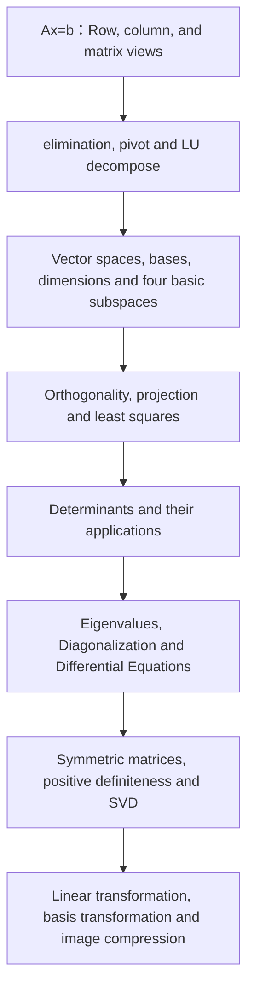

> Linear algebra textbook reconstructed using Gilbert Strang's 35 lecture videos and complete verbatim manuscripts. Each lecture is a chapter, and each chapter is embedded with a corresponding video, which can be read, checked, and followed.

## Course information

| Project | content |
| --- | --- |
| courses | MIT 18.06 Linear Algebra (Spring 2010; class video recorded Fall 1999) |
| Lecturer | Gilbert Strang |
| Lecture times | 35 lectures (Lecture 1–34, plus Lecture 24b test review) |
| total duration | About 27.9 hours |
| video | [Bilibili · 34 lectures + supporting teaching materials](https://www.bilibili.com/video/BV1ix411f7Yp)(BV1ix411f7Yp) |
| illustration | 2–6 pages per lecture MIT OCW official lecture notes + 5–8 Bilibili classroom video frames, 352 in total |
| official courses | [MIT OpenCourseWare 18.06](https://ocw.mit.edu/courses/18-06-linear-algebra-spring-2010/) |
| Textbook | Gilbert Strang, *Introduction to Linear Algebra* |
| permission | Verbatim manuscript and course materials: CC BY-NC-SA 4.0; video copyright belongs to the original rights holder |

## what is this book

This is not a literal translation of the verbatim manuscript, nor is it a summary of the test points. Each lecture is reorganized according to the logic of knowledge: first use "Lecture Introduction" to explain the problem and location, then use several sections to string together definitions, motivations, derivation, and examples, and finally conclude with "Lecture Summary" and "Keywords." All mathematics content is based on the verbatim transcript of the lecture; the examples, numbers, and derivation chains in the lecture transcript are retained as much as possible, and only pleasantries, repetitions, and classroom interactions are deleted.

Each lecture also begins with pages 2–6  **MIT OCW 18.06SC official lecture notes summary** (Clearly printed version of formulas and schematic diagrams), insert 5–8 more pictures with time points in the text.  **Bilibili classroom video frames**; There are about 10 pictures in each lecture, the official pictures are responsible for accuracy, and the video frames are responsible for restoring the classroom scene.

The book is organized according to the three-part structure of the course itself:

1. **Elimination and vector spaces** (Lecture 1–12): From  $A\boldsymbol{x}=\boldsymbol{b}$  Starting from the three views, the system of equations is transformed into an upper triangle by elimination, and then column space, null space, basis, dimension and four basic subspaces are introduced.
2. **Orthogonality and determinants** (Lecture 13–20): Orthogonal complement, projection, least squares, Gram-Schmidt, and properties, formulas, and applications of determinants.
3. **Eigenvalues, positive definiteness and linear transformations** (Lecture 21–34): Eigenvalues, diagonalization, differential equations, Markov matrices, symmetric and positive definite matrices, SVD, linear and basis transformations.

## How to use

- **Read along**:from  [Lecture 1](/en/notes/mit-1806/lec01)  To begin, advance in directory order. There is navigation to the previous/next lecture at the end of each chapter.
- **follow video**: There is a corresponding Bilibili sub-P player embedded at the top of each chapter; if the player is not loaded, just click the Bilibili link in the same row. The video is a complete classroom recording, and the text is reorganized according to knowledge logic and does not correspond to the timeline sentence by sentence.
- **check concept**: The "Keywords" table at the end of each chapter gives English, Chinese and one-sentence explanations; the "Keywords" table at the end of the course  [General review](/en/notes/mit-1806/lec34)  Connect all the main threads.
- **Look at the picture**: At the beginning of each lecture, a 2-6 page summary of the official lecture notes is given continuously, covering the core formulas and schematic diagrams of the lecture; 5-8 video frames with time points are interspersed in the text, which can be compared with Bilibili video positioning.
- **Match official materials**: The top of each chapter links to the corresponding MIT OCW lectures, where you can download official lecture notes, exercises, and exams.

## course map

## Directory

### Part 1 · Elimination and Vector Spaces (Lecture 1–12)

| Lecture times | Topic | core issues | duration |
| --- | --- | --- | --- |
| [1](/en/notes/mit-1806/lec01) | Geometric Interpretation of Systems of Equations | How to describe and solve linear equations from three perspectives: row, column, and matrix? | 39:49 |
| [2](/en/notes/mit-1806/lec02) | matrix elimination | How does Gaussian elimination convert a system of equations into an upper triangle, and when does it fail? | 47:42 |
| [3](/en/notes/mit-1806/lec03) | Matrix multiplication and inverse matrix | What are the understandings of matrix multiplication? When does the inverse matrix exist and how to find it? | 46:49 |
| [4](/en/notes/mit-1806/lec04) | $A$  LU decomposition of | How does elimination lead to A=LU, and why is it the core of calculations? | 49:06 |
| [5](/en/notes/mit-1806/lec05) | Transpose, permutation and vector spaces  $\mathbb{R}^n$ | Transpose, Permutation and Vector Space: Why is subspace the stage of the entire course? | 47:42 |
| [6](/en/notes/mit-1806/lec06) | Column space and null space | How do column space and null space characterize the solvability of Ax=b? | 46:01 |
| [7](/en/notes/mit-1806/lec07) | Solve  $A\boldsymbol{x}=\boldsymbol{0}$: Main variables and special solutions | How to write all the solutions to Ax=0 using pivot components and free variables? | 43:20 |
| [8](/en/notes/mit-1806/lec08) | Solve  $A\boldsymbol{x}=\boldsymbol{b}$: row simplest form  $R$ | How does rank determine the existence and uniqueness of the solution Ax=b? | 47:26 |
| [9](/en/notes/mit-1806/lec09) | Linear independence, basis and dimensionality | How do linear independence, basis and dimensionality measure a vector space? | 50:20 |
| [10](/en/notes/mit-1806/lec10) | four fundamental subspaces | How do the four basic subspaces fit together into a complete map of linear algebra? | 49:26 |
| [11](/en/notes/mit-1806/lec11) | Matrix spaces, rank-1 matrices, and small-world graphs | The matrix itself also constitutes a vector space; why can a rank 1 matrix generate all matrices? | 46:02 |
| [12](/en/notes/mit-1806/lec12) | Graphs, networks and correlation matrices | How to write graphs and networks as correlation matrices? How do Kirchhoff's laws correspond to subspaces? | 47:57 |

### Part 2 · Orthogonality and Determinants (Lecture 13–20)

| Lecture times | Topic | core issues | duration |
| --- | --- | --- | --- |
| [13](/en/notes/mit-1806/lec13) | First test review | From elimination to four subspaces: what is the main thread of the first part? | 47:40 |
| [14](/en/notes/mit-1806/lec14) | Orthogonal vectors and orthogonal subspaces | How do orthogonal vectors and orthogonal subspaces complete the four basic subspaces? | 49:48 |
| [15](/en/notes/mit-1806/lec15) | Projection on subspace | How to project a vector into a subspace? Why is projection the best approximation? | 48:51 |
| [16](/en/notes/mit-1806/lec16) | Projection matrix and least squares | How are projection matrices related to least squares? | 48:05 |
| [17](/en/notes/mit-1806/lec17) | Orthogonal matrices and Gram-Schmidt orthogonalization | Orthogonal Matrix and Gram-Schmidt How to turn a set of basis into an orthonormal basis? | 49:25 |
| [18](/en/notes/mit-1806/lec18) | Determinant properties | How do the three defining properties of determinants lead to all the other properties? | 49:12 |
| [19](/en/notes/mit-1806/lec19) | Determinant formula and algebraic cofactor | How do the large formulas of determinants and algebraic cofactors provide general calculation methods? | 53:17 |
| [20](/en/notes/mit-1806/lec20) | Cramer's rule, inverse matrices and volumes | How can Kramer's rule, inverse matrix formula and volume be unified under the determinant? | 51:01 |

### Part 3·Eigenvalues, positive definiteness and linear transformations (Lecture 21–34)

| Lecture times | Topic | core issues | duration |
| --- | --- | --- | --- |
| [21](/en/notes/mit-1806/lec21) | Eigenvalues and eigenvectors | What are eigenvalues and eigenvectors and how to solve them? | 51:23 |
| [22](/en/notes/mit-1806/lec22) | Diagonalization and matrix powers | How do you diagonalize A and use it to calculate A^k? | 51:51 |
| [23](/en/notes/mit-1806/lec23) | Differential Equations and Matrix Exponents  $e^{At}$ | How to solve the system of linear differential equations du/dt=Au? | 51:03 |
| [24](/en/notes/mit-1806/lec24) | Markov matrix and Fourier series | What structure do the steady states of Markov matrices and Fourier series have in common? | 51:12 |
| [24b](/en/notes/mit-1806/lec24b) | Second test review | Orthogonality, projections, determinants and eigenvalues: what are the main threads of Part 2? | 48:20 |
| [25](/en/notes/mit-1806/lec25) | Symmetric matrices and positive definiteness | Why can a symmetric matrix be orthogonally diagonalized? What does positive certainty mean? | 43:52 |
| [26](/en/notes/mit-1806/lec26) | Complex matrices and fast Fourier transform | How do complex matrices, Hermitian matrices and FFT generalize real symmetry theory? | 47:52 |
| [27](/en/notes/mit-1806/lec27) | Positive definite matrix and minimum value | Why does a positive definite matrix correspond to the minimum value of a multivariate function? How to judge? | 50:40 |
| [28](/en/notes/mit-1806/lec28) | Similarity matrix and Jordan standard form | When do similar matrices represent the same linear transformation? How to complete the Jordan type when it is not diagonalizable? | 45:57 |
| [29](/en/notes/mit-1806/lec29) | singular value decomposition | How does SVD decompose any matrix into "rotation-stretch-rotation"? | 41:35 |
| [30](/en/notes/mit-1806/lec30) | Linear transformations and their matrices | How do linear transformations correspond to matrices? How does the choice of basis affect the matrix? | 49:27 |
| [31](/en/notes/mit-1806/lec31) | Basis transformation and image compression | How does basis transformation simplify matrices? How does image compression utilize basis transformation? | 50:14 |
| [32](/en/notes/mit-1806/lec32) | Third test review | Eigenvalues, positive definiteness, SVD and linear transformations: what is the main thread of Part 3? | 47:05 |
| [33](/en/notes/mit-1806/lec33) | Left inverse, right inverse and pseudo inverse | How do the left inverse, right inverse and pseudo inverse describe the "inverse" of a rectangular matrix? | 41:53 |
| [34](/en/notes/mit-1806/lec34) | General review | What are the eight main lines and core test points of the entire course? | 43:26 |

## Signs and Agreements

| mark | meaning |
| --- | --- |
| $A$ | coefficient matrix ($m\times n$) |
| $\boldsymbol{x}$ | unknown vector ($n$  dimension) |
| $\boldsymbol{b}$ | Right end vector ($m$  dimension) |
| $A^{\mathsf T}$ | $A$  transposition of |
| $C(A)$ | column space |
| $N(A)$ | nullspace |
| $C(A^{\mathsf T})$ | row space |
| $N(A^{\mathsf T})$ | left nullspace |
| $r$ | rank |
| $\lambda$ | Eigenvalue |
| $\det A$ | determinant |
| $\|\boldsymbol{x}\|$ | Vector norm (norm) |

## Source and License

- **verbatim**: From user-provided  *MIT 18.06 Complete Lecture Transcripts*, the original content is English class subtitles for MIT OpenCourseWare 18.06 Linear Algebra (Spring 2010), taught by Gilbert Strang. Verbatim manuscript  [CC BY-NC-SA 4.0](https://creativecommons.org/licenses/by-nc-sa/4.0/)  Used; this book has reconstructed, abridged and typeset it in Chinese.
- **video**: Bilibili Collection  [BV1ix411f7Yp](https://www.bilibili.com/video/BV1ix411f7Yp), compiled by the uploader; the copyright of the video belongs to the original rights holder. This book only embeds the official player link, and does not download or distribute the video files.
- **Summary of official handout**: MIT OCW [18.06SC Lecture Summaries](https://ocw.mit.edu/courses/18-06sc-linear-algebra-fall-2011/) (CC BY-NC-SA 4.0). This book renders each content page of the abstract PDF corresponding to each lecture as an illustration, and presents the formulas and schematic diagrams as they appear on the official pages.
- **official courses**: [MIT OCW 18.06](https://ocw.mit.edu/courses/18-06-linear-algebra-spring-2010/). Links to the official pages of each lecture can be found at the top of each chapter.
- **book**: A Chinese video book based on the above verbatim manuscript, for learning and exchange purposes only, not an official publication of MIT or OCW. If you find any errors, please refer to the official handouts and videos.

---

*Compilation date: 2026-11-14 \| 35 chapters in total \| Total video duration is about 27.9 hours*
