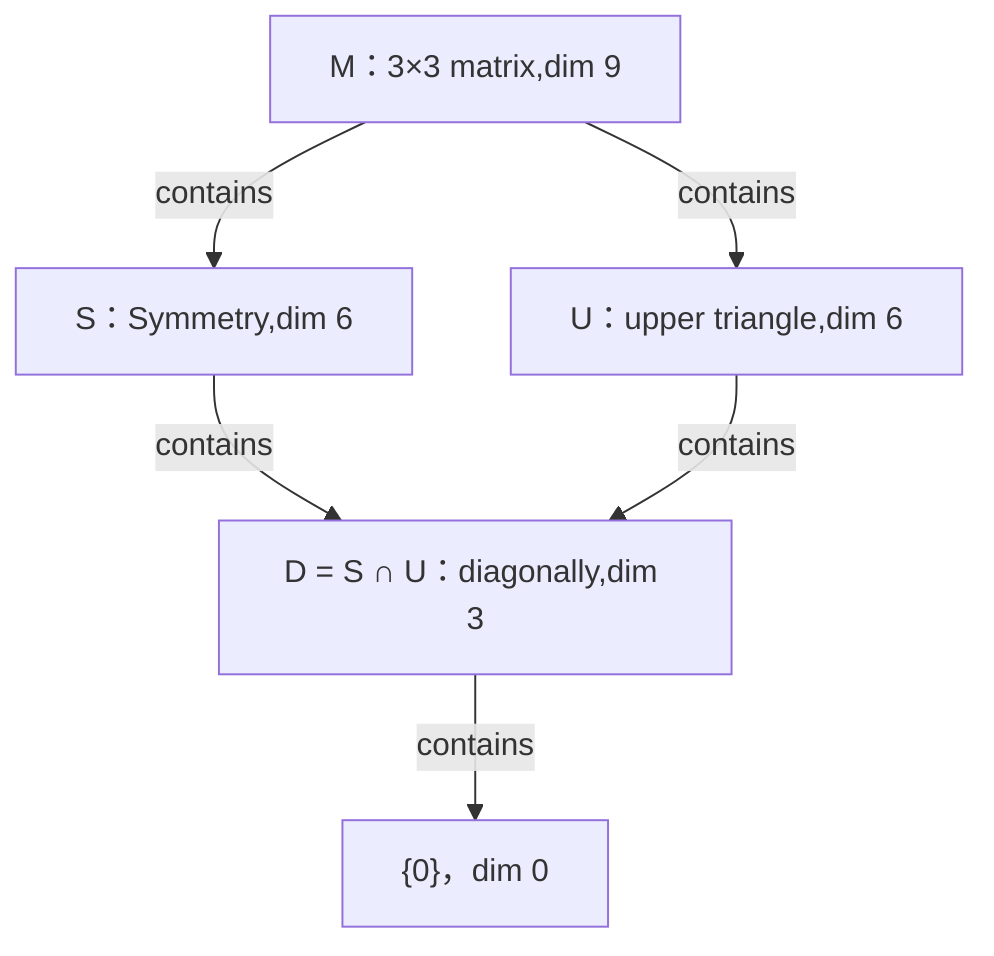
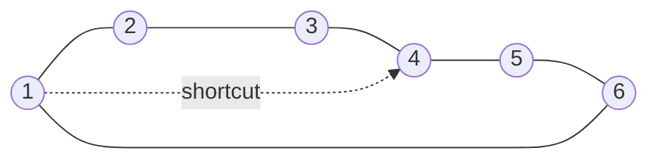
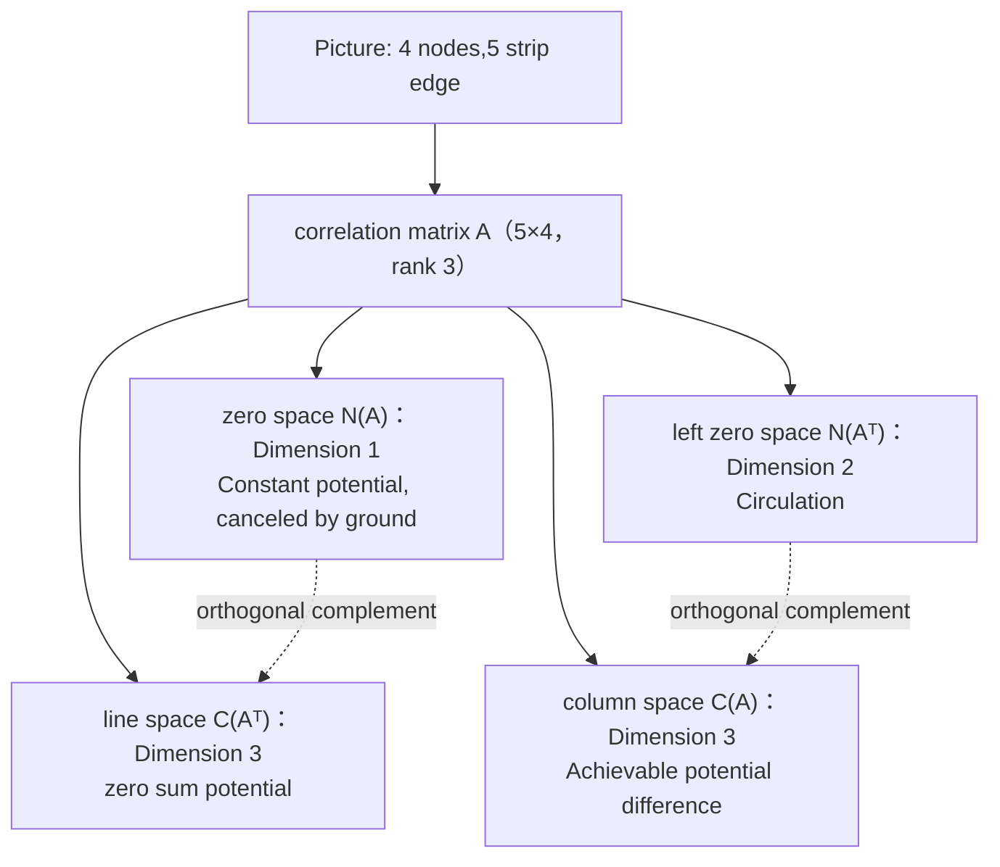
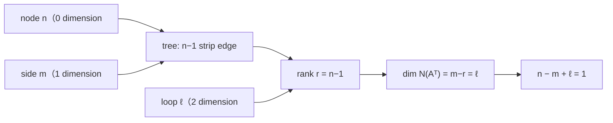
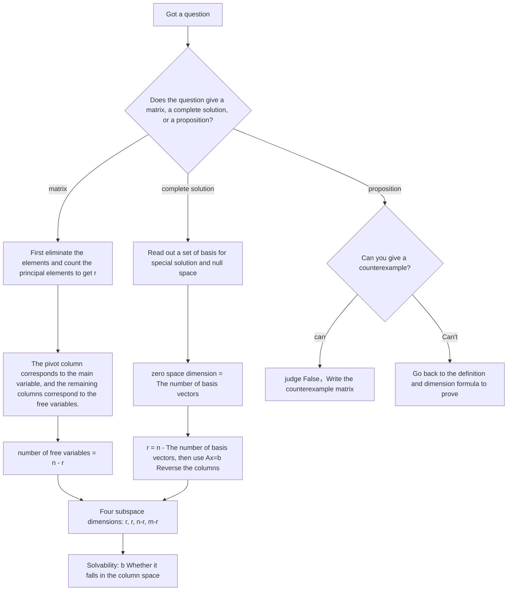
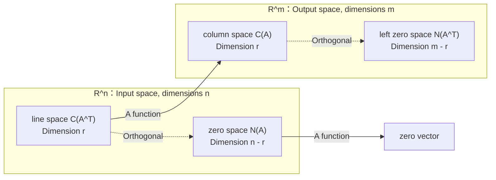

> **Lecture**: Gilbert Strang · MIT 18.06 Linear Algebra (Spring 2010)  
> **Collection video**: [Station B BV1ix411f7Yp No. 11–13 P](https://www.bilibili.com/video/BV1ix411f7Yp/?p=11)  
> **included**: [Lecture 11 Matrix space, rank 1 matrix and small world graph](https://www.bilibili.com/video/BV1ix411f7Yp/?p=11) · [Lecture 12 Graphs, Networks and Correlation Matrix](https://www.bilibili.com/video/BV1ix411f7Yp/?p=12) · [Lecture 13 First Test Review](https://www.bilibili.com/video/BV1ix411f7Yp/?p=13)  
> **scale**: 3 talks · 2 hours 21 minutes · 41 native 640×480 player screenshots · 6 Mermaid structure diagrams  
> **Organizing basis**: Three lectures with complete English subtitles rewritten paragraph by paragraph; terminology and chapters refer to the MIT OCW lecture page and Strang's "Introduction to Linear Algebra"  
> **illustration**: Each screenshot can be clicked to jump back to the corresponding moment of point P on Bilibili.  
> **Provenance and permission**: Courses and official materials are copyright MIT OpenCourseWare and Gilbert Strang, Inc.  [CC BY-NC-SA 4.0](https://creativecommons.org/licenses/by-nc-sa/4.0/)  Published with permission; this book is compiled and edited in Chinese

This collection combines the three previously separated lectures into one volume according to the course sequence, retaining the original time anchors, screenshots, formulas and "Editor's Notes" of each lecture. It can be read sequentially from the first page, or viewed individually by lecture.

Three lectures form a complete clue: Lecture 11 generalizes vector space to matrix space, ends with a rank-1 matrix, and uses graphs and small-world graphs to derive networks; Lecture 12 writes graphs as correlation matrices and uses four basic subspaces to explain electric potential, current, circuits, and Euler's formula; Lecture 13 uses the first test review to reconnect the elimination, rank, zero space, complete solution, and four basic subspaces of the first half of the semester into a network.

### Reading convention

- **screenshot**: The link below the picture or the picture itself can jump back to the corresponding seconds of the original video on station B; the source video is 640×480 (4:3), and the screenshot is taken at the native resolution of 1:1.
- **formula**: Written in LaTeX; Markdown readers that support MathJax / KaTeX can render directly.
- **time anchor**: `*(参考时间: MM:SS)*`  It refers to the position of the segment in the corresponding minute P, not the total duration of the collection.
- **Editor's note**: Necessary supplements beyond what is said in class are marked with this mark and do not represent Strang's original words.

---

## Lecture 11: Matrix spaces, rank-1 matrices and small-world graphs

> **Lecturer**: Gilbert Strang, MIT 18.06 Linear Algebra  
> **video**: [Station B BV1ix411f7Yp 11th P](https://www.bilibili.com/video/BV1ix411f7Yp/?p=11), 45 minutes and 42 seconds long  
> **Organizing basis**: MIT OCW official English subtitles for the same lecture (687 paragraphs) rewritten paragraph by paragraph; terminology reference  [OCW lecture page](https://ocw.mit.edu/courses/18-06-linear-algebra-spring-2010/resources/lecture-11-matrix-spaces-rank-1-small-world-graphs/)  
> **illustration**: 13 pictures are taken from the original drawings on the blackboard of the B station player, and the timestamps correspond to the narrative content one by one.  
> **Provenance and permission**: Courses and official materials are copyright MIT OpenCourseWare and Gilbert Strang, adopted  [CC BY-NC-SA 4.0](https://creativecommons.org/licenses/by-nc-sa/4.0/)  Permission; this book is compiled and edited in Chinese

### 1. From vector to matrix space

*(Reference time: 00:00:10)*

At the end of the previous lecture, Strang had already started talking about some "vector spaces", but the inhabitants of those spaces were not what we usually call vectors. He went straight to the point and reminded the class: You can still add these things and multiply them by a number, so they can be called vectors. The example he used at that time was a matrix, which is the set of all third-order matrices. What Lecture 11 wants to say is: the previous $n$ Dimensional space is too specific. In fact, as long as you can add and multiply, the same concept still holds true.

#### 1.1 Only addition and multiplication are allowed

There is a line here that is easily overlooked. Strang specifically stated in front of the blackboard: two matrices can of course be multiplied, but he doesn't do it because matrix multiplication does not belong to the vector space picture. Vector spaces only admit two operations - addition and multiplication. As long as these two operations do not take elements out of the set, the entire language of bases, dimensions, subspaces, and linear combinations all apply, regardless of what the elements look like.

#### 1.2 Nine coordinates and standard bases

So take $M$ is the overall third-order real matrix. It is obviously closed to addition and multiplication. Next are two standard questions: $M$ What is the basis of and what are its dimensions? Instead of writing the answer directly, Strang asked the class first: How many numbers are needed to determine a third-order matrix? nine. So the dimensionality will be nine.

The most natural base is to put one in each of the nine positions $1$, put all other positions $0$ of those nine matrices. use $E_{ij}$ means "th $i$ line of work $j$ listed as $1$, the rest are zero" matrix, then

$$
E_{11},E_{12},\dots,E_{33}\ \text{是 } M \text{ 的基，}\quad \boxed{\dim M=9}
$$

They are linearly independent because any third-order matrix $A=(a_{ij})$ can be uniquely written as $\sum_{i,j}a_{ij}E_{ij}$;Coefficient $a_{ij}$ Those are the nine coordinates.

Strang has a very measured comment on this matter: This space is almost a nine-dimensional space, except that the nine numbers are written as a square instead of a column. But it is something different after all and should be thought of as an independent object.

**Editor's note**: This difference will become more and more specific later - the matrix has structures such as transpose, row space, and rank, but the nine-tuple in the nine-dimensional space does not have these things; and because of this, the matrix space deserves a separate name, rather than simply being equivalent to the nine-dimensional space.

Drawing this inclusive relationship, the skeleton of the whole lecture will be clear:

There is no picture on purpose in the picture $S+U$: It is not an inclusion relationship, but the larger space obtained after "filling all the combinations of the two subspaces". Next section first $S$ with $U$ Their respective bases are clearly explained.

### 2. Symmetrical S and upper triangular U

*(Reference time: 00:05:00)*

#### 2.1 Symmetric subspace: six parameters

Let’s first look at the symmetric matrix subspace $S$, that is, all satisfies $A^{T}=A$ a third-order matrix. Why is it a subspace? Strang's check is simple: if two symmetric matrices are added, the sum remains symmetric. He also conveniently set a trap - if two symmetric matrices are multiplied, will the product automatically be symmetrical? No. But he does not multiply matrices, so this counterexample does not prevent $S$ is a subspace. This kind of restriction of "only addition and multiplication of numbers is allowed" is the foreshadowing that appears repeatedly throughout the lecture.

Next is a very good leading question: among the nine standard basis matrices just now, several of them themselves fall into the $S$ Medium? The answer is three, namely $E_{11},E_{22},E_{33}$——Only placed in the diagonal position $1$ It will not be changed by transposition. But $\dim S$ It's not three. Here comes the first important lesson of this lecture: **The basis of a large space usually does not include the basis of a subspace**. to portray $S$, have to think about it again.

The new way to think about it is to count the parameters: there are nine positions in the third-order matrix. The symmetry locks the three positions below the diagonal to the values of the corresponding positions above the diagonal. Therefore, you can freely choose the three on the diagonal and the three above, a total of six. Therefore $\dim S=6$.

A set of visible bases is as follows, the first three tubes are diagonal, and the last three tubes each tube are in a pair of symmetrical positions:

$$
\begin{aligned}
&\begin{bmatrix}1&0&0\\0&0&0\\0&0&0\end{bmatrix},\ 
\begin{bmatrix}0&0&0\\0&1&0\\0&0&0\end{bmatrix},\ 
\begin{bmatrix}0&0&0\\0&0&0\\0&0&1\end{bmatrix},\\[2pt]
&\begin{bmatrix}0&1&0\\1&0&0\\0&0&0\end{bmatrix},\ 
\begin{bmatrix}0&0&1\\0&0&0\\1&0&0\end{bmatrix},\ 
\begin{bmatrix}0&0&0\\0&0&1\\0&1&0\end{bmatrix}.
\end{aligned}
$$

use $E_{ij}$ It is easier to write the notation: $E_{11},E_{22},E_{33},E_{12}+E_{21},E_{13}+E_{31},E_{23}+E_{32}$. These six matrices are linearly independent, and any symmetric matrix is ​​a combination of them, so it is indeed a basis. When Strang wrote this series, he did not forget to remind: of the six parameters of the symmetric matrix, three are on the diagonal, three are above the diagonal, and the three below are determined by symmetry - this is the source of the "six", not a memorized conclusion.

#### 2.2 Upper triangular subspace: an accidental convenience

Let’s look at the upper triangular subspace again $U$, that is, a third-order matrix with all zeros below the diagonal. Its general shape is

$$
U=\left\{\begin{bmatrix}a&b&c\\0&d&e\\0&0&f\end{bmatrix}\right\}
$$

Six of the letters can take on any real numbers, so $\dim U=6$. Strang summed up the coincidence in three words: "Six again."

But $U$ The basis of has a $S$ Completely different nature. Exactly six of the nine standard basis matrices are above or on the diagonal: $E_{11},E_{22},E_{33},E_{12},E_{13},E_{23}$. they constitute exactly $U$ a set of bases. Strang calls this situation "accidental": the basis of the large space happens to contain the basis of the subspace, so you don't have to do anything; in the symmetric case, there is no such luck, and you have to reconstruct it. This set of comparisons shows that there is no unified shortcut to find the basis of a subspace, and the degrees of freedom can only be counted according to the constraints of the subspace itself.

### 3. Intersection, union and sum: $6+6=9+3$

*(Reference time: 00:08:00)*

#### 3.1 Only the diagonals remain at the intersection

With two six-dimensional subspaces, the most natural action is to compare them together. Strang first asks about intersection: If a matrix is ​​both symmetric and upper triangular, what does it look like?

There are only two steps to reasoning. Upper triangle requires all zeros below the diagonal; symmetry requires $a_{ij}=a_{ji}$, so the zeros below are mirrored to the top, and the top diagonal must also be all zeros. Clamp the two sides, leaving only the diagonal line. So

$$
S\cap U=D=\{\text{对角矩阵}\},\quad \boxed{\dim(S\cap U)=3}
$$

The base is $E_{11},E_{22},E_{33}$, without any difficulty. Strang wrote here and confirmed the symbols: $S\cap U$ That is "at the same time $S$ and $U$ The set of vectors in .

#### 3.2 Why is the union not a subspace?

What about union? Put all symmetric matrices and all upper triangular matrices together and write it as $S\cup U$. Strang's question is "Why am I not interested in unions?" The answer is simple: it is not a subspace. The analogy he gave is the most vivid sentence in this lecture - it is like taking two straight lines on the plane, and then placing the two lines there and stopping; each of the two lines is a subspace, but together they are not. Two six-dimensional subspaces live in a nine-dimensional space, each stretching in different directions, "so we can't just put them together, we have to fill them up."

**Editor's note**:The reason why the union fails can be said more specifically. The union only allows "taking one or the other", but does not allow taking a part from each direction and adding it; and subspace requires that all linear combinations be closed. $E_{12}+E_{21}$ is symmetrical, $E_{13}$ is an upper triangular shape, and adding the two together gives $E_{12}+E_{21}+E_{13}$: This sum is neither symmetrical ($(1,3)$ everywhere $1$, $(3,1)$ Everywhere is $0$), nor superior triangle ($(2,1)$ Appeared everywhere $1$), so it falls out of the union.

#### 3.3 Sum space and dimension formulas

The way to fill it up is not the union, but the sum: put all $s+u$ Take it in, including $s$ Taken from $S$, $u$ Taken from $U$.

Pay attention to the quantifier in the definition: take any symmetric matrix and add any upper triangular matrix, rather than "take a matrix that is both symmetric and upper triangular". The difference between the two is the difference between sum and intersection.

Strang Let the class guess $S+U$ What is it, and then give the answer yourself: you can get everything, you can get all the third-order matrices. He said that it was worth stretching the mind a little bit - getting used to doing intersections and sums between subspaces is the intuition to be cultivated in this chapter. Since $S+U=M$, there is $\dim(S+U)=9$.

**Editor's note**: This "can get everything" can be verified explicitly. Take any matrix $A$ Keep the diagonal line and the lower part as they are, change the upper part to the value of the corresponding position below, record this result as $S_0$: It is symmetrical by construction. And $A-S_0$ in $i\ge j$ are all zero, leaving only those differences above the diagonal $a_{ij}-a_{ji}$, so it is strictly upper triangular. So $A=S_0+(A-S_0)$ It is indeed written as a symmetric matrix plus an upper triangular matrix, $S+U=M$ Get certified.

Putting the four dimensions together, the core formula of this lecture appears:

$$
\boxed{\dim(S)+\dim(U)=\dim(S+U)+\dim(S\cap U)}
$$

Substituting specific numbers, we get $6+6=9+3=12$.

Strang's evaluation of this line is "quite satisfactory": intersection and sum are the two most natural operations on subspaces, and the dimensions are equal under these two operations. He immediately pointed out that this is not a special case of third-order matrices, and is true for any two finite-dimensional subspaces.

**Editor's note**: The idea of proving the formula is to "take the basis of the intersection and expand to both sides." Set $\dim(S\cap U)=k$, take its basis $w_1,\dots,w_k$, respectively expanded to $S$ base $w_1,\dots,w_k,s_1,\dots,s_m$ with $U$ base $w_1,\dots,w_k,u_1,\dots,u_n$. This can be verified $k+m+n$ The vectors are combined to form $S+U$ and are linearly independent, so $\dim(S+U)=k+m+n$, while $\dim S=k+m$, $\dim U=k+n$, which is obtained by subtracting both sides. This proof also explains why the formula "should" hold: the intersection is counted twice, so it needs to be subtracted once on the right-hand side.

| space | meaning | Dimension | a set of bases |
| --- | --- | --- | --- |
| $S$ | Symmetric matrix | 6 | three $E_{ii}$, three pairs $E_{ij}+E_{ji}$ |
| $U$ | upper triangular matrix | 6 | six $E_{ij}$($i\le j$) |
| $D=S\cap U$ | diagonal matrix | 3 | three $E_{ii}$ |
| $S+U$ | sum of both | 9 | Same $M$ |

### 4. Solution space of differential equations

*(Reference time: 00:14:30)*

In addition to the matrix space, Strang also provides another vector space that "contains something other than vectors", this time from differential equations. take

$$
\frac{d^{2}y}{dx^{2}}+y=0
$$

#### 4.1 The solution space is a null space

He first asked: What is the solution to this equation? $\cos x$ is a solution, because taking the derivative twice yields $-\cos x$, substituted back to be exactly zero; $\sin x$ It is also a solution, and we also obtain the derivative twice. $-\sin x$. He also mentioned $e^{ix}$ It was also an explanation, but he immediately rejected it: "Why did you put it in? It was already inside." This sentence points out the essence of understanding space——$e^{ix}=\cos x+i\sin x$ It's nothing new, just a complex number combination that already has two solutions.

So all solutions are $y=c_1\cos x+c_2\sin x$, among which $c_1,c_2$ is an arbitrary constant.

This is something that takes a moment to appreciate: everything deconstructs into a vector space. Strang's original words were "This is a vector space, this is a vector space", repeated twice. Why? Since the solution is closed for addition (adding two solutions is still a solution) and logarithmic multiplication is also closed (multiplying the solution by a constant is still a solution), the zero function is the solution. In other words, **What we are looking at here is a null space - the null space of differential equations, which is the solution space.**.

Since it is a vector space, we should ask about the basis and dimension. $\{\cos x,\sin x\}$ is a set of basis: the two are linearly independent (if $c_1\cos x+c_2\sin x$ is always zero, take $x=0$ Got $c_1=0$, take $x=\pi/2$ Got $c_2=0$), and Zhang Cheng solved them all. So

$$
\boxed{\dim\{\text{解空间}\}=2}
$$

Strang makes a beautiful analogy here: $\cos x$ with $\sin x$ like $Ax=0$"Special solution". He first said it by mistake $Ax=b$, then corrected to $Ax=0$——Because what is discussed here is indeed the zero space, not the complete set of solutions of the special solution plus the zero space. This correction is worth noting in itself: the general solution of a differential equation is all linear combinations of a basis in the null space of homogeneous equations, corresponding literally to the case of systems of linear equations.

#### 4.2 The basis is not unique and the dimensions are fixed

Ky is not alone. Strang specifically asked "Are these the only ones?" and then answered "Absolutely not" himself: $e^{ix}$ with $e^{-ix}$ It is also a set of basis, and the same two functions also form this space. The number of dimensions is always two, because the equation is of second order. He told this matter as a joke: What a linear differential equations course (MIT's 18.03) really does is to find a set of basis for the solution space; and 18.06 processed 18.03 in five minutes.

This example is not about differential equations, but about the boundaries of the word "vector." These solutions look like functions, not like vectors, but they can be added and multiplied by constants, so linear combinations can be taken, so all the statements about bases, dimensions, and subspaces in linear algebra can be transferred. Strang says that's why linear algebra goes far beyond what he's been talking about $m\times n$ matrix.

### 5. Rank 1 matrix: one column by one row

*(Reference time: 00:20:00)*

After talking about these "atypical" vector spaces, Strang brought the topic back to the most critical number of matrices: rank. It does not exceed the number of rows and does not exceed the number of columns; in addition, he wants to add another angle - starting from the simplest non-zero matrix, which is a rank 1 matrix. The reason is very straightforward: if the rank is only one, the matrix cannot escape from the palm of your hand.

#### 5.1 A two-by-three example

He built a two-by-three example on the spot. Write the first line first $\begin{bmatrix}1&4&5\end{bmatrix}$, and then ask: What can the second row be so that the rank of the entire matrix is one? The answer is a multiple, such as $\begin{bmatrix}2&8&10\end{bmatrix}$. Because the second row is linearly related to the first row, the row space is one-dimensional, and the set of basis is the first row:

$$
A=\begin{bmatrix}1&4&5\\2&8&10\end{bmatrix}
$$

Then ask about the column space as usual. The dimension of the column space is also equal to rank, so it is also one; all columns are multiples of the first column (the second column is a $4$ times, the third column is $5$ times). Here Strang restates a series of equations in passing: the dimension of the column space is equal to the rank, which is also equal to $A^{T}$ The column space dimension of , which is $A$ row space.

#### 5.2 External product  $uv^{T}$

Then he gave the writing method that "should have been seen earlier": write the matrix as the pivot column multiplied by the first row,

$$
A=\begin{bmatrix}1\\2\end{bmatrix}\begin{bmatrix}1&4&5\end{bmatrix}
=\begin{bmatrix}1&4&5\\2&8&10\end{bmatrix}
$$

one $2\times 1$ The matrix of $1\times 3$ matrix, the result is exactly two times three. Strang emphasizes that this is a general phenomenon: **Every rank 1 matrix can be written as a column times a row**. If $u$ is a column vector, $v$ It is also a column vector, put $v$ Transposed into rows, we get

$$
\boxed{A=uv^{T}}
$$

This is the complete picture of a rank 1 matrix. Strang said that he will be more interested in rank 1 matrices in the future: their determinants are easy to calculate, and their eigenvalues ​​are interesting; more importantly, rank 1 matrices are the building blocks for building all matrices.

**Editor's note**: $uv^{T}$ Each column of is $u$ A multiple of , each row is $v^{T}$ is a multiple of , so the column space is at most one dimension, the row space is at most one dimension, and the rank does not exceed one; as long as $u\neq 0$ and $v\neq 0$, the rank is exactly one. This also explains why $uv^{T}$ of the $(i,j)$ Yuan is $u_iv_j$- A "row indicator" is only followed by $u$, column indicators are only followed by $v$” product structure. By the way, $\operatorname{tr}(uv^{T})=v^{T}u$.

### 6. Rank  $r$  Decomposition with rank 1 bounds

*(Reference time: 00:24:30)*

#### 6.1 Rank  $r$  The matrix is  $r$  building blocks

Since rank 1 matrices are building blocks, a natural conjecture is that any matrix can be broken into several such building blocks. Strang gives a deliberately exaggerated example - a five by seventeen matrix of rank four. It's probably true, he said, and it's true: it can be broken down into the sum of four rank-1 matrices. Why four? Because the rank is four. So he gave a general proposition:

$$
A_{m\times n},\ \operatorname{rank}(A)=r
\quad\Longrightarrow\quad
A=u_1v_1^{T}+u_2v_2^{T}+\cdots+u_rv_r^{T}
$$

Rank 1 matrices are therefore called "the building blocks of all matrices". This decomposition has actually already occurred during the elimination process: $A$ Each column of is a linear combination of the pivot columns. If this combination is split by columns, we get $r$ A "column times one row" term.

#### 6.2 Why is the set of rank 1 not a subspace?

Next is the best "counterexample question" in this lecture. Strang himself said that this is a mid-term review question: treat all five-by-seventeen matrices as the parent space $M$, do those matrices of rank four constitute a subspace?

To be a subspace, the zero matrix must be in it, so the question should be changed to a subset of "rank no more than four". But even putting the zero matrix in is not enough - having the zero matrix inside does not mean that there is a subspace. The real test is addition: if two matrices of rank four are added, do they still have rank four?

The answer is "usually not". Strang gives a general bound: $\operatorname{rank}(A+B)\le \operatorname{rank}(A)+\operatorname{rank}(B)$.

According to this bound, when two rank fours are added together, the rank will not exceed eight; but in the space of five times seventeen, the rank is originally at most five, so this bound is loose here. In fact, it is entirely possible for the sum of two rank-4 matrices to reach rank-5. So "rank no more than four" is not closed to addition and is not a subspace.

**Editor's note**: This world is not difficult to understand: $A+B$ Each column of is $A$ A certain column of $B$ The sum of the corresponding columns of , so $A+B$ The column space falls in "$A$ The column space of $B$ in the space formed by the sum of the column spaces, and the dimension of the latter is at most $\operatorname{rank}A+\operatorname{rank}B$.

Replacing four with one is even more jarring: adding two rank-1 matrices usually results in rank-2. So **All rank 1 matrices do not form a subspace**——It is closed to multiplication, not to addition, and even the zero matrix is not included. This point is particularly interesting: every matrix is ​​composed of rank 1 matrices, but the set of rank 1 matrices itself is not a subspace. "Who created it" and "whether it is a subspace" are two different things.

Strang added a lesson here: He asked these short questions in succession because he was studying for a test. The purpose of these questions is to test whether you really know the meaning of these words; after the test, he stopped asking these questions. This sentence also hints at the nature of this lecture - it is more like an inventory of the previous ten lectures, rather than a brand new departure.

### 7. A constraint in four-dimensional space

*(Reference time: 00:28:40)*

Using a different blackboard, Strang gives a more "vector-like" example. Find a vector whose sum of all components is zero in four-dimensional space, that is $v_1+v_2+v_3+v_4=0$.

Make sure it's a subspace first. Strang says the formal check should be: if the sum of the components of a vector is zero and you multiply it by six, the sum of the components is six times zero, which is still zero; if $v$ with $w$ The sum of the components is zero, and the sum is still zero after adding them up one by one. The zero vector certainly suffices. So $S$ is a subspace.

So what are the dimensions? He asked the class to guess first and then confirmed the answer after hearing it: three. But "three" requires a reason, and there is more than one reason. The intuitive reason is: four components, one equation, so there are three freedoms; the strict reason is to regard it as the null space of a certain matrix.

#### 7.1 Write constraints as matrices

Which matrix's null space is this set? Strang waited a moment, then wrote four 1's:

$$
\begin{bmatrix}1&1&1&1\end{bmatrix}
\begin{bmatrix}v_1\\v_2\\v_3\\v_4\end{bmatrix}=[0]
$$

Exactly it. This one-by-four matrix is multiplied by $v$, the only component obtained is the sum of the four components; requiring it to be zero is the original constraint. So $S=N(A)$, and the set of machines for linear equations is immediately available.

Let’s look at the rank first. This matrix has only one non-zero row, so $r=1$. The formula for the dimensionality of the null space is $\dim N(A)=n-r$, here $n=4$, $r=1$, so $4-1=3$. Strang said this problem can be seen directly or calculated using a systematic approach to four basic subspaces.

#### 7.2 Three special solutions

Next, follow the standard process to find the basis, that is, find three special solutions. The pivot is in the first column, and the free variables are in the second, third, and fourth columns. For the first free variable, take $1$, take the rest $0$, by $v_1=-v_2-v_3-v_4$ The winner meta variable is $-1$: 

$$
s_1=\begin{bmatrix}-1\\1\\0\\0\end{bmatrix},\quad
s_2=\begin{bmatrix}-1\\0\\1\\0\end{bmatrix},\quad
s_3=\begin{bmatrix}-1\\0\\0\\1\end{bmatrix}
$$

The sum of the components of the three vectors is zero, so they are indeed $S$; they correspond to three different free variables and are therefore linearly independent. Strang's statement is simple: give that free variable a $1$, the main variable is $-1$, so that the components always add up to zero. He also emphasized that these three are not the only choices, but they are the "standard three" and the three that should be written down on the answer sheet.

### 8. A complete inventory of the four fundamental subspaces

*(Reference time: 00:35:55)*

#### 8.1 Four subspaces and two dimensional accounts

Got it $A=\begin{bmatrix}1&1&1&1\end{bmatrix}$, you can count the four basic subspaces at once. Strang said what he was doing at the moment was actually "saying the words."

- **line space** $C(A^{T})$: Living in a four-dimensional space, formed by that line, the dimension is one.
- **zero space** $N(A)$: also lives in a four-dimensional space, with three dimensions, and its basis is the three special solutions in the previous section.
- **column space** $C(A)$: This column has only one component, so it lives in a one-dimensional space; and all its multiples exactly fill the one-dimensional space, so the column space is the entire one-dimensional space, with a dimension of one.
- **left zero space** $N(A^{T})$: put $A$ Transpose and ask what combination of these "columns" (one column and four rows) gives zero. Strang's answer is that there are no combinations of four 1's that can turn them into zero rows, only zero combinations. So the left zero space contains only zero vectors.

Both sides of the accounts are even: three dimensions in zero space plus one dimension in line space equals $4$, exactly the number of columns $n$;One dimension of column space plus zero dimension of left zero space is equal to $1$, exactly the number of rows $m$.

#### 8.2 Zero-dimensional space and empty set

The very fact of zero-dimensional space deserves a pause. Strang asks: What is the smallest subspace dimension? The subspace containing only one point has zero dimension. What is its basis? Empty set - because the dimension is zero, there should not be any members in the base; and the number of elements in the empty set is zero, which exactly corresponds to the upper dimension. This seemingly word play actually closely aligns the definitions of "base" and "dimension".

**Editor's note**: This inventory of the four subspaces also explains why $r+(n-r)=n$ with $r+(m-r)=m$ These two identities seem "too trivial": they are actually $\mathbb{R}^n$ with $\mathbb{R}^m$ are split into two complementary subspaces. Lecture 14 will add another sentence: This complementarity is not just the addition of dimensions, the row space and the null space, the column space and the left null space are also orthogonal.

### 9. Pictures and small worlds

*(Reference time: 00:39:04)*

Strang wraps up the final five minutes with a brand new object: Figure. He first clarified the meaning of the word - this is not the sinusoidal curve in calculus. "The usage of the word graph is completely different." A graph is just a bunch of nodes, plus edges connecting the nodes.

#### 9.1 Five nodes and six edges

He drew five nodes on the blackboard, then connected the edges, counting them as he connected: six edges in total. Then he said the words that laid the foundation for the next lecture: a certain $5\times 6$ The matrix of will tell us everything about this graph, but leave that matrix for another time.

**Editor's note**: This matrix is the incidence matrix. Each column corresponds to an edge, each row corresponds to a node, and the two nodes connected by the edge are taken respectively. $+1$ with $-1$; Lecture 12 starts from it to teach linear algebra of graphs.

#### 9.2 Distance, six degrees and shortcuts

Strang then enlarged the image to a realistic scale. Assume that everyone in this classroom is a node, and two people who are friends have only one edge. This describes a graph - a large graph with about a hundred nodes, and he does not know the number of edges. Then expand the scope to the entire country, which is 260 million nodes, and the edges still represent friendship relationships. For such a picture, the question he is concerned about is: How many steps does it take to walk from any one person to any other person? In other words, in this friendship graph, which two people are farthest apart?

He used his own example to illustrate the meaning of distance. The distance between him and Clinton is two: he does not know Clinton (so not one), but one of his classmates in college knew Clinton, and that classmate was a senator and must have known him. As for the distance between each of you here and Clinton, Strang laughed and said, it won’t be more than three — because you know me. He took advantage of the situation and took the "credit" to himself: It was me who reduced the distance between you and Clinton to three.

The class also made a joke about Washington news here: someone asked about the distance between two public figures, and Strang said that it was best not to record this number on the video. This type of gag is the norm in Strang's classroom, and deleting it would be distorted; but it is just an interlude, and the real problem is mathematical: **How big can the distance be?** The phrase "Six Degrees of Separation" is the answer to this, and it became the title of a movie and a book. Strang described the everyday origin of this saying: When chatting with your seatmate on the plane about mutual friends, you often find that there are only two, three, or three or four steps between each other, so you sigh, "The world is really small" - this is how the word small world comes from. He also added a very real suspicion: If you really need to take six steps, you may not be able to find those six people one by one on a flight.

The mathematical point is at the end: **Just add a few shortcuts and the distance drops dramatically**. Strang left this conclusion to Lecture 12 and joked that after learning linear algebra, your distance to Clinton immediately dropped to three, which was an added bonus for taking this course. Another example he mentioned is the World Wide Web: nodes are websites, edges are links, and it's a graph of staggering scale that everyone wants to model.

In a ring, adjacent nodes are connected from $1$ Arrive $4$ Three steps to take; add one $1$—$4$ After the shortcut, the distance immediately becomes one. The average distance of the entire network also collapses, while the local area still maintains the aggregation of "neighbors' neighbors are still neighbors" - these are two characteristics of small world graphs. Lecture 12 will translate this picture into matrix language: nodes and edges are written as matrices, and distance and connectivity become questions of rank and null space. This lecture only uses intuition to raise questions, and the next lecture will use elimination to answer.

### Attachment: Official reference and further reading for Lecture 11

- **OCW Course Home Page**: [MIT 18.06 Linear Algebra, Spring 2010](https://ocw.mit.edu/courses/18-06-linear-algebra-spring-2010/)——All videos, subtitles and exercises.
- **Lecture page**: [Lecture 11: Matrix Spaces; Rank 1; Small World Graphs](https://ocw.mit.edu/courses/18-06-linear-algebra-spring-2010/resources/lecture-11-matrix-spaces-rank-1-small-world-graphs/)——The source of the video and subtitles of this lecture.
- **18.06SC Review Page**: [Matrix Spaces; Rank 1; Small World Graphs(18.06SC)](https://ocw.mit.edu/courses/18-06sc-linear-algebra-fall-2011/pages/ax-b-and-the-four-subspaces/matrix-spaces-rank-1-small-world-graphs/)——Contains exercises, solutions and special short films.
- **Textbook**: Gilbert Strang, *Introduction to Linear Algebra* (4/5th edition), Chapter 3 "Vector Spaces and Subspaces", especially §3.1 Vector spaces, §3.4 Independence and basis, §3.5 Dimensions of four subspaces; for graphs and networks, see the Graphs and Networks section in Chapter 10 "Applications", corresponding to Lecture 12.

The content of this lecture is copyrighted by MIT OpenCourseWare and Gilbert Strang.  [CC BY-NC-SA 4.0](https://creativecommons.org/licenses/by-nc-sa/4.0/)  Published with permission; please retain attribution (Gilbert Strang / MIT OpenCourseWare), license mark, and original link for citations, reprints, and redistributions. This book is compiled and edited in Chinese, with written reconstruction and necessary supplementary notes on the spoken narrative. The supplementary notes are all marked with "**Editor's note**” marked does not represent the original author’s expression.

---

## Lecture 12: Graphs, Networks and Correlation Matrix

> **Lecturer**: Gilbert Strang (MIT 18.06 Linear Algebra, Spring 2010)  
> **video**: [Station B No. 12 P: Lec12 Picture and Network](https://www.bilibili.com/video/BV1ix411f7Yp/?p=12), with a total length of 47 minutes and 42 seconds.  
> **Organizing basis**: MIT OCW official English subtitles read paragraph by paragraph; refer to terminology and reading chapters  [OCW lecture page](https://ocw.mit.edu/courses/18-06-linear-algebra-spring-2010/resources/lecture-12-graphs-networks-incidence-matrices/).  
> **illustration**: The pictures in the text correspond to the classroom blackboard pictures, which are taken from the original video. Click on the picture to jump to the corresponding video location.  
> **Provenance and permission**: Course lectures and official text materials are copyrighted by MIT OpenCourseWare and Gilbert Strang, in accordance with  [CC BY-NC-SA 4.0](https://creativecommons.org/licenses/by-nc-sa/4.0/)  Published; this book is a structured and streamlined compilation and teaching of Chinese.

---

### 1. From “made-up matrix” to structured matrix

*(Reference time: 00:00:12)*

#### 1.1 A belated confession

"This is the twelfth lecture." Strang stood in front of the blackboard and said that this lecture was different from the previous eleven lectures: it was "more application-oriented than the other lectures." Then there was a rare confession - when he talked about zero space and row space in the previous lectures, he casually created a small matrix as an example, "You can probably see that, I made up that matrix while I was talking." He said he was "a little guilty" about this, because in real linear algebra, matrices "come from somewhere" and are not written by teachers. They have a certain structure, and people who actually use them rely on this structure to calculate and understand problems.

#### 1.2 Chemist’s Balance and Mathworks Birthday Party

In order to explain "where does the matrix come from", he talked about two examples around him. This past weekend, he attended an event where chemistry professors were present, and those people were also doing element elimination. Their matrix records the reaction formula: how many molecules of each type enter the reaction, and how many are generated; by performing row elimination on such a matrix, the context of a complex reaction will be clear. This weekend he's going to a birthday party at Mathworks on Route 9 in Natick, where Matlab was born, "a hugely successful piece of software"; the theme of the conference is exactly how linear algebra is used.

These two things made him feel "I am in a good mood to talk about this topic today": Instead of making up a topic on the blackboard,  $3\times3$, it is better to talk about a matrix that will really grow out of the project.

#### 1.3 Graphs are the most important models in applied mathematics

So he raised the topic to "the most important model in applied mathematics": its discrete version is **graph**. There are only two things in the picture -**nodes **with** edges**. Strang said that what he is really interested in is "the graph of all websites", "the graph of all telephones" and "the graph of all the people in the world"; but today, let's draw a small one, write out the matrix, and see what this matrix can tell us.

The images are too large to be seen at a glance. The really valuable observation is that no matter how big the graph is, the matrix describing it has only two kinds of non-zero elements, and each non-zero element only explains one thing - which node a certain edge starts from and which node it ends at. By grasping this point, graph theory problems can be translated into linear algebra problems; conversely, some pure combinatorial conclusions in graph theory can also be proved by using the rank and zero space of matrices. The Euler formula to be deduced at the end of this lecture is an example. The route of this lecture is therefore very clear: first draw a small diagram of four nodes, write down its correlation matrix, then translate the four basic subspaces into physical quantities on the network one by one, and finally put the three equations of voltage, current, and conservation into a whole.

Here we first explain the notation of this book: the number of nodes is recorded as  $n$, the number of edges is recorded as  $m$. A diagram can describe a circuit, a water pipeline network, an oil pipeline network, or even a bridge or the truss structure of a Fuller Dome; but Strang chose to use the words "potential" and "current" because the language of electrical networks is the most ready-made, and the same set of equations can be transferred to other networks intact.

---

### 2. Four nodes and five edges: turn the picture into a matrix

*(Reference time: 00:02:40)*

#### 2.1 First give each edge a direction

He drew nodes 1, 2, and 3 on the blackboard, added node 4 to the right, and then connected the edges: $1\to2$, $1\to3$, $2\to3$, $1\to4$, $3\to4$. Four nodes and five edges, so  $n=4$, $m=5$.

Arrows are not imposed by graph theory: a graph is essentially just a "connection of points." Strang draws arrows for each edge so that the positive and negative signs are documented - current flowing along the arrow is recorded as positive, and current flowing against the arrow is recorded as negative. He emphasized that these arrows "were drawn randomly by me" and the directions could be completely reversed; but once selected, each arrow in the subsequent matrix  $+1$  and  $-1$  The position is determined. In other words, **Direction is man-made, conservation is objective**.

There was an episode during the drawing process: while he was numbering, he wondered if he had "numbered the same edge twice." He searched on the blackboard for a while before confirming the numbers of the five edges one by one. This episode just illustrates that there is no room for ambiguity in the writing of correlation matrices: one edge corresponds to one row, and if the row number is wrong, the entire matrix will be wrong.

#### 2.2 Write the correlation matrix row by row

This matrix is called **correlation matrix**. There is only one rule: **A row corresponds to an edge, and a column corresponds to a node; the edge starts from the node  $i$  Point to node  $j$, just at the  $i$  List  $-1$, No.  $j$  List  $+1$, write the remaining positions  $0$.**

So
$$
A=\begin{bmatrix}
-1&1&0&0\\
0&-1&1&0\\
-1&0&1&0\\
-1&0&0&1\\
0&0&-1&1
\end{bmatrix}
$$
The first row comes from edge 1 ($1\to2$), the second row comes from edge 2 ($2\to3$), the third row comes from edge 3 ($1\to3$), the fourth row comes from edge 4 ($1\to4$), the fifth row comes from edge 5 ($3\to4$).

Reading along the arrows, the five edges become five rows: the first row is non-zero only on node 1 and node 2, and the fifth row is non-zero only on node 3 and node 4. Strang Start writing from the first line. After writing a line, look back at the previous picture to confirm the starting point.  $-1$  with the end point  $+1$  Not written backwards.

After the matrix is written, there is a property that can be seen immediately: the two non-zero elements in each row are  $+1$  with  $-1$, so the sum of each row is  $0$. Write it in matrix language, that is  $A(1,1,1,1)^T=0$——The constant vector in the zero space actually appeared when I wrote the first line.

#### 2.3 Sparse and extremely structured

Strang specifically stopped to look at the shape of this matrix: $5\times4$, each row has only two non-zero elements, one  $-1$, one  $+1$, so the total number of non-zero yuan is exactly  $2m=10$. If the graph is large—like the entire Internet—the matrix will be very large, but the vast majority of positions will be zeros. "It's a very sparse matrix." That's where his opening statement comes in: the matrix of real problems **Large, sparse, and regular**, one of the tasks of linear algebra is to use this law instead of treating the matrix as a bunch of random numbers. From four nodes to four million nodes, all that changes is the size of the matrix. What remains unchanged are the two non-zero elements in each row and the picture behind these two non-zero elements. Only three of the five row vectors are independent, and the other two are redundant; this "3" will later be interpreted as the number of edges of a tree.

---

### 3. $Ax$: The matrix is a difference operator

*(Reference time: 00:11:40)*

#### 3.1 handfuls  $x$  Interpreted as node potential

Faced with a new matrix, Strang's old question is: what is its null space? This time, instead of spending the yuan, he gave  $x$  A physical identity. Set
$$
x=\begin{bmatrix}x_1\\x_2\\x_3\\x_4\end{bmatrix}
$$
Among them  $x_i$  It's the first  $i$  on nodes **potential**.

put  $A$  Take it up:
$$
Ax=\begin{bmatrix}
-1&1&0&0\\
0&-1&1&0\\
-1&0&1&0\\
-1&0&0&1\\
0&0&-1&1
\end{bmatrix}
\begin{bmatrix}x_1\\x_2\\x_3\\x_4\end{bmatrix}
=\begin{bmatrix}
x_2-x_1\\
x_3-x_2\\
x_3-x_1\\
x_4-x_1\\
x_4-x_3
\end{bmatrix}
=e
$$
Each component is the difference in electric potential across a certain edge, and the direction is determined by the arrow. Strang's original words are: this matrix "calculates the potential difference on each edge." In other words, **$A$  is a difference operator**: It changes the quantity defined on the node into the quantity defined on the edge. Note that the fifth line is  $x_4-x_3$  instead of  $x_4-x_2$: The starting point of edge 5 is node 3 and the end point is node 4, and the sign is completely determined by the arrow.

#### 3.2 Verify with a specific set of numbers

take  $x=(1,3,5,7)$, that is, the potentials of the four nodes are 1, 3, 5, and 7 volts respectively. Calculate row by row:
$$
Ax=(3-1,\ 5-3,\ 5-1,\ 7-1,\ 7-5)^T=(2,2,4,6,2)^T
$$
Side 1 has a difference of 2 volts across it, side 2 has a difference of 2 volts, side 3 has a difference of 4 volts, side 4 has a difference of 6 volts, and side 5 has a difference of 2 volts. These numbers are not independent: along the triangle  $1\to2\to3\to1$  Walking around in a circle, the sum of the potential differences in the three sections is  $2+2-4=0$; along  $1\to3\to4\to1$  Walk around, yes  $4+2-6=0$. Any circle must return to the starting point, and the potential difference must cancel out when it goes around - this is Kirchhoff's Voltage Law (KVL). It is automatically established because  $e=Ax$  Each component of comes from the same  $x$.

> **Editor's note**: Strang In this lecture, we only use  $Ax$  Interpreted as potential difference, KVL is not expanded. The above sentence "The sum of the loop is zero" is the column space  $C(A)$  Direct corollary to: $e$  if equal to  $Ax$, it must satisfy that the voltage sum of all loops is 0; conversely, satisfying this condition  $e$  It must also fall  $C(A)$  inside.

---

### 4. Null space: The electric potential can only be determined to a constant

*(Reference time: 00:14:40)*

#### 4.1 Solution  $Ax=0$

If the potential difference is all zero, the solution is  $Ax=0$: Let the five components be zero at the same time,
$$
x_2-x_1=x_3-x_2=x_3-x_1=x_4-x_1=x_4-x_3=0
$$
The first two equations are already given  $x_1=x_2=x_3$, the fourth gives  $x_4=x_1$, so all four components must be equal. So the null space is a straight line:
$$
\boxed{\,N(A)=\left\{c\begin{bmatrix}1\\1\\1\\1\end{bmatrix}\ \middle|\ c\in\mathbb{R}\right\}, \dim N(A)=1\,}
$$
Strang's way of asking questions is worth remembering: he first asked "Are these four column vectors independent?", then asked "What else is there besides zero vectors in the zero space", and finally asked someone to report a solution. students say  $(1,1,1,1)$  At that time, what he asked was not "whether it is right", but "what does it mean".

#### 4.2 Physical meaning: Only potential differences drive current

If the potentials of four nodes are raised by the same constant at the same time, all potential differences remain unchanged and nothing happens on the network. "The electric potential can only be determined to a constant." It is the electric potential difference that determines the current, not the absolute value of the electric potential. This also explains why engineers can easily change a node **ground**: order  $x_4=0$, the fourth unknown quantity is no longer an unknown quantity, and the fourth column of the matrix disappears, leaving three independent columns. The problem starts from  $4$  unknown quantity reduced to  $3$ .

The practice of grounding is common in circuits: the chassis or the earth is regarded as zero potential, and other points are measured relative to it. Changing the reference point, all potentials translate simultaneously, and the current distribution remains unchanged - this is the physical version of zero space with only one direction. Because of this, the sentence "the electric potential at a certain point is 5 volts" is incomplete in itself, and must be supplemented by "relative to which point".

He gave three analogies in succession, all with the same "arbitrary constant":

- **temperature**: It can be calculated in degrees Celsius or from absolute zero. The difference between the two scales is a constant. The flow of heat only depends on the temperature difference;
- **Ranking**: Add 10 points to the points of all teams at the same time, and the ranking remains unchanged;
- **Calculus**: The one after the indefinite integral  $+C$, "You have to specify a starting point to know  $C$  How much is it?"

The null space here is not a strange phenomenon in algebra, but a matrix expression of the fact that "physical quantities have only relative values".

#### 4.3 Rank, column space and an easy mistake

According to the rank-zero degree theorem,
$$
\boxed{r=\operatorname{rank}A=n-\dim N(A)=4-1=3}
$$
Five rows and four columns, rank 3. Strang said: Any three columns are independent, "any three potentials are good variables," and the fourth potential is determined by grounding. This 3 can also be read directly from the diagram: one of the four nodes is redundant, remove it (ground), and the remaining three nodes each provide one-dimensional independent information. column space  $C(A)$  The dimension of is therefore also 3: all possible potential difference vectors  $e$  fill only  $\mathbb{R}^5$  a three-dimensional subspace in .

> **Editor's note**: When talking about the main column, Strang said "the first three columns are not independent", and also said "the first column plus the second column equals the third column". Press on the blackboard  $A$  Check, the first three columns are actually independent, and the only linear relationship between the four columns is  $c_1+c_2+c_3+c_4=0$, that is  $(1,1,1,1)$; His sentence more likely refers to rows: row 1 + row 2 = row 3. The pivot columns he finally selected were 1, 2, and 4, and the corresponding edges did not form a loop. This conclusion was consistent with the calculation.

---

### 5. $A^Ty$: Kirchhoff's current law

*(Reference time: 00:20:00)*

#### 5.1 Write out  $A^T$

What follows is what Strang considers "the most basic equation in applied mathematics": $A^Ty=0$. First write the transposition. $A$  Yes  $5\times4$, $A^T$  That’s it  $4\times5$, the original five columns become five rows:
$$
A^T=\begin{bmatrix}
-1&0&-1&-1&0\\
1&-1&0&0&0\\
0&1&1&0&-1\\
0&0&0&1&1
\end{bmatrix}
$$
unknown vector  $y=(y_1,\dots,y_5)^T$  The weight is on the five sides **current**, plus or minus are still calculated according to the direction of the arrow.

#### 5.2 Read the equation node by node

put  $A^Ty=0$  The four components of are written as follows:
$$
A^Ty=\begin{bmatrix}
-y_1-y_3-y_4\\
y_1-y_2\\
y_2+y_3-y_5\\
y_4+y_5
\end{bmatrix}=\begin{bmatrix}0\\0\\0\\0\end{bmatrix}
$$
Strang drew the picture again, comparing it line by line. The reason why I need to redraw it is because I only see  $A^T$  It is difficult to remember which row corresponds to which node; with the diagram in front of you, the equations will make sense on their own.

- **first equation** $-y_1-y_3-y_4=0$: $y_1,y_3,y_4$  It is the current on the three edges originating from node 1. All three arrows point outward, so "the sum of the outflows is zero."
- **second equation** $y_1-y_2=0$: Edge 1 sends the current into node 2, and edge 2 sends it away. Incoming equals outgoing. $y_1=y_2$.
- **third equation** $y_2+y_3-y_5=0$: Edge 2 and edge 3 flow into node 3, and edge 5 flows out. Inflow is equal to outflow.
- **fourth equation** $y_4+y_5=0$: Edge 4 and edge 5 both flow into node 4, and the sum of the two is zero, indicating that no charge is accumulated on the node.

The last one is the key to this section: charge does not accumulate on the nodes, "it travels around the network". So
$$
\boxed{\,A^Ty=0\iff\text{每个节点：流入 = 流出}\,}
$$
this is **Kirchhoff's Current Law (KCL)**. Strang said physicists should be happy to see this formula: it is a balancing equation, a conservation law.

If you look at the four equations side by side, you will find that they are four restatements of the same sentence at four nodes: how much goes in, how much goes out, and the difference must be zero. The fourth node is especially clear - both edges point to it, so the two currents add up to zero; if they had the same sign, the charge would accumulate there, which is impossible in the steady state. If a current is injected into a node from the outside, the right end is no longer zero, and the equilibrium equation becomes  $A^Ty=f$.

#### 5.3 Check with numbers

take  $y=(2,2,-1,-1,1)$, substitute line by line:
$$
A^Ty=(-2+1+1,\ 2-2,\ 2-1-1,\ -1+1)^T=(0,0,0,0)^T
$$
All four nodes are balanced. Take another unbalanced example: $y=(1,0,0,0,0)$, there is a current of 1 amp on edge 1 only. At this time  $A^Ty=(-1,1,0,0)^T$.

first component  $-1$  Indicates net outflow from node 1  $-1$, that is, net inflow 1; the second component  $+1$  Indicates that node 2 has a net outflow of 1. An ampere goes from node 1 along edge 1 to node 2, and the accounts are exactly right. If the right end is written as  $f=(1,-1,0,0)$, that is "inject 1 amp at node 1 and withdraw 1 amp from node 2", the corresponding solution is  $y=(-1,0,0,0,0)$——Current flows from node 2 to node 1 against the arrow on edge 1.

---

### 6. Left null space: circulation

*(Reference time: 00:31:40)*

#### 6.1 Dimensions are calculated first

The dimensions are  $\dim N(A^T)=m-r=5-3=2$. You can know this without looking at the matrix: $A^T$  There are 5 columns and rank 3, so there are 2 free variables. If you eliminate it, the last line must be all zeros - "because we only have three pivots". But Strang doesn't want to eliminate elements: "In real examples, we can find them by thinking." The "thinking" here refers to finding the loop on the picture, rather than deducing from the numbers.

Of course elimination can also be done: put  $A^T$  In the simplest form of a row, there are only three pivots, and the last row must be a zero row. The special solution corresponding to the two free variables is exactly the circulation of the two loops. But Strang prefers to just look at the diagram—the circuit is visible, so why do the math again.

#### 6.2 Let the current flow around a loop

To satisfy KCL, the most natural way is to let the current flow around a closed loop: every current starting from a node eventually returns to this node, and naturally no charge accumulates on the node.

shilling  $y_1=1$: 1 ampere flows from node 1 to node 2 along edge 1. Equation for Node 2  $y_1-y_2=0$  request immediately  $y_2=1$, so 1 ampere continues to flow along edge 2 to node 3. At node 3, the equation  $y_2+y_3-y_5=0$  in  $y_5=0$  time requirements  $y_3=-1$: The current flows back to node 1 along edge 3 against the arrow. Check node 1 again, $-y_1-y_3-y_4=-1+1-0=0$, established. So a basis vector is  $y_{(1)}=(1,1,-1,0,0)^T$: 1 amp along the triangle  $1\to2\to3\to1$  Go in a circle. Pay attention to this construction process - use the node equation once every time you reach a node until it returns to the starting point and automatically closes. This is not elimination, but walking along the graph.

#### 6.3 The second loop and the "big loop"

Use the same method for the second basis vector: let the current flow around  $1\to3\to4\to1$  Take a walk. take  $y_3=1$ (along edge 3 from 1 to 3), $y_5=1$ (from 3 to 4 along edge 5), then the current on edge 4 must be  $-1$ (Going against the arrow, from 4 back to 1), so  $y_{(2)}=(0,0,1,-1,1)^T$. Node-by-node verification: Node 1 is  $-0-1-(-1)=0$, node 2 is  $0$, node 3 is  $0+1-1=0$, node 4 is  $-1+1=0$.

Some students will naturally ask: If you go around the outermost big loop, isn't it also a circulation? take  $y=(1,1,0,-1,1)$——Along edge 1 and edge 2 to node 3, then along edge 5 to node 4, and finally back to node 1 in the opposite direction of edge 4. It does satisfy KCL, but it **Not a new basis vector**: 
$$
(1,1,0,-1,1)=(1,1,-1,0,0)+(0,0,1,-1,1)
$$
The two small loops are energized at the same time, and the positive and negative currents on the common side 3 cancel each other out, and what is left is the large circulation around the outer circle. So the dimension of the circulation space is 2, not 3 - the extra "loop" is not independent.

$$
\boxed{\,N(A^T)=\operatorname{span}\{y_{(1)},y_{(2)}\}, \dim N(A^T)=m-r=2\,}
$$

This image is very intuitive: the circulation is like water swirling in place, returning to the original place in a circle, and the accounts on the nodes are always flat. This also explains why the circulation space is exactly two-dimensional: there are two "basic" small loops in the diagram, and the third (outer circle) is their sum; if the diagram is more complex, the number of independent loops is still given by  $m-r$  given. Strang's summary is: "Any current flowing around a loop satisfies the current law." In other words, every vector in the left zero space is the superposition of several loop currents.

---

### 7. Tree, pivot column and four basic subspaces

*(Reference time: 00:36:00)*

#### 7.1 Dependence between row vectors comes from loops

$A$  The rank is 3, and only three of the five elements are independent. Which three lines? Look at the three sides of the triangle: row 1 is  $x_2-x_1$, row 2 is  $x_3-x_2$, the addition of the two equations is exactly  $x_3-x_1$, that is, line 3. So row 3 = row 1 + row 2. The dependence between rows comes from exactly what is shown in the picture. **loop**. Strang foreshadowed this when writing the matrix: he first wrote only three rows of edges 1, 2, and 3, and then asked, "Are these three rows independent? Do you see the relationship?" - "Add this row to that row, and you will get the third row." In turn, the row vectors of each side on any loop are added according to the winding direction, and the result must be zero: the loop gives dependence, and the dependency corresponds to the loop.

#### 7.2 The edge corresponding to the pivot column is a tree

Change to the direction of the columns: the pivot columns are columns 1, 2, and 4, corresponding to edges 1, 2, and 4. These three edges connect all four nodes, but there are only three edges, so **Does not contain any loops**. If you add another side (for example, side 3), a triangle is immediately formed. Strang traced the three edges with thick chalk: "The graph is smaller, but it still has four nodes."

A graph without circuits is named **tree**. The properties of trees are exactly the same as those of matrices:

- $n$  The tree of nodes has exactly  $n-1$  lines, so  $n=4$  Time is 3;
- The corresponding rows (or columns) of the tree are linearly independent and constitute a set of basis of the row space;
- For every additional edge, there is one more loop and one more linear dependence.

These three points taken together show that trees are the most economical connection method in the matrix sense. The number of edges is just enough, not too many and not too little.

> **Editor's note**: A tree covering all nodes in the graph, usually called **spanning tree**. In this lecture, what we get by taking the pivot columns 1, 2, and 4 is exactly a spanning tree: all four nodes are present, three edges, and no loops.

#### 7.3 The meaning of the four subspaces on the graph

Gather the results of this lecture into a table. $A$  Yes  $5\times4$, rank 3:

| subspace | space | Dimension | meaning on the picture |
| --- | --- | --- | --- |
| zero space  $N(A)$ | $\mathbb{R}^4$ (node) | $1$ | The four nodes have the same potential, $c(1,1,1,1)$;Eliminates when grounded |
| line space  $C(A^T)$ | $\mathbb{R}^4$ (node) | $3$ | The "effective potential" after removing the common constants is the same as  $(1,1,1,1)$  Orthogonal |
| column space  $C(A)$ | $\mathbb{R}^5$ (side) | $3$ | Can be realized by electric potential difference  $e=Ax$;The sum of the voltages along each loop is 0 |
| left zero space  $N(A^T)$ | $\mathbb{R}^5$ (side) | $2$ | Circular current: A current that flows around a loop without accumulating charge at the nodes. |

$$
\boxed{\dim N(A)=1,\quad \dim C(A^T)=3,\quad \dim C(A)=3,\quad \dim N(A^T)=2}
$$

The first two lines live in the node space, and the last two lines live in the edge space - this is where the term "four subspaces" comes from. Both row space and null space are  $\mathbb{R}^4$  subspace, dimension  $3+1=4$, orthogonal to each other; both the column space and the left zero space are  $\mathbb{R}^5$  subspace, dimension  $3+2=5$, are also orthogonal to each other. The four numbers added up are exactly the "number of nodes" and "number of edges". Strang says this is why the four basic subspaces are worth learning: abstract definitions each do a specific job in real problems.

---

### 8. Euler’s formula: Topological theorem proved by linear algebra

*(Reference time: 00:39:20)*

#### 8.1 Derive Euler’s formula from the dimension formula

Put the two dimensional formulas together. Rank comes from the number of nodes: $r=n-1$, because  $n$  There is exactly one dependency between columns (constant vector  $(1,1,1,1)$). The dimension of the left null space is the number of edges minus the rank:
$$
\ell:=\dim N(A^T)=m-r=m-(n-1)
$$
Move the item and get it
$$
\boxed{\,n-m+\ell=1\,}
$$
Among them  $n$  is the number of nodes, $m$  is the number of sides, $\ell$  is the number of independent circuits. Strang said it was "a great formula" and immediately tested it with a new graph.

#### 8.2 Change the picture and check again

He drew another more complex diagram on the blackboard: five nodes, seven edges, and three independent loops, count. Substitute  $5-7+3=1$, established. "Euler is always right." Strang added smoothly: Mr. Euler is never idle. This formula ties three quantities together: knowing two of them determines the third. For engineers, this means **The number of edges, the number of nodes, and the number of loops cannot be specified arbitrarily at the same time**——If you connect one more edge, there will be one more circuit. Back to the original example: four nodes, five edges, two independent loops, $4-5+2=1$, the same holds true. Both examples illustrate that the proof of this formula only uses the rank of the matrix and has nothing to do with the shape of the graph.

#### 8.3 Dimensional perspective

Strang gave a geometric interpretation of this formula: nodes are zero-dimensional objects, edges are one-dimensional objects, and loops are two-dimensional objects—it encloses an area. So  $n-m+\ell=1$  is "0 dimension − 1 dimension + 2 dimension = 1", which is an Euler characteristic number of the planar graph. In other words, it is not a coincidence of a certain picture, but a relationship that the three counts of "number of points, number of edges, and number of loops" must satisfy on the plane; this formula is both topological and linear.

> **Editor's note**: If the unbounded surface outside the picture is also counted as a surface  $F$, then  $F=\ell+1$, Euler’s formula is written as the familiar  $V-E+F=2$. This lecture does not introduce the concept of "face", it is only used as an extension.

---

### 9. Three-step cycle: $e=Ax$, $y=Ce$, $A^Ty=f$

*(Reference time: 00:43:35)*

#### 9.1 Three equations of applied mathematics

At the end of the talk, Strang strings the entire blackboard into a loop. Set  $x$  is the node potential:

1. **geometric step**: $e=Ax$, the potential difference is determined by the electric potential;
2. **physical step**: $y=Ce$, the current is determined by the potential difference, which is **Ohm's law**.$C$  is a diagonal matrix, the elements on the diagonal are the **Conductance** (reciprocal of resistance): current = conductance × potential drop;
3. **conservation step**: $A^Ty=f$, the current must be balanced across the nodes.

The first two steps combined are  $y=CAx$, and then enter the third step:
$$
\boxed{\,A^TCA\,x=f\,}
$$
This is the network **master equation**. Note the order of matrix multiplication: $A$  Send the quantity on the node to the edge, $C$  Acts on the edge, $A^T$  Then send the quantity on the edge back to the node; each of the three steps takes care of one thing, and finally falls back to the node to get a result about  $x$  equation. Strang emphasized that these three equations are "the three most basic equations of applied mathematics" and are **equilibrium state** It is established below: there are no derivatives in time, Newton's law does not appear, everything has stabilized, the question is just "how the current is distributed".

#### 9.2 From which port does the external source enter?

Nothing happens on a network without sources. To make current flow, there are two ways to add a source, entering the cycle from two different locations:

- **Inject current into the node**: The externally applied current source is connected between the node and ground, and it enters  $A^Ty=f$  the right end of  $f$; 
- **Add batteries to the side**:The battery provides electromotive force, which enters  $e=Ax$  That layer.

Strang only wrote the first one, "send 1 amp into this node and then out from that node", and there is a non-zero value on the right end.  $f$.

#### 9.3 Final questions: $A^TCA$  What matrix is

Before the end of the class, he left questions to the students: "About  $A^TCA$, what can you say? Even, about  $A^TA$, what can you say? "Pause and answer to yourself: "It's always symmetrical. "This answer can be verified in one sentence: $C$  is a diagonal matrix, $C^T=C$, so  $(A^TCA)^T=A^TC^TA=A^TCA$. This is the introduction to the next stage (orthogonality, least squares, positive definite matrices).

> **Editor's note**: $A^TCA$  Not only symmetrical. When the conductances are all positive, $y^T(A^TCA)y=(Ay)^TC(Ay)\ge 0$, so it is positive semi-definite; its null space is exactly  $A$  of the null space (constant vector), and therefore remains singular. After grounding any node and deleting the corresponding row and column, the remaining  $3\times3$  The matrix is positive definite and reversible, and the main equation has a unique solution. This matrix is also in graph theory **weighted Laplacian matrix**, appears repeatedly in finite elements, network flows and graph neural networks.

#### 9.4 Why is this a core problem in numerical linear algebra?

Strang concluded by saying that such equations are the source of "systems to be solved by numerical linear algebra": the matrix is not written casually, it comes from a graph, and is therefore sparse, symmetric, and structured; good algorithms should exploit these structures rather than treating them as ordinary dense matrices. For this four-node graph, $A^TCA$  Yes  $4\times4$;After the grounding point is determined,  $3\times3$. For a real network, it might be a sparse matrix of order one million, but the structure is exactly the same. He also explained the course schedule: on Wednesday, the whole class would be reviewed, and on Friday it would be the students' turn to lecture to him.

---

### Attachment: Official reference and further reading for Lecture 12

- **Course home page**: [MIT 18.06 Linear Algebra, Spring 2010](https://ocw.mit.edu/courses/18-06-linear-algebra-spring-2010/)
- **This lecture page (including video, subtitles, and handout downloads)**: [Lecture 12: Graphs, networks, incidence matrices](https://ocw.mit.edu/courses/18-06-linear-algebra-spring-2010/resources/lecture-12-graphs-networks-incidence-matrices/)
- **18.06SC Review Page**: [Graphs, Networks, Incidence Matrices](https://ocw.mit.edu/courses/18-06sc-linear-algebra-fall-2011/pages/ax-b-and-the-four-subspaces/graphs-networks-incidence-matrices/)
- **Textbook chapters**: Gilbert Strang "Introduction to Linear Algebra" 5th edition §3.5 and §10.1; 4th edition corresponds to §8.2 "Graphs and Networks" (for chapter correspondence, see  [OCW Reading Chart](https://ocw.mit.edu/courses/18-06-linear-algebra-spring-2010/pages/readings/)).

The content of this lecture and the above official materials are released by MIT OpenCourseWare, taught by Gilbert Strang, using  [CC BY-NC-SA 4.0](https://creativecommons.org/licenses/by-nc-sa/4.0/)  License: Reproduction and adaptation are allowed under the conditions of attribution, non-commercial use and share-alike. This book is compiled and edited in Chinese. The translation, structure and "editor's notes" in the text are all added by the organizer and do not represent MIT or Strang's own expressions. Please retain this signature and permission statement for citation and redistribution.

---

## Lecture 13: Quiz 1 Review

> **Lecturer**: Gilbert Strang (MIT 18.06 Linear Algebra, Spring 2010)  
> **video**: [Station B BV1ix411f7Yp 13th P](https://www.bilibili.com/video/BV1ix411f7Yp/?p=13), total length 47 minutes 39 seconds  
> **Organizing basis**: The complete English subtitles of this lecture (761 paragraphs) are rewritten paragraph by paragraph; scope and terminology comparison  [MIT OCW 18.06 course homepage](https://ocw.mit.edu/courses/18-06-linear-algebra-spring-2010/) with [Lecture 13 official page](https://ocw.mit.edu/courses/18-06-linear-algebra-spring-2010/resources/lecture-13-quiz-1-review/)  
> **illustration**: 14 scenes in the article are taken from the original blackboard of the player on Station B. The timestamp is the moment when the scene appears.  
> **Provenance and permission**: Course content is copyrighted by MIT OpenCourseWare and Gilbert Strang, in accordance with  [CC BY-NC-SA 4.0](https://creativecommons.org/licenses/by-nc-sa/4.0/)  Used with permission; this book is compiled and edited in Chinese  

---

### 1. What will be tested: A map of test sites

*(Reference time: 00:00:09)*

This is a review class for the first half of the semester, covering the course  $Ax=b$  that part of. Strang's first sentence drives home the point: Chapter 3 will be emphasized on the exam.

Why the separate emphasis on Chapter 3? The reason he gave is itself a review outline: when the matrix is a square matrix and invertible, the zero space, $A^{\mathsf T}$  Things like zero space and rank are "too clear to think about" - the null space only has zero vectors, and the column space is the entire  $\mathbb{R}^n$, the rank is equal to the order; but once the matrix becomes a rectangle, the same concept must be rethought. Null space may hold many vectors, $A^{\mathsf T}$  For the first time, the null space really takes center stage, and the rank is equal to neither the number of rows nor the number of columns.

Then comes the very important sentence: In addition to rectangular matrices, we also need to consider vector spaces, subspaces, and the "most important" four basic subspaces. In other words, Chapter 3 is not a collection of scattered techniques but an interlocking counting system: a number  $r$  It determines the dimensions of the four spaces and also determines whether and how many solutions the equation has.

His review method is very simple: dig out a few old test papers, read out the questions, write the necessary parts on the blackboard, and then check the answers on the spot. The following table first compresses the question types that appear in this lecture into a quick reference list. You can return here for reference in each subsequent chapter.

| Test points | one sentence criterion | The most common place to go wrong |
| --- | --- | --- |
| Rank and pivot | $r$  Equal to the number of pivots after elimination | put  $r$  As the number of rows or columns |
| zero space | $\dim N(A)=n-r$ | Forgetting the number of free variables is  $n-r$ |
| complete solution | $x=x_p+x_n$ | Treat a particular solution as the only solution |
| four subspaces | The dimensions are  $r,\ r,\ n-r,\ m-r$ | Confusing row space with column space |
| linearly independent | $N(A)=\{\mathbf 0\}\iff r=n$ | Only count the number of vectors, not independence |
| Solvability | $b\in C(A)$ | thought  $m=n$  There must be a solution |
| $A=LU$ | multiplier  $L$, Zhu Yuanjin  $U$ | Forgot to write after line swapping  $PA=LU$ |

If you want to turn this list into a set of actions in the examination room, the sequence is roughly as follows.

At the beginning, he stood in front of the podium, the blackboard was still empty, and first explained the boundaries of this review and the source of the test paper.

---

### 2. Warm-up questions: $\mathbb{R}^7$  How many dimensions can the three non-zero vectors in

*(Reference time: 00:01:23)*

He could pronounce the first question almost without writing.

> **title**: Assume  $u,v,w$  Yes  $\mathbb{R}^7$  three non-zero vectors in . What are the possible dimensions of the subspace they span?

**Ideas**: Zhang Cheng Space  $\operatorname{span}\{u,v,w\}$  by all linear combinations  $c_1u+c_2v+c_3w$  The dimension is equal to the number of vectors of the maximal linearly independent group. So the problem becomes a dilemma between two directions: how many independent directions can there be at most, and how few can they have at least.

**Derivation**: The upper bound is 3. There are only three vectors in hand, and any linear combination falls into the set of these three vectors. It is impossible to create a fourth independent direction out of thin air. The lower bound is 1. The question says that all three vectors are non-zero, so there is at least one direction; if the three vectors are all multiples of the same direction, the space will be a straight line passing through the origin, with a dimension of 1. Just give an example of each intermediate situation: $u,v$  independent and  $w$  If they fall on their planes, we get 2 dimensions; if two of them are not coplanar, we get 3 dimensions.

It's worth noting the number 7: it's just the context of the vector, and it doesn't place any constraints on the answer. Even if replaced by  $\mathbb{R}^{100}$, the conclusion is still 1, 2 or 3. He also specifically explained why 0 is not in the answer - if all three vectors are allowed to be zero vectors, the zero-dimensional subspace  $\{\mathbf 0\}$  will be counted, and the question clearly excludes this possibility.

**Conclusion**: 

$$\boxed{\dim\operatorname{span}\{u,v,w\}\in\{1,2,3\}}$$

This question looks simple, but it has already used the two core concepts of this semester: Zhang Cheng has nothing to do with linearity. The number of dimensions is not calculated, but is determined by the "number of independent vectors".

---

### Three. $5\times3$  Ladder matrix of : null space, stacking and block elimination

*(Reference time: 00:02:37)*

The second question starts to gain weight. Strang drew a on the blackboard  $5\times3$  matrix  $U$, indicating that it is already on the echelon form and has three pivots, $r=3$. He paused deliberately to let everyone see the shape clearly: three columns, five rows, and three main elements.

The shape itself already reveals a lot. There are three columns and a rank of three, which means that the three columns are all independent and there are no free variables; there are five rows and a rank of three, which means that there must be two rows of all zeros in the echelon form, that is, only three of the five equations are providing new information.

#### 3.1 First question: $U$  the null space of

> **title**: $U$  What is the zero space of ?

What he wants is not the "definition of zero space", but the specific zero space of this matrix. The answer is a vector containing only zeros.

**Derivation**: $n=3$, $r=3$, the number of free variables is  $n-r=0$, so  $Ux=0$  There are no free variables that can take values, only  $x=\mathbf 0$. To put it another way: rank three means that the three columns are linearly independent in any combination  $x_1u_1+x_2u_2+x_3u_3$  Equal to zero, only the three coefficients are all zero.

He conveniently wrote out the vector: $(0,0,0)$. There is only one vector in the null space, and its dimension is 0.

$$\boxed{N(U)=\{\mathbf 0\}\subset\mathbb{R}^3,\qquad \dim N(U)=3-3=0}$$

#### 3.2 The second question: put  $U$  Stack twice

> **title**: take  $10\times3$  matrix  $B=\begin{bmatrix}U\\2U\end{bmatrix}$, that is, put  $U$  stacked in  $2U$  above. What is its ladder shape? What is the rank?

**Derivation**: Elimination is done on rows, so it can be done in blocks: subtract twice the row above from the row below, and the lower half will become zero.

$$\begin{bmatrix}U\\2U\end{bmatrix}\longrightarrow\begin{bmatrix}U\\0\end{bmatrix}$$

There are still only three pivots. Strang asks and answers: $B$  Is the rank six or three? --three. Because after elimination, you still see the three main elements, and the seven extra lines are all zero lines.

**Conclusion**: $\operatorname{rank}(B)=3$.$B$  There are 10 rows, so zero space left  $N(B^{\mathsf T})$  The dimension of is  $10-3=7$; and  $B$  There are only 3 columns and rank 3, so  $N(B)=\{\mathbf 0\}$.

#### 3.3 Question 3: Made of four blocks  $C$

> **title**: Take again  $10\times6$  matrix  $C=\begin{bmatrix}U&U\\U&0\end{bmatrix}$, the upper left, upper right, and lower left blocks are all  $U$, the lower right is the zero block. What is its ladder shape? What is the rank?

**Derivation**: Also eliminate elements by block, this time there are three steps.

$$\begin{bmatrix}U&U\\U&0\end{bmatrix}\xrightarrow{R_2-R_1}\begin{bmatrix}U&U\\0&-U\end{bmatrix}\xrightarrow{R_2\times(-1)}\begin{bmatrix}U&U\\0&U\end{bmatrix}\xrightarrow{R_1-R_2}\begin{bmatrix}U&0\\0&U\end{bmatrix}$$

The first step is to subtract the first row from the second row to get the lower right corner  $-U$;The second step is to multiply the entire second block of rows by  $-1$, change the pivot back to the positive sign; in the third step, subtract the second block of rows from the first block of rows, and clear the upper right corner to zero. So far, two pieces  $U$  Each stands on the diagonal, without interfering with each other, and the order is naturally  $3+3=6$.

He also left a very thin tail: strictly speaking, this is not a reduced row echelon shape (RREF). because  $U$  Bringing the zero rows yourself, these zero rows are now sandwiched in the middle of the matrix, and RREF requires that the zero rows all sink to the bottom; to move them down, you have to disrupt the boundaries of the two blocks. Strang's original words were: I'm not going to make a project out of that. For rank and null spaces, this does not affect the conclusion.

**Conclusion**: $\operatorname{rank}(C)=6$.$C$  Yes  $10\times6$, the number of columns is equal to rank, so  $N(C)=\{\mathbf 0\}$;The number of rows is greater than the rank, and there is zero space on the left  $10-6=4$  dimension.

#### 3.4 Question 4: $C^{\mathsf T}$  The zero space dimension of

> **title**: $\dim N(C^{\mathsf T})$  How much?

**Derivation**: This step only uses "$m-r$"A formula, but it must first be  $m$  Get it right. $C$  Yes  $10\times6$, $m=10$; $C^{\mathsf T}$  Yes  $6\times10$, its zero space is  $\mathbb{R}^{10}$  inside. $C^{\mathsf T}$  The rank is equal to  $C$  The rank of is still 6, so the free variable has  $10-6=4$ .

$$\boxed{\dim N(C^{\mathsf T})=m-r=10-6=4}$$

The value of this question is to remind: see  $C^{\mathsf T}$  It is necessary to immediately reverse the roles of rows and columns. The number of columns of the original matrix becomes the number of rows of the transposed matrix, and the number of rows of the original matrix becomes the number of columns of the transposed matrix, while the rank remains unchanged. Many people lose points here, not because they don’t know the formula, but because they  $m$  and  $n$  Copied backwards.

---

### 4. Reverse question: only give complete solutions and reverse the matrix

*(Reference time: 00:10:37)*

This question is the most beautiful part of the whole class. Strang does not give the matrix, only the equation and its complete solution, and then requires the matrix itself to be restored.

> **title**: known
>
> $$A x=\begin{bmatrix}2\\4\\2\end{bmatrix},\qquad x=\begin{bmatrix}2\\0\\0\end{bmatrix}+c_1\begin{bmatrix}1\\1\\0\end{bmatrix}+c_2\begin{bmatrix}0\\0\\1\end{bmatrix}$$
>
> Ask for  $A$  The row space dimension, rank and  $A$  itself; and ask: for which  $b$, $Ax=b$  Any solution?

**Ideas**: Complete solution  $x=x_p+x_n$  Carry two types of information at the same time. $x_n$  The part of tells us how big the null space is, thus giving  $n-r$; $x_p$  tells us part of  $A$  Acting on a specific vector is equal to  $b$, thus giving column information. The two pieces of information taken together, the matrix is ​​nailed.

#### 4.1 First determine the shape and rank

$x$  There are three components, so  $n=3$; $b$  There are three components, so  $m=3$. Two independent vectors appear in the null space  $(1,1,0)$  with  $(0,0,1)$, so  $\dim N(A)=2$, so

$$r=n-\dim N(A)=3-2=1.$$

The rank is one, and the row space dimension is one. This is also what he repeatedly emphasized: all dimensions start from  $r$  Set off.

#### 4.2 Read the first column from the special interpretation

put  $x_p=(2,0,0)$  Substitute  $Ax=b$. multiply by  $(2,0,0)$  Only the first column will be selected and multiplied by a factor of 2, so

$$A\begin{bmatrix}2\\0\\0\end{bmatrix}=2\begin{bmatrix}1\\2\\1\end{bmatrix}=\begin{bmatrix}2\\4\\2\end{bmatrix}\quad\Longrightarrow\quad \text{第一列}=\begin{bmatrix}1\\2\\1\end{bmatrix}.$$

This step is the key to the whole question: the non-zero component in the special solution is like a hand, directly from  $b$  The corresponding column is "picked up".

#### 4.3 Two zero-space vectors determine the other two columns

$(0,0,1)\in N(A)$  means  $A$  The effect on the third coordinate must be zero, that is, the third column must be zero. $(1,1,0)\in N(A)$  Meaning the first column plus the second column equals zero, so the second column is the inverse of the first column.

$$A=\begin{bmatrix}1&-1&0\\2&-2&0\\1&-1&0\end{bmatrix}.$$

**Editor's note**: The complete solution given on the blackboard is  $(2,0,0)$  For special explanation, with  $(1,1,0)$  with  $(0,0,1)$  is a set of bases of the zero space; the above three columns are exactly defined by "the first column is  $(1,2,1)$""The third column is zero" "The second column is  $(-1,-2,-1)$"The derivation of these three sentences is consistent with the order in which Strang filled in column by column. Substitute verification: $A(1,1,0)^{\mathsf T}=\mathbf 0$, $A(0,0,1)^{\mathsf T}=\mathbf 0$, $A(2,0,0)^{\mathsf T}=(2,4,2)^{\mathsf T}$, all established.

#### 4.4 Four subspaces and solvability

Once the matrix is written out, the four subspaces are clear: the row space is  $(1,-1,0)$  is a multiple of , the column space is  $(1,2,1)$  are multiples of , both dimensions are 1; the null space is given by  $(1,1,0)$, $(0,0,1)$  Zhang Cheng, dimension 2; left zero space dimension  $m-r=2$.

So solvability also has an answer: $Ax=b$  There is a solution if and only if  $b$  falls in the column space, that is  $b$  Yes  $(1,2,1)$  multiples. Given by the question  $b=(2,4,2)=2(1,2,1)$  Just right. But "for every  $b$  Is there a solution for all? No. Strang’s answer is simple: No.

$$\boxed{Ax=b\ \text{可解}\iff b\in C(A)=\operatorname{span}\left\{\begin{bmatrix}1\\2\\1\end{bmatrix}\right\}}$$

#### 4.5 Don’t forget the two extremes of full rank

At this point, he deliberately deviated: Don’t forget those situations where the rank is large, $r=m$  with  $r=n$. The entire lecture in Lecture 10 deals with these two types of full-rank matrices, which is the easiest part of the exam to "take for granted".

**Editor's note**: The table below is organized according to the four situations in Lecture 10. This lecture only touches on "$r=m$  or  $r=n$”, the table is used to clearly compare the two extremes with the general situation at one time.

| situation | rank | zero space | left zero space | solution situation |
| --- | --- | --- | --- | --- |
| $r=m=n$ | full rank square matrix | $\{\mathbf 0\}$ | $\{\mathbf 0\}$ | for each  $b$  only solution |
| $r=m<n$ | Full of rank | $n-m$  dimension | $\{\mathbf 0\}$ | for each  $b$  There are solutions, and there are infinitely many solutions |
| $r=n<m$ | Full rank | $\{\mathbf 0\}$ | $m-n$  dimension | Unique when there is a solution; majority  $b$  No solution |
| $r<m,\ r<n$ | General situation | $n-r$  dimension | $m-r$  dimension | No solution or infinite solutions, never a unique solution |

As long as  $r=m$, each  $b$  There are solutions; as long as  $r=n$, there is at most one solution; if both are established at the same time, it is a reversible square matrix, and the solution is unique at this time.

---

### 5. The first set of true-false questions: from zero space to "dangerous matrix"

*(Reference time: 00:18:31)*

He first stated: There will be no true or false questions in this test. But true-false questions can go through a whole set of concepts in a few minutes, so they are most suitable for review.

Before getting into the question, let's talk about "column independence" thoroughly, because the next few questions will rely on it.

#### 5.1 Linear independence, basis and dimensionality: three equivalent statements

a set of vectors  $a_1,\dots,a_n$  Linearly independent, meaning

$$c_1a_1+\cdots+c_na_n=\mathbf 0\ \Longrightarrow\ c_1=\cdots=c_n=0.$$

Written in matrix language, it is  $N(A)=\{\mathbf 0\}$;The language written in rank is  $r=n$. The three statements are completely equivalent, whichever is more convenient in the examination room can be used.

A basis is a set of vectors that are "both unrelated and can be spanned"; the dimension is the number of any set of basis vectors. To determine whether a set is basic, two things need to be checked: independence and adequacy. One less vector will result in dissatisfaction, and one more vector will inevitably be related.

$$\boxed{\text{列独立}\iff N(A)=\{\mathbf 0\}\iff r=n\iff\text{没有自由变量}}$$

Take the Chapter 6 one.  $3\times3$  factor  $C$  As an example: its second column has a 1 in the second row, and the other two columns are both 0 at that position, so any combination equal to zero dare not use the second column; the remaining two columns are obviously independent. Strang uses this method of "looking at the location" to determine at a glance  $C$  Reversible.

#### 5.2 True or False Question 1: The null space of the square matrix and the transposed null space

> **title**: Assume  $A$  It's a square formation. If  $N(A)=\{\mathbf 0\}$, then  $N(A^{\mathsf T})$  What is it?

**Answer: There are only zero vectors.**

**Derivation**: $N(A)=\{\mathbf 0\}$  Description  $r=n$; There is another square array  $m=n$, so  $r=m$. So  $\dim N(A^{\mathsf T})=m-r=0$. It can also be seen from the perspective of invertibility: a square matrix with only zeros in the zero space is invertible, and the transpose of an invertible matrix is also invertible, so  $A^{\mathsf T}x=\mathbf 0$  Again there is only zero solution.

Strang comments on this: This is a very, very important fact. It ensures that "row independence" and "column independence" are the same thing in a square matrix.

#### 5.3 True or False Question 2: Is an invertible matrix a subspace?

> **title**: put all  $5\times5$  The matrix is regarded as a vector space, and its dimension is 25. Do those matrices that are invertible constitute a subspace?

**Answer: No.**

**Derivation**: The subspace must be closed to addition and multiplication, and contain zero vectors. Invertible matrices do not satisfy all three conditions: the zero matrix is irreversible and not in the set at all; $I$  with  $-I$  All are invertible, but they add up to a zero matrix; multiplying an invertible matrix by 0 also immediately falls out of the set. Strang's statement is straightforward: I have to be able to multiply by zero and still stay in the subspace, which an invertible matrix can't do.

He also added: Singular matrices also do not constitute subspaces. The zero matrix is ​​singular, but the addition of two singular matrices may become invertible.

**Editor's note**: For example  $\begin{bmatrix}1&0\\0&0\end{bmatrix}$  with  $\begin{bmatrix}0&0\\0&1\end{bmatrix}$  They are all strange, but the addition is the identity matrix. It can be seen that the two sets of "reversible" and "singular" are too fragile and cannot withstand an addition.

#### 5.4 True or False Question 3: $B^2=0$  Whether to launch  $B=0$

> **title**:If square matrix  $B$  satisfy  $B^2=0$, whether there must be  $B=0$?

**Answer: Not necessarily, the proposition is false.**

**Derivation**: real number  $b^2=0$  indeed launched  $b=0$, this experience in the matrix is invalid. The simplest counterexample is

$$B=\begin{bmatrix}0&1\\0&0\end{bmatrix},\qquad B^2=\begin{bmatrix}0&1\\0&0\end{bmatrix}\begin{bmatrix}0&1\\0&0\end{bmatrix}=\begin{bmatrix}0&0\\0&0\end{bmatrix}.$$

It "moves" the first coordinate to the second coordinate, and then moves it again and nothing is left. Strang calls it "a dangerous matrix" and says that it will be used as a standard example of "going wrong" in some places later.

**Editor's note**: This matrix will indeed appear repeatedly in the subsequent sections on eigenvalues and similar matrices - it is not diagonalizable, which is exactly what it means to explain "not enough eigenvectors".

#### 5.5 True or False Question 4: Does the independent column guarantee that each  $b$  All can be solved

> **title**: $m$  an equation, $m$  an unknown number. If the columns of the coefficient matrix are linearly independent, then for each right-hand  $b$, $Ax=b$  Any solution?

**Answer: Yes.**

**Derivation**: Column independent description  $r=m$;The matrix is again  $m\times m$, so  $r=m=n$, the matrix is invertible, $x=A^{-1}b$  to any  $b$  All exist.

He raised his hands to vote on the spot, and the result was about half and half. His comment was: This audience is not reliable. Then he added what he would answer: I vote in favor, because independent columns mean that the rank has reached full  $m$, the square matrix is reversible at full rank, and nothing can go wrong.

He also made a joke, saying that several methods of asking for help in quiz shows are not very useful here: you can ask the audience, or you can call a friend - but that friend is not a friend until he gives the wrong answer; if that doesn't work, you can also call your brother and ask him where the capital of Bosnia and Herzegovina is, but he can only make a guess anyway. (**Editor's note**: This paragraph alludes to the classic help-seeking setting of "ask the audience, make a phone call, and eliminate two wrong options" in TV quiz shows. )

---

### 6. Product matrix  $B=CD$: Reversible factors do not change the null space

*(Reference time: 00:25:26)*

Next is an old exam question. Strang deliberately did not multiply the matrix apart, but instead wrote it as the product of two factors.

> **title**: Assume
>
> $$B=\begin{bmatrix}1&1&0\\0&1&0\\1&0&1\end{bmatrix}\begin{bmatrix}1&0&-1&2\\0&1&1&-1\\0&0&0&0\end{bmatrix}=CD.$$
>
> Ask for  $B$  The dimension of the null space and a set of basis; then solve  $Bx=\begin{bmatrix}1\\0\\1\end{bmatrix}$.

**Ideas**: First look at the shape. The two factors are  $3\times3$  with  $3\times4$, multiply out  $B$  Yes  $3\times4$, so the zero space is in  $\mathbb{R}^4$  Here, there are four unknown quantities. Then pay attention to one key thing: the first factor  $C$  Invertible, whereas left multiplying by an invertible matrix does not change the null space.

#### 6.1 Why  $C$  Reversible

$C$  The three columns of are  $(1,0,1)$, $(1,1,0)$, $(0,0,1)$. The second column has a 1 in the second row, and the other two columns are both 0 in the second row, so any combination equal to zero dare not use the second column; after removing it, the first and third columns are obviously independent. Strang relies on this glance to judge  $C$  It is reversible, and it says that you can use the determinant instead if you encounter it in the future.

$$\det C=1\neq0.$$

#### 6.2 A lemma that can be used at any time

If  $C$  reversible, then  $N(CD)=N(D)$.

**prove**: On the one hand, $Dx=\mathbf 0$  Take left on both sides  $C$, got  $CDx=\mathbf 0$, so  $N(D)\subseteq N(CD)$. On the other hand, if  $CDx=\mathbf 0$, multiply left by both sides  $C^{-1}$, got  $Dx=\mathbf 0$, so  $N(CD)\subseteq N(D)$. The sum of the two directions is equal.

$$\boxed{C\ \text{可逆}\ \Longrightarrow\ N(CD)=N(D)}$$

This lemma cuts the problem in half: there is no need to multiply, just  $D$  Find the zero space. Strang's summary is: left multiplying an invertible matrix does not change the null space.

#### 6.3 pairs  $D$  do free variable method

$D$  Already on the simplified row echelon form: the pivots are in columns 1 and 2, and the free variables are  $x_3,x_4$. The block in the pivot row corresponding to the free column is

$$F=\begin{bmatrix}-1&2\\1&-1\end{bmatrix}.$$

Let the free variables take the order  $(1,0)$  with  $(0,1)$, back to the substitution to find the main variable, we get two special solutions: $x_3=1$  time  $x_1=1,x_2=-1$; $x_4=1$  time  $x_1=-2,x_2=1$.

$$s_1=\begin{bmatrix}1\\-1\\1\\0\end{bmatrix},\qquad s_2=\begin{bmatrix}-2\\1\\0\\1\end{bmatrix}.$$

Put them side by side, exactly

$$N=\begin{bmatrix}-F\\I\end{bmatrix}=\begin{bmatrix}1&-2\\-1&1\\1&0\\0&1\end{bmatrix}.$$

This is exactly the pattern Strang wants everyone to remember: the upper half of the null-space matrix is the inverse of the free column part  $-F$, the lower half is the identity matrix  $I$. He said, that  $2\times2$  The corners have "all the signs reversed", and underneath sits the identity matrix firmly.

$$\boxed{N(B)=\operatorname{span}\left\{\begin{bmatrix}1\\-1\\1\\0\end{bmatrix},\begin{bmatrix}-2\\1\\0\\1\end{bmatrix}\right\},\qquad \dim N(B)=4-2=2}$$

get by the way  $\operatorname{rank}(B)=\operatorname{rank}(D)=2$.

#### 6.4 Solution  $Bx=(1,0,1)$

**Ideas**: Find the special solution first, then add the zero space. Strang noticed something coincidental: $B$  The first column of happens to be  $(1,0,1)$. The reason is  $B$  The first column of is equal to  $C$  multiply by  $D$  the first column of , while  $D$  The first column of is  $(1,0,0)$, multiplied by  $C$  It’s equal to  $C$  the first column.

$$B e_1=C D e_1=C\begin{bmatrix}1\\0\\0\end{bmatrix}=\begin{bmatrix}1\\0\\1\end{bmatrix}.$$

So  $x_p=(1,0,0,0)$  It is a special solution, and the complete solution is

$$\boxed{x=\begin{bmatrix}1\\0\\0\\0\end{bmatrix}+c_1\begin{bmatrix}1\\-1\\1\\0\end{bmatrix}+c_2\begin{bmatrix}-2\\1\\0\\1\end{bmatrix}}$$

**Editor's note**: Multiply the two factors to check: $B=\begin{bmatrix}1&1&0&1\\0&1&1&-1\\1&0&-1&2\end{bmatrix}$, the first column is indeed  $(1,0,1)$, and  $Bs_1=Bs_2=\mathbf 0$.

#### 6.5 The special solution is not unique, but only one is needed

Some students asked: Can another solution be used as a special solution? Strang's answer: Of course. Any solution can be a special solution, because the "special solution" only requires us to choose one, and does not stipulate which one must be chosen; we choose the most convenient one. For example  $x_p+s_1$  It is also a special solution, which also satisfies the equation.

He also used the topic to make a point: the structure of special solution plus zero space runs through the entire mathematics of linear systems. The system here is discrete and finite-dimensional, so it is called linear algebra; but the idea of ​​"a special solution plus all homogeneous solutions" does not depend on whether the matrix is ​​finite, it appears everywhere in broader mathematics.

---

### 7. The second group of true-false questions: row space, column space and "the same group of subspaces"

*(Reference time: 00:36:42)*

In this section, he encouraged everyone to find questions from the textbook, and he also randomly selected a few true-and-false questions that "can be answered at a glance."

#### 7.1 Is the row space of a square matrix equal to the column space?

> **title**:If  $m=n$, then the row space is equal to the column space. Right or wrong?

**Answer: Wrong.**

**Derivation**: The counterexample is still the familiar matrix

$$A=\begin{bmatrix}0&1\\0&0\end{bmatrix}.$$

Its row space is  $(0,1)$  multiples of  $y$  axis; the column space is  $(1,0)$  multiples of  $x$  axis. The two are completely different. Strang says this matrix is ​​almost always the first example worth trying.

He added a condition: if the matrix is symmetrical and the rows and columns are swapped, they will still be the same, and the row space will of course be equal to the column space. Symmetry is the exception here, not the rule.

**Editor's note**: Line space lives in  $\mathbb{R}^n$, the column space lives in  $\mathbb{R}^m$;even if  $m=n$, they are also two different  $\mathbb{R}^n$  The subspaces in the replicas only overlap under special circumstances.

#### 7.2 $A$  with  $-A$  The four subspaces of

> **title**: $A$  with  $-A$  Do they share the same four subspaces?

**Answer: Yes.**

**Derivation**: Multiply an entire column or row by  $-1$  It does not change the set it spans, so the column space and row space remain unchanged; $Ax=\mathbf 0$  with  $-Ax=\mathbf 0$  They are equations with the same solution, so the two null spaces are also unchanged. All four subspaces are identical.

#### 7.3 If the four subspaces are the same, does the matrix have to be a multiple?

> **title**:If  $A$  with  $B$  have the same four subspaces, then  $A$  Yes  $B$  a constant multiple of . Right or wrong?

**Answer: Wrong.**

**Derivation**: The correct approach to this question is to find counterexamples first, rather than trying to prove it first. Take any two different  $6\times6$  An invertible matrix, such as  $I$  with  $I+E_{16}$ (There is only one more 1 matrix in row 1 and column 6. It is still an upper triangle and the diagonal is all 1, so it is invertible). Reversible means

$$C(A)=C(A^{\mathsf T})=\mathbb{R}^6,\qquad N(A)=N(A^{\mathsf T})=\{\mathbf 0\}.$$

So everything is reversible  $6\times6$  The four subspaces of the matrix are exactly the same: two are the entire  $\mathbb{R}^6$, two are zero spaces. But they are obviously not multiples of each other.

Strang has a self-deprecating comment here: This was all in Chapter 2, and I didn’t know what subspace was at that time. Then he added something more valuable: Although the proposition is false, something must be true - for example, of course they have the same rank. He could have continued to ask along this line, but he said he would not delve deeper into this question.

#### 7.4 Swapping two rows, which subspaces remain unchanged

> **title**: put  $A$  When two rows of are swapped, which subspaces remain unchanged?

**Answer: Row space and null space remain unchanged; column space changes.**

**Derivation**: Swapping rows just changes the positions of the two equations in the system of equations. The solution set of course remains unchanged, so the null space remains unchanged; the row space is the set of linear combinations of all rows. Rearranging the rows does not change this set, so the row space does not change. This is not the case in column space: swapping rows is equivalent to multiplying a permutation matrix on the left  $P$, $PA$  Each column of the original corresponding column has been rearranged, and the set usually changes.

To give a minimal example: $\begin{bmatrix}0&1\\0&0\end{bmatrix}$  The column space is  $x$  axis; after exchanging the two rows, it becomes  $\begin{bmatrix}0&0\\0&1\end{bmatrix}$, the column space becomes  $y$  axis.

---

### 8. Closing question: Why  $(1,2,3)$  You cannot be both row and in zero space

*(Reference time: 00:44:00)*

As for the last question, Strang said that it just brings together the relationship between the four subspaces.

> **title**: vector  $v=(1,2,3)$  Can it be a matrix  $A$  line, and falls on  $A$  In the zero space?

**Answer: No.**

**Derivation**: Reverse assumption  $v^{\mathsf T}$  Yes  $A$  the first line of , and  $Av=\mathbf 0$. look  $Av$  The first component of , which is the first row with  $v$  The inner product of:

$$(Av)_1=\begin{bmatrix}1&2&3\end{bmatrix}\begin{bmatrix}1\\2\\3\end{bmatrix}=1+4+9=14\neq0.$$

This is related to  $Av=\mathbf 0$  Contradiction. Strang's exact words: That number can't be zero, it's fourteen.

#### 8.1 General conclusion: the null space and the row space only intersect at the origin

Let’s abstract the above argument: If  $v\in N(A)$, then  $Av=\mathbf 0$, so  $A$  each line of  $r_i$  All satisfied  $r_i\cdot v=0$. That is to say, $v$  Orthogonal to each row and therefore to the entire row space.

$$N(A)\cap C(A^{\mathsf T})=\{\mathbf 0\},\qquad N(A)\perp C(A^{\mathsf T}).$$

The dimensions are also exactly complementary: $\dim N(A)+\dim C(A^{\mathsf T})=(n-r)+r=n$. Two subspaces live in the same  $\mathbb{R}^n$ , but they only intersect at the origin and are perpendicular to each other. That's where the next lesson, "perpendiculars," begins, Strang said.

**Editor's note**: The sum of the dimensions equals  $n$  Together with orthogonality, we get  $N(A)=C(A^{\mathsf T})^{\perp}$; This is the topic of orthogonal complement in the next lecture. Just write down the conclusion first.

#### 8.2 Full graph of four basic subspaces

Looking at this picture and the dimensions together, the structure of the first half of the course becomes clear: $A$  Map the row space to the column space one by one, and press the zero space to the origin; $A^{\mathsf T}$  In turn, the column space is mapped back to the row space, and the left zero space is pressed to the origin. Four spaces, two dimensional formulas, that's what Chapter 3 is all about.

Before get out of class ended, he explained his schedule: Monday is a holiday, Wednesday will be about verticals, see you on Friday, and wish you good luck in the exam.

---

### 9. Examination strategies, formula quick reference and  $A=LU$  make-up lessons

*(Reference time: 00:23:00)*

#### 9.1 Seven examination room actions

Strang did not give a list of questions, but he repeatedly demonstrated a set of actions that can be followed:

1. **Look at the shape first**.$m$  with  $n$  How many are each, and where does the vector live?  $\mathbb{R}$  Here, if you make a mistake in this step, everything will go wrong later.
2. **Find the rank first**. Eliminate elements and count pivot elements to get  $r$, all four dimensions are available immediately.
3. **Dimension four-piece set**.$r,\ r,\ n-r,\ m-r$  The order is column space, row space, zero space, and left zero space.
4. **Solvability only asks one thing**.$b$  Whether in the column space; do not be  $m=n$  Confused.
5. **Find the most convenient solution**. Set all free variables to zero and replace the main variables.
6. **For judgment questions, first look for counterexamples**. His actual words were: If it were me, I would just take the extreme situation. Extreme cases include  $I$, zero matrix, $\begin{bmatrix}0&1\\0&0\end{bmatrix}$, and various  $2\times2$  small matrix.
7. **Last verification**. Multiplying the answer back is more reliable than any sense of self.

#### 9.2 Formula quick check

| object | formula or criterion |
| --- | --- |
| rank | $r=$  Number of pivots  $=\dim C(A)=\dim C(A^{\mathsf T})$ |
| zero space | $\dim N(A)=n-r$ |
| left zero space | $\dim N(A^{\mathsf T})=m-r$ |
| complete solution | $x=x_p+x_n$, $x_n$  Go through the null space |
| Solvability | $Ax=b$  There is a solution  $\iff b\in C(A)$ |
| null space matrix | $\begin{bmatrix}-F\\I\end{bmatrix}$, $F$  Free column block in pivot row |
| column independent | $N(A)=\{\mathbf 0\}\iff r=n$ |
| Row transformation | Do not change line space and null space |
| Left multiplied invertible matrix | Do not change the null space |
| elimination decomposition | $A=LU$;When a line break is needed  $PA=LU$ |

#### 9.3 handfuls  $A=LU$  Walk again

**Editor's note**: There is no re-derivation in this lecture.  $A=LU$, but it falls within the scope of the test (Chapter 2). Let’s use a small example to compare elimination with  $L,U$  Go through the origins completely for easy comparison and review.

$$A=\begin{bmatrix}2&1&0\\4&3&1\\0&1&2\end{bmatrix}.$$

The first step is to use the first line to eliminate the second line  $4$: multiplier  $l_{21}=4/2=2$, the second row minus 2 times the first row becomes  $(0,1,1)$;The first element of the third line is already 0, the multiplier  $l_{31}=0$. The second step is to use the new second line to eliminate the third line  $1$: multiplier  $l_{32}=1/1=1$, the third row minus the second row becomes  $(0,0,1)$. Placing the pivot on the diagonal, we get

$$U=\begin{bmatrix}2&1&0\\0&1&1\\0&0&1\end{bmatrix},\qquad L=\begin{bmatrix}1&0&0\\2&1&0\\0&1&1\end{bmatrix}.$$

$L$  The diagonals of are all 1, and the elements below the diagonal are exactly the multipliers used during elimination, and the order corresponds to the positions of the original matrix. It can be verified by direct multiplication  $LU=A$: The second line is  $2\cdot(2,1,0)+(0,1,1)=(4,3,1)$, the third line is  $(0,1,1)+(0,0,1)=(0,1,2)$.

This decomposition is two sides of the same coin as the lemma of Chapter 6: elimination is equivalent to multiplying a sequence of elementary matrices on the left, $L$  is the product of the inverses of these matrices, and an invertible matrix does not change the null space, so  $A$  with  $U$  The zero space is the same. If lines must be exchanged for a step, the decomposition must be written as  $PA=LU$;arrangement matrix  $P$  It is also reversible, and the zero space remains unchanged - this exactly echoes the true or false question in Chapter 7 "Swap two rows, the zero space remains unchanged".

#### 9.4 Last principle

All problems return to rank, all ranks return to pivots, and all pivots return to elimination. Memorizing this sentence is more effective than memorizing any single formula.

---

### Attachment: Official reference and further reading for Lecture 13

- [MIT OCW 18.06 Linear Algebra Course Home Page](https://ocw.mit.edu/courses/18-06-linear-algebra-spring-2010/): Course outline, all videos and exercises.
- [Lecture 13: Quiz 1 Review](https://ocw.mit.edu/courses/18-06-linear-algebra-spring-2010/resources/lecture-13-quiz-1-review/): The official page of this lecture, including video and subtitles.
- [18.06 Exams and Answers](https://ocw.mit.edu/courses/18-06-linear-algebra-spring-2010/pages/exams/): The original papers and answers of the first test (Quiz 1) in previous years. Most of the old questions read in this lecture are from this.
- [18.06SC first exam (Exam 1)](https://ocw.mit.edu/courses/18-06sc-linear-algebra-fall-2011/pages/ax-b-and-the-four-subspaces/exam-1/): Corresponding test to the exercise lesson version.
- [18.06SC Exam 1 Review](https://ocw.mit.edu/courses/18-06sc-linear-algebra-fall-2011/pages/ax-b-and-the-four-subspaces/exam-1-review/): The teaching assistant explains each topic step by step, which can be compared with this lecture.
- [18.06SC: Four basic subspaces](https://ocw.mit.edu/courses/18-06sc-linear-algebra-fall-2011/pages/ax-b-and-the-four-subspaces/the-four-fundamental-subspaces/): Exercise material corresponding to Lecture 10.
- Gilbert Strang, *Introduction to Linear Algebra*, 5th ed., Wellesley-Cambridge Press, 2016: Chapter 1 (1.2–1.3 Elimination), Chapter 2 (2.2–2.4 Elimination and  $A=LU$), Chapter 3 (3.1–3.5 vector space, null space, rank, four basic subspaces, linear independence and basis), Chapter 4 (orthogonal and orthogonal complement).

The course videos, handouts, and exam questions in this lecture are copyrighted by MIT OpenCourseWare and Gilbert Strang.  [CC BY-NC-SA 4.0](https://creativecommons.org/licenses/by-nc-sa/4.0/)  Published with permission; reproduction or adaptation must retain attribution, share with the same license, and may not be used for commercial purposes. This book is compiled and edited in Chinese, with written rewriting and necessary structural supplements to the classroom spoken language. The supplementary content is marked with "Editor's Note".
